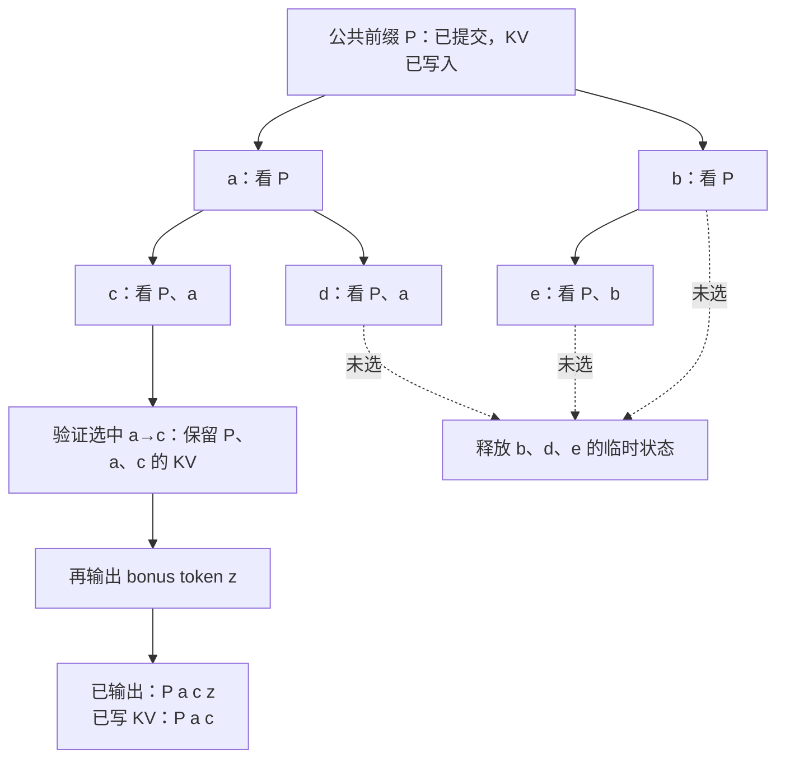

# 一轮生成：猜几个，验几行，花多少

[从这里开始](<../00 从这里开始.md>) · 前提：基础 [05 从模型权重到一次生成](<../基础/05 从模型权重到一次生成.md>) 里 prefill 和 decode 的区别、KV cache 存什么 · 用到的算法：[五笔账 §1 关键路径](<00 五笔账.md#1 关键路径：并行时什么相加>)、[§4 分母](<00 五笔账.md#4 分母：吞吐、goodput 与同质量成本>)

这篇只跟踪一个对象：代码助手的一轮 decode。普通 decode 一轮只确定一个 token，因为要等这一轮算完，才知道下一步的输入。投机解码的做法是先用便宜的方法猜出后面几个 token，再让目标模型在一次前向里检查全部猜测，接受猜对的部分，修正第一个猜错的位置。

一轮投机由三部分组成：一条接受规则，一次多行前向，一张成本表。第一部分决定输出是否还和原模型一样。第二部分决定状态是否正确。第三部分决定是不是真的更快。本篇大部分篇幅放在第三部分，因为 2026 年 11 月的两项新材料都改变了这张表的来源：引擎的执行路径，和模型本身的注意力结构。

> [!abstract] 读完这篇，你应该能判断
> - **正确性只来自接受规则。** 规则对了，候选再差也只是慢。规则被改动，候选再准也会改变输出。
> - **快不快要看“每个已提交 token 花了多少时间”。** 同样的接受率，低并发时可能快一倍，批次满时可能比不用投机还慢。
> - **候选长度要用两张表来定：接受统计和执行成本。** 接受统计可以在线学；执行成本取决于引擎、kernel、图捕获，现在还要加上模型的稀疏索引，它变了以后要重新测量。

---

## 1 为什么拒绝之后仍是原分布

记目标模型在当前前缀下的下一 token 分布为 $p$，候选实际来自的分布为 $q$。服务协议若规定了温度、top-p 或语法约束，$p$ 和 $q$ 都指施加这些变换以后的分布。

规则分两步。先从 $q$ 抽一个候选 $x$，以概率 $\min(1,\,p(x)/q(x))$ 接受。如果拒绝，就从目标比提议多出来的那部分里重新抽：

$$
r(x)=\frac{[p(x)-q(x)]_+}{\sum_y [p(y)-q(y)]_+}.
$$

接受路径给 $x$ 的概率是 $\min(p(x),q(x))$。总拒绝概率恰好等于 $\sum_x[p(x)-q(x)]_+$，于是拒绝路径给 $x$ 的概率是 $[p(x)-q(x)]_+$，两条路径相加正好得到 $p(x)$。[Leviathan 等，§2 与附录 A.1](https://arxiv.org/html/2211.17192v2)【已核】

**手算一次。**【算例】词表只有 A、B、C。目标分布 $p=(0.5,0.3,0.2)$，提议分布 $q=(0.6,0.1,0.3)$。

| | A | B | C |
| --- | --- | --- | --- |
| 接受率 $\min(1,p/q)$ | 5/6 | 1 | 2/3 |
| 接受路径给出的概率 $\min(p,q)$ | 0.5 | 0.1 | 0.2 |
| 残差 $[p-q]_+$ | 0 | 0.2 | 0 |

总拒绝率是 0.2，残差全部落在 B 上。“起草了 A，随机数大于 5/6 时被换成 B”，这一步补的正是 $q$ 少给 B 的那 0.2。

> [!warning] 反例：只改一处，分布就变了
> 拒绝以后不按残差重抽，而是改为输出目标模型概率最大的 A，整体分布就变成 $(0.7,0.1,0.2)$。候选再准，这个改动也让 B 的概率少了 0.2。所以评价一项投机方法，第一步是看它的拒绝分支，候选准确率放在后面。

多个位置时依次判定：第 $i$ 个候选用“前缀加上前 $i-1$ 个已接受候选”下的 $p$ 和 $q$。第一次拒绝就按该位置的残差重抽，后面的候选全部丢弃。全部接受时，再从目标分布多抽一个 token，常叫 bonus token。所以一轮至少交付一个 token。

有两组承诺容易混在一起。“保持分布”和“同一随机种子下逐 token 相同”是两件事；greedy 下输出一致和随机采样下无偏，也是两个命题。真实采样器还有 EOS、最大长度、logits processor 和数值容差，把公式放进采样器之前，要确认这些分支都用的是同一个 $p$。

## 2 一次前向验证多行：mask、位置与回滚

候选一旦给定，就是已知输入，目标模型可以在一次因果前向里同时算出每个位置的条件分布。难点在于每一行必须看到、而且只看到逐步执行时它会看到的历史。

**链。** 候选 a、b、c 需要四个分布：a 在前缀 P 下，b 在 P+a 下，c 在 P+a+b 下，再加上全部接受时 bonus token 的分布。普通下三角 mask 正好满足。要逐行对齐三样东西：这一行的输入位置，它写入的 KV，以及预测它后继的 logits。

**树。** 想给第一位多留一个备选，就成了树：P 之后有 a、b 两支，a 下面有 c、d，b 下面有 e。五个节点可以放进同一次前向，但 c 只能看见 P、a 和它自己，看不见兄弟 d，也看不见另一支的 b、e。c 和 e 深度相同，历史却不同。所以树验证需要按祖先关系构造的 mask，位置编码也要按逻辑深度给，不能按物理行号。

图里的边表示“谁能看见谁”，和普通下三角不同。最后一格是整篇最容易出错的地方：z 刚被抽出来，还没有作为输入经过目标模型，所以**已输出的 token 比已写入的 KV 多一个**。下一轮处理 z 时才补上它的 KV。Transformers v4.46.0 把目标缓存裁到“新输出长度减一”，就是这个差一的边界。[固定版本实现](https://github.com/huggingface/transformers/blob/v4.46.0/src/transformers/generation/utils.py)【已核】

**回滚。** 链 a、b、c 中接受 a、b，拒绝 c 并修正为 z：保留 a、b 的目标 KV，释放 c 以后的临时状态，再接上 z。语法解析器的状态、起草模型自己的缓存，也要退回同一个前缀。只裁 KV、不退解析器，下一步的语法 mask 针对的就是错误的历史。这里的“已输出、已写 KV、候选前沿”三条边界，正是 [历史状态 §6](<02 历史状态.md#6 编辑、回滚与混合状态>) 里状态系统要保存的语义。

树的接受规则也不能随意设计。把每个分支当作独立的链各验一遍，再挑最长的，会改变选择概率。树验证需要和候选的联合提议方式配套的接受规则。

## 3 每个已提交 token 花了多少时间

一轮的产出是“接受的 $A$ 个候选，加上 1 个修正或 bonus token”。和同条件下的普通 decode 相比：

$$
S\approx\frac{(\mathbb E[A]+1)\,t_{\rm base}}{\mathbb E[t_{\rm round}]}
$$

$t_{\rm base}$ 是普通 decode 生成一个 token 的时间，$t_{\rm round}$ 是一整轮的时间。轮内各步顺序执行时，$t_{\rm round}$ 等于起草、验证、管理（采样、状态整理、必要的通信）三项之和。起草和验证重叠执行时，要沿真实关键路径计算，重叠部分只算一次。

**低并发的一轮。**【算例】设每个候选在前面都被接受的条件下，接受概率都是 0.8，链长 4：

$$
\mathbb E[A]=0.8+0.8^2+0.8^3+0.8^4=2.3616
$$

每轮平均提交 3.3616 个 token。普通 decode 每步 18 ms；四次起草共 6 ms，验证 22 ms，管理 2 ms，一轮 30 ms。$S\approx3.3616\times18/30\approx2.02$。

> [!warning] 反例：接受行为不变，换成繁忙批次
> 【算例】批次已满时，普通 decode 一步 20 ms；起草 8 ms，验证因为每条序列多出 4 行而升到 64 ms，管理 2 ms，一轮 74 ms。$S\approx3.3616\times20/74\approx0.91$，比不用投机还慢。

两组数都是假设，它们说明的是：**候选质量相同，低并发时加速，高并发时减速。** 验证并不免费。批次空闲时，多出来的行用的是原本闲着的算力；批次满时，它们占用的是本可以服务别的请求的算力和 KV 空间。[算子与编译 §1](<05 算子与编译.md#1 形状决定先省哪一笔>) 从矩阵形状解释了这一点：多出来的验证行增加了 $M$，在权重读取主导的小批量下几乎不花钱，在已经吃满矩阵吞吐的大批量下就要按行付费。

真实的开放服务还有新请求排队，候选占用 KV 也可能引发抢占，所以最终要看满足时限的有效吞吐，封闭批次的加速比不够。系统测量《Performance or Illusion?》给出了实测对照：在 vLLM 上，验证成本随批次上升，接受长度随任务和位置变化；代码编辑任务里，廉价的 n-gram 候选可以胜过学习出来的起草模型。【作者数据】它支持“成本曲线必须实测”这一点，但部分实验刻意限制并发以避免抢占，没有覆盖真实到达和尾延迟。[固定论文，§3–6](https://arxiv.org/html/2601.11580v1)

**候选从哪里来，只影响公式里的两项：$\mathbb E[A]$ 和起草成本。**

| 候选来源 | 读什么信息 | 什么时候划算 | 额外付出 |
| --- | --- | --- | --- |
| 独立小模型 | 自己读前缀、维护自己的 KV | 通用；同词表最简单 | 小模型的权重、KV、前向；版本要跟着目标走 |
| 复用目标特征的起草头（EAGLE 系） | 目标已算出的多层表示，加上实际选中的 token | 目标表示信息量大时命中高 | 需要训练；目标更新后要重训 |
| 多头并行预测（Medusa） | 目标最后一层表示，一次猜多个位置 | 一次前向出整组候选 | 后续位置之间的依赖靠训练和树验证补 |
| 检索 / n-gram | 已出现过的文本 | 代码编辑、大段引用 | 几乎不用训练；开放问答命中低 |

EAGLE-3 解决的是“未来位置还没有目标特征”：它融合低、中、高层表示，把实际选中 token 的 embedding 一起输入，训练时就展开“用自己的输出继续起草”，让训练和部署看到同一种状态分布。[EAGLE-3，§2.2–3](https://arxiv.org/html/2503.01840v1)【已核】Medusa 同一框架里既有精确接受，也有 typical acceptance，后者明确不保证原分布，所以“无损”要按配置逐个确认。[Medusa，§3](https://arxiv.org/html/2401.10774v1)【已核】

链和树是预算怎样分配，与候选从哪里来无关。往深处多猜一层，押的是一段长的正确续写；同一层多留一个分支，押的是早期存在分歧。目标模型很确定时，宽树是浪费；早期分歧大时，备选能减少整轮作废。

## 4 成本表从哪里来，又怎样过期

由第 3 节可以推出：最佳候选长度不是方法固有的属性，而是模型、上下文长度、设备和当前批次的函数。动态策略每一轮要比较两件事：多猜一个位置，期望多提交多少 token；这让这一轮的关键路径、显存和其他请求多付出多少。只看接受率，策略会一直把候选加长，越过验证成本的拐点。

TableTune（2026-11 v2）把这个比较拆成两张可以分别更新的表，是目前最清楚的实例。【已核】

1. **成本表，离线测。** 沿真实引擎路径，测出每种批量和每种候选长度下一步的耗时。
2. **接受统计，在线更新。** 运行中按实际接受情况，调整每个批量下用多长的候选。

固定版本的控制器代码说明了这种设计的边界。负载变化以后，控制器只更新接受统计，成本一直用离线表；默认只在初始表里已有的长度中选择，因为每个长度都要有 CUDA Graph 覆盖，临时换成没捕获过的长度会停顿；没被起草的位置得不到新观测，而探索和先验衰减默认是关闭的。[TableTune v2，§4、6–7](https://arxiv.org/html/2610.38968v2) · [固定控制器](https://github.com/asm582/tabletune/blob/38170878d901cb06f696a122a0b4140a3d365f02/dsd_tuning/controller/controller.py)

这给出一条可以直接用的诊断规则：**投机收益下降时，先分清变的是候选质量还是执行成本。** 接受率下降，在线统计能跟上；引擎升级、批次组成变化、kernel 换了路径，成本表就过期了，在线更新修不好它，只能重新测量。CUDA Graph 覆盖为什么会限制可选长度，见 [算子与编译 §6](<05 算子与编译.md#6 编译保存的是代码和它的成立条件>)。

论文的评测覆盖单卡 H100 上的闭环和开放到达，以及 llm-d 上两个 Qwen3-32B 副本；但论文所说的 goodput 是输出 token/s，不是满足 SLO 的请求率，两组实验的负载也不同，只能各自说明自己的配置。【作者数据】大 MoE、超过 4096 的混合上下文、多节点 P/D、严格 SLO 下是否都有收益，卡片里列为未证实。

硬件耗时曲线也可以和候选置信度一起决定验证预算。DeepInfer 的 DSpark（2026-10）采用这一思路，但它要处理异步路径里滞后的接受反馈；它的残差采样带 draft-probability penalty，分布语义要按这项修正分析，不能直接套第 1 节的证明。【已核】

**起草放在哪里也会改变分母。** 和目标同设备起草，省一次交接，但要和目标争计算、显存和 KV；放到另一台设备或流水执行，可以重叠，但要传前缀、目标特征和接受反馈。反馈还没到就继续往下猜，可能猜出更长的错误续写，取消它们还要处理在途访问。

## 5 稀疏注意力把索引成本放进验证行

成本表还有第二个过期原因，和引擎无关，来自模型结构。长上下文模型若用内容选择式稀疏注意力，每一行查询要经过三段工作：

1. **索引器扫描历史**：为历史位置打分，读的是索引键；
2. **Top-k 筛选**：从分数里选出要读的位置；
3. **核心注意力**：只对选中位置读 K/V，做注意力。

最终参与注意力的位置很少，这只说明第三段便宜。第一段仍可能扫描完整历史。NVIDIA 2026-11-17 的报告把成本按这三段分开，并指出减少索引键数和融合中间分数的读写是可以组合的两条路线。【已核】[NVIDIA 报告](https://developer.nvidia.com/blog/co-designing-sparse-attention-for-efficient-long-context-inference/)

先用一组数看清楚为什么“只读少量 KV”不等于“读得少”。

**【算例】** 单层、单序列，历史 $N=131072$。核心注意力每个位置的 K/V 为 8 个 KV 头 × 128 维 × 2（K 和 V）× 2 bytes = 4 KiB；Top-k 取 2048。假设索引器每个位置只有一个 128 维 FP8 索引键，即 128 bytes。这些数字是教学设定，不来自报告。

| 每一行查询 | 读多少字节 |
| --- | --- |
| 索引器扫描全部历史的索引键 | $131072\times128$ B = 16 MiB |
| 核心注意力读选中的 K/V | $2048\times4$ KiB = 8 MiB |

稀疏以后，索引器读的字节反而是核心注意力的两倍。现在放进投机验证：链长 4，加上 bonus，这一轮有 5 行查询。

| 5 行验证 | 索引器读取 |
| --- | --- |
| 5 行能共用同一次索引键读取 | 约 16 MiB |
| 每行各扫一次 | 约 80 MiB |

能不能共用不是算法问题，是 kernel 形状问题。报告指出，验证行是否共享索引键的读取，受查询头分组、tile 容量和寄存器压力限制。【已核】也就是说，第 3 节公式里的 $t_{\rm verify}$ 现在多了一项，它随候选长度怎样增长，取决于这些行能不能放进同一个 tile。共享得了，多猜一个位置几乎不增加索引成本；共享不了，验证成本随候选长度线性上升，最佳候选长度就要变短。在稀疏注意力模型上沿用不含索引项的成本表，会低估长候选的代价，选出的候选偏长。这是从成本结构推出的方向，目前没有实测。

**融合省下什么，又留下什么。** FlashInfer 2026-11-05 合入了一条实验路径：先抽样定一个阈值，计算分数时只保留过阈值的候选，再对候选做 Top-k；候选不足或溢出的行进入重新计分。这样不用生成完整分数矩阵，但恢复路径仍可能物化部分行，代价随分数分布变化。同分边界上可以选出不同但同样有效的索引集合，输出顺序也没有约定。[合入的 PR](https://github.com/flashinfer-ai/flashinfer/pull/7325) · [固定 wrapper](https://github.com/flashinfer-ai/flashinfer/blob/be0985b1ae7a7f480714cc20486004e73029691d/flashinfer/attn_scores/mqa_topk.py)【已核】

这条路径目前只能支持一个很窄的结论：它是 opt-in 的实验 API，只覆盖单请求 prefill、连续 K 和规定的形状，作者只在 B200 上验证，没有 paged KV，也没有 decode。投机验证恰好发生在 decode 阶段，所以“融合索引在验证行上能省多少”目前没有实测，只有机制上的方向。

这里有两个要分开检验的正确性问题：筛选器是否返回它数值规则下有效的 Top-k；稀疏模型是否保留了任务需要的信息。前者看 kernel，后者看长程任务评估。结构这一侧的选择（共享表示、删除连接、压缩成状态）见 [历史状态 §2](<02 历史状态.md#2 共享表示、删除连接、压缩成状态>)。

## 6 换了采样协议或词表

第 1 节的证明假定 $p$ 和 $q$ 已经定义清楚。换成语法约束或跨词表起草时，要先回答验证器保持的是哪一个分布。

**语法约束。** 协议若规定每一步先做语法 mask，目标就是 mask 之后的逐步分布；候选要来自同样处理过的 $q$，拒绝以后解析器要退回接受前缀。但“每一步都合法”和“在所有合法完整输出上的条件分布”是两个目标。【算例】当前有两个合法分支，原模型各给 0.5；它们以后能合法结束的概率分别是 0.1 和 0.9。逐步 mask 在第一步仍然各给一半，而完整合法输出的条件分布应是 0.1 和 0.9。

Future Validity（2026-05）用“将来能合法完成的概率”重新加权目标，并分析近似估计的误差；它在可枚举语法和有限 JSON 上验证。任意生产语法能否便宜地求这个概率，仍是开放问题。【已核】[固定论文，§3–5](https://arxiv.org/html/2605.07698v1)

**跨词表。** 同一段字符串在目标侧可能是 1 个 token，在起草侧是 2 个；拼接还可能改变分词边界。Transformers v4.46.0 的 Universal Assisted Generation 先把候选解码成文本，再用目标词表重新编码，带回看窗口对齐，并裁掉起了变化的起草 KV。两边概率不在同一词表上，所以验证侧不做概率相除，而是从目标分布采样、保留匹配的前缀、在第一个不匹配处停下。【已核】这样仍正确推进目标采样，但匹配率和转换开销都和同词表情形不同，第 3 节的接受率要重新测。[官方说明](https://huggingface.co/blog/universal_assisted_generation) · [固定实现](https://github.com/huggingface/transformers/blob/v4.46.0/src/transformers/generation/candidate_generator.py)

## 7 改变轮次的组织

候选来源、验证语义和成本模型固定以后，还可以改两件事：什么时候验证，验证时历史从哪里来。

**DLoop：多起草几段再验证。**（2026-10 v2）并行起草器一次产出一整块候选，缩短候选不一定省掉那次前向，于是 DLoop 允许连续起草多个阶段再集中验证。后面的阶段没有目标特征可用，就用前一阶段起草器自己的隐藏状态，并做跨阶段展开的训练。代价是较晚验证会让错误续写更长，也放弃了中间那些 bonus token。主要结果在 greedy、指定节点预算和 H100 上得到。【作者数据】[DLoop v2，§3–4](https://arxiv.org/html/2610.07659v2)

**SpecStream：历史放在主存，边传边验。**（2026-09 v1）只把已提交的历史搬到主存，未验证的候选留在 GPU；验证时历史按块传回，用在线 softmax 逐块累加完整注意力，让一块历史同时服务这一轮的多个验证查询。它区分三条边界：已迁走的历史 $H$、已提交且写了 KV 的前缀 $C$、包含候选在内的全部已写前缀 $L$，满足 $H\le C\le L$。拒绝时只释放 $[C',L)$，永远不会碰到已搬走的历史。【作者数据】[SpecStream v1，§3–5](https://arxiv.org/html/2609.33184v1)

SpecStream 和第 5 节是同一个问题的两种回答：长历史下，验证多出的行要读的历史太多。稀疏索引减少每行要读的位置，SpecStream 让多行共用一次读取。在线 softmax 必须维护同一组最大值、分母和加权分子，最后统一归一化；各块分别归一化再相加是错的。这个递推的推导见 [算子与编译 §5](<05 算子与编译.md#5 Attention：省掉中间矩阵以后>)。

## 8 结论在什么时候反过来

| 你原本的判断 | 什么条件下反过来 | 先查什么 |
| --- | --- | --- |
| 投机能加速 | 批次已满、验证行挤占矩阵吞吐 | 验证一轮的实测时间，不是接受率 |
| 候选越长越好 | 验证成本随长度线性上升（稀疏索引不能共享、图没捕获） | 成本表是否覆盖这个长度、这种模型 |
| 学出来的起草模型更好 | 输出高度重复（代码编辑、引用） | n-gram 候选在同一任务上的接受长度 |
| 在线调参能跟上负载 | 变的是执行成本：引擎、kernel、批次组成 | 接受率有没有变；成本表是哪个版本测的 |
| 稠密模型上调好的长度可以沿用 | 换成内容选择式稀疏注意力 | 验证行能否共用索引读取 |
| 这个方法是无损的 | 拒绝分支不按残差、typical acceptance、语法只做逐步 mask | 它保持的是哪一个分布 |

读一项新的投机工作，依次问：它保持哪个分布；它改了公式里的哪一项；拒绝或取消以后，状态各退到哪里；在什么并发、什么到达方式下测的；离线测出的东西（成本表、起草头、捕获的图）在目标模型或负载变化后由谁维护。

## 证据

| 正文判断 | 标记 | 证据卡或来源 |
| --- | --- | --- |
| 接受与残差重抽保持原分布 | 【已核】 | [Leviathan 等](https://arxiv.org/html/2211.17192v2)；机制基线见 [D07 证据 JSON](<../研究台账/evidence/D07 投机执行与解码加速.json>) |
| 成本表离线、接受统计在线；控制器不更新成本，默认只选图已覆盖的长度 | 【已核】 | [AIINFRA-E-20261123-03](<../研究台账/来源与证据.md#AIINFRA-E-20261123-03>) |
| TableTune 的 H100 与 llm-d 两副本结果；goodput 为输出 token/s | 【作者数据】 | 同上，卡内“评测口径” |
| 稀疏注意力成本分为索引、筛选、核心注意力；验证行共享索引读取受 tile 和 head 分组限制 | 【已核】 | [AIINFRA-E-20261123-07](<../研究台账/来源与证据.md#AIINFRA-E-20261123-07>) |
| FlashInfer 阈值融合路径：实验 API、单请求 prefill、B200、无 paged KV / decode | 【已核】 | 同上，卡内“成立边界” |
| DSpark 的验证预算与 penalty 残差 | 【已核】 | [AIINFRA-E-20261026-01](<../研究台账/来源与证据.md#AIINFRA-E-20261026-01>) |
| DLoop 延迟验证 | 【作者数据】 | [AIINFRA-E-20261104-08](<../研究台账/来源与证据.md#AIINFRA-E-20261104-08>) |
| SpecStream 的 $H\le C\le L$ 与流式验证 | 【作者数据】 | [AIINFRA-E-20261104-09](<../研究台账/来源与证据.md#AIINFRA-E-20261104-09>) |
| 语法约束下的完整合法分布 | 【已核】 | [AIINFRA-E-20261104-27](<../研究台账/来源与证据.md#AIINFRA-E-20261104-27>) |
| A/B/C 分布、2.02 与 0.91、索引字节账 | 【算例】 | 作者设定，非实测 |

最近改写：2026-11-23，新增 §4 的诊断规则和 §5 整节。见 [2026-11-23 进展 §1](<../进展/2026-11-23.md#1 投机解码的成本表会过期>)。
