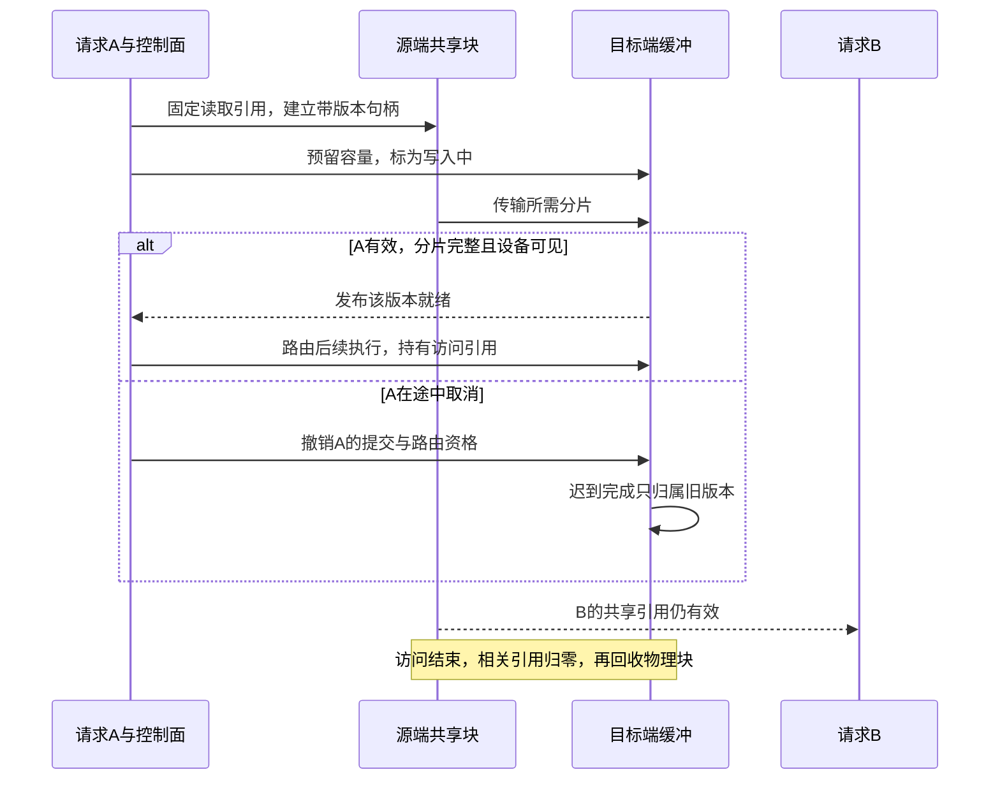

# 历史状态：保存什么，放在哪里，何时释放

[从这里开始](<../00 从这里开始.md>) · 前提：基础 [04 模型结构怎样重新分配系统压力](<../基础/04 模型结构怎样重新分配系统压力.md>)、[05 从模型权重到一次生成](<../基础/05 从模型权重到一次生成.md>) · 用到的算法：[五笔账 §2 容量账与搬运账](<00 五笔账.md#2 容量账与搬运账>)、[§3 提交点](<00 五笔账.md#3 提交点：什么时候算完成、何时能释放>)

这篇跟踪一段历史：两条请求 A、B 共用的一段 4096-token 前缀，再把它拉长到 128K。模型结构先决定这段历史保存成什么样子：完整的 K/V、共享的 K/V、一个窗口、一份递归状态，或者几样东西的组合。然后系统决定怎样共享它、压缩它、放到哪里、何时回收。

这两件事过去分在《模型结构》和《KV 与模型状态》两篇里写。放在一起，是因为结构上的每个选择都会直接变成系统要处理的对象。比如窗口注意力让窗口以外的 KV 可以不存，代价是窗口以外的信息再也找不回来；递归状态让容量不随长度增长，代价是“回到第 3500 个 token”这件事需要检查点。

> [!abstract] 读完这篇，你应该能判断
> - **共享表示、删除连接、压缩成状态是三种不同的节省。** 任务需要原样找回遥远的证据时，保留可以直接访问的通路最重要；局部模式占主导时，窗口和递归更划算。
> - **降位宽和删位置不能互相替代。** 前者让每个位置的数值变得近似，后者让一些位置消失，载荷相近，丢掉的信息却不同。
> - **缓存命中要和重算比。** GPU 变快、恢复有固定开销、并行组里有一个 rank 读得慢，都可能让原本划算的缓存路径变得更慢。
> - **回收要等所有引用都结束。** 共享引用、在途传输、正在运行的 kernel，各自持有一份引用。

---

## 1 一个 token 的历史有多大

**【算例】** 教学配置：32 层，32 个查询头，8 个 KV 头，每头 128 维，BF16。每个历史 token 在每层存一份 K 和一份 V：

$$
2\times32\ \text{层}\times8\ \text{头}\times128\times2\ \text{bytes}=131072\ \text{bytes}=128\ \text{KiB}.
$$

4096 个 token 是 512 MiB，131072 个 token 是 16 GiB。如果 KV 头数也是 32，就是 64 GiB。权重、临时张量和分配浪费另算。

这个数字要分成两笔账看。**容量**：这些字节要同时放在某处。**搬运**：每一步 decode，这条序列要把自己的全部历史读一遍。后面每一种方法，先问它改的是哪一笔。

## 2 共享表示、删除连接、压缩成状态

全注意力让当前查询可以直接选择所有历史位置里的细节。代价是 prefill 的位置对随长度平方增长，decode 每步读的历史随长度线性增长。节省它有三种做法，改变的对象各不相同。

**共享表示：每个位置存得更少。** 分组查询注意力（GQA）让多个查询头共用一组 KV，上面 8 个 KV 头和 32 个 KV 头之间的四倍差距就来自这里，查询头仍是 32 个。已有的多头模型可以通过追加训练适配这种共享，只改缓存文件是不够的。多头潜在注意力（MLA）进一步把历史存成潜在表示加一个解耦的位置分量；部署时保持压缩形式还是展开，会改变真正读多少字节、传多少字节。[GQA](https://arxiv.org/html/2305.13245v3) · [DeepSeek-V3 结构](https://arxiv.org/html/2412.19437v2)【已核】

**删除连接：一部分位置不再参加。** 【算例】只保留窗口 $w=4096$，长序列 prefill 的位置对约为 $Sw$，全因果约为 $S^2/2$，在 $S=131072$ 时比值约 1/16。所有层都只看窗口时，KV 约 512 MiB。省下的恰好是窗口外的直接访问：后面突然需要十万 token 之前的一个变量声明，那里已经没有可读的状态。

局部加全局块、块稀疏、内容选择，是给远处信息留通道的几种办法。固定的局部连接索引简单，适合局部相关性强的负载；内容选择适合少量关键证据散在长历史里的负载，代价是要先找到它们。这一步的代价比看上去大：索引器每行要扫描整段历史的索引键，最后只读少量 KV，并不等于读得少。投机验证时，这笔代价落在每一行上，见 [一轮生成 §5](<01 一轮生成.md#5 稀疏注意力把索引成本放进验证行>)。推理时删掉原模型的连接是在做近似；从训练开始就用稀疏连接，是在比较另一个模型。

**压缩成状态：历史不再按位置保存。** 每步只更新一份固定大小的状态，比如 $h_t=A_th_{t-1}+b_t$。历史再长，状态维度不变，但早先的信息必须挤进这份有限表示，并经历后续的遗忘和覆盖。线性注意力的简单形式维护 $S_t=S_{t-1}+\phi(k_t)v_t^\top$，用 $\phi(q_t)^\top S_t$ 读出；带门控的 delta-rule 和状态空间模型改变写入、擦除和衰减的方式。[Mamba](https://arxiv.org/html/2312.00752v2)【已核】

递归也能并行训练，因为两段仿射变换可以合成，$(A_2,b_2)\circ(A_1,b_1)=(A_2A_1,\,A_2b_1+b_2)$，这个合成满足结合律，所以可以做前缀扫描或分块计算。它一般不满足交换律，时间顺序必须保留。分块计算的算子组织见 [算子与编译 §5](<05 算子与编译.md#5 Attention：省掉中间矩阵以后>)。

**【算例】** 每层 32 个 $128\times128$ 的 FP32 矩阵状态是 2 MiB，32 层共 64 MiB。改成 24 层递归加 8 层全局 GQA，约为 48 MiB 加 4 GiB KV：少量全局层保住直接访问的通路，其余层不随长度增长，但那 8 层仍随长度增长。混合的比例和层位置要由任务决定。

> [!warning] 反例：压掉的信息，读出时加权恢复不了
> 【算例】两个历史块，初态为零。块 1 写入 10；块 2 把旧状态乘 0.01，不写新东西。组合以后只剩 0.1。后来的查询若需要块 1 的信息，给最终输出加权恢复不了它，因为块 2 已经把它压小了。能调的是块 2 对旧状态施加的那个变换本身。

HLA（2026-10）沿这个思路，为每个历史块保存仿射摘要 $(A_j,B_j)$，让查询给每块一个门值 $w_j$，按 $[(1-w_j)I+w_jA_j]S+w_jB_j$ 重新组合：$w_j=0$ 跳过整块变换，$w_j=1$ 回到原变换。【已核】代价是固定大小的递归状态变成了随块数增长、可以查询的历史，路由和重新组合也要时间。作者在单 H200、BF16、单序列、4096 输入和 128 token 稳态生成下，生成速度慢于原生递归层，同时报告了长程评估的改善。【作者数据】这是表达能力和延迟的一次交换，不是免费的改进。

## 3 两条请求共用一段前缀

普通因果注意力里，后来的 token 不会改写早先的历史，所以同一模型、同一有效前缀、同一位置和执行条件下，历史可以复用。

**【算例】** A、B 共用 4096-token 前缀（512 MiB），各自再追加 256 token（各 32 MiB）。各存一份要 1088 MiB，共享前缀只要 576 MiB。省下的是重复的副本；每条请求每步仍要读完 4096 个历史位置。

分页把逻辑上连续的历史映射到不连续的物理块，可以按需增长、按块共享，减少预留和碎片。[PagedAttention](https://arxiv.org/html/2309.06180v1)【已核】**【算例】** 一块存 16 个 token，跨所有层是 2 MiB，公共前缀占 256 块，A、B 各持一份引用。分叉点若落在一块没填满的共享块里，追加写入要写时复制，才不会改掉另一条请求的历史。A 取消时只减去 A 的引用，B 正在用的块继续保留。

**能不能复用，要三项同时成立。** 内容相同：权重、适配器、位置规则、前缀、媒体预处理、数值表示都一致。布局可读：内容相同但块布局不同，需要转换。允许共享：内容和布局都相同，但用户组不同，仍应隔离。系统还要说明它承诺的是逐位一致、某种数值容差，还是近似的任务质量。

DeepInfer 的部署说明（2026-11）给出了一种具体契约：缓存身份由部署配置、模型权重和用户组组成；权重、块布局、分词器或改变 KV 数值的框架更新后，旧副本失效。生成侧异步写回，写失败不反馈给引擎，读取时严格校验。【已核】复用副本允许丢失，读到的内容必须可信。

## 4 降位宽和删位置不是同一种压缩

固定层数和 KV 头结构，单层载荷约为 $2TH_{kv}d_hb/8$ bytes。量化降低每个元素的位数 $b$，删位置降低保留的位置数 $T$。两者改变的信息不同。

K 的误差经过点积和 softmax 改变注意力分布，V 的误差进入加权输出，所以两者可以用不同的分组方式。KIVI（2024-07）让 K 按通道分组、V 按 token 分组；新来的、还没凑成一组的 K 先留在高精度残余区，V 也保留一个近期高精度窗口。【已核】[KIVI](https://arxiv.org/html/2402.02750v2)

**【算例】把“4 bit”展开成字节。** 512 MiB 前缀，只看载荷，降到 4 bit 是 128 MiB。每 32 个元素再存一个 FP16 尺度和一个 FP16 零点，元数据 32 MiB。K、V 各保留 128 个高精度 token：其余 3968 个 token 的量化数据 124 MiB，元数据 31 MiB，残余区 16 MiB，共 **171 MiB**。名义上四倍压缩，算上这些约是三倍。对齐、索引和工作区还没算。

删位置是另一回事：保留最近的位置和累计注意力大的位置，用过去的访问模式预测将来的需要。[H2O](https://arxiv.org/html/2306.14048v1)【已核】过去很少被关注的位置，下一个问题可能正好需要它；在保留子集上重新归一化，也改变了输出。

只保留四分之一位置、仍用 BF16，和保留全部位置、改用 4 bit，载荷可能接近，丢掉的东西却不同。前者删掉了一些键值，要完整恢复只能另存副本或重算；后者每个位置都还在，误差来自数值近似。局部的连续写作和跨文档检索，对这两种损失的容忍程度也不一样。两者组合时还会互相影响：量化误差改变注意力分数，也就改变了选中哪些位置。

还有一点：如果消费之前先把压缩状态展开成完整的高精度副本，转换的读写可能抵消节省下来的搬运。要直接按块消费压缩状态，需要相应的算子。递归状态的量化误差会随时间累积，这个问题见 [数值与硬件 §3](<06 数值与硬件.md#3 递归状态里的误差会活多久>)。

## 5 放到 GPU 外：取回还是重算

把历史放到主存、SSD 或远端，改变的是它驻留的位置。命中一次要回答三个问题：内容是否仍然有效，能不能存到下次，用到时取回是否比重算快。

复用 $n$ 个 token。重算约 $n/R$，$R$ 是实际 prefill 速率；取回约 $T_0+ns/W$，$s$ 是每 token 字节数，$W$ 是有效带宽，$T_0$ 是固定开销（查找、调度、剩余执行）。

**【算例】** 4096 token 以 20000 token/s 重算，要 204.8 ms。512 MiB 经 5 GB/s 取回，纯传输 107.4 ms，加 20 ms 固定开销共 127.4 ms，命中划算。

> [!warning] 反例：GPU 变快以后，缓存反而更慢
> 【算例】同一台机器换了更快的 GPU，prefill 提到 50000 token/s，重算只要 81.9 ms，同一条缓存路径的 127.4 ms 反而更慢。如果改为取回压缩到 171 MiB、可以直接消费的表示，纯传输约 35.9 ms，又重新划算，但要把转换和带宽争用算进去。

共享也改变收益的归属。公共前缀读回一次可以供多个请求使用，所以取消其中一个请求，未必值得立刻把它换出。但公共副本只在远端时，很多请求同时回暖，会在远端形成热点。

多卡 prefill 还要看最慢的那个 rank。沿序列切分的上下文并行里，各 rank 交换 KV 后同步推进，一个 rank 等块，全组都要等。Remote KV Tiers（2026-10）调整存储所有权、远端分区和异步加载，以减少这种等待。作者在特定 B300、MLA 和引擎组合上的关键命中实验，用的是能装进远端的预热子集，多数条件只跑了一次，完整部署对照还同时改了并行和池的放置。【作者数据】所以要观察每个 rank 各自暴露的等待和命中长度，合计的传输吞吐说明不了这个问题。

取回路径本身怎样走（预取、缺页、直达 GPU），见 [数据移动 §5](<04 数据移动.md#5 谁决定搬什么：预取、缺页与直接访问>)；调度怎样把“状态何时能用”计入路由，见 [请求调度 §3](<03 请求调度.md#3 多副本：命中率为什么不够>)。

## 6 编辑、回滚与混合状态

到这里，历史一直是只追加的 K/V。实际系统里，它会被编辑、回滚，而且不止一种东西。

**上下文被编辑。** A 把中间一条工具消息替换成摘要，后面的 token 即使相同，前缀也已经变了。基本做法是保留修改点之前的有效状态，重算受影响的后缀；B 仍用旧上下文，就继续持有旧分支。有效性和驻留要分开决定。KVTether（2026-09）让应用显式传递删除、替换、分叉、保留这些意图，引擎因此知道的不只是“最近访问时间”。【已核】作者的评估用记录下的长度和前缀关系做回放，工具等待是模拟的，替换策略的好坏受这种访问模式约束。

**缩短重放也会改变可见历史。** DeepInfer 的有界重放（2026-10 源码）从位置 $s$ 开始恢复时，位置 $i$ 只看 $\max(s,i-127)$ 到 $i$。【已核】这是近似恢复：它省掉的是参与计算的信息，和搬回完整缓存、从完整前缀重算属于不同的质量条件，要分开比较。

**混合模型里的递归状态。** 删掉末尾的 KV 块可以回到更早的注意力前缀，但最新的递归状态一般没法倒推回旧边界。**【算例】** 8192-token 轨迹每 1024 token 存一次递归检查点，恢复到 3500 可以从 3072 开始，再重算 428 token。存得越密，恢复越快，容量也越大。恢复的访问模式不对称：注意力要读之前所有的 KV，递归层只需要选中边界的一个检查点。所以可以把整段 KV 放在快层，把大量检查点放在慢层。HiState（2026-10）这样分层；作者在单 H100、指定混合模型的 Agent 轨迹回放中，部分常见请求的中位延迟略有回退，换来的是尾部改善。【作者数据】MAX 26.7（2026-10）在 KV 块边界保存递归和卷积检查点，随 KV 一起从主存或磁盘恢复；非全注意力模型的 P/D 分离在启动时会被拒绝。【已核】

**快照还在，但已经过时。** 双向迭代揭示 token 的扩散式语言模型里，一个位置的更新可能改变其他位置的表示，沿用旧 KV 本身就有误差，量化再叠加一层。dLLM-KVQ（2026-10）离线选策略，在线保留部分高精度 K；它的质量诊断是量化/反量化模拟，端到端收益还需要融合消费。【作者数据】评价这类压缩，先要说清楚误差的参照是旧缓存，还是完整的重新计算。

**候选前沿。** 一次前向里有投机候选时，状态里既有已确认的前缀，也有可以回滚的临时部分。已输出的 token 还可能比已写入的 KV 多一个。会话恢复要分别记录已输出、已写 KV 和候选前沿，见 [一轮生成 §2](<01 一轮生成.md#2 一次前向验证多行：mask、位置与回滚>)。

**不只是语言模型。** 用视频生成做机器人仿真时，会话状态包括去噪模型的 KV、位置和 VAE 的时序状态，三者有先后顺序，见 [模型之外的任务 §6](<09 模型之外的任务.md#6 画面成为下一次动作的输入>)。

统一的状态接口可以统一分配、保存、恢复和释放，但每类对象各有自己的有效性条件：因果 KV 可以按前缀裁剪，递归层需要检查点，近似缓存要声明质量参照，候选要保留验证边界。

## 7 迁移与取消：什么时候能回收

继续跟踪 A、B：A 要迁移到另一台机器，B 仍在用公共前缀。

这张图是按数据依赖推出的最小协议，不对应某个具体系统。它要表达的是：逻辑登记、分片到齐、设备可读、可以路由，是四个先后发生的事实。取消撤销的是 A 的资格，B 的引用还在。正在执行的 kernel 或传输各自持有访问引用。目标端收到迟到通知时，按版本号识别它属于旧任务，免得把同一地址上新分配的对象误标为完成。所有引用归零、访问确实结束以后，物理块才能复用。

已有实现暴露过这条缺失的边。llm-d 的 SGLang/NIXL 文档（2026-10）记录：生成端在传输启动前取消或死亡时，输入端的 KV 可能一直滞留到 pod 重启；定期清理只处理控制记录，GPU 内存的回收要另行落实。【已核】

存储直达路径有同样的问题：uGDS 从入队那一刻起持有缓冲引用，有在途 IO 时注销返回 busy。提交得越早，重叠越多，不能回收的区间也越长，见 [数据移动 §6](<04 数据移动.md#6 绕过 CPU：省下复制，接过责任>)。同一套提交点算法见 [五笔账 §3](<00 五笔账.md#3 提交点：什么时候算完成、何时能释放>)。

迁移也未必转移唯一的所有权：源端可以继续保留缓存，目标只拿到副本。内容有效性、位置和使用权要分开登记。

## 8 结论在什么时候反过来

| 你原本的判断 | 什么条件下反过来 | 先查什么 |
| --- | --- | --- |
| 窗口或稀疏能省下长上下文的成本 | 任务需要原样找回很远的证据 | 长程检索类任务的质量，不是困惑度 |
| 只读少量 KV，所以读得少 | 索引器要扫描整段历史 | 索引键的字节数和扫描次数 |
| 4-bit KV 省四倍 | 小分组、高精度残余区、展开后再消费 | 算上元数据和残余区的总字节；消费路径 |
| 缓存命中就比重算快 | GPU 变快；固定开销大；并行组里有慢 rank | $n/R$ 与 $T_0+ns/W$；每个 rank 的等待 |
| 取消以后可以立刻释放 | 在途 kernel 或传输还在访问 | 访问引用归零的那个事件 |
| 递归模型的状态容量固定，恢复也简单 | 需要回到历史上任意一个位置 | 检查点间隔和重算长度 |

## 证据

| 正文判断 | 标记 | 证据卡或来源 |
| --- | --- | --- |
| GQA、MLA、Mamba、PagedAttention、KIVI、H2O 的机制 | 【已核】 | 机制基线来源；[D04](<../研究台账/evidence/D04.json>)、[D06](<../研究台账/evidence/D06 KV 与模型状态系统.json>) 证据 JSON |
| HLA 的查询门控；生成速度与长程评估 | 【已核】/【作者数据】 | [AIINFRA-E-20261104-04](<../研究台账/来源与证据.md#AIINFRA-E-20261104-04>) |
| 内容选择的索引成本 | 【已核】 | [AIINFRA-E-20261123-07](<../研究台账/来源与证据.md#AIINFRA-E-20261123-07>) |
| DeepInfer 的缓存身份与写回契约 | 【已核】 | [AIINFRA-E-20261109-10](<../研究台账/来源与证据.md#AIINFRA-E-20261109-10>) |
| DeepInfer 有界重放 | 【已核】 | [AIINFRA-E-20261026-01](<../研究台账/来源与证据.md#AIINFRA-E-20261026-01>) |
| Remote KV Tiers 的分区与异步加载 | 【作者数据】 | [AIINFRA-E-20261104-06](<../研究台账/来源与证据.md#AIINFRA-E-20261104-06>) |
| HiState 的分层与回退 | 【作者数据】 | [AIINFRA-E-20261104-26](<../研究台账/来源与证据.md#AIINFRA-E-20261104-26>) |
| MAX 26.7 的检查点与 P/D 拒绝 | 【已核】 | [AIINFRA-E-20261026-07](<../研究台账/来源与证据.md#AIINFRA-E-20261026-07>) |
| dLLM-KVQ | 【作者数据】 | [AIINFRA-E-20261104-07](<../研究台账/来源与证据.md#AIINFRA-E-20261104-07>) |
| llm-d SGLang/NIXL 的 KV 滞留 | 【已核】 | [AIINFRA-E-20261109-05](<../研究台账/来源与证据.md#AIINFRA-E-20261109-05>) |
| KVTether 的应用语义 | 【已核】 | D06 证据 JSON |
| 128 KiB、1088/576、171 MiB、204.8/127.4/81.9 ms、428 token | 【算例】 | 作者设定，非实测 |

最近改写：2026-11-23，§2 加入内容选择的索引成本，并指向一轮生成 §5。见 [2026-11-23 进展 §1](<../进展/2026-11-23.md#1 投机解码的成本表会过期>)。
