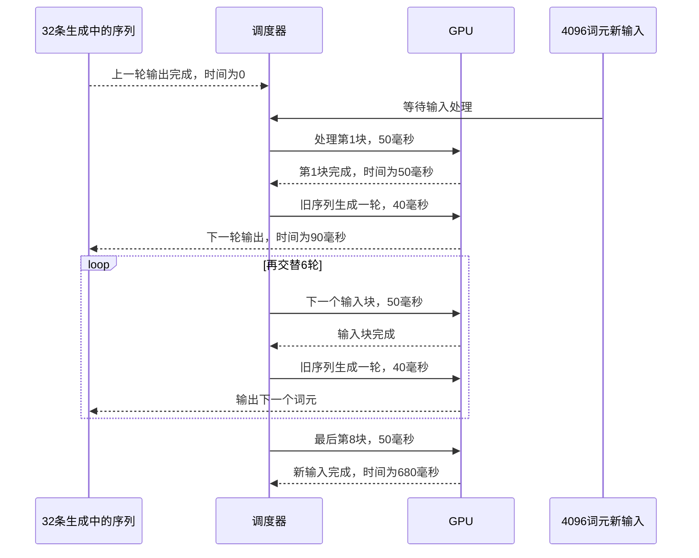

# 请求调度：谁先执行，谁等待，谁被换出

[从这里开始](<../00 从这里开始.md>) · 前提：基础 [06 当许多请求同时到来](<../基础/06 当许多请求同时到来.md>) · 用到的算法：[五笔账 §1 关键路径](<00 五笔账.md#1 关键路径：并行时什么相加>)、[§4 分母](<00 五笔账.md#4 分母：吞吐、goodput 与同质量成本>)

这篇跟踪一个时刻：GPU 上有 32 条序列正在生成，一个 4096-token 的新请求刚到。服务系统要连续做四个决定：现在接不接它，下一轮让谁执行，交给哪个副本，什么时候迁移或停下。每个决定都在改变谁在等，而等待本身又会改变下一轮的批次和状态位置。

调度和状态是分不开的。每条正在生成的序列都占着一段还在增长的 KV，接纳一个请求，就是答应在它整个生命期里给这段 KV 留位置。这一篇里提到“状态何时能用”的地方，都指向 [历史状态](<02 历史状态.md>)。

> [!abstract] 读完这篇，你应该能判断
> - **分块给了调度器更多让步的机会，但不会让资源变多。** 保护老请求的输出节奏，通常意味着新请求的输入更晚处理完。
> - **时限要靠调度和状态一起兑现。** 排到执行机会以后，还要能在恢复预算内拿回状态。
> - **路由要比较预计完成的总路径。** 热缓存省重算，短队列省等待，两者冲突时看谁的总路径更短。
> - **阶段拆分用交接成本和资源不能互借，换取两个阶段可以分别配置。** 相同设备预算下，只有阶段成本和时限的改善超过这些代价才划算。

---

## 1 新请求插进来，谁让出时间

连续批处理让请求在每一轮迭代的边界进入或退出，避免等整批结束造成的空位，同时把“下一轮选谁”交给了调度器。

**【算例】** 32 条正在生成的序列，一轮 decode 40 ms。新请求完整 prefill 要 400 ms，切成八块各 50 ms。时间零是上一轮输出刚完成。

- 先完整处理新输入，再做一轮 decode：老请求要到 440 ms 才收到下一个 token。
- prefill 块和 decode 轮交替：老请求的输出间隔约 90 ms；新请求最后一块到 $8\times50+7\times40=680$ ms 才完成。

老请求的第一次等待从 440 ms 降到 90 ms，新请求的输入完成从 400 ms 推迟到 680 ms。分块没有让资源变多，只是改变了谁在等。它带来的另一个好处是：如果有一条短请求在第 10 ms 到达，两种排程下调度器下次能重新选择的时刻分别是 400 ms 和 50 ms。

实际的混合执行还会让 prefill 和 decode 共享一次矩阵运算，所以要测的是单轮时间函数 $t(c,B,\{T_i\})$：$c$ 是这一轮的 prefill 行数，$B$ 是生成中的序列数，$T_i$ 是各序列的历史长度。总 token 数相同，计算和状态读取可能完全不同。Sarathi-Serve（2024-06）把长输入分块，再和生成组成有预算的混合批次，关键在于组合后的计算强度和轮次时间，而不是简单交替。[Sarathi-Serve](https://arxiv.org/html/2403.02310v3)【已核】

投机解码也在这里付钱：每条序列多出的验证行，就是这一轮的 $c$ 变大了。批次越满，这笔钱越贵，见 [一轮生成 §3](<01 一轮生成.md#3 每个已提交 token 花了多少时间>)。

## 2 时限、公平和未来的状态

接着上面的算例：如果相邻输出间隔的目标是 100 ms，90 ms 只留下 10 ms 余量，一次慢的状态加载就会超期；如果新请求的首 token 预算是 500 ms，680 ms 也超了。这时调度器要改批次、加资源，或者少接请求。平均吞吐回答不了该做哪一个。

首 token 等待（TTFT）从请求到达前端开始计时，包括准入、路由、状态等待、排队和执行。平均每输出 token 时间（TPOT）说明首 token 之后的平均速度；相邻 token 间隔的分布则能看出停顿。goodput 要说清楚哪些请求达到了哪些时限，拒绝、取消、失败怎样计入。平均到达率相同，突发程度、长短混合和前缀复用都会改变队列。

**接纳要为未来的增长留空间。** 每一轮都在追加历史，输出长度事先未知，只能靠预算、预测和恢复余地。下一轮的执行额度，和整个请求存活期间的状态额度，要一起决定。

**抢占先问释放的是哪种资源。** 暂停但保留 GPU 上的状态，释放的是执行机会；换出状态，释放显存但增加 IO；丢弃可以重算的状态，就把恢复变成了以后的一次 prefill。短作业优先依赖对剩余长度的预测，而被估计为很短的请求也可能继续长生成。反复抢占同一个长请求，会反复付恢复成本，所以需要年龄提升、最大等待或份额保护。

**两种公平。** 一种是长期的服务量公平：按输入和已生成输出的加权 token 记账，优先选欠服务最多的客户端，重新回到队列的客户端要抬升计数，防止空闲时攒下无限信用。VTC（2023-12）这样处理输出长度未知的问题：边生成边计费。【已核】它保证的是对应服务度量下的份额，各种形状的真实执行时间需要另一套成本模型。

另一种是每个 token 的延迟公平。FairInference（2026-09）先估计每个租户独占公平份额时的完成时刻，加上容许延迟，形成共享执行时的 deadline；放行新 prefill 之前，检查已有 token 会不会超期，并保护能在恢复预算内回来的 KV。【已核】它把公平调度和公平缓存接成了同一个时限合约。作者原型依赖批次时间模型、需求边界和恢复预算，低估执行耗时会误放行输入工作。

公平和紧急程度也会冲突：已经用超份额的租户，仍可能提交最紧急的任务。这需要产品明确优先级、配额、拒绝和降级规则，调度算法替它做不了这个决定。

## 3 多副本：命中率为什么不够

同一模型有多个副本时，队列最短的副本未必有可用的前缀，缓存最热的副本又可能最拥挤。

**【算例】** 热副本等待 200 ms，命中后再花 30 ms，共 230 ms。冷副本等待 20 ms，重算 100 ms，共 120 ms。冷副本更早完成。

所以路由要比较队列等待、状态恢复或缺失部分重算、阶段执行这几项加起来的预计路径。队列长度同样粗糙，一个长输入和一个短生成步的成本不同。预测有误时，重新路由也要有收益门槛，否则请求来回迁移，反而放大网络和缓存波动。缓存取回和重算什么时候谁更快，见 [历史状态 §5](<02 历史状态.md#5 放到 GPU 外：取回还是重算>)。

跨模型路由多了一个质量维度。RouteLLM（2024-06）用偏好数据预测强模型相对弱模型获胜的概率，按阈值决定调用谁。【已核】它预测的是相对偏好，不是答案对错。强模型拥塞时提高阈值，可能降低成本和排队，也会改变任务质量。验收要在同一任务集上同时比较质量、总成本和时限，并按领域看误路由。

## 4 同样四张卡，要不要拆阶段

**【算例】** 模型能装进一张卡，总预算四张卡。每个请求平均消耗 0.25 GPU·s 的 prefill 和 0.50 GPU·s 的 decode。只按平均工作量算：

| 四卡安排 | prefill 上界 | decode 上界 | 整体上界 |
| --- | --- | --- | --- |
| 四卡共置，可以互借 | 合计 | 合计 | $4/0.75\approx5.33$ 请求/s |
| 1P + 3D | $1/0.25=4$ | $3/0.50=6$ | 4 请求/s |
| 2P + 2D | $2/0.25=8$ | $2/0.50=4$ | 4 请求/s |

整数分池留下了不能互借的空隙。拆分要赢，就必须通过专用组批、各自的并行方式和干扰隔离，真正改变每个阶段的成本，只把原来的成本分到两组设备上是不够的。

> [!warning] 常见误解：“P/D 分离会提高原始吞吐”
> 更准确的说法是：它让首 token 和输出间隔可以分别调节，减少尾延迟上的互相干扰。KV 传输和跨池排队可能让原始吞吐下降。原课程笔记引用的 vLLM 分离 prefill 文档明确区分了这两种目标。[vLLM 文档](https://docs.vllm.ai/en/latest/features/disagg_prefill/)【已核】

DistServe（2024-06）把阶段放置和并行配置放进同一个搜索，争取更大的时限可达区域。【已核】代价有三项：重复持有部分模型资源，交接 KV，跨池排队。**【算例】** 512 MiB 经有效 50 GB/s 的链路交接，纯传输下界约 10.7 ms，查找、排队、布局转换和设备可见性另算。多条请求共用同一个出口时，分的是同一份带宽。prefill 做完了，decode 端没有空位，状态就必须暂存在某处；不给下游预留容量或限制缓冲，计算队列就会变成一个无界的 KV 队列。

输入突然变长，前一个池积压；输出突然变长，后一个池积压。所以两个池的比例要跟着长度分布和阶段成本调整。拆池以后，滚动升级时“每种角色都要有人在场”成了新约束，见 [持续交付 §2](<10 持续交付.md#2 资源何时真的可用>)。

## 5 主存侧也能推进生成

HBM 放不下历史时，主存可以提供容量。但如果每一轮都把需要的状态搬回 GPU，就是在持续搬运。另一种做法是让主存那一侧连执行一起接过去。

DualPace（2026-10）让 CPU 引擎拥有独立的队列、调度时钟和主存 KV，自己推进生成；GPU 负责全部 prefill 和驻留在 GPU 上的请求，必要时在明确的阶段边界上帮 CPU 请求做不读 KV 的稠密计算。【已核】两个队列共享一本容量账：迁移前要同时计算已占、已承诺、将来增长和可能迁入的状态。新请求将来驻留 CPU 时，先预留主存块，GPU 逐层生成并异步复制 KV；已有请求换出时，要等数据到齐才对 CPU 调度器可见。

> [!warning] 反例：可迁移的生成太少
> 作者在指定 GPU 和 AMX CPU 组合上测了 Azure-Code 长度的合成负载：输入长、输出短，主要受 prefill 限制，搬过去的长前缀只摊到很少的后续生成上。部分配置下，只用 GPU 反而更好。【作者数据】判断异构执行值不值，先估计可迁移的生成工作量、迁移字节和主存侧的持续处理能力。

## 6 扩缩容接上正在运行的请求

需求持续增长时，新副本有一段较慢的就绪过程：分配机器、加载权重、编译或捕获形状、建立状态路径，然后才能接请求。扩容判断要看到等待工作的增长和这段准备时间。突发只持续 20 秒，新副本 40 秒才就绪，就救不了这一次排队。

迁移可以让目标副本先重算到中间某个前缀，源副本继续生成，最后暂停源、补上增量、切换路由。ServerlessLLM（2024-01）研究这种两阶段 token 重算迁移，它转移的是计算和会话推进的职责。【已核】权重已经热了，只缩短了模型准备；正在运行的会话还要带上自己的历史。长上下文让重算更贵，网络争用让搬 KV 更贵，两者应该放进同一个成本模型选择。

缩容先停止新路由，再排空或迁移。取消也沿着执行链传播：前端停止返回结果以后，kernel 或传输可能还在访问缓冲，回收要等访问结束，见 [历史状态 §7](<02 历史状态.md#7 迁移与取消：什么时候能回收>)。

**公开部件的边界。** DeepInfer（2026-10 源码）公开的是离线推理和核心引擎；完整 KV 服务、视觉编码与 P/D 拆分服务、跨数据并行副本的负载均衡，不在公开范围内。【已核】deepseek-recipe 只负责把会话编码为输入、把流式输出解析成协议对象，推理、工具执行和 API 传输由调用者提供。【已核】组合这些部件时，每一段的实现和验证责任要分开写清楚。

## 7 结论在什么时候反过来

| 你原本的判断 | 什么条件下反过来 | 先查什么 |
| --- | --- | --- |
| 分块能降低延迟 | 新请求的首 token 预算很紧 | 新输入的完成时刻，不只是老请求的间隔 |
| 路由到缓存命中的副本 | 那个副本很拥挤，冷副本重算更快 | 等待加恢复的总路径 |
| P/D 分离提高吞吐 | 整数分池留下空隙；交接贵；长度分布变化 | 同预算下的持续有效吞吐和突发恢复 |
| 主存执行层能扩容 | 输入长、输出短，迁移摊不薄 | 可迁移的生成量和迁移字节 |
| 只看已接纳请求的延迟 | 过载时拒绝增加 | 拒绝、取消和失败是否计入分母 |
| 扩容能解决突发 | 就绪时间比突发还长 | 从决策到 ready 的完整准备时间 |

## 证据

| 正文判断 | 标记 | 证据卡或来源 |
| --- | --- | --- |
| Sarathi-Serve、VTC、RouteLLM、DistServe、ServerlessLLM 的机制 | 【已核】 | [D05 证据 JSON](<../研究台账/evidence/D05 推理服务与调度.json>) |
| FairInference 的时限与缓存合约 | 【已核】 | [AIINFRA-E-20261104-25](<../研究台账/来源与证据.md#AIINFRA-E-20261104-25>) |
| DualPace 的独立调度权与容量账；长输入短输出反例 | 【已核】/【作者数据】 | [AIINFRA-E-20261104-05](<../研究台账/来源与证据.md#AIINFRA-E-20261104-05>) |
| DeepInfer 公开范围 | 【已核】 | [AIINFRA-E-20261026-01](<../研究台账/来源与证据.md#AIINFRA-E-20261026-01>) |
| deepseek-recipe 的责任划分 | 【已核】 | [AIINFRA-E-20261026-02](<../研究台账/来源与证据.md#AIINFRA-E-20261026-02>) |
| 440/90/680 ms、230/120 ms、5.33/4 请求/s、10.7 ms | 【算例】 | 作者设定，非实测 |

最近改写：本版首次成文，内容取自已发布版《推理服务与调度》，2026-11-23 无改写。
