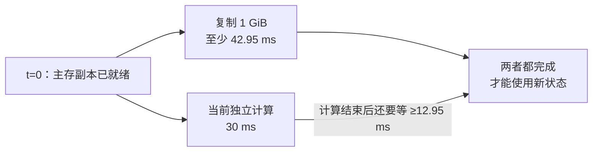
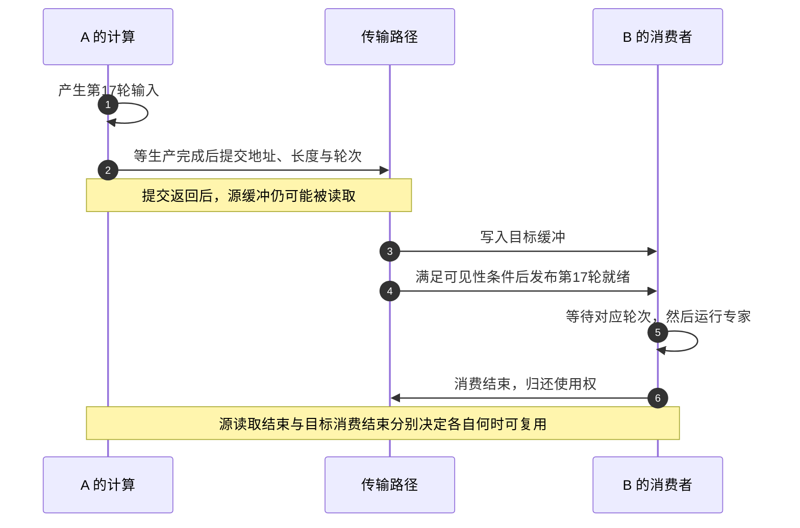

# 数据移动：一块数据什么时候才算到了

[从这里开始](<../00 从这里开始.md>) · 前提：基础 [02 一张 GPU 上时间和显存花在哪里](<../基础/02 一张 GPU 上时间和显存花在哪里.md>)、[03 一张卡放不下跑不完以后](<../基础/03 一张卡放不下跑不完以后.md>) · 用到的算法：[五笔账 §1 关键路径](<00 五笔账.md#1 关键路径：并行时什么相加>)、[§3 提交点](<00 五笔账.md#3 提交点：什么时候算完成、何时能释放>)

这篇跟踪几块要交给 GPU 的数据：四张卡各算出的一份梯度，一批要送到专家的 token，一块躺在 SSD 上的 1 GiB 状态。过去它们分属《通信与互联》和《存储与异构内存》两篇。这里合在一起写，是因为它们面对的是同一组问题：路径上哪一段最慢，“到了”具体指哪个时刻，被省掉的那一步工作由谁接手。

> [!abstract] 读完这篇，你应该能判断
> - **收益看消费者等了多久，不看带宽涨了多少。** 能完全藏在独立计算后面的传输，再加速也不改变结果。
> - **“完成”有四个时刻**：提交返回、源端可复用、目标可见、消费结束。每一种下一步只能依赖其中一个。
> - **重叠要付资源。** 通信和计算争用同一批 SM、HBM 或链路时，流水可能比串行还慢。
> - **“直达 GPU”是一组交换。** 省掉 CPU 中转，同时把文件语义、缓冲寿命和同步交给了调用者；提交和排队足够贵时，中转仍可能更快。
> - **小请求的瓶颈是操作次数和尾部，不是带宽。**

---

## 1 1 GiB 搬完之前 GPU 能做什么

**【算例】** 下一阶段需要一块 1 GiB 的状态，主存里已经有一份可以直接复制的副本，单向有效带宽 25 GB/s：

$$
t_{\rm copy}=\frac{2^{30}\ \text{bytes}}{25\times10^9\ \text{bytes/s}}\approx42.95\ \text{ms}
$$

当前还有 30 ms 与它无关的计算，复制从一开始就启动。消费者最早在 42.95 ms 拿到数据，计算结束以后至少还要等 12.95 ms。

图里只有已经就绪的主存副本。从 SSD 来的话，前面还有定位文件、读进主存、可能的解码和重排，每一步都有队列和完成通知。这些步骤能按块流水时，稳态由最慢的一段决定，但第一块的准备和最后一块的尾巴仍在路径上。SSD 和 PCIe 的峰值各属一段，组合路径要按依赖求时间，不能取其中一个峰值。

这个 12.95 ms 就是后面所有方法争夺的对象。预取把复制提前到更早的窗口；直达路径去掉中转；副本让读取走更快的那条路。哪种有用，取决于消费者在哪一刻需要数据。权重按层顺序使用，地址可以提前确定，预取很有效；检索或 Agent 分支选中的 KV，要等分支结束才知道要哪块，可提前的窗口就小得多。

## 2 环、树与共享出口

现在换成通信。4 个 rank 各有大小为 $S$ 的梯度，要逐元素求和，并让每个 rank 都拿到完整结果，即 AllReduce。

环形 AllReduce 先做 reduce-scatter，再做 all-gather，每 rank 共发送 $2(n-1)S/n$。设每步启动代价 $\alpha$、可持续单向载荷率 $b$：

$$
T_{\rm ring}\approx2(n-1)\alpha+\frac{2(n-1)S}{nb}
$$

一棵不分段的教学归约树，关键路径上有 4 次整份传输：$T_{\rm tree}\approx4\alpha+4S/b$。

**【算例】** $\alpha=5\ \mu$s，$b=50$ GB/s，$n=4$：

| 每 rank 的 $S$ | 环 | 教学树 |
| --- | --- | --- |
| 4 KiB | 30 + 0.123 = 30.123 μs | 20 + 0.328 = 20.328 μs |
| 100 MiB | 0.030 + 3.146 = 3.176 ms | 0.020 + 8.389 = 8.409 ms |

小消息树少两次启动占优，大消息环的分块减小了载荷项。实际的树算法可以分段流水、分担内部节点负载；NCCL 2019 年介绍的双树把数据分给两棵互补的二叉树，让一个 rank 最多在其中一棵承担内部节点工作。[NCCL 双树](https://developer.nvidia.com/blog/massively-scale-deep-learning-training-nccl-2-4/)【已核】

**同一次运行，两种“带宽”。** 100 MiB 在 3.176 ms 内完成：按算法口径 $S/T$ 约 33.0 GB/s，按每 rank 实际发送量 $1.5S$ 约 49.5 GB/s。比较两份实验，先统一分子和计时终点。

**共享出口。** 扩到两个节点、每节点 4 张卡。跨节点总共只有 50 GB/s 时，4 个 rank 各申请 50 GB/s，得到的不是 200 GB/s，它们分的是同一个出口。分层算法先在节点内 reduce-scatter，再让各结果块跨节点归约，最后节点内 all-gather，用多一点本地工作换更少的跨节点字节。机内快、出口紧时划算；节点间够快、消息很小时，多出来的同步反而延长等待。拓扑检查要从每一份待发送的数据出发，画出它经过的 GPU 接口、节点内链路和网卡出口，把共用边上的需求相加。

## 3 交接完成有四个时刻

GPU A 产生一块专家输入，要交给 GPU B。

图里“传输路径”可能由 GPU 线程、主机代理和网卡共同推进，箭头表示必须满足的先后关系，不对应某个具体 API。有三种错误都出在这里：先发就绪信号、后让数据可见，B 读到旧内容；A 提前覆写源缓冲，在途 DMA 读到下一轮的数据；地址复用时不区分轮次，迟到的第 17 轮通知把第 18 轮的缓冲标成就绪。

计时也要对准这四个时刻之一。计时止于提交返回，测的是发起成本；止于源端可复用，测的是生产者何时能继续；要评估下一层专家何时开始，就要等目标可见且轮次就绪。

**接口的保证要逐个确认。** NVSHMEM 把 fence 的顺序保证和 quiet 的完成保证分开，CPU 和 GPU 发起的操作作用域也不同。[NVSHMEM 顺序与完成](https://docs.nvidia.com/nvshmem/archives/nvshmem-203/api/docs/gen/api/ordering.html)【已核】它 2026-09 的版本在增加批量非阻塞远程访问的同时，修复了 device signal wait 后的可见性和延迟完成问题，说明发起粒度和完成契约要一起采用。【已核】DeepEP 2026-09 的实现改走 GIN 路径，它的 deferred epilogue 在第一次 wait 里才执行尾处理并产生结果，所以 wait 本身也要算成本。【已核】“NVSHMEM 偏 GPU、NCCL 偏 CPU”这种概括已经不够用了：NCCL 的 GIN/device API 也能从 GPU 内提交网络操作。比较时要追问谁初始化、谁敲队列、谁搬载荷、谁确认完成。【已核】

同一套交接协议在 GPU 内部也成立，满槽和空槽两次交接见 [算子与编译 §3](<05 算子与编译.md#3 异步流水的两次交接>)。

## 4 把通信藏进计算，以及藏不住的时候

MoE 的一层里，dispatch 把 token 送到专家，专家做完计算，combine 再把输出送回原 rank。如果一段输出已经写完、目的地已知、接收缓冲可写，它就可以先发回去，剩下的专家计算继续进行。

**【算例】** 输出分两段，每段计算 6 ms、回传 4 ms。串行 20 ms。资源独立时：第一段 0–6 ms 计算、6–10 ms 回传，第二段 6–12 ms 计算、12–16 ms 回传，共 16 ms。

> [!warning] 反例：共驻以后，流水比串行慢
> 【算例】通信轮询、拷贝和 GEMM 争用 SM、HBM/L2、功率或链路，每段变成计算 8 ms、回传 5 ms，流水就是 $8+8+5=21$ ms，比串行的 20 ms 还慢。放进不同 stream 只是提供了并发的机会。

按 tile 发信号的方法先按返回目的地排行、对齐，让一个输出块只交给一个接收者；GEMM 完成一个 tile 就发信号，另一组常驻 SM 消费。它在单节点 4×A100 NVLink 的前向实验里，较小隐藏维度的模型落后于部分基线，这显示了 padding、信号和调度的固定成本。[论文](https://arxiv.org/html/2607.19539v1)【作者数据】

Weave（2026-09）根据标定的带宽和吞吐曲线，随层和 rank 选择通信的 SM 份额和分块数，并让空闲的通信 worker 临时执行 GEMM tile。作者实验限于一个 4×H100 NVLink 节点、EP=4。【作者数据】它报告的端到端延迟，是把 SGLang 里 MoE 之前的时间和单独测得的 MoE kernel 时间相加得到的，所以它支持的是单机负载下的组合估计，排队、动态批次和跨节点争用要另做完整服务对照。

**尾部来自最忙的那一个。** 【算例】4 个专家 rank 平均各收 100 个 token，某个实际收到 250 个，其他 rank 都要等它。接收窗口满了而发送继续，排队增加；多个发送者同时奔向一张卡，形成 incast。控制在途字节、先发关键块、重排路由、复制热点专家，分别改变队列、时间、需求和算力，要针对卡住的那一项选。专家负载本身怎样形成，见 [训练一次更新 §7](<07 训练一次更新.md#7 专家：平均负载失去预测力>)。

**拥塞反馈的对象。** 端点降速、网络选路、通信库调整交换图，作用于不同对象、不同时标。REACT（2026-09）按各流完成时间修改通信图；作者附录里部分模式比直接用 NCCL 更慢，检测、搜索和换图的成本超过了收益。【作者数据】热点持续很多轮，控制回路才有摊销空间；几十微秒的热点，新图下发前可能就消失了。换图也绕不开服务器唯一的出口。UE 1.1 规范（2026-10）把同步组、网络内归约、拥塞信号写进了规范层【已核】，设备实现和跨厂商互通是另一件事。

## 5 谁决定搬什么：预取、缺页与直接访问

回到存储。显式预取、managed memory、直接远端访问的根本区别，是谁决定搬运的时机和单位。

| 方式 | 谁决定 | 适合 | 代价 |
| --- | --- | --- | --- |
| 显式复制 / 预取 | 应用 | 地址可提前确定，搬进来会多次使用 | 页锁定缓冲的数量和寿命；误取 |
| managed memory 按需迁移 | 运行时 | 地址动态，希望少管物理位置 | 缺页、驱逐、抖动 |
| 直接访问 | 每次访问 | 每次只用远层一小部分，复用少 | 每次都付远端延迟 |

managed memory 下，GPU 访问到不在 HBM 的页就触发缺页：HBM 不够先腾出旧页（脏页还要回写），再迁入并重试。复用距离超过 HBM 能驻留的范围时，刚迁走的页很快又被访问，链路一直忙于来回换页。[CUDA 12.8.1 语义](https://docs.nvidia.com/cuda/archive/12.8.1/cuda-runtime-api/group__CUDART__HIGHLEVEL.html)【已核】

**【算例】** 迁移单位 4 KiB，每次只用其中 128 bytes，被驱逐前不再用其余部分：有效字节只有 1/32，为了用 32 MiB，可能搬了 1 GiB。整页被多次使用时迁移划算；零星用一次时，直接取所需的字节更合算。NVIDIA 的显存超额订阅实验用三种访问模式比较按需迁移、直接访问和分区，在 V100/A100、PCIe 与 Power9 NVLink 上结论各不相同。[实验](https://developer.nvidia.com/blog/improving-gpu-memory-oversubscription-performance/)【已核】

**主存也有远近。** GPU 接在 socket 0，页面却由 socket 1 上的线程首次写入，之后的 DMA 可能要跨 socket 才到设备。把读线程绑到 socket 0 不会让已有页面跟着迁过来；生产线程、页面、GPU 和网卡的位置要一起核对。

**主存成为执行路径的一部分。** DeepInfer 2026-11 更新的部署说明描述了 Engram 的做法：词表按词表维度分片放在注册过的主存里，每次 forward 开始时发起单边 RDMA 读，由网卡在后台搬进 GPU；较小的 scales 留在 GPU。NPU 路径还没有这种卸载。【已核】

## 6 绕过 CPU：省下复制，接过责任

**GDS 去掉了 CPU 中转缓冲。** GPUDirect Storage 让存储和 GPU 之间的 DMA 不必先进 CPU 的 bounce buffer。这里指 CPU 发起的 cuFile API：提交和资源准备仍有控制开销，需要 GPU、驱动、文件系统和拓扑都支持。调用成功以后，数据仍可能经过中转：不支持的文件系统走主存兼容路径，未对齐的请求或某些拓扑会引入内部缓冲，managed allocation 不在直达范围内。反过来，没有 `nvidia-fs` 也不一定回退，受支持的 NVMe P2PDMA 可以用上游驱动。[GDS 设计指南](https://docs.nvidia.com/gpudirect-storage/design-guide/index.html) · [兼容路径](https://docs.nvidia.com/gpudirect-storage/overview-guide/functional-overview.html)【已核】所以使用前要核实际的分配类型、挂载方式和传输模式，“调用成功”不说明走的是直达路径。

**uGDS 把控制路径也搬到用户态。**（2026-10 技术报告与公开实现）CPU 在用户态直接组织 NVMe 命令、敲 doorbell、收完成项；数据仍由 SSD 经 P2P DMA 写进 GPU，GPU 不参与轮询。【已核】它换来更短的提交路径，同时接手了三项原本由内核和文件系统承担的责任：

1. **文件语义。** 它独占原始 NVMe 设备，绕过文件系统，接口是块偏移，没有目录、锁和页缓存。适合本来就维护块池的系统（比如 KV 块池），不能透明替换任意 POSIX 文件。
2. **缓冲寿命。** 异步实现从入队那一刻起持有缓冲和句柄的引用；IO 完成后的 host callback 才放行后续 stream 工作；缓冲上还有在途 IO 时注销返回 busy；缓冲也注册给了 RDMA 时，要先等外部访问结束并释放注册。提交得越早，重叠越多，不能回收的区间也越长。这和 [历史状态 §7](<02 历史状态.md#7 迁移与取消：什么时候能回收>) 的 KV 回收是同一个问题。
3. **同步。** 轮询消耗 CPU，跨设备同步由调用者负责。

它固定版本的 benchmark 说明验证的是外部缓存命中，不是 TTFT 胜出；论文所说的 goodput 是逻辑 KV 吞吐，正文没有 SLO。项目的首发日期没锁定，README 记录了早于报告的集成。

**什么时候绕过 CPU 没有意义。** 数据必须先由 CPU 解压或解析时，这一步本来就在关键路径上；IO 已经完全藏在计算之后时，传得再快也不改变交付时间。GDS 指南自己把“IO 在关键路径上、GPU 是数据的第一个或最后一个消费者”列为适用条件。

**TailGuard-GDS：把选路径变成阶段调度。**（2026-11 v1）在相同文件区间、相同 GPU 目标缓冲和相同持久化要求下，它按训练阶段联合选择直达或主存中转、请求大小、并发和放置，依据是会暴露给计算的等待；切换前先排空旧请求、注册新路径。提交、排队和同步足够贵时，中转反而赢。【作者数据】它的证据范围要看清：ZeRO-3 实验是 49–112M 参数的随机初始化模型外挂一块单独 payload，原生参数交换仍在运行；压力实验全程走主存中转、放置不变，只调请求形状，压力标签和 profile 由外部提供。所以它支持“路径选择是阶段调度的一个变量”，没有验证真实大模型的全参数交换，也没有验证按压力自动切换路径。

## 7 小请求、尾部和副本的写入账

**【算例】** 同样 1 GiB，只能做 4 KiB 随机读，路径每秒最多完成 100,000 次 IO：$100000\times4096$ bytes/s = 409.6 MB/s，1 GiB 需要 262,144 次 IO，至少 2.62 s。这一段的上界由每秒操作数决定，第 1 节的 25 GB/s 说的是连续块复制。合并请求能减少操作数，也可能多读无用内容、等相邻请求、占更多缓冲。

**在途数。** 稳定系统里，平均在途请求数约等于完成速率乘平均响应时间（Little 定律）：100,000 IOPS、平均 100 μs，约 10 个在途。过饱和以后，再加并发主要是在增加排队。

> [!warning] 单次 IO 的 P99 和整批任务的 P99 是两回事
> 【算例】消费者要等一整批 100 个独立读取，每个有 99% 的概率按时完成，整批按时的概率只有 $0.99^{100}\approx36.6\%$。真实系统里读取共享队列、彼此相关，数值会不同，但方向不变。先发关键块、先消费这一轮必需的部分，同时改变等待、流量和缓冲。

十万个小对象还意味着十万次名字查找、权限和版本检查。打包成大文件减少小操作，但要维护索引，改一小段可能要重写一大片。冷读和热读要分开计时：第一次读包含查找、页面驻留和设备注册，重复地址可能已经由主存或页缓存命中。

**副本把读的收益变成写的账。** KVStream（2026-10 v1）在本地 NVMe 和并行文件系统各存一份 KV，一批读取交给先空闲的那条路径，并尽量把写入藏在计算后面。【作者数据】

> [!warning] 反例：主存够大以后，副本的收益消失
> 在作者的 trace 上，主机内存增加时，TTFT 加速比从 1.71 降到 0.98；复用稀疏时还可能亏损。主存已经装得下复用集，磁盘层能省下的读就少了，复制写入却一直在发生。[KVStream §6.5](https://arxiv.org/html/2610.31827v1)【作者数据】

写入账可以直接数。【算例】产生 1 GiB 新状态，同时写本地 NVMe 和远端文件系统，应用层就写了 2 GiB；只改 4 KiB 却要重写整个 1 MiB 块，单副本又放大 256 倍。后台检查点的顺序写可以被流水隐藏，但仍和训练数据读取、在线恢复读取争用同一份服务能力。

“写完了”也有好几层：进程缓冲、OS 页缓存、设备确认、跨故障域持久化。可再生的缓存允许丢；检查点必须能在恢复前找到已提交的版本和完整的分片清单，见 [持续交付 §3](<10 持续交付.md#3 失效之后恢复哪一次更新>)。

增加一层快存储，也不一定是为了读得更快。DeepInfer 部署说明讨论 CXL 当 KV 二级缓存时，作者认为他们的 KV 读取已经和排队、计算重叠，更低的命中延迟对 TTFT 帮助有限；更值得研究的是把热条目或只用一次的条目暂留内存，以减少 SSD 写入。这是一个尚未采用、没有实验的设想。【已核】

## 8 共享内存池先要正确发布

CXL 可以把设备内存映射进主机地址空间。[Linux v6.12 CXL 文档](https://www.kernel.org/doc/html/v6.12/driver-api/cxl/memory-devices.html)【已核】CMM-MP（2026-10 v1）把后端扩到以太网，主机看到的是 CXL Type 3 内存；它的多主机共享模式保证**单次访问的原子性，但不保证不同主机请求的执行顺序**，上层要自己做一致性和带外同步。评估用的是 Valkey/YCSB、DiskANN 等应用，没有覆盖 GPU 训练或长上下文服务。【作者数据】

单次原子为什么不够：生产者先写 payload，再写“版本 17 就绪”。系统只保证每次访问原子时，消费者可能先看到就绪标志、再读到旧 payload。把标志改成原子整数只能防止标志本身被撕裂；发布协议还必须保证数据先于就绪条件可见。发布以后还有引用寿命：消费者仍持有旧版本时，地址不能分给新对象；节点失效后，引用要失效或从副本恢复。可寻址的容量、跨主机正确共享、持久事务，是三个需要各自协议的承诺。

## 9 结论在什么时候反过来

| 你原本的判断 | 什么条件下反过来 | 先查什么 |
| --- | --- | --- |
| 传输提速就有收益 | 传输已经藏在独立计算后面 | 消费者暴露的等待 |
| 树比环快 | 消息变大 | 启动次数和载荷项各占多少 |
| 多个 rank 并行发送，带宽相加 | 它们共用一个网卡出口 | 每条共享边上的需求总和 |
| 通信和计算重叠能省时间 | 共驻争用让每段变慢 | 共驻下每段的实测时间 |
| 能直达 GPU 就直达 | 提交、排队、同步贵；CPU 必须先处理数据；文件系统静默回退 | 实际传输模式；对照组是否同一文件区间 |
| 加带宽能解决 IO 慢 | 小随机读，瓶颈在操作数和尾部 | IOPS、在途数、整批的 P99 |
| 多副本加快读取 | 主存已经装得下复用集 | 读省下的时间 vs 写入翻倍 |
| 内存池能共享就能用 | 只保证单次原子，不保证跨主机顺序 | 发布协议和回收规则 |

## 证据

| 正文判断 | 标记 | 证据卡或来源 |
| --- | --- | --- |
| NCCL 双树、NVSHMEM 顺序与完成 | 【已核】 | [D10 证据 JSON](<../研究台账/evidence/D10-sources.json>) |
| NCCL 也能从 GPU 内发起网络操作（GIN / device API） | 【已核】 | [原课程笔记 §12.3](<../../courses/hpcgame/HPCGame 2026 - 大模型训练、推理与 Infra 概览.md>)；已发布版《通信与互联》所附官方 device API 文档 |
| NVSHMEM 3.8 修复、DeepEP GIN 与 deferred epilogue | 【已核】 | D10 证据 JSON |
| Weave 的资源分配；E2E 是分项相加 | 【作者数据】 | [AIINFRA-E-20261109-06](<../研究台账/来源与证据.md#AIINFRA-E-20261109-06>) |
| REACT 的调图与反例 | 【作者数据】 | [AIINFRA-E-20261104-14](<../研究台账/来源与证据.md#AIINFRA-E-20261104-14>) |
| UE 1.1 规范 | 【已核】 | [AIINFRA-E-20261104-13](<../研究台账/来源与证据.md#AIINFRA-E-20261104-13>) |
| CUDA managed memory、GDS 适用范围与兼容路径、CXL | 【已核】 | [D11 证据 JSON](<../研究台账/evidence/D11-sources.json>) |
| DeepInfer Engram 与 CXL 设想 | 【已核】 | [AIINFRA-E-20261109-10](<../研究台账/来源与证据.md#AIINFRA-E-20261109-10>) |
| uGDS 的用户态控制、三项责任、benchmark 范围 | 【已核】 | [AIINFRA-E-20261123-01](<../研究台账/来源与证据.md#AIINFRA-E-20261123-01>) |
| TailGuard-GDS 的阶段选择及其证据范围 | 【作者数据】 | [AIINFRA-E-20261123-02](<../研究台账/来源与证据.md#AIINFRA-E-20261123-02>) |
| KVStream 的副本读取与 1.71→0.98 反例 | 【作者数据】 | [AIINFRA-E-20261026-05](<../研究台账/来源与证据.md#AIINFRA-E-20261026-05>) |
| CMM-MP 的原子性与顺序 | 【作者数据】 | [AIINFRA-E-20261104-15](<../研究台账/来源与证据.md#AIINFRA-E-20261104-15>) |
| 42.95 ms、环与树表、20/16/21 ms、1/32、409.6 MB/s、$0.99^{100}$、2 GiB 与 256 倍 | 【算例】 | 作者设定，非实测 |

最近改写：2026-11-23，§6 改写为“省下复制，接过责任”，加入 uGDS 的三项责任和 TailGuard-GDS。见 [2026-11-23 进展 §2](<../进展/2026-11-23.md#2 存储直达 GPU：省下一次复制，接过三项责任>)。
