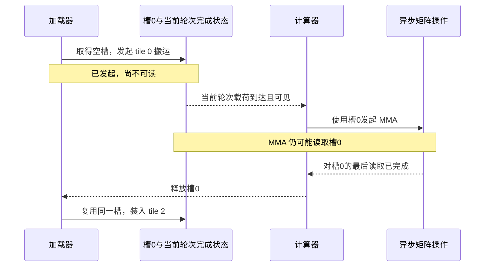
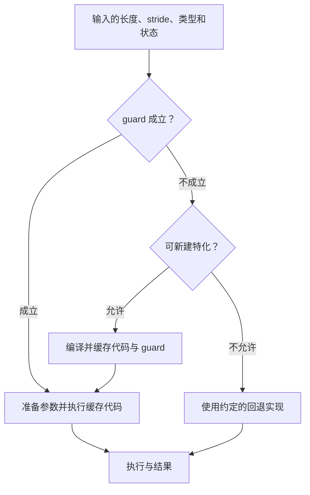

# 算子与编译：一个线性层怎样落到 GPU 上

[从这里开始](<../00 从这里开始.md>) · 前提：基础 [02 一张 GPU 上时间和显存花在哪里](<../基础/02 一张 GPU 上时间和显存花在哪里.md>) · 用到的算法：[五笔账 §1 关键路径](<00 五笔账.md#1 关键路径：并行时什么相加>)、[§3 提交点](<00 五笔账.md#3 提交点：什么时候算完成、何时能释放>)、[§4 分母](<00 五笔账.md#4 分母：吞吐、goodput 与同质量成本>)

这篇跟踪两个小对象：一个 $4096\times4096$ 的线性层，和一行 softmax。先看它们在 GPU 上怎样执行，等什么，怎样把等待藏起来；再看编译器替我们做了哪些决定，这些决定在输入形状变化时还能不能复用，复用之前要检查什么。

过去“算子”和“编译”分成两篇。合在一起写，是因为编译器决定的正是算子的布局、同步和命中路径。一行 softmax 能否融合，要先回答线程怎样持有元素；一个特化的 kernel 能否复用，要先回答它依赖输入的哪些性质。

> [!abstract] 读完这篇，你应该能判断
> - **形状决定先省哪一笔工作。** 行数少时先看权重读取和并行度，行数多时才容易利用矩阵吞吐。
> - **融合省下的全局读写，可能以寄存器、布局转换和 spill 的形式回来。**
> - **异步流水靠两次交接保证正确**：载荷到齐才允许读，最后一次读取结束才允许覆写；循环复用还要区分轮次。
> - **编译结果复用的是“代码加上它的成立条件”。** guard 失败、图中断、回退的代价各不相同。
> - **调优的回报要按调用次数摊销**，而且要在实际的执行方式（比如 CUDA Graph 内）里选赢家。

---

## 1 形状决定先省哪一笔

线性层 $Y=XW$，$X$ 是 $M\times K$，$W$ 是 $K\times N$，$K=N=4096$，BF16。只算一次理想的全局读写：输入和权重各读一次，输出写一次。

**【算例】**

| token 行数 $M$ | 计算量 $2MKN$ | 理想载荷 | 算术强度 |
| --- | --- | --- | --- |
| 1 | 约 33.55 MFLOPs | 约 32 MiB，几乎全是权重 | 约 1 FLOP/byte |
| 64 | 约 2.147 GFLOPs | 33 MiB | 约 62.1 FLOP/byte |

64 行共用同一份权重，搬一次权重能支持 64 倍的计算，才有机会从带宽限制转到矩阵吞吐限制。行数可以来自批处理，也可以来自投机验证多出的行，所以服务调度和投机解码会直接改变 kernel 的最佳实现，见 [一轮生成 §3](<01 一轮生成.md#3 每个已提交 token 花了多少时间>)。

$M$ 小时还有第二个困难：输出 tile 太少，启动的 block 填不满设备。减小 tile 增加 block，但降低复用；split-K 沿归约维度拆出更多 block，计算同一个输出的不同部分，再合并部分和。拆成 $s$ 份、部分和用 FP32 存，仅载荷就约 $4sMN$ bytes，另有写入、归约和同步。另一条路线是专门的 GEMV，用线程内累加和 warp 归约消费权重。Tensor Core 的峰值替代不了必要的权重读取。Exo-GPU（2026-09）的 GEMV/GEMM 对照给出了有具体精度和计时边界的实现例子。【已核】

## 2 复用、融合与片上容量

分块让一组输出共用留在片上的输入，布局决定这份输入由哪些线程持有、按什么地址读取、怎样送进矩阵指令。全局内存希望相邻线程合并访问，矩阵指令要求特定的操作数排列，两种要求要在同一条消费路径上接起来。

更大的 tile 通常带来更多复用，也占用更多寄存器和共享内存，可能减少同时驻留的工作量。occupancy 是隐藏等待的手段，本身不是要最大化的目标。[Blackwell 调优指南](https://docs.nvidia.com/cuda/blackwell-tuning-guide/index.html)【已核】

融合把同样的取舍延伸到相邻的操作。**一行 softmax 的例子：** 数值稳定的 softmax 先求最大值，减去最大值，求指数，求和，再相除。逐操作启动 kernel 会反复读写中间数组；整行能留在片上时，融合以后只读输入、写输出。但省下的全局流量变成了寄存器占用、线程间归约和指数单元的工作。[Triton 的 softmax 教程](https://github.com/triton-lang/triton/blob/v3.4.0/python/tutorials/02-fused-softmax.py)把 1025 列补到下一个 2 的幂 2048，越界位置填负无穷，写回时用 mask；多出来的 1023 个位置没有合法载荷，却仍占用局部表示和归约资源。【已核】它还根据编译后的寄存器和共享内存估计能驻留多少个 program，再选择启动规模。

接到矩阵计算后面，问题变成两种布局怎样衔接：矩阵指令要一种排列，后面的归约希望同一行集中在另一组线程上。编译器于是插入 shuffle 或共享内存重排，融合还拉长了值的存活期，可能引起 spill。图上少了一个中间张量，机器上可能仍有数据交换。检查降低后的代码时，要看逻辑形状、元素到线程的映射、指令操作数、同步和回收顺序，这些比 IR 里有几个算子更接近真实的性能和正确性。

## 3 异步流水的两次交接

有了复用，计算仍可能在等操作数。异步流水让加载器准备下一块，计算器同时处理当前这块。TMA 是由硬件执行 tile 搬运的机制，MMA 是矩阵乘加；两者都是异步的，发出指令的线程继续向前，并不表示操作数已经到了，也不表示最后一次读取已经结束。

**满槽通知让消费者开始，空槽通知让生产者覆写。** 循环复用还要区分槽号和轮次，否则上一轮的完成状态会被当成这一轮就绪。[CUTLASS 的流水抽象](https://github.com/NVIDIA/cutlass/blob/v3.5.1/media/docs/pipeline.md)用 acquire/commit、wait/release 组织这两个方向；TMA 的载荷完成可能自动推进 barrier 的事务计数，单有线程 arrival 不能说明数据到齐。【已核】这和 [数据移动 §3](<04 数据移动.md#3 交接完成有四个时刻>) 跨设备交接的协议是同一个。

可以从错误倒推缺了哪个条件：消费者读到旧块，查载荷完成和轮次标志是否对应；结果偶尔变化，查槽是不是在矩阵操作结束前被覆写；加一级流水反而变慢，查共享内存和驻留数是否下降。第三个槽能让加载器更早开始，代价是更多片上缓冲；稳态供给本来就慢于消费时，加槽只能藏住有限的等待。

## 4 大小不同的专家

MoE 的路由让每个专家拿到的行数不同。**【算例】** 四个专家分别收到 $[1,7,24,96]$ 行，行 tile 为 16，需要 $[1,1,2,6]$ 组，共 10 组；全部填到 96 行则要 24 组。跳过填充省掉了无用计算，但只有 1 行的 tile 仍然很难利用硬件。每个专家单独 launch 又增加启动成本，还可能要求 host 先知道动态长度。

grouped GEMM 把多个矩阵问题放进一个调度空间，让设备跨专家分配 tile。持久 block 按全局编号轮流取 tile，访问器把编号映射到专家和局部位置。设备端查找可以直接消费动态长度；host 预先生成日程可以减少设备查找，但要付预计算、上传和形状变化的成本。[CUTLASS 调度说明](https://github.com/NVIDIA/cutlass/blob/v3.5.1/media/docs/grouped_scheduler.md)【已核】选择要依据真实的路由分布、空专家比例和热点，只测规则的大 GEMM 是不够的。

NVIDIA 的 MoE 报告（2026-06）把 gate 和 input 两部分权重列一起安排，在矩阵运算的收尾阶段完成门控激活和量化，并把动态专家长度留在设备上，减少中间写回和逐专家启动前的 CPU 往返。【已核】它还允许通过 cluster margin 给通信留出资源：给 GEMM 更多 SM 可能缩短当前计算，却会推迟下一批专家数据的到达。作者的完整预训练对照同时改变了计算图和重叠，收益要归于整条组合路径。【作者数据】专家负载为什么会不均，见 [训练一次更新 §7](<07 训练一次更新.md#7 专家：平均负载失去预测力>)。

## 5 Attention：省掉中间矩阵以后

规则 GEMM 主要在调整数据怎样移动；Attention 还能用数学重组，避免把全部 score 和概率写回 HBM。对一行 query 逐块读 K/V，维护三个量：当前最大值 $m$、指数和 $l$、未归一化的输出 $u$。新块的 score 为 $s_j$、value 为 $v_j$：

$$
m'=\max(m,\max_j s_j),\quad a=e^{m-m'},\quad l'=al+\sum_j e^{s_j-m'},\quad u'=au+\sum_j e^{s_j-m'}v_j.
$$

最终输出是 $u/l$。新块抬高了最大值时，系数 $a$ 把旧块的累积量缩放到新基准上。初始空状态和整行被 mask 的情况要单独处理。反向可以只保存少量归约量，重算局部概率，用计算换存储。[FlashAttention 论文 §3.1 / 附录 B](https://arxiv.org/html/2205.14135v2)【已核】这组递推也是 [一轮生成 §7](<01 一轮生成.md#7 改变轮次的组织>) 里 SpecStream 逐块读回历史时必须维护的同一组量。

这个重组保留了完整 Attention 的数学目标。块稀疏跳过某些 query–key 对：原模型本来就有对应 mask 时是同一个运算，学习或启发式丢弃时，质量就成了新的验收条件。中间矩阵省掉以后，矩阵乘加、指数运算和片上数据发布仍要互相等待。FlashAttention-4（2026-03）在 Blackwell 上分别核算这几项工作，用交叠流水、条件缩放、Tensor Memory 和两个线程块协作重新安排。矩阵单元变快以后，指数和共享内存访问占的比例变大，下一步优化就转向了它们。[FlashAttention-4](https://arxiv.org/html/2603.05451v1)【已核】

> [!warning] 反例：矩阵变快了，训练却发散
> Hardware-Aware FP4 FlashAttention-4（2026-09）把矩阵运算继续降到 FP4，概率转换、缩放和片上依赖变得更显眼。部分 MXFP4 的概率矩阵和 value 路径训练轨迹发散，保留下来的分布式训练路线用 FP8 的 P/V；kernel 计时也排除了动态 Q/K/V 量化。【作者数据】单步计时、固定输入误差和持续训练质量是三种不同的验收。

**递归状态的分块。** 线性递归 $S_t=S_{t-1}+v_tk_t^\top$、$o_t=S_tq_t$ 在 decode 时只更新一份固定大小的状态；训练时逐 token 执行会产生长依赖链。把 $C$ 个位置分成一块后，输出分成两部分：块前状态对当前 $Q$ 的贡献，以及块内带因果 mask 的 QK/V 计算，后者可以用矩阵操作并行。[Gated DeltaNet，§2–3](https://arxiv.org/html/2412.06464v1)【已核】模型侧为什么要压缩成状态，见 [历史状态 §2](<02 历史状态.md#2 共享表示、删除连接、压缩成状态>)。

## 6 编译保存的是代码和它的成立条件

编译要回答三层问题，每层要保存的条件不同：

| 层次 | 对一行 softmax 要回答的问题 | 要保存的条件 |
| --- | --- | --- |
| 图 | 最大值、指数、归约、除法能否融合 | 依赖、控制流、别名、mutation |
| kernel | 元素分给谁，怎样归约，用什么指令和存储 | 形状、类型、布局、资源、同步 |
| runtime | 这次输入能不能用已有的实现，怎样提交执行 | guard、特化身份、地址和状态、回退策略 |

现在让调用长度依次变成 128、129、256，stride 也会变。逐长度特化减少边界判断、利用常量，但扩大了编译和缓存集合；统一放进 256 的桶、用 mask 处理短输入，变体少了，又多付一些填充。guard 是运行前对这些假设的检查。

删掉检查能缩短热路径，也可能把错误的输入送进特化。PyTorch Dynamo 遇到图中断时可以执行 Python 再继续捕获，所以 guard 命中、guard 失败产生新特化、图中断后继续、因预算或能力限制回退，要分别记录，它们的代价和修法都不同。[Dynamo 机制](https://docs.pytorch.org/docs/2.9/torch.compiler_dynamo_overview.html)【已核】

GPU kernel 很短时，命中路径上的主机开销就显眼了。Trident（2026-09）把带 guard 的分发、参数准备和主机执行合进原生模块，命中的调用留在编译代码里，只在需要新特化时回到 Python；它优化的是保留了检查的 warm 调用路径。【已核】CUDA Graph 是另一条路线：重放满足捕获条件的设备执行序列，减少 host 提交，前提是地址、形状和状态适合复用。

**这一点直接限制了投机解码。** TableTune 默认只在 CUDA Graph 已覆盖的候选长度里选择，因为临时换到未捕获的长度会停顿；在线更新接受率只改变“在已有长度里选哪个”，修不了执行成本。见 [一轮生成 §4](<01 一轮生成.md#4 成本表从哪里来，又怎样过期>)。【已核】服务为组批而改变长度组合时，热点形状也变了，调度参数和编译缓存应该作为同一份运行条件记录。

**语言选择，是选择把哪些决定交给谁。** CUDA/PTX 由开发者决定线程、指令和同步，控制最细，适配和验证工作最多；Tile 或张量 DSL 让开发者决定块和布局，由后端降低；整图编译管更大范围的融合和内存寿命，受控制流和动态输入约束；自动调优在给定空间里搜索，承担测量噪声和未见形状的风险；Agent 或学习型搜索扩大候选空间，需要冻结契约和独立晋升，见专题 [Agent 算子开发与优化](<../专题研究/Agent 算子开发与优化（2026-11-04）/00 阅读入口与结论.md>)。比较工具时，追问三件事就够了：元素由谁持有，搬运和计算何时发生，多个操作在哪个边界组合。

**更自由的流水，能否有更强的检查。** Exo-GPU（2026-09）先规定顺序程序的结果，再检查新增的并行和同步是否保留它：collective 分析检查哪些线程应该一起执行，抽象机跟踪读写和异步可见性。【已核】它检查的是具体尺寸，保留了两个超出检查范围的 unsafe 变换，生成代码和正式 CUDA 语义之间还没有完整证明，论文版本不支持 tcgen05。【作者数据】

## 7 调优要多少次调用才回本

只看 warm kernel，调优越多越好；把构建成本放回调用流，结论就变了。构建与调优成本 $C$，每次运行 $t$，调用 $R$ 次，简化成本是 $C+Rt$。

**【算例】** 多调优 8 秒、每次省 4 微秒，要超过两百万次调用才收回时间；只调用 10 万次，只省 0.4 秒。多形状系统要把各形状的调用数相加，再算上构建、未命中、回退和缓存失效。

**赢家要在真实的提交方式里选。** Helion/vLLM 的报告（2026-10）把多种 GEMM 算法纳入按形状搜索，只在限定的小形状范围、CUDA Graph 重放路径里采用新实现，其余回退默认后端。在图外测得的赢家，进了图以后可能换位。【作者数据】TensorRT Global Performance Tuner（2026-10）把搜索从单个 kernel 扩到整个引擎的构建路线，逐路线构建、测量；准确性验证要显式启用，并提供参考输入、输出和阈值，然后才从已测合格的路线里挑最快的。【已核】

搜索还会选中噪声里的幸运赢家。候选要在相同的 GPU 分配、cache/Graph 状态和计时边界下交错测量，用独立样本确认；带 mutation 的算子每轮恢复输入；未见过的 stride、极端值和 NaN、训练与服务负载要分别验收。制品什么时候失效也要分清：换硬件、换布局、换后端，旧代码可能不再正确；只是输入分布变了，旧代码仍正确，只是哪些形状值得专门优化需要重选。

## 8 结论在什么时候反过来

| 你原本的判断 | 什么条件下反过来 | 先查什么 |
| --- | --- | --- |
| Tensor Core 峰值高，所以快 | 行数少，权重读取主导 | 算术强度和实际 $M$ |
| 融合减少了内存流量，所以快 | 寄存器压力、布局转换、spill | 降低后的代码和 spill 统计 |
| 加一级流水能藏住等待 | 共享内存成了限制，驻留数下降 | 稳态供给率和驻留数 |
| 跳过 padding 就高效 | 很多专家只有一两行 | 路由分布和小 tile 利用率 |
| 低精度 kernel 更快就可用 | 训练轨迹发散 | 持续训练质量，不是单步计时 |
| 删掉 guard 能提速 | 输入假设不再成立 | guard 失败率和回退路径 |
| 调优找到的赢家能用 | 调用次数少；在图外测的 | 摊销所需调用数；图内计时 |

## 证据

| 正文判断 | 标记 | 证据卡或来源 |
| --- | --- | --- |
| CUTLASS 流水与 grouped 调度、Triton 教程、FlashAttention、Gated DeltaNet、Dynamo | 【已核】 | [D08](<../研究台账/evidence/D08.json>)、[D09](<../研究台账/evidence/D09.json>) 证据 JSON |
| NVIDIA MoE 融合；cluster margin 的收益归属 | 【已核】/【作者数据】 | D08 证据 JSON |
| FlashAttention-4 的再平衡；FP4 FA4 的发散反例 | 【已核】/【作者数据】 | [AIINFRA-E-20261104-10](<../研究台账/来源与证据.md#AIINFRA-E-20261104-10>) |
| Helion/vLLM 的图内选择 | 【作者数据】 | [AIINFRA-E-20261104-11](<../研究台账/来源与证据.md#AIINFRA-E-20261104-11>) |
| Trident 的原生 guard 分发 | 【已核】 | [AIINFRA-E-20261104-12](<../研究台账/来源与证据.md#AIINFRA-E-20261104-12>) |
| Exo-GPU 的同步检查及其边界 | 【已核】/【作者数据】 | [AIINFRA-E-20261104-29](<../研究台账/来源与证据.md#AIINFRA-E-20261104-29>) |
| TensorRT Global Performance Tuner | 【已核】 | [AIINFRA-E-20261026-08](<../研究台账/来源与证据.md#AIINFRA-E-20261026-08>) |
| TableTune 与 CUDA Graph 覆盖 | 【已核】 | [AIINFRA-E-20261123-03](<../研究台账/来源与证据.md#AIINFRA-E-20261123-03>) |
| $M=1/64$ 表、$[1,7,24,96]$、8 秒 / 4 微秒 | 【算例】 | 作者设定，非实测 |

最近改写：2026-11-23，§6 加入 CUDA Graph 覆盖对投机候选长度的限制。见 [2026-11-23 进展 §1](<../进展/2026-11-23.md#1 投机解码的成本表会过期>)。
