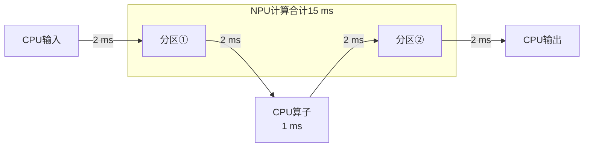

# 数值与硬件：一个数占几个字节，在哪种单元上算

[从这里开始](<../00 从这里开始.md>) · 前提：基础 [02 一张 GPU 上时间和显存花在哪里](<../基础/02 一张 GPU 上时间和显存花在哪里.md>) · 用到的算法：[五笔账 §2 容量账与搬运账](<00 五笔账.md#2 容量账与搬运账>)、[§4 分母](<00 五笔账.md#4 分母：吞吐、goodput 与同质量成本>)

这篇跟踪两样东西：一组 4-bit 权重，和三台教学设备。前一半问量化到底省多少、训练里还能不能用、误差会留多久；后一半问增加算力、带宽或容量各能缩短哪一段，换一种硬件时要重新做哪些事。

把数值表示和硬件放在一起写，是因为它们回答的是同一个问题的两半。“这个数占几个字节”决定搬运账；“这种格式在哪种单元上原生执行”决定能不能兑现。一块硬件的算力翻倍，对每步读 16 GB 权重的 decode 毫无帮助；权重量化到 4 bit，却能直接把这一步缩短到四分之一左右。

> [!abstract] 读完这篇，你应该能判断
> - **低位宽的收益要沿整条数值路径兑现。** 小批量先看权重字节和解包，大批量看矩阵吞吐，训练还要看转置、更新和达到同一质量所需的步数。
> - **元数据也占位宽。** 名义 4 bit，算上尺度常是 4.1 到 5 bit。
> - **递归状态里的舍入误差有寿命。** 同一次写回误差，在慢衰减的通道里影响更久。
> - **硬件选择先看算力、带宽、容量的比例。** 大批量矩阵、小批量生成、多会话驻留，各由不同的资源主导。
> - **跨设备划分子图，收益要大于边界开销。** 分区算得更快，转换、同步和回退仍可能让整条路径更慢。

---

## 1 “4 bit”展开成字节

一次量化写作 $\hat x=sQ(x/s)$：$s$ 是分组尺度，$Q$ 决定可用的值、舍入方式和范围。**【算例】** INT4，同组最大绝对值 100，正向最大整数 7，尺度约 14.29，于是值 1 会被舍入成 0。缩小分组能把异常值隔开，代价是更多尺度和布局处理。FP4 的值格另有定义，要按它自己的数值格分析。

量化的位置决定省什么。W4A16（权重 4 bit、激活 16 bit）主要节省权重搬运；W8A8 或原生 FP8/FP4 矩阵运算还改变了输入计算；KV 和递归状态的量化把误差送进历史，见 [历史状态 §4](<02 历史状态.md#4 降位宽和删位置不是同一种压缩>)。

**【算例】元数据也占位宽。** 每 128 个 INT4 值存一个 FP16 尺度，平均 $4+16/128=4.125$ bit/值；组长缩到 16，变成 5 bit/值，零点和对齐还没算。理想压缩比从 $16/4.125\approx3.88$ 降到 $16/5=3.2$。

**【算例】换成整个模型。** 32B 权重，BF16 载荷 64 GB；理想 4 bit 是 16 GB，加上每 128 值一个 2-byte 尺度共 16.5 GB。按 1 TB/s 的有效 HBM 读取，完整读一遍的下界从 64 ms 降到 16.5 ms。这只是读量账：激活、反量化、计算和非理想访存另算。如果每步先把整个矩阵展开成高精度再读，新增的流量就把节省吃掉了。融合反量化、按 tile 解包、复用尺度，才能把节省接进消费路径。

**已有模型怎样进入低位格式。** 训练后量化（PTQ）用校准数据决定表示，成本低；量化感知训练（QAT）在训练中暴露舍入误差让参数适应，要付训练数据和设备时间。输出误差是 $X(W-Q(W))$，所以校准关心输入激活：等价缩放 $XW=(XS^{-1})(SW)$ 可以改变量化格对各通道的保护。AWQ 在少量校准数据上搜索这个尺度。[AWQ](https://arxiv.org/html/2306.00978v3)【已核】

存储配置和执行配置可以分开表达。Humming（2026-10）把量化存储、计算和调优配置拆开，但转换后的权重仍绑定目标 GPU 架构和布局；它的官方服务对照同时改了后端和激活精度，所以格式选择、执行效率和质量要分别比较。【已核】模型制品应该记录分组轴、块大小、尺度类型、舍入和饱和规则、布局版本，见 [持续交付 §5](<10 持续交付.md#5 发布单位是一个组合>)。

## 2 训练里的低精度：转置、累加与步数

推理只需要前向。训练还要保存或重算激活、准备转置后的表示、归并梯度、更新主参数、重建低位副本。加载以后全部展开成 BF16，只省了存储文件；模拟舍入、再用高精度矩阵乘，测的是数值行为，不是速度。

**转置会改变分组。** $Y=XW$ 的反向里，输入梯度要用 $W^\top$。原矩阵按行量化，转置后重新按行分组，原来的列被放进了新组：异常值的位置变了，尺度和舍入也变了，一般 $Q(W^\top)\ne Q(W)^\top$。前向和反向用的可能是两个不同的近似权重。方形块能保持转置前后的分组对应。转置一致的 FP4 研究（2026-07）对权重和部分梯度用二维块，配合尺度和随机舍入，激活保留一维，查询和键用更高精度。【作者数据】作者在最大 30B 模型、100B token 范围内用软件模拟研究稳定性和质量，原生硬件上的训练速度留待测量。

DeepSeek-V3 的 FP8 配方同时设计了细粒度尺度、累加处理和高精度组件。【已核】它说明“低精度训练”描述的是整条更新路径，只说矩阵乘用了什么格式是不够的。

**真正的分母是同质量的总设备时间。** 更低的精度如果要多走若干步才能达到同一质量，每步的节省就被摊薄了；末期才做适配，前期的高精度成本也在总账里。数值稳定、长程精度、独立任务表现分别回答不同的问题。

## 3 递归状态里的误差会活多久

递归状态的误差会参加下一次更新。用标量模型 $e_t=ae_{t-1}+\epsilon_t$ 描述：$|a|<1$、各次噪声独立、零均值、方差 $\sigma^2$ 时，稳态方差是 $\sigma^2/(1-a^2)$。

**【算例】** $a=0.99$ 时约 $50.25\sigma^2$，$a=0.5$ 时约 $1.33\sigma^2$。同一次写回误差，在慢衰减通道里的影响大约是快衰减通道的 38 倍。真实的门控、擦除和相关舍入会改变这个简化推导，但方向不变。

所以可以按将来的读出敏感度和数值范围给不同通道分配位宽，把取整、上下限、尺度和位宽元数据都计入平均预算。Low-Bit Recurrent States（2026-09）用可观测 Gramian 推导这种局部近似。【作者数据】它的量化/反量化模拟在短文本 NLL 上比较分配规则，部分评估和选规则的数据有重叠，实际打包、算子时间和独立长程任务还没有检验。

写回频率是另一个旋钮：少写回，量化次数少，但要保留更多高精度工作状态；多写回，常驻表示更小，更需要保护慢衰减通道。

## 4 算力、带宽、容量各缩短哪段

**【算例】** 三台教学设备，只用于比较资源比例，不对应任何实际芯片。8B 模型 BF16 权重约 16 GB，其他显存预留 8 GB，每 token KV 128 KiB。

| 教学设备 | 矩阵算力 C | HBM 有效带宽 W | 容量 H |
| --- | --- | --- | --- |
| A：基础 | 200 TFLOP/s | 1 TB/s | 48 GB |
| B：算力翻倍 | 400 TFLOP/s | 1 TB/s | 48 GB |
| C：带宽与容量翻倍 | 100 TFLOP/s | 2 TB/s | 96 GB |

| 工作 | A | B | C | 由什么决定 |
| --- | --- | --- | --- | --- |
| 4096-token prefill 的主要矩阵计算（约 65.5 TFLOP） | 327.68 ms | 163.84 ms | 655.36 ms | 算力 |
| decode 一轮读权重（16 GB） | 16 ms | 16 ms | 8 ms | 带宽 |
| decode 一轮读权重加 32 条 × 4096 位置的 KV（约 33.18 GB） | 33.18 ms | 33.18 ms | 16.59 ms | 带宽 |
| 每条保守预留 4352 个 KV 位置，最多能驻留几条 | 42 | 42 | 126 | 容量 |

B 的算力翻倍，没有缩短 decode 的任何一项。C 的算力减半，prefill 慢了一倍，decode 却快了一倍，还能多放三倍的请求。

把比例缩到一次矩阵乘：$M$ 行输入乘 $K\times J$ 权重，权重流量主导时算术强度约为 $M$ FLOP/byte。它和设备的 C/W 比较，给出 A、B、C 大约 200、400、50 行的局部转折点：B 要更多行共用同一份权重才能用上新增的算力。这个推导解释资源比例，不能给完整 8B 模型划精确阈值。

于是不同阶段需要不同的硬件：大矩阵 prefill 看算力，小批量 decode 看带宽，多会话驻留看容量。拆阶段部署可以分别选，但要付 KV 交接和网络等待，见 [请求调度 §4](<03 请求调度.md#4 同样四张卡，要不要拆阶段>)。

## 5 共享接口之后仍要重排物理执行

GPU 把线程、通用执行和矩阵单元组合在一起，矩阵单元靠布局、共享存储和异步搬运供给，见 [算子与编译 §2](<05 算子与编译.md#2 复用、融合与片上容量>)。TPU 等阵列加速器同样要给运算安排数据，但缓冲和执行约束不同。Pallas 的 GPU 和 TPU 后端共用 Ref、BlockSpec 和流水的思想，同时提供硬件专用 API；在 TPU 上，HBM 输入由编译组织到较低层的 VMEM/SMEM，最后两个轴影响 padding、转置和寄存器利用。[Pallas](https://docs.jax.dev/en/latest/pallas/index.html) · [TPU 细节](https://docs.jax.dev/en/latest/pallas/tpu/details.html)【已核】

**通信顺序要放进目标编译图。** TorchTPU（2026-10 开源阶段）在 ProcessGroup 层接入 PyTorch collective，再降低为 StableHLO/XLA 图。各 rank 执行不同程序时，融合可能让同步关系失配，所以默认把通信单独切开；各 rank 严格执行同一程序时，才能在支持的条件下融合并做图一致性握手，重新争取图内重叠。【已核】接口迁过去以后，分片和重叠策略仍要适应这项图约束。

**数值路径也要迁移。** TorchTPU 默认的 FP32 matmul 用 BF16 输入精度和 FP32 累加，提高精度要增加矩阵单元的执行遍数。【已核】比较时要记录实际的乘法、累加和融合舍入，再验层输出、梯度和任务质量。这一点接回 [生成进入训练 §5](<08 生成进入训练.md#5 权重交接：数值契约与物理传输>)：训练端和生成端的概率对齐，依赖的正是这类细节。

硬件也可以按阶段配置资源。Google 的 TPU 8t/8i 报告（2026-04）把训练和推理分开组织，把后者的片上 SRAM、集合通信加速单元和互联联系到小步生成和同步等待上；Intel 的 GPU D-series（2026-10 公告）走大容量 LPDDR5X、风冷 PCIe 路线，处于客户采样阶段。【已核】这些设计都应该代回第 4 节的工作负载里去比较：权重和状态能否驻留，当前批量能复用多少数据，频繁同步走什么路径。

## 6 CPU 与 NPU：边界的代价

**CPU。** 【算例】有效内存带宽 200 GB/s 时，16 GB 权重读一遍就要 80 ms。但小模型、低并发、本地工具或没有加速器的环境，可能因此省掉转换和跨设备往返。PyTorch CPU max-autotune 在编译时比较库实现和 C++ GEMM 模板，为冻结权重预打包，标为 prototype。【已核】预打包把成本移到了准备阶段：【算例】编译和转换多花 2 秒、每次请求省 2 ms，要约 1000 次调用才回本。

**NPU。** 把一项本地推理子任务交给 NPU，要导出图、匹配算子和形状、量化或转换、准备可执行 context。某个算子不支持时，运行时可能把图切成多个分区，CPU 和 NPU 分别执行。

> [!warning] 反例：NPU 算得更快，整条路径更慢
> 【算例】整图在 CPU 上 20 ms。两个 NPU 分区合计 15 ms，中间一个 CPU 算子 1 ms，四次边界转换与同步各 2 ms，总共 $15+1+4\times2=24$ ms。重写不支持的算子、融合边界或让子图常驻，才有机会拿回计算上的收益。

整图验收可以显式禁止 CPU 回退。ONNX Runtime 的 QNN 执行后端要求固定动态形状、检查算子覆盖、用代表性数据校准；设置 `session.disable_cpu_ep_fallback=1` 以后，不能整图落到 HTP 后端就直接报错。它还提供 context 缓存，HTP 子系统重启则要求上层重建 session。【已核】

电池设备还要算能量。【算例】10 W×5 s=50 J，30 W×1 s=30 J，平均功率更低的路线可能花更多单任务能量。热限制会改变持续频率，首轮的突发性能要和长时间运行分开看。

## 7 从算子正确到持续可用

移植要过三层，每层有自己的证据终点。

1. **功能与语义。** 算子、状态、误差和错误路径符合约定。同一算子接口下，后端仍可以按硬件分别实现：ROCm/AITER 列出 Triton、CK、ASM 等路径，区分 CDNA 和实验性的 RDNA。【已核】它 2026-11 把一个 MLA 性能 sweep 改为显式启用，标准 CI 只跑 pytest。【已核】默认测试通过，只覆盖它实际执行的项目。
2. **工具链连通。** 编译、库、profiling、通信和设备管理形成可用的组合。跨 GPU 的 kernel 表达还会把拓扑带进编译支持条件：CUDA 13.5 的 Tile 操作中，unicast 需要 NVLink 对端访问，multicast 进一步需要带 NVLink SHARP 的 NVSwitch；相邻的 SIMT 库调用仍是 public preview。【已核】
3. **性能与运维。** 在真实输入和并发下比较启动、稳态、尾延迟、恢复和总成本。单卡前向跑通以后，AllReduce、变长 All-to-All、图捕获、注册和故障终止的组合仍要验证；设备枚举、驱动和固件兼容、错误码、健康检查、容器权限也是迁移的一部分。

采购也是一层：发布、采样、内部使用和一般供货是不同的承诺。

## 8 结论在什么时候反过来

| 你原本的判断 | 什么条件下反过来 | 先查什么 |
| --- | --- | --- |
| 4-bit 省四倍 | 小分组、零点、对齐 | 算上元数据的平均位宽 |
| 量化后 decode 变快 | 每步先展开成高精度再读 | 消费路径是否融合了反量化 |
| 低精度训练更省 | 要多走很多步才达到同一质量 | 同质量的总设备时间 |
| 前向反向用的是同一个量化权重 | 按行分组后转置 | $Q(W^\top)$ 与 $Q(W)^\top$ 是否一致 |
| 算力翻倍，推理变快 | 小批量 decode，带宽主导 | 每轮读多少字节 |
| 把子图交给 NPU 更快 | 分区多、边界转换贵、有 CPU 回退 | 关键路径上的边界次数 |
| CI 通过，迁移完成 | 性能 sweep 默认不跑；通信和故障组合没测 | 实际执行了哪些测试 |

## 证据

| 正文判断 | 标记 | 证据卡或来源 |
| --- | --- | --- |
| AWQ、DeepSeek-V3 FP8、GQA/MLA 机制 | 【已核】 | [D04 证据 JSON](<../研究台账/evidence/D04.json>) |
| Humming 的配置分离与对照条件 | 【已核】 | [AIINFRA-E-20261026-06](<../研究台账/来源与证据.md#AIINFRA-E-20261026-06>) |
| 转置一致 FP4 | 【作者数据】 | D04 证据 JSON |
| Low-Bit Recurrent States | 【作者数据】 | [AIINFRA-E-20261104-24](<../研究台账/来源与证据.md#AIINFRA-E-20261104-24>) |
| TorchTPU 的通信分图与数值精度 | 【已核】 | [AIINFRA-E-20261109-03](<../研究台账/来源与证据.md#AIINFRA-E-20261109-03>) |
| Intel D-series 的容量与采样状态 | 【已核】 | [AIINFRA-E-20261104-16](<../研究台账/来源与证据.md#AIINFRA-E-20261104-16>) |
| CUDA 13.5 Tile 的拓扑条件与 preview 状态 | 【已核】 | [AIINFRA-E-20261109-09](<../研究台账/来源与证据.md#AIINFRA-E-20261109-09>) |
| Pallas、TPU 8t/8i、CPU max-autotune、QNN EP、AITER | 【已核】 | [D13 证据 JSON](<../研究台账/evidence/D13-sources.json>) |
| INT4 尺度例、4.125/5 bit、16.5 GB、$50.25\sigma^2$、三台设备、24 ms、50/30 J | 【算例】 | 作者设定，非实测 |

最近改写：本版首次成文，内容取自已发布版《模型结构与数值表示》的数值部分和《硬件与跨平台》，2026-11-23 无改写。
