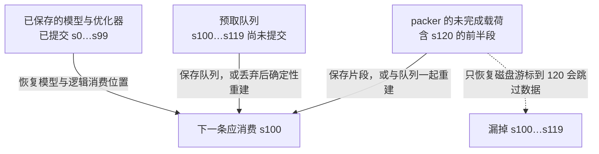

# 训练一次更新：从原始语料到一次提交的参数

[从这里开始](<../00 从这里开始.md>) · 前提：基础 [01 我们究竟在优化什么](<../基础/01 我们究竟在优化什么.md>)、[03 一张卡放不下跑不完以后](<../基础/03 一张卡放不下跑不完以后.md>) · 用到的算法：[五笔账 §1–§4](<00 五笔账.md>)

这篇跟踪一次参数更新的全程。前一半是数据怎样变成这次更新的监督信号：保留哪些材料，看到多少次，每次贡献多大，怎样装进设备。后一半是这次更新怎样在 64 张卡上执行：谁拥有哪份状态，缺的部分什么时候送到，最忙的参与者是谁，中断以后从哪里继续。

数据配方和分布式训练过去分在两篇。放在一起，是因为有几件事必须同时写对：packing 以后的损失分母，要靠分布式归并来保持；恢复时的数据游标，要和参数、优化器落在同一个更新边界上。只看一半，就会写出“各卡先平均再平均”这种同权错误。

> [!abstract] 读完这篇，你应该能判断
> - **数据价值要按达到同一独立验收的总成本比较。** 整理、教师、验证、配方搜索都要入账。
> - **去重、采样、损失加权控制的是三种不同的东西**：保留集合、实际曝光、已看到样本的更新贡献。
> - **分片节省的是指定对象的常驻副本。** 参数物化、激活、通信缓冲仍进入同一时刻的峰值。
> - **长序列的扩展最终受可隐藏窗口约束。** CP 度数加大，计算窗口比每轮消息缩得更快。
> - **恢复以“已经影响保存参数的样本”为准。** 读过、打包过、影响了参数，是三种不同的进度。

---

## 1 先决定保留集合

**获取。** 原始池缺少需要的任务或监督格式时，筛选只能在已有信息里取舍。AgenticDS（2026-10）把训练需求转成带硬约束的查询计划，再结合文本检索和模型—论文—数据集关系扩展候选，为每份候选保留进池的理由，未找到的元数据保持 unknown。【已核】它的 search-to-train 实验只覆盖三个领域、三个模型的受控微调。【作者数据】

**去重。** 【算例】代码库 A 被镜像十遍，B 只有一份。按文件均匀采样，A 占 10/11；合并镜像后，两者各占一半。去重同时改变了存储、重复曝光和领域权重。如果镜像中有一个修复版被错误合并，丢掉的是真实的变化。所以至少要保留原始对象、处理后文档、训练样本三层身份，以及“谁被哪份代表”的映射。[Dolma](https://arxiv.org/html/2402.00159v2)【已核】

精确哈希便宜，抓不到换行和模板变化；基于 n-gram 指纹的近似去重用召回和误合并，换取不必两两比较；长片段精确去重删掉跨文档重复的段落，保留文档其余内容；语义去重把不同措辞视为相似，容易把同主题的互补事实也合并掉。网页页脚和许可证反复出现时，片段级删除损失最小；任务需要比较相近实现的细微差别时，语义阈值过宽尤其危险。[去重原论文](https://arxiv.org/html/2107.06499v2)【已核】

过滤问的是“值不值得训练”，去重问的是“是否已经出现过”。教育分数高的模板仍可能重复；罕见的专业文本也可能因为写法不规范被低分过滤，丢掉长尾知识。训练内部去重和“训练集与验收集去污染”也是两件事。

**修复而不是删除。** ReScraper（2026-09）先给渲染后的网页逐行编号，提出删除指令，再选择保留、删除、局部编辑或整页重写，由确定性执行器应用；三个教师的操作被蒸馏到一个 0.6B 模型。【已核】大多数页面只生成短指令，破碎内容才承担整页重写的成本。作者从同一网页池出发、固定三种规模的预训练预算、接相同去重，用 22 项下游评估比较过滤与修复，实验限于指定英语池和最大 2.8B 模型。【作者数据】

## 2 生成的数据要数所有尝试

清洗只能整理已有的信息。缺某类修复示范时，就要让教师生成，再验证。

**【算例】** 要交付 10 万条通过测试的修复轨迹，每次尝试平均输出 2000 token，验证保留率 20%。至少要 50 万次尝试、10 亿个输出 token，最终只保留 2 亿 token。按最终 token 数估算教师成本，会漏掉四倍的被拒输出，教师输入的 prefill 和测试执行还另算。成功率低的类别恰好是长文件和复杂依赖，按总体保留率估计又会进一步低估。

强教师单次贵，弱教师多候选再验证则尝试多、验证器可能成为瓶颈。测试便宜且能并行时，多候选划算；每次都要构建大型工程时，先用便宜检查淘汰明显错误，但便宜检查的误拒会改变保留集合。只生成容易验证的题，又会让语料离真实任务越来越远。

生成以后，同一题十个几乎相同的成功补丁不算十份独立覆盖，还要回到第 1 节的去重。在线 RL 的轨迹面对同样的问题，区别只在数据生产和学习是不是同时进行，见 [生成进入训练 §3](<08 生成进入训练.md#3 哪些轨迹进入了更新>)。

## 3 采样份额与损失权重

同一份代码换 tokenizer，token 数、切分边界、稀有标识符的表示都会变。以 token 预算固定训练量时，切得更碎的语料，模型实际看到的原始文件更少。新词表让代码 token 变少，训练同样多 token 就相当于增加了代码曝光；质量改善要分清是表示变好了，还是多看了内容。

**【算例】** 知识 K 和数学 M 两桶，按 7:1 采样，一批 800 个样本里约 700 个知识、100 个数学。把数学损失乘二，看到的仍然只是 100 个数学样本；改成 7:2 采样，则约看 178 个。两种做法都增加了数学的贡献，但前者只放大了已有梯度的幅值，后者增加了覆盖。对独立抽样的简化估计，领域均值梯度的方差与样本数成反比。

写成目标函数：$J(\theta)=\sum_i p_ia_i\,\mathbb E_{x\sim\mathcal D_i}[\ell(\theta;x)]$，$p_i$ 是采样份额，$a_i$ 是损失系数。7:1 配比、相对权重 1:2，可以归一成 $a_K=8/9$、$a_M=16/9$，使平均系数为一。这控制了系数的量级，但**不保证梯度范数不变**：不同领域的梯度大小、方向和相关性都不同，Adam、Muon 还会对混合后的梯度做非线性变换。

LARE（2026-10）在曝光固定的前提下调整贡献：记录各领域未加权损失和有效目标数的滑动平均，预热后令 $r_i=(\bar\ell_i+\epsilon)^{-1/2}$，再用监督 mask 后的损失 token 份额归一化，于是损失较低的领域得到较大系数。【已核】作者在 1.5B 模型、固定数据流和 mask 下比较了阶段顺序、直接混合与重加权，多数结果是单次运行，墙钟时间、峰值显存和跨规模的同质量成本还没回答。【作者数据】

## 4 装满设备，同时保持学习目标

**【算例】** 长度 128 的独立样本，每条填充到 4096，长度利用率只有 3.125%。把 32 条装进同一个序列，线性层就不再处理填充位置。但如果还用一个普通因果 mask，第 20 条就会看到前 19 条：EOS 只是一个可见的 token，挡不住注意力。目标是独立样本时，必须用分段或块对角的因果关系，并相应处理位置、标签移位和边界 loss。

mask 正确和避免无用计算是两项检查。可变长 Attention 按真实段长计算，位置对约 $\sum_js_j^2$；只给一个长稠密矩阵加 mask，结果正确，执行成本仍接近 $(\sum_js_j)^2$。

**全局分母。** 【算例】两张卡各有 100 和 900 个有效监督位置，本地平均损失为 $l_1$、$l_2$。全局 token 均值应是 $(100l_1+900l_2)/1000$，不是 $(l_1+l_2)/2$。分布式框架默认对梯度取平均时，本地损失的缩放必须和这个约定配合；梯度累积要以整次更新的有效位置总数为分母。改了 packing 或 CP，本地有效位置数就变了，旧的隐含缩放不能沿用。

为了装得更满而把长度相近的样本聚在一起，也会改变更新顺序、来源共现和噪声。保留足够大的 shuffle 缓冲可以缓解，但它的内存、随机读和恢复成本要计入。

## 5 谁拥有哪份状态

**【算例】** 32B 参数，64 张 80 GB 的卡。BF16 参数和梯度各 2 bytes，FP32 主参数和两个 Adam 状态各 4 bytes，每参数 16 bytes，共 512 GB。64 卡完全分片，常驻均摊 8 GB；只在节点内 8 卡分片、节点间复制，每卡 64 GB，只剩 16 GB 给激活和临时对象，长序列可能再次超限。

8 GB 和 64 GB 只是常驻基线。峰值要加上同一时刻还活着的东西：

$$
V_{\rm peak}=\text{本卡常驻的权重、梯度、优化器}+A_{\rm live}+V_{\rm materialize}+V_{\rm workspace}.
$$

参数分片以后，本层仍要读到它需要的权重，通常靠 AllGather 物化；梯度相加以后只留给所有者，用 ReduceScatter。[ZeRO](https://arxiv.org/html/1910.02054v3)【已核】预取太早，同时保留更多完整层；太晚，又要等通信，所以预取距离本身是容量和等待之间的选择。

HyperParallel-FSDP（2026-09）利用快域和慢域的差别：节点内逐参数发送，省掉打包拷贝；慢域里融合梯度消息、放进待完成队列，到更新前统一结算。【已核】它还提醒分片要尊重优化器作用的对象：Muon 对整个矩阵梯度做变换，任意切碎以后各自变换会改变算法。作者在 Atlas 900 A3 上比较的是整套系统，最大规模的演示没有匹配基线。【作者数据】

**层内切分欠的是部分和。** 张量并行把两层 MLP 的中间宽度切开：每卡算出的 $Y_i=Z_iW_{2,i}$ 只是部分和，完整输出是 $\sum_iY_i$。序列并行再把 LayerNorm 这类逐位置区域按位置切开：进入列切分前 AllGather，第二个矩阵后 ReduceScatter，两者组成原来 AllReduce 的两半。[Megatron-LM](https://arxiv.org/html/2104.04473v5) · [SP 与选择性重计算](https://arxiv.org/html/2205.05198v1)【已核】检查分布式图时，对每条边问一句：这是最终值还是部分和，哪个轴还欠一次求和？漏一次归并，少算贡献；多一次，梯度被放大。

**交给另一种布局。** 训练完的权重要交给用另一种 mesh 的生成池时，保留的是同一个逻辑张量，变的是每个 rank 拥有的区域。先拼齐再广播，会传送接收者最后丢弃的部分；按两端分片的交集直接搬运就能避免。NVIDIA 的 Reshard Collective（2026-11）展示了这条路线，具体契约限于等大连续本地块、一或二维 mesh 等条件。【已核】交接之后的数值和缓冲问题见 [生成进入训练 §5](<08 生成进入训练.md#5 权重交接：数值契约与物理传输>)。

## 6 长序列与流水：窗口还够吗

**【算例】** 某注意力层 $d=4096$、32 个查询头、8 个 KV 头，序列 131072，单序列 BF16。一层 K 和 V 共 512 MiB；完整得分矩阵则是 1 TiB。FlashAttention 不物化这个矩阵，但全局位置交互的计算一点没少。上下文并行（CP）让不同卡负责同一序列的不同位置，本地 query 仍要读远端的 K/V。环形方法把 KV 块逐轮传来，每块计算后合并在线 softmax 的统计量。[Ring Attention](https://arxiv.org/html/2310.01889v1)【已核】

**【算例】** 有效算力 200 TFLOP/s、单向带宽 50 GB/s，看一个完整的非因果矩形块：

| 序列与 CP 度数 | 每个 KV 块 | 块计算 | 块传输 |
| --- | --- | --- | --- |
| 131072，CP=8 | 64 MiB | 22.0 ms | 1.34 ms |
| 131072，CP=64 | 8 MiB | 0.344 ms | 0.168 ms |
| 8192，CP=8 | 4 MiB | 0.086 ms | 0.084 ms |

每块计算随 $1/P^2$ 缩小，KV 块随 $1/P$ 缩小，环要走约 $P$ 轮。每卡的总通信趋向一份完整 KV，计算却继续下降，于是“每卡工作更少”逐渐变成“通信藏不住”。短序列的第三行已经几乎没有余量。Ulysses 式 All-to-All 换一种组织：交换后每卡持有全序列、部分 head，算完整 Attention 再换回来，减少反复轮转，但要求高效 All-to-All，head 数和整除关系也限制并行度。[Ulysses](https://arxiv.org/html/2309.14509v1)【已核】

**流水的气泡。** 【算例】理想的平衡流水有 $p$ 个阶段、$m$ 个微批时，简单填充排空的有效比例是 $m/(m+p-1)$，$p=8$、$m=32$ 时约 82.1%。这只在各阶段等时、忽略通信时成立；1F1B 和交错调度会改变在途激活和气泡，增加微批又可能让每次 GEMM 过小。

**相同 token 数，不同工作量。** 16 条 8K 序列和一条 128K 序列都是 128K token，全局 Attention 的平方项却差 16 倍。流水并行里，一个慢微批会沿多个阶段传播等待。HyDra（2026-09）把负载估计从 token 数改成接近 $\sum_is_i^2/P_i$ 的工作量，据此动态安排 CP 和 packing，组合内层 Ulysses 和浅外环，Q/K/V 各自满足依赖时分别发起交换。【已核】作者在 2048 张 H800 上观察到微批离散度和流水气泡一起下降；更大规模的结果含模拟。【作者数据】

**剩下的激活：重算还是卸载。** 【算例】某激活 1 GiB，链路 50 GB/s，卸载再读回的带宽下界约 42.9 ms；重算相关子图 20 ms。两者都完全暴露时，重算更好；前向到反向之间有足够独立工作时，传输可以提前完成，卸载的暴露时间可能小于 20 ms。所有层同时卸载、同一链路还在搬检查点时，就不能按 50 GB/s 估计了。

## 7 专家：平均负载失去预测力

**【算例】** 4096 个 token，64 个专家，每 token 选 2 个，平均每专家 128 行。某个专家实际收到 512 行，同一层就要等它。容量因子 1.25 给每专家 160 行上限，热点部分要丢弃、重路由或用别的溢出语义；不丢弃的变长执行保留所有分配，要承受动态缓冲、小 GEMM 和最忙专家的尾部。两种做法都要报告路由负载、实际保留的 token 和任务质量。

MoE 的参数账和计算账是分开的。【算例】64 个专家各 100M 参数，总容量 6.4B；每 token 选 2 个，只经过约 200M 专家参数的计算。BF16 专家权重仍约 12.8 GB，要驻留或分片保存。

强行均衡可能压制有用的专业化，放任热点又浪费其他设备；复制专家减少热点等待，要付容量；限制可到达的节点减少网络范围，也收窄了选择。DeepSeek-V3 的共享与路由专家、均衡和节点限制，是这些选择的一种组合。[DeepSeek-V3](https://arxiv.org/html/2412.19437v2)【已核】

**【算例】** dispatch 的全组逻辑输入约 $4096\times2\times4096\times2$ bytes = 64 MiB，combine 还有约 64 MiB，反向另算。这是全组被路由行的总量，不是每卡消息量。把 EP 域从节点内扩到节点间，就要重新回答这些消息能不能在专家 GEMM 之前到齐。扩大通信域只解决了“能把 token 送得更远”，没有给热门专家增加算力。小专家怎样在一个 kernel 里调度见 [算子与编译 §4](<05 算子与编译.md#4 大小不同的专家>)，dispatch 和 combine 怎样与计算重叠见 [数据移动 §4](<04 数据移动.md#4 把通信藏进计算，以及藏不住的时候>)。

## 8 从已提交的更新继续

**【算例】** 逻辑样本流 $s_0,s_1,\ldots$。检查点里的模型已经消费到 $s_{99}$；loader 预取到 $s_{119}$；packer 又把 $s_{120}$ 的前半段放进了还没交付的 pack。

**读过、打包过、影响了已保存参数，是三种不同的进度。** 只保存磁盘游标 120，会漏掉 $s_{100}$ 到 $s_{119}$；从 100 重读、又恢复了旧的预取队列，就会重复。预取可以保存，也可以丢弃后从提交点确定性重建，但两种方法不能混用。在梯度累积的中间保存，还要保存累积梯度和子步，否则就退回上一个完整更新。

换了 rank 数，物理游标就失效了：旧 rank 的第 10 个分片不对应新 rank 的第 10 个分片。按逻辑编号重新分派能保留消费集合；如果还要求同一步的组成和顺序不变，就要保持全局批次的定义。同一更新边界上，参数、优化器、步数、随机状态、数据游标和分片描述要一起恢复，见 [持续交付 §3](<10 持续交付.md#3 失效之后恢复哪一次更新>)。

**结算总账。** 回到开头的问题，处理得更精细值不值得：

$$
C(Q)=C_{\rm acquire}+C_{\rm curate}+C_{\rm teacher}+C_{\rm verify}+C_{\rm search}+C_{\rm train}(D_Q)+C_{\rm eval}.
$$

ReScraper 在指定英语网页池上每池运行 494 H200 GPU 小时，同文的 ProX-C 和 UltraX 分别是 147 和 180；教师标注和两阶段 SFT 另有 642 小时一次性成本。【作者数据】小整理模型省下了反复调用教师的那部分，但胜负还取决于复用多少轮，以及达到同一质量能省多少训练。

**【算例】** 规则管线每轮整理 100 GPU 小时、训练 4000；学习型整理器先花 600 小时，每轮整理 400、训练到同一质量 3200。第一轮 4100 对 4200；跨 $m$ 轮比较 $4100m$ 与 $600+3600m$，第二轮才改变胜负。3200 是假设的同质量训练成本，不是由保留率推出来的，也不是上面任何一份材料的实测。它指出了还缺哪一项实验。

## 9 结论在什么时候反过来

| 你原本的判断 | 什么条件下反过来 | 先查什么 |
| --- | --- | --- |
| 去重越狠越好 | 误合并了修复版、长尾或互补事实 | 抽查误合并；按领域看保留变化 |
| 把损失乘二等于多看一倍 | 只放大了已有样本的梯度 | 实际曝光数 vs 损失系数 |
| packing 只是填满设备 | 普通因果 mask 让样本互相看见 | 可见范围和全局损失分母 |
| 全分片最省显存 | 物化、激活、缓冲同时存在 | 同一时刻的峰值，不是常驻 |
| CP 加大，每卡更轻松 | 序列不够长，计算窗口盖不住通信 | 块计算与块传输之比 |
| token 数相同，负载相同 | 长度分布不同，平方项不同 | $\sum s_i^2$，不是 $\sum s_i$ |
| 平均每专家 128 行 | 热点专家收到 512 行 | 最忙专家的行数 |
| 恢复磁盘游标就能继续 | 有预取和未完成的 pack | 已影响保存参数的最后一个样本 |

## 证据

| 正文判断 | 标记 | 证据卡或来源 |
| --- | --- | --- |
| AgenticDS 的获取与核验 | 【已核】/【作者数据】 | [AIINFRA-E-20261109-01](<../研究台账/来源与证据.md#AIINFRA-E-20261109-01>) |
| Dolma、去重路线、DataComp-LM | 【已核】 | [D01 证据 JSON](<../研究台账/evidence/D01.json>) |
| ReScraper 的方法、质量对照与每池成本 | 【已核】/【作者数据】 | [AIINFRA-E-20261104-21](<../研究台账/来源与证据.md#AIINFRA-E-20261104-21>) |
| LARE 的重加权规则与实验范围 | 【已核】/【作者数据】 | [AIINFRA-E-20261104-01](<../研究台账/来源与证据.md#AIINFRA-E-20261104-01>) |
| ZeRO、Megatron TP/SP、Ring Attention、Ulysses、DeepSeek-V3 专家设计 | 【已核】 | [D02 证据 JSON](<../研究台账/evidence/D02.json>) |
| HyperParallel-FSDP | 【已核】/【作者数据】 | [AIINFRA-E-20261104-02](<../研究台账/来源与证据.md#AIINFRA-E-20261104-02>) |
| HyDra 的平方负载估计与实验范围 | 【已核】/【作者数据】 | [AIINFRA-E-20261104-22](<../研究台账/来源与证据.md#AIINFRA-E-20261104-22>) |
| Reshard Collective | 【已核】 | [AIINFRA-E-20261109-08](<../研究台账/来源与证据.md#AIINFRA-E-20261109-08>) |
| 10/11 镜像、50 万次尝试、7:1 与 7:2、3.125%、100/900、512 GB、CP 表、128/512 行、64 MiB、$s_{99}$/$s_{119}$、4100/4200 | 【算例】 | 作者设定，非实测 |

最近改写：本版首次成文，内容取自已发布版《训练数据与配方》《分布式训练与模型状态》和《模型结构与数值表示》的 MoE 部分，2026-11-23 无改写。
