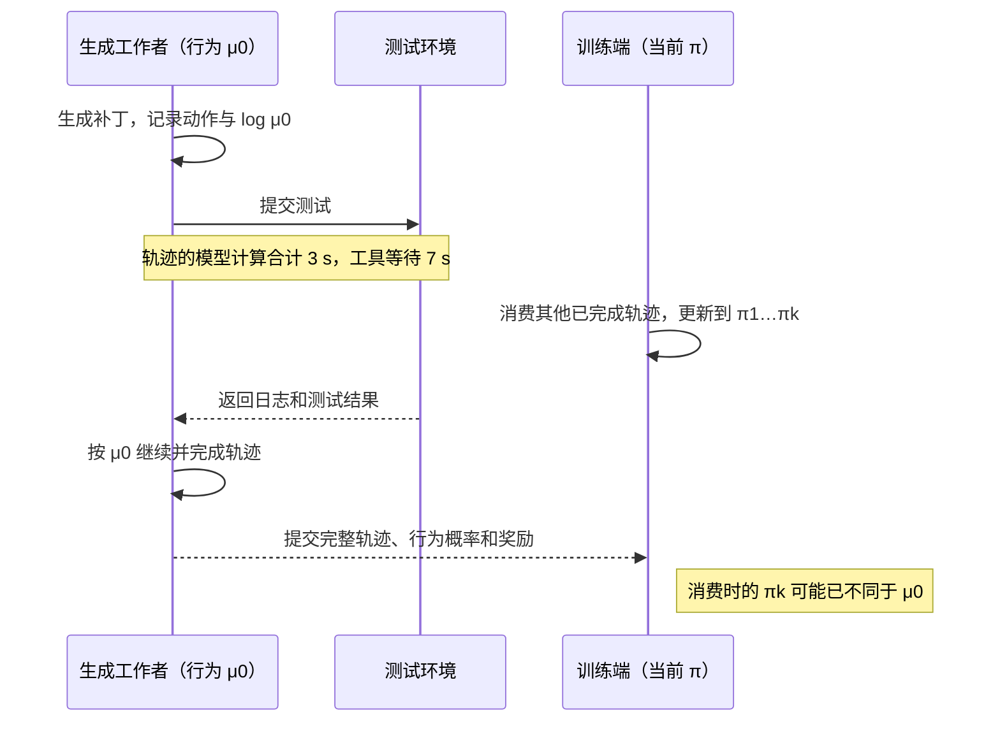

# 生成进入训练：一条轨迹怎样变成一次更新

[从这里开始](<../00 从这里开始.md>) · 前提：基础 [07 当生成结果又参与模型更新](<../基础/07 当生成结果又参与模型更新.md>) · 用到的算法：[五笔账 §3 提交点](<00 五笔账.md#3 提交点：什么时候算完成、何时能释放>)、[§4 分母](<00 五笔账.md#4 分母：吞吐、goodput 与同质量成本>)

这篇跟踪一条带工具等待的 RL 轨迹：代码助手读代码，写补丁，调用测试，读回错误，再修改，最后结束。它在生成池里产生，被评分，被送进训练池，参与一次更新，更新后的权重再发回生成池。这条闭环里，调度决定先消费谁，这直接改变了训练数据；权重交接要同时满足数值和物理两份契约。

后训练的路线很多：给正确示范，让人比较两份回答，让模型试错并接受反馈，或者权重不动、按次多生成几个再挑。它们都在花计算改善结果，付费的位置不同：数据生产、模型更新、环境反馈，或者每次请求的额外求解。

> [!abstract] 读完这篇，你应该能判断
> - **先固定独立的验收，再比较路线。** 完成率、完成子集的通过率、全体限时成功率要分开报告，失败的尝试也进成本。
> - **为了吞吐丢掉慢样本，改变的是学习分布。** 组内相对方法里，丢掉三个失败回答会改变剩余回答的更新权重。
> - **异步把资源等待藏起来了，但样本照样变旧。** 要保留完整轨迹、真实的行为概率和实际消费的集合。
> - **权重交接有两份契约。** 同一权重下两端概率对齐，依赖执行组合；快速搬运，依赖布局和缓冲寿命。
> - **训练和按次求解按调用规模竞争。** 高频稳定任务更容易收回蒸馏投入，低频难题更适合按次花搜索预算。

---

## 1 先规定成功与预算

**【算例】** 100 道题，方案甲完成 80 道、通过 60 道，完成子集通过率 75%，整体限时成功率 60%；方案乙完成 100 道、通过 70 道。按整体限时成功率比，乙更好。两个指标回答不同的问题，报告时还要给出失败种类和已经付出的计算。

独立质量至少要和训练反馈隔开。训练奖励来自公开单元测试，最终验收就要加入没参与训练的测试和问题；训练依赖 reward model，验收就要有和训练评分器分开的依据。还应保留容易暴露策略缺陷的分层：长上下文、多轮工具、当前几乎不能成功的题、原有能力的回归。

预算也要对上实际消耗：实际输出 token 和长度上限分开，工具和 verifier 调用与采样次数分开。论文里从多个 checkpoint 里取最好结果，可以描述“曾经达到什么”，部署一个固定终点时，挑选的成本要算进去。

## 2 示范、偏好与测试结果

**有正确补丁：SFT。** 把提示和目标补丁一起输入，预测每个目标 token，目标是 $-\sum_t\log\pi_\theta(y_t\mid x,y_{<t})$。已知的回答不需要逐步采样，多个位置可以在一次因果前向里求概率。提示和测试日志通常只作条件，是否监督它们要写进 mask。

**只有“A 比 B 好”：偏好优化。** DPO 在同一提示下比较两条完整回答相对参考策略的概率：

$$
z=\beta\left[\log\frac{\pi_\theta(y^+|x)}{\pi_{\rm ref}(y^+|x)}-\log\frac{\pi_\theta(y^-|x)}{\pi_{\rm ref}(y^-|x)}\right],\qquad L=-\log\sigma(z).
$$

它提高胜方相对参考策略的优势，不是把胜方当成唯一的正确答案。[DPO](https://arxiv.org/html/2305.18290v2)【已核】已有离线偏好对时，更新不必在线生成，也不必另训 reward model；但偏好若来自旧模型，就只覆盖那批回答能表达的比较，探索不到没出现过的解。也可以先训 reward model，再让策略在线生成、评分、更新，即 InstructGPT 的 RLHF 流程。[RLHF](https://arxiv.org/html/2203.02155v1)【已核】

**只能运行测试：在线 RL。** 策略提出补丁，环境返回奖励，再调整行为。终局的测试结果只说明整次尝试的好坏，不说明哪一步该被强化，这是信用分配问题。过程评分给更密的信号，要付标注或 verifier 的成本；价值模型用状态预测剩余收益，增加了训练状态和拟合误差；组内相对基准不需要 critic，但需要同一题的多个候选，全部同分时又没有相对信息。

三条路线的条件很具体：高质量示范覆盖充分，SFT 省探索；人擅长相对判断、写不出完美示范，偏好有价值；反馈便宜、策略还需要发现新行为，在线 RL 合适。测试很贵、奖励稀疏、当前模型几乎不能成功时，扩大 rollout 未必比先补示范更好。

## 3 哪些轨迹进入了更新

**【算例】** 同一题采 8 个回答，2 个奖励为 1，6 个为 0。按组内总体标准差归一，均值 0.25，成功项的优势约 1.732，失败项约 -0.577。

> [!warning] 反例：为了吞吐丢掉三条慢的，训练分布就变了
> 【算例】三个失败回答因为耗时太长被丢弃，剩下 2 个成功、3 个失败，均值变成 0.4，归一后优势约 1.225 与 -0.816。这不只是省了三次执行：剩余回答的更新权重变了，训练也偏向了容易完成的轨迹。

超长、工具出错、编译失败、基础设施超时，不能统一设为零或统一忽略。补丁没通过规定测试是任务失败；测试服务宕机是结果未知，应该重试或单独记账；达到明确的输出上限属于协议内截断，换了上限就换了任务。按回答平均和按有效 token 平均会给长回答不同的权重，不能在 batching 优化里悄悄替换。这和数据配方里“曝光”与“损失权重”的区分是同一件事，见 [训练一次更新 §3](<07 训练一次更新.md#3 采样份额与损失权重>)。

记录要从“准入题目 → 生成候选 → 完成环境 → 有效评分 → 实际消费 → 提交更新”逐层留下数量和成本。只对完成子集报 reward，系统性漏掉的难题很容易被误读成学习进展。

配方若规定了来源比例，提前消费也要给配额留空间。KnitTrans（2026-10）在 minibatch 准入时检查剩余容量能否满足剩余配额，再按训练拓扑组织轨迹读取，让“快样本先到”和“规定来源比例”同时进入调度决策。【已核】

## 4 异步让两个策略同时存在

**【算例】** 一条轨迹有 3 秒模型计算和 7 秒工具等待。一直占着独享 GPU，等待窗口就浪费了；挂起它，又要保留或能恢复上下文、工具执行身份和取消状态。

同步执行先生成、再更新，行为和更新目标容易对齐，但生成卡和训练卡交替空闲。异步让训练继续消费已完成的轨迹，其他轨迹同时等待或生成。

重叠省掉了资源等待，却没有让这条轨迹变年轻。它进入更新时，需要说明为什么行为 $\mu_0$ 产生的数据可以用于当前的 $\pi_k$。版本差只是一个代理量：十个小更新未必比一个大更新偏得更多；同一权重的采样端和训练端，也可能因为 dtype、kernel、mask 或采样变换不同而给出不同的概率。所以要保存行为策略的身份、实际 logprob、temperature/top-p 等协议，以及训练端对同一 token 序列的概率。

CadenceRL（2026-09）把挂起的轨迹按行为版本保存，让它回到同版本 worker 继续；长上下文暂时迁出、短上下文填入，最后集中排空尾部，用准入 credit 控制整体在途量。【已核】作者为隔离 rollout 瓶颈给 trainer 留了余量，质量检查限于 Qwen3-8B 的 30 次迭代平均 reward。【作者数据】

## 5 权重交接：数值契约与物理传输

**数值契约。** 控制同一权重下两端的数值差异，可以减少实现漂移带来的偏差。TitanRL（2026-11）共用模型定义，把 batch-invariant 模式约束到两端 BF16 前向、训练端 FP32 主参数、相同 TP 度数并禁用 SP；attention、logprob 和归约路径也要匹配，关闭 TF32 和低精度归约，固定 NCCL 的树和 channel。【已核】这份契约会穿过缓存布局：它的 Kimi K3 路径里 K 和 V 的 head 大小不同，按 K 的大小估算 V 页面会留下 padding，再和 attention kernel 的固定 block 拆分冲突，修复办法是补入真实的 V 维。【已核】也就是说，数值对齐要由模型、缓存和 kernel 一起实现。相关 GPU 验证限于维护者的 GB300 短程测试。

**物理传输。** 两端的分片布局在初始化时已知，于是可以提前规划每个生成 rank 需要的分片交集：训练端把转好精度的片段放进注册过的页锁定主存缓冲，生成端用单边读取把它们读到自己的预取区，省去每步通用对象存储的查找和元数据交换。2026-11-17 起，这条 NIXL 路径成为 CPU 预取模式的默认。【已核】

同一天，TitanRL 取消了训练端为读取连续性做的重分布 collective，改由生成端先紧密接收片段、再按目标位置拷回模型。**布局的代价从训练端转到了生成端**：传输字节不变，读取次数、非连续拷贝和暂存峰值可能增加（作者单机微基准里一例读取数从 291 增至 355，字节相同）。【作者数据】当前实现要等这次拷贝完成，才允许下一次读取覆写预取区；读取超时不会取消在途传输，文档要求重启作业。【已核】这和 [数据移动 §3](<04 数据移动.md#3 交接完成有四个时刻>) 的源端复用、[历史状态 §7](<02 历史状态.md#7 迁移与取消：什么时候能回收>) 的在途访问是同一类问题。

使用边界按组合区分：CPU 预取默认走 NIXL，GPU 获取模式仍走原存储路径；可选的 Mooncake 后端需要一个晚于安装脚本所锁 PyTorch 版本的修复，相关迁移 PR 尚未合入。【已核】

**版本契约。** 权重发布以后，正在生成的轨迹还要选择自己的版本规则。Spindle（2026-10 beta）让多个 LoRA 实验共享基座，一个实验等生成时安排另一个；它的 exact 模式要求轨迹生成的起止版本都等于指定版本，latest/minimum 模式允许满足下限的跨版本轨迹。【已核】用跨版本模式时，动作概率、KV 和所选的学习目标要对应。

## 6 旧数据：修正分布还是改变目标

令 $\mu$ 为真实的行为分布，$\pi$ 为当前目标策略。完整轨迹的重要性比是逐位置概率比的乘积，$\log w=\sum_t(\log\pi-\log\mu)$。

**【算例】** 每 token 的对数概率差都是 0.02，20 个 token 的轨迹比值是 $e^{0.4}\approx1.49$，1000 个 token 是 $e^{20}\approx4.85\times10^8$。实际差值有正有负，这只说明很小的逐位置差异会沿长轨迹累积。只用当前位置的概率比，一般不能恢复旧策略产生的前缀分布；完整轨迹比又可能方差极大。

裁剪比值、删掉异常位置、限制策略年龄，都能降低不稳定性，也都改变了估计或接受的集合。PPO 对概率比做裁剪，使用时要给出行为概率、旧策略和裁剪位置。[PPO](https://arxiv.org/pdf/1707.06347v2)【已核】【算例】权重 $[1,1,1,9]$ 的有效样本量 $(\sum w)^2/\sum w^2=144/84\approx1.71$：四条轨迹也可能只相当于不到两条的贡献。

另一种选择是直接围绕滞后的行为策略定义目标。OAPL（2026-02）用 KL 正则化约束策略相对行为分布的偏离；简化到整条回答的奖励 $R$，理想最优分布为 $\pi^*\propto\mu e^{R/\beta}$，于是 $\beta\log(\pi^*/\mu)=R-V^*(x)$。它从一组行为样本估计 $V^*$ 并回归这个关系，避开了完整的重要性乘积。【已核】

> [!warning] 反例：样本数优势要换算成实际成本
> OAPL 的代码实验过滤掉了没有正确回答的 prompt，并从多个 checkpoint 选最好的；在 279 个 LiveCodeBench 问题、每题 20 次采样的比较里，约 200K 与约 650K 次生成之间还有长度差异，作者也没有复现对照方法原报告的 60.6%。【作者数据】样本数少，不等于实际生成、环境和更新的成本少。

## 7 训练哪些参数，或干脆按次求解

**全参还是适配器。** 【算例】$4096\times4096$ 矩阵全参更新有 16,777,216 个参数；LoRA 写成 $W=W_0+BA$，rank 16 时只训练 131,072 个，约 1/128，优化器和梯度状态也随之下降。[LoRA](https://arxiv.org/html/2106.09685v2)【已核】但 $W_0$ 仍要加载和计算，训练前面层的适配器时，反向还要穿过后面的冻结基座传递梯度。省下的是基座权重的梯度，不是整个反向。未合并的适配器增加分支执行和版本身份，合并后又是另一个权重制品，见 [持续交付 §5](<10 持续交付.md#5 发布单位是一个组合>)。

**多算当前这道题。** 权重不变，也可以多采样、串行修订或搜索。【算例】独立候选各以 0.2 的概率正确、有完美验证器时，4 次至少一次正确的概率是 $1-0.8^4=0.5904$。这是 oracle 的机会，不是现实中 best-of-4 的成功率：候选相关、验证器误判、选择器偏好长回答，都会让可交付的质量更低。[推理计算分配研究](https://arxiv.org/html/2408.03314v1)【已核】这些方法主动改变输出分布，和 [一轮生成](<01 一轮生成.md>) 里保持分布的投机加速是两回事，收益要分开记账。

**蒸馏把成本提前。** 【算例】离线蒸馏多花 1000 GPU 小时，教师每任务 2 GPU 秒，学生 0.5 秒，二者达到同一验收。多出来的 360 万设备秒，要靠每任务省 1.5 秒收回，约需 240 万次任务。学生质量达不到验收时，部署量再大也换不来同质量的节约。稳定高频的任务更容易收回蒸馏投资，低频难题更有理由按次花搜索预算，领域快速变化会削弱静态蒸馏的摊销。

## 8 结论在什么时候反过来

| 你原本的判断 | 什么条件下反过来 | 先查什么 |
| --- | --- | --- |
| 完成子集通过率高就更好 | 完成率低，难题被系统性漏掉 | 整体限时成功率 |
| 丢掉慢样本只是省时间 | 组内相对方法；慢的恰好是难题 | 剩余回答的优势和来源比例 |
| 异步提高了利用率，也就提高了学习效率 | 行为策略和当前策略差得多 | 实际 logprob 和策略年龄 |
| 同一份权重，两端概率一样 | dtype、kernel、TP、归约路径不同 | 两端对同一序列的概率 |
| 权重传输字节不变，代价不变 | 读取次数和非连续拷贝增加 | 生成端的拷贝和暂存峰值 |
| 样本效率高的方法更省钱 | 生成长度不同，checkpoint 挑选未计入 | 换算成实际生成和更新的总成本 |
| LoRA 省掉了大部分计算 | 基座前向和反向梯度传递仍在 | 可训练状态 vs 仍存在的前反向 |
| 多采样能把 pass@k 变成成功率 | 验证器不可靠、候选相关 | 选择器选中正确答案的比例 |

## 证据

| 正文判断 | 标记 | 证据卡或来源 |
| --- | --- | --- |
| DPO、PPO、LoRA、推理计算分配的机制 | 【已核】 | [D03 证据 JSON](<../研究台账/evidence/D03.json>) |
| InstructGPT 的 RLHF 流程 | 【已核】 | [来源与证据 · 机制基线来源](<../研究台账/来源与证据.md#机制基线来源>) |
| KnitTrans 的配额准入 | 【已核】 | [AIINFRA-E-20261026-04](<../研究台账/来源与证据.md#AIINFRA-E-20261026-04>) |
| CadenceRL 的节奏控制与实验范围 | 【已核】/【作者数据】 | [AIINFRA-E-20261104-03](<../研究台账/来源与证据.md#AIINFRA-E-20261104-03>) |
| TitanRL 的数值契约与 V 维页面修复 | 【已核】 | [AIINFRA-E-20261109-04](<../研究台账/来源与证据.md#AIINFRA-E-20261109-04>) |
| TitanRL 的预规划单边读取、布局代价转移、超时与依赖边界 | 【已核】/【作者数据】 | [AIINFRA-E-20261123-06](<../研究台账/来源与证据.md#AIINFRA-E-20261123-06>) |
| Spindle 的版本模式 | 【已核】 | [AIINFRA-E-20261026-03](<../研究台账/来源与证据.md#AIINFRA-E-20261026-03>) |
| OAPL 的目标构造与评估反例 | 【已核】/【作者数据】 | [AIINFRA-E-20261104-23](<../研究台账/来源与证据.md#AIINFRA-E-20261104-23>) |
| 80/60 与 100/70、1.732/-0.577 与 1.225/-0.816、3 s/7 s、$e^{20}$、1.71、1/128、0.5904、240 万次 | 【算例】 | 作者设定，非实测 |

最近改写：2026-11-23，§5 加入 TitanRL 默认读取路径和布局代价转移。见 [2026-11-23 进展 §3](<../进展/2026-11-23.md#3 状态变化：对正在用这些系统的人有用>)。
