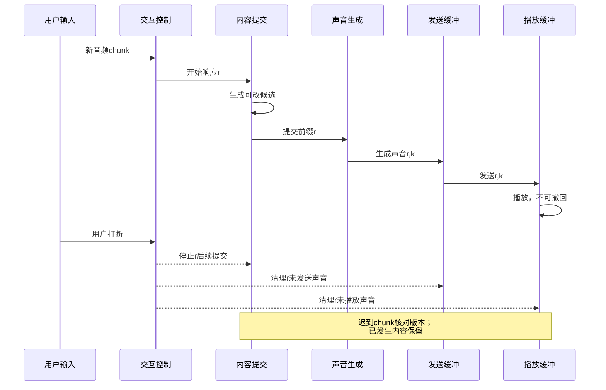

# 模型之外的任务：输入怎样变成工作，输出怎样变成事实

[从这里开始](<../00 从这里开始.md>) · 前提：基础 [08 当请求变成多模态任务与 Agent](<../基础/08 当请求变成多模态任务与 Agent.md>) · 用到的算法：[五笔账 §1 关键路径](<00 五笔账.md#1 关键路径：并行时什么相加>)、[§3 提交点](<00 五笔账.md#3 提交点：什么时候算完成、何时能释放>)

这篇跟踪一个复杂请求：用户交来一段演示视频，要求找出变化、查资料，并且边讲解边生成示意片段。它会穿过视觉编码、语言生成、画面生成、实时语音、工具执行和检索，每一段都有自己的状态和时间要求。最后，生成的画面不再交给人看，而是交给机器人策略作为下一次观察。

多模态、Agent、流式和检索推荐过去分在两篇。合在一起，是因为它们共用两个问题：模型之前，输入怎样变成工作，哪些信息在这一步就已经丢掉了；模型之后，输出什么时候变成已经发生的事实，再也不能回滚。

> [!abstract] 读完这篇，你应该能判断
> - **按阶段实际消费的对象安排资源。** patch、语言 token、去噪步、音频块、候选文档，数量和成本都不同。
> - **加速迭代有三种来源**：少走几步、用旧特征近似、多设备分摊。它们改变的条件不同，要在同一输出目标下比较。
> - **实时流同时受处理速率和提交边界约束。** 平均跟得上以后，还要限制慢块、播放积压和打断后迟到的输出。
> - **已生成、已提交、已发送、已播放、已执行的工具调用，是五个不同的终点。** 取消要沿着它们逐层生效。
> - **候选预算先决定下游能看见什么，再决定下游的成本。** 漏召回的东西，后面的强模型补不回来。

---

## 1 一帧图像变成几段工作

上传一个文件，并不直接得到语言 token：系统要解码、选帧或切块、编码视觉内容，再交给语言模型。Qwen2.5-VL（2025-02）给出一种具体的计算图：图像先调整到宽高为 28 的倍数，以步长 14 切 patch，经 ViT 以后，空间相邻的四个特征拼起来，经两层 MLP 投影到语言 embedding。【已核】

**【算例】** 448×448 的输入对应 1024 个 ViT patch，merger 后是 256 个视觉 token；896×896 则是 4096 和 1024。边长加倍，两种序列都变四倍，全局视觉注意力的配对数可能变十六倍，但窗口层、MLP 和语言侧的增长各不相同。

这给出两个不同的优化位置。降低输入分辨率，减少编码器位置，也减少后面的上下文，但可能丢掉细小的文字和局部证据；只加强桥接压缩，减少的是语言侧 prefill、KV 和注意力读取，不能反推编码器也同比少算。该报告多数视觉层用窗口注意力，但仍保留四个全局层，所以“窗口内随 patch 数线性”不能推广到整个编码器。【已核】图中要找的是细小表格时，缩小图像可能让答案直接不可辨；问题只问主体颜色时，最佳点又不同。

**两个队列。** 服务有独立的编码器队列和语言队列时，同样一句短文本附一张图和附一段视频，按文本长度路由会严重低估后者。编码器快、语言池堵时，提前无界编码只会积累大量特征；语言池快、编码器堵时，加语言副本救不了首响应。阶段之间的缓冲要设上限，并让下游的可用容量反馈到媒体接纳。缓存可以省去重复编码，但缓存身份要包含媒体内容、采样、分辨率、权重和预处理；换了帧率或裁剪，就不能把同一个文件路径当作等价输入。

## 2 生成画面：迭代依赖限制加速

去噪过程每一步都要用当前 latent 和条件，算出更新以后才有下一步的输入。三种加速改变的东西不同：把 30 步改成 10 步，改变了采样轨迹或训练目标；在 30 步里缓存部分特征，是用旧表示近似当前表示；把单步切到多设备上，是在分摊同一步的计算，只有它在保留全部依赖时才可能只改变执行。

DistriFusion（2024-02）让每张卡处理本块的 query，同时用覆盖整幅特征的 K/V：本块用当前激活，远块用前一步到达的激活，再通过异步 all-gather 补齐。【已核】这是一种带旧激活误差的近似分布式执行。作者在选定的 SDXL/A100 配置上比较了与原输出的相似度。【作者数据】多卡用于单请求能降延迟，多用户吞吐还要和多副本比。

**【算例】** 条件编码 100 ms，30 次去噪各 20 ms，VAE 与媒体输出 150 ms，共 850 ms。只把去噪降到 300 ms，总路径仍是 550 ms，约 1.55 倍，不是两倍。步数继续减少，权重 offload 的预取窗口也跟着缩短，原本藏住的搬运可能重新暴露。SGLang-Diffusion 的 2026-01 报告给出了组合按层预取、多种并行和特征缓存的工程实例。【已核】

## 3 声音按物理时间到来

视频和工具结果可以排队等，实时麦克风不会等。用户可能在系统讲解时继续补充问题；系统要一直接收，并在合适的时候让出或取得发言权。

Moshi（2024-09）把用户和系统的声音作为两条流，在同一时间轴上推进；每个时间点，大的 Temporal Transformer 先汇总历史，小的 Depth Transformer 再处理多个音频码本和文本。【已核】它的 12.5 Hz 时间步意味着每 80 ms 一个新时点，端到端延迟还要加上 codec 积累帧、模型执行和输出缓冲。

> [!warning] 反例：平均跟得上，仍会越积越多
> 【算例】输入每 80 ms 一帧，连续三帧各需 100 ms，待办就累积 60 ms。平均速率偶尔赶得上，也挡不住慢帧造成的抖动。跨会话组批能提高效率，但等批消耗的是每条流自己的余量。

StreamSE（2026-10）在冻结的因果 codec latent 中，把每帧的迭代采样换成一次回归，再反馈过去的量化输出；作者在手机单核、int8 条件下测完整的 codec、增强和 decoder 路径，以 80 ms 帧预算检查 p95。【已核】没有未来前瞻，仍要积累一个输入帧；热管理、有限状态窗口和分段重置共同限定了它能连续运行的条件。【作者数据】

Diffuplex（2026-10）把交互判断和内容生成分成两个时钟：自回归分支每个音频块判断交互状态，扩散分支取得发言权以后生成内容，二者共享权重、各有自己的 KV。开头少量 token 提前冻结并送入 TTS，其余部分继续去噪，用放弃修订开头换取更早开口。【已核】作者对照里，更积极的接话策略缩短了响应，却更容易误解犹豫和短暂停顿。【作者数据】

## 4 打断以后，什么还算发生过

用户打断时，取消要穿过文本、音频 token、波形和播放缓冲。只停止后续文本生成，队列里的旧声音可能继续播放；只清空输出缓冲，又会留下不该再提交的候选状态。



$r$ 是响应版本，$k$ 是声音块序号。系统要跟踪“已生成、已提交、已发送、已播放”四条边界和响应版本，拒绝迟到的旧 chunk，清掉还没播放的输出，同时保留应用需要的真实对话记录。Diffuplex 的具体规则会截断余音，一秒内中断就丢弃未说出的画布；这是作者实现的一种取舍，不是所有对话都适用的语义。【已核】输入感知如果也暂停了，模型甚至不知道应该停下。

因果缓存还要区分“分配了空间”和“完成了提交”。SGLang-Omni 的 Fun-CosyVoice3 案例（2026-10）为每个 Euler step、每一层分别保存完整因果块的 K/V 和卷积上下文，让同一步的前缀在不同输出 hop 之间复用，未完成的尾部留在分配区。【已核】它和“播放完成”“用户真正听见”仍是不同的事件。

回压不能简单地让所有方向一起暂停。文件转码可以让上游等；实时麦克风不会停止物理时间，积压只会让模型一直听见过去。限制生成并发、丢弃或降采样输入、降级模型、拒绝新会话，每个选择都改变质量或可用性，需要明确的策略。

## 5 工具调用改变关键路径

回到“查资料”那一步。模型先规划，“读文件”和“检索资料”如果互不依赖就可以并发，需要两者结果的下一次推理必须等它们都返回。调度器要区分“可提交、执行中、等外部结果、可恢复”这几种状态，而不是把工具等待算进 GPU 服务时间，再和长短请求放在一起排序。

协议转换也是执行链的一段。deepseek-recipe 把请求变成会话对象、编码成 token，再把流式输出解析回协议对象；它能构造输出约束，但约束解码要由后端实际执行，工具动作要由执行器校验和提交。【已核】格式能解析、解码受约束、动作已执行，是三个可以分别验收的终点。

**状态局部性和任务完成时间可能相反。** 先处理一个热会话能少做一次 prefill；但如果一个冷会话的结果会解锁十个后续步骤，它可能更接近整个任务的关键路径。HEAR（2026-10）在上层编排器和引擎之间交换这类信息：编排器提供意图、依赖和要求，引擎返回队列、缓存、能力和执行结果。【已核】作者实验保留了一个反例：缓存优先改善了中位数，却拖延了冷请求。【作者数据】接口提供的信息，和用这些信息做出的策略，要分开评价。

**副作用不能靠清 KV 回滚。** 父任务放弃以后，迟到的工具结果不能自动接进新的上下文。工具若已经写入外部系统，停止模型不会撤销那个副作用，重试还可能重复执行。应用需要幂等键或明确的补偿规则，推理服务清掉 KV 并不等于任务已经回滚。

## 6 画面成为下一次动作的输入

前面生成的示意视频是给人看的。生成的画面如果交给机器人策略作为下一次观察，图像误差就会通过动作进入之后的输入，评价要看“观察 → 动作 → 环境预测 → 新观察”这一整个闭环。

Uranus（论文 2026-09，官方解读 2026-11-19）用关节位置轨迹条件化的视频生成预测短段多视角画面，再交回策略。外部策略每次提供 4 个关节配置，模型预测一个 latent frame，再为每个相机解码 4 帧 RGB；它预测的是画面，不是从力矩积分运动。【已核】

会话状态因此包括三样东西：去噪 Transformer 的 KV、位置进度、VAE 的时序状态。公开的推理代码在多步去噪期间只读历史，帧求解以后才写入干净帧、修剪窗口、推进位置，随后 VAE 解码更新自己的状态。【已核】恢复会话时，这三者必须对齐到同一帧。论文还描述了 DiT/VAE 拆池、会话所有权和原子发布，但这一层完整服务的控制面没有核读。这是 [历史状态 §6](<02 历史状态.md#6 编辑、回滚与混合状态>) 所说“状态不止 KV”在视频生成里的一个实例。

作者在 RoboTwin 域适配以后，用 9 个策略 × 5 个任务 × 每任务 15 个 episode，比较 Uranus 和 RoboTwin 仿真的聚合策略成功率，Pearson 相关系数 0.98。【作者数据】这是两种仿真之间的相关系数，不是 98% 的真实机器人成功率。真实机器人迁移、物理接触、物体状态和长程漂移都还没有独立检验。

## 7 候选集合决定下游能看见什么

现在看“查资料”背后的检索。向量检索、倒排检索、结构化过滤和混合检索，差别首先在于保留什么信息，然后才是执行成本。

> [!warning] 反例：先取全局 top-100 再过滤
> 目标是“指定语言且有访问权限的 top-k”。先取全局 top-100，再过滤掉 99 个，最后只剩 1 个候选。reranker 可以细读这一个，却找不回从未被取回的合格对象。比较不同方法时，参考答案要来自同一个合格集合。

过滤、召回、排序改变的是三个不同的集合：过滤规定谁有资格，召回从中挑出愿意继续付费的对象，排序比较已经取到的候选。失败也就能定位：条件错了修过滤，相关对象从未进入候选修召回，取回了却排错修评分。换更大的下游模型，只作用于它真正拿到的输入。

**先算容量。** 【算例】$10^9$ 个 768 维、每元素 2 bytes 的向量，仅向量载荷就是 1.536 TB，另有索引、元数据和副本；缩到一百万个 128 维 FP32 向量，全量扫描约读 512 MB，大批量 query 可以复用这次读取，低延迟的单个 query 很难摊薄。

**近似搜索的两种误差。** IVF 把对象分进粗聚类，查询只扫描若干个 list。【算例】一百万个向量、1024 个 list 完全均匀、探测 8 个，平均约比较 7813 个；热点 list 和过滤会打破均匀假设。PQ 把向量拆成子向量、用码本编号表示。这里有两种不同的误差：对象根本没被访问，和已访问对象的量化距离改变了次序。增加 probe 只处理前一种。[Faiss 索引说明](https://github.com/facebookresearch/faiss/wiki/Faiss-indexes)【已核】

**多给候选，还是给每篇更少的内容。** ColBERT 式多向量交互保留更多局部关系，【算例】query 16 个表示、文档 128 个，一篇比较 2048 对，200 篇就是 409,600 对。【已核】Cohere 的 Rerank 5（2026-10）在一次重排调用中返回相关段落的字符区间，Context Focus 默认关闭，启用后用阈值和段落数上限控制内容。【已核】候选文档数和每篇保留长度由此成为两个预算：裁剪减少下游 prefill、KV 和累积上下文，也可能删掉必要证据。通过 OpenRouter 调用 Rerank 5 时不提供段落区间，需要段落输出要用 Cohere 自己的 API。【已核】给生成模型的上下文怎样计成本，见 [一轮生成 §3](<01 一轮生成.md#3 每个已提交 token 花了多少时间>) 和 [历史状态 §1](<02 历史状态.md#1 一个 token 的历史有多大>)。

**分路还是合并执行。** Hybrid GPU–CPU Retrieval（2026-09）把较深的个性化计算放在 GPU、较广的库存覆盖留给 CPU，合并候选后再排序。【已核】作者记录了一个离线相关性改善、在线结果反而退化的前例，原因涉及精确与量化 ANN、文本表示与下游过滤的不匹配。【作者数据】SilverTorch（论文 2025-11，工程报告 2026-05）走相反的路线，把 ANN、过滤、embedding 和重排表示为同一个 GPU 模型中的模块。【已核】它用 Bloom 近似过滤，允许误报，访问权限这类精确规则仍要复核。

## 8 查询读到的是哪一刻的数据

**【算例】** 一条用户行为发生在 10:00，10:07 才进入特征系统，一个预测样本的请求时刻是 10:05。只看事件时间，这条行为属于过去；按线上当时可知的信息，它还没到。离线训练直接加入它，就得到了线上拿不到的优势。Feast 的 point-in-time join 按样本时刻、特征时间和 TTL 约束历史连接。【已核】要重建“当时已知”，还需要保存到达和发布版本。

索引更新期间也要能查询。UBIS（2026-01）在对象分组分裂或合并时，用状态、版本和后继指针让并发更新找到新去向，过渡向量先进入可查询的缓存。【已核】作者单机实验里有召回率和吞吐提高、尾延迟变差的组合。【作者数据】迁移 embedding 模型时，新 query 和新索引必须在同一个空间里比较，通常要双写、重建、并行验证，再切换模型与索引的组合，见 [持续交付 §5](<10 持续交付.md#5 发布单位是一个组合>)。

## 9 推荐模型：通信跟着 ID 走

推荐系统还训练和查询实体 embedding 表，常见瓶颈是稀疏的随机读取，不是大矩阵乘。

```text
样本 b0: [2, 11]     b1: [7]     b2: [2, 5, 11]
values  = [2, 11, 7, 2, 5, 11]
offsets = [0, 2, 3, 6]
```

offsets 标出每段的起点，不必填充成等长矩阵。bag 求和时输出是各段所查行向量的和，反向时同一 ID 的梯度要累积到同一参数行。[TorchRec 机制](https://meta-pytorch.org/torchrec/concepts.html)【已核】按表分片让一张表在本地完成，但大热表会压满单卡；按行分片分散容量，需要路由 ID 和返回结果；按列分片分散同一行的维度，需要重组输出；复制小热表减少远端读，要付状态和梯度同步。行数均匀，访问也可能不均。

TorchRec 2026-09 的发布记录给了两个实例：Maglev 把流水阶段放在各自的 scale-up 域内，域内完成 embedding 通信，跨阶段只传微批激活和梯度；EMS 在权重暂时不用时把它移到页锁定主存，反向需要之前再恢复，分块复制以缓解 copy engine 争用。【已核】前向结束以后，参数和输入还有反向这个消费者，迁移和释放要等正确的生命周期结束。

## 10 结论在什么时候反过来

| 你原本的判断 | 什么条件下反过来 | 先查什么 |
| --- | --- | --- |
| 降分辨率省计算 | 答案依赖细小文字或局部证据 | 分层任务质量 |
| 去噪快了一倍，交付也快一倍 | 编码、VAE、媒体输出占了大头 | 端到端各段时间 |
| 平均处理速率够，实时没问题 | 慢帧连续出现，积压不能回收 | 每帧 p95 和积压上限 |
| 停止生成就是取消了 | 声音已在播放队列、工具已经执行 | 已发送、已播放、已执行的边界 |
| 缓存优先降低延迟 | 冷请求恰好在任务关键路径上 | 任务级完成时间，不只是中位数 |
| 视频仿真相关 0.98，真实机器人也行 | 物理接触、物体状态、长程漂移 | 真实机器人上的独立评估 |
| 多给候选，答案更好 | 过滤在召回之后，合格对象早已漏掉 | 合格集合上的召回率 |
| 离线相关性改善，线上也改善 | 量化 ANN、表示、下游过滤不匹配 | 完整消费链上的在线对照 |
| 用事件时间就能重建训练特征 | 到达晚于请求时刻 | 到达和发布版本 |

## 证据

| 正文判断 | 标记 | 证据卡或来源 |
| --- | --- | --- |
| Qwen2.5-VL 的视觉 token、DistriFusion、Moshi、SGLang-Diffusion、Fun-CosyVoice3 缓存 | 【已核】 | [D14 证据 JSON](<../研究台账/evidence/D14 多模态 Agent 与流式系统.json>) |
| StreamSE 的帧预算与运行条件 | 【已核】/【作者数据】 | [AIINFRA-E-20261104-17](<../研究台账/来源与证据.md#AIINFRA-E-20261104-17>) |
| Diffuplex 的两个时钟与接话反例 | 【已核】/【作者数据】 | [AIINFRA-E-20261104-28](<../研究台账/来源与证据.md#AIINFRA-E-20261104-28>) |
| HEAR 的接口与冷请求反例 | 【已核】/【作者数据】 | [AIINFRA-E-20261104-18](<../研究台账/来源与证据.md#AIINFRA-E-20261104-18>) |
| deepseek-recipe 的责任划分 | 【已核】 | [AIINFRA-E-20261026-02](<../研究台账/来源与证据.md#AIINFRA-E-20261026-02>) |
| Uranus 的状态顺序与 0.98 相关系数 | 【已核】/【作者数据】 | [AIINFRA-E-20261123-04](<../研究台账/来源与证据.md#AIINFRA-E-20261123-04>) |
| Rerank 5 的段落区间与接口限制 | 【已核】 | [AIINFRA-E-20261109-02](<../研究台账/来源与证据.md#AIINFRA-E-20261109-02>) |
| GPU–CPU 分路检索与离线改善、在线退化 | 【已核】/【作者数据】 | [AIINFRA-E-20261104-19](<../研究台账/来源与证据.md#AIINFRA-E-20261104-19>) |
| TorchRec 1.9 的 Maglev 与 EMS | 【已核】 | [AIINFRA-E-20261104-30](<../研究台账/来源与证据.md#AIINFRA-E-20261104-30>) |
| Faiss、ColBERT、Feast、SilverTorch、UBIS | 【已核】/【作者数据】 | [D15 证据 JSON](<../研究台账/evidence/D15.json>) |
| 1024/256 与 4096/1024、850/550 ms、80/100 ms、7813、409,600 对、10:00/10:05/10:07 | 【算例】 | 作者设定，非实测 |

最近改写：2026-11-23，§6 加入 Uranus 的状态提交顺序。见 [2026-11-23 进展 §3](<../进展/2026-11-23.md#3 状态变化：对正在用这些系统的人有用>)。
