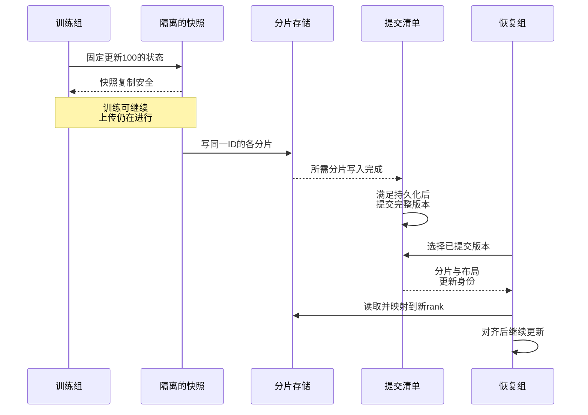
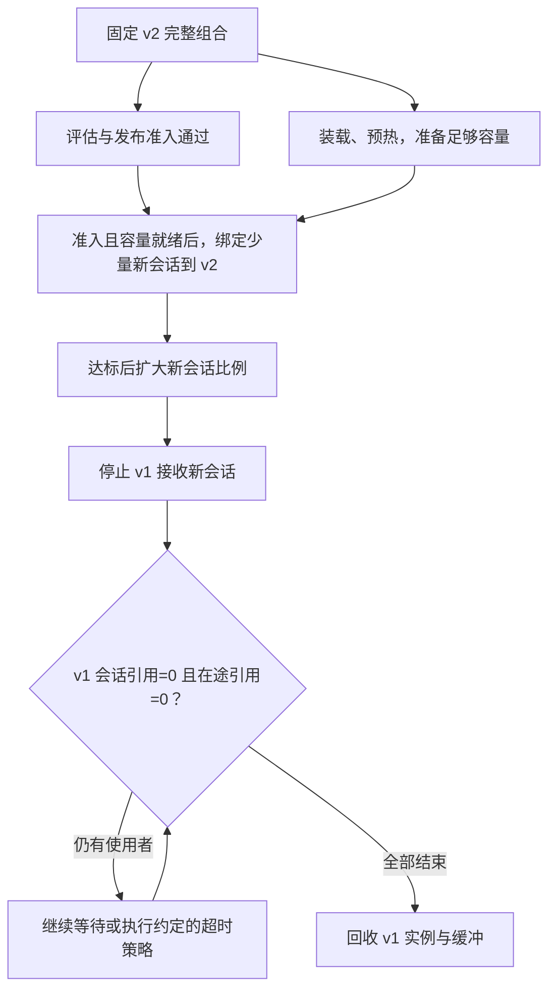

# 持续交付：资源和组合什么时候真的可用

[从这里开始](<../00 从这里开始.md>) · 前提：基础 [09 怎样让整套系统持续交付结果](<../基础/09 怎样让整套系统持续交付结果.md>) · 用到的算法：[五笔账 §3 提交点](<00 五笔账.md#3 提交点：什么时候算完成、何时能释放>)、[§4 分母](<00 五笔账.md#4 分母：吞吐、goodput 与同质量成本>)

这篇跟踪两件事。一件是一项训练在共享池里拿到资源、运行、在第 45 分钟失效、再恢复。另一件是一次 v1→v2 的模型发布：从被评估的组合，到真正处理请求，再到旧版本安全退出。

集群可靠性和模型交付过去分在两篇。合在一起，是因为它们反复做同一类判断：“分到了”“文件到了”“标为 ready 了”都不等于“能够交付结果了”。中间差的东西——拓扑、预热、完整的服务链、一致的状态边界——正是这篇要列出来的。

> [!abstract] 读完这篇，你应该能判断
> - **资源公平、任务完成时间和学习进展是三个目标。** 需求向量能比较份额，拓扑和任务效率决定份额换来多少产出。
> - **弹性的收益来自及时到达的完整能力。** 新实例要在需求消失前就绪；拆分服务还要求兼容的各个角色同时在场。
> - **异步检查点有两道边界**：快照隔离以后，训练才能继续改参数；完整版本提交以后，恢复者才能选它。
> - **发布单位是一个可追溯的组合**：权重、前后处理、运行环境、编译制品、接口和状态命名空间，对应同一份评估证据。
> - **回退先改变新任务的去向，再处理旧任务的寿命。**

---

## 1 资源够不够：按需求向量算

**【算例】** 池里有 8 张 GPU、64 个 CPU 核。A 每份要 1 GPU、16 CPU；B 每份要 2 GPU、8 CPU。按 GPU 平分忽略了 A 的 CPU 需求，按任务数平分又要解释“一份”代表多少资源。

Dominant Resource Fairness（DRF）取用户在各资源上已分配比例的最大值，称为 dominant share，再提高当前最小的那一个。A 是 $\max(1/8,16/64)=1/4$，B 是 $\max(2/8,8/64)=1/4$。资源可分割时，各分 $x$ 份，满足 $3x\le8$ 与 $24x\le64$，得到 $x=8/3$，两种资源恰好用满。[DRF](https://www.usenix.org/events/nsdi11/tech/full_papers/Ghodsi.pdf)【已核】真实任务是离散的：各放 2 份只用了 6 GPU、48 CPU，余量还能再放一份 B，但两人的瞬时份额就不再相等。

公平规定的是资源权利，产出要靠另一个模型估计。**拓扑让同样数量的卡形成不同的可用集合。** 【算例】一个 4-GPU 同步作业，立即拿到分散的设备，预计运行 20 分钟；等 2 分钟进入紧密互联域，预计运行 17 分钟，后者早 1 分钟结束。只有 1 分钟的短任务，多等就不划算。

成组准入要一次交付作业的全部必要资源，避免部分 rank 先占着卡、其他参与者迟迟不到。回填让短工作利用预留前的空隙，但要估计它能否及时结束。CPU 测试可以填空，也可能占满训练的解码核和存储队列，让原来的运行时间预测失效。

## 2 资源何时真的可用

**共享按峰值准入。** 两项服务各需 20 GB 权重和状态，看起来能放进 48 GB 的卡；长输入却可能同时增加 KV 和工作区。整卡独占减少共驻干扰，付出细粒度的闲置；时间复用容纳更多工作，付出切换和争用；硬件切片提前划定部分计算和内存，可能留下大小不匹配的碎片。MIG 在支持的 GPU 上分配独立的部分处理器、L2、内存控制器和 DRAM 路径；CPU、共享网卡、存储和整节点故障是另外的边界。[MIG](https://docs.nvidia.com/datacenter/tesla/mig-user-guide/introduction.html)【已核】

**扩容要换算成“什么时候到达”。** 突发只持续 20 秒、新副本 40 秒后才 ready，就救不了这次排队；预热池缩短交付时间，同时持续占预算。控制器要分别记录期望量、已分配、可服务、正在排空四个数。把正在排空的旧副本立即算成空闲，同时又让新任务占用，就会把一次安全退出变成超额准入。

**拆分服务要求一组角色同时可服务。** 每个 slice 只有一个 prefill 时，先停旧角色会暂时切断完整服务链；保留旧角色直到新角色 ready，又需要一张备用加速器。llm-d v1.0.0 的 P/D 配方用的是前一种设置，升级时可能返回 503。11-21 合入 main 的修复改为 `maxSurge=1 / maxUnavailable=0`，把代价换成了预留一个额外 prefill 副本的容量。【已核】正式版 v1.0.0 的配方仍是旧值，这是配置和文档修复，控制器本身没改。备用容量的要求一直都在，修复改变的只是预算的选择。为什么拆池以后角色不能互借，见 [请求调度 §4](<03 请求调度.md#4 同样四张卡，要不要拆阶段>)。

**训练扩容会改变更新。** 4 卡增到 8 卡，每卡 microbatch 和梯度累积不变，全局 batch 就翻倍；保持全局 batch 不变则要重调两者，可能降低单卡效率。Pollux 用系统吞吐乘统计效率估计训练 goodput，同时选择资源和 batch。[Pollux](https://www.usenix.org/conference/osdi21/presentation/qiao)【已核】收回资源前，先停止接新工作，让在途任务完成、迁移或按约定失败。

## 3 失效之后恢复哪一次更新

**【算例】** 一项同步训练需要 60 分钟无故障的等价工作，排队 2 分钟、准备 3 分钟；第 45 分钟失效，最近一次提交在第 40 分钟。

| 阶段 | 时长 |
| --- | --- |
| 检测、隔离 | 1 分钟 |
| 替换资源 | 2 分钟 |
| 载入一致状态 | 3 分钟 |
| 预热 | 1 分钟 |
| 重做未提交的区间 | 5 分钟 |

总交付时间 $2+3+60+1+2+3+1+5=77$ 分钟。更快的检查点只影响其中几段；更快的检测还要控制误杀慢而健康的工作。

“第 40 分钟提交”要意味着什么？检查点必须包含**同一个更新边界**上的参数、优化器、步数、随机状态、数据游标和分片描述。把 rank 0 的更新 100 和 rank 1 的更新 101 拼在一起，即使每个分片都完整，恢复的也不是同一个学习时刻。数据游标为什么要按“已影响保存参数的样本”记录，见 [训练一次更新 §8](<07 训练一次更新.md#8 从已提交的更新继续>)。



图里有两道允许继续的边界：快照复制安全以后，活跃参数才能被下一次更新修改；完整版本提交以后，恢复者才能选它。两道之间，上传和训练可以重叠，前提是后台不再读取正在被优化器原地改写的对象。

| 故障发生在 | 可选的恢复状态 | 要守住的条件 |
| --- | --- | --- |
| 正在复制更新 100 | 上一个已提交版本 | 活跃对象和半份快照分开 |
| 分片写入途中 | 上一个已提交版本 | 目录存在不代表完成 |
| 数据齐了、清单未发布 | 按协议仍选旧版本 | 不自行拼接未确认的新版本 |
| 已提交 100，训练到了 105 | 更新 100 | 全组重放 101–105，数据和更新一一对应 |

**源码里的这两道边界。** PyTorch DCP 的异步保存分别给出 staging 完成和上传完成两个终点，并可以限制在途保存数，免得快照占满主存。【已核】默认的文件保存路径先等各分片写完，再写临时 metadata、按同步开关完成同步、rename 为正式 metadata；关闭同步，故障一致性的保证也随之撤销。【已核】NVRx（2026-09）的异步 writer 对相关 CPU tensor 做 clone，把快照和活跃存储分开，应用负责收集同一更新的全部状态。【已核】它的故障归因和 Restart Agent 属于实验功能。Spindle（2026-10 beta）把快照捕获、持久化和生成端发布分到不同的执行通道，减少互相阻塞；它的全参数通路用无损字节差分节约部分传输，但要保留上一版完整的页锁定主存权重。恢复时要分别核对持久化的版本和生成端已发布的版本。【已核】

**【算例】保存间隔。** 每次保存造成 1 分钟不可重叠的代价，平均每 600 分钟失效一次，失效均匀落在间隔内。间隔 $I$ 分钟时开销近似为 $1/I+I/(2\times600)$：$I$=10、30、60 时分别约 10.83%、5.83%、6.67%，最优点约 34.6 分钟。实际的异步系统要用暂停时间、后台资源、故障相关性替换这些假设。

本地检查点恢复快，但可能和计算节点一起丢失。副本应按进程、GPU、节点、机架的故障域放置；写入和持久化的层次见 [数据移动 §7](<04 数据移动.md#7 小请求、尾部和副本的写入账>)。

## 4 把准备移出中断窗口

计划内的迁移可以把准备挪到中断之前。TrainMover（OSDI 2026-07）让新节点在训练照常推进时用记录下的通信张量预热、提前建立通信引导和拓扑，切换时只更新有差异的连接；计划迁移可以向离开的节点取最新状态，突发故障仍需冗余副本或检查点。【已核】作者在最多 1024 GPU 的实验中报告约 20 秒的迁移，64K 规模的资源节省是推演；原型修改了训练框架、c10d 和 NCCL。【作者数据】热备本身持续占设备，低故障率下可能不划算；机架断电和共享网络故障会一起影响多个节点。

**归因沿同一条时间线找第一个停止推进的边界**：输入没到，追 CPU 和存储；输入到齐但算得慢，追设备、共驻和功率；本地算完、远端没到，追通信边和对端；数据齐了却没提交，追协调和存储。等得最久的那个 rank，可能只是受害者。

## 5 发布单位是一个组合

v2 同时改了 tokenizer、量化布局和工具 schema。只替换权重，旧的前处理会产生另一串 token，旧的 plugin 可能误读权重，工具调用也可能解析成功、执行的却是另一个动作。

```json
{
  "release": "v2",
  "weights_digest": "W2",
  "preprocessor_digest": "P2",
  "runtime_image_digest": "R2",
  "compiled_artifact_digest": "E2",
  "interface_schema": "tools-v2",
  "evaluation_record": "eval-v2-env-A",
  "state_namespace": "state-v2"
}
```

这是一份教学 manifest，说明应该绑定在一起的关系，不是哪个平台的实际配置。digest 说明文件是否相同；来源可信、能运行、质量合格，各需要自己的证据。注册表的 alias 可以指向版本、改变入口，但评估和请求记录应保存解析后的不可变身份。[MLflow Model Registry](https://mlflow.org/docs/latest/ml/model-registry/)【已核】alias 更新了、某个副本载入完成了、全部在途请求结束了，是三个不同的事实。

**三层兼容检查，分别回答三个问题。**

1. **图怎样解释。** ONNX 区分 IR、opset 和模型版本；runtime 能解析文件，还要实际支持其中的算子、类型、形状和自定义 domain。【已核】
2. **图怎样执行。** 编译后的 engine 可能绑定硬件、驱动、runtime、plugin 或形状。TensorRT 区分版本兼容和硬件兼容选项，放宽绑定可能排除专用 tactic、改变性能。【已核】量化布局属于这一层，见 [数值与硬件 §1](<06 数值与硬件.md#1 “4 bit”展开成字节>)。
3. **执行结果怎样被使用。** 输入模板、采样、生成约束、输出格式、工具 schema、状态命名空间要和调用方一致。KV 缓存身份要按模型、适配器、位置和输入隔离，见 [历史状态 §3](<02 历史状态.md#3 两条请求共用一段前缀>)。

把三层拆开，失败时才能找对修复的对象。只检查文件格式，会漏掉应用动作；只检查最终回答，又很难定位是哪一层制造了差异。

RTP-LLM（2026-10）让模型代码负责前向和 checkpoint 解释，把 batching、调度和状态管理交给公共 runtime，以状态描述和 cache view 连接两侧；它分别管理请求、传输和保留缓存的引用，异步使用者结束后才释放存储。【已核】这是作者的系统设计，完整实现和生产规模另有验证边界。

## 6 ready 之前还有什么

冷启动要沿依赖记录：等资源 → 拿到制品 → 校验与挂载 → 初始化 runtime → 载入或转换权重 → 建图与调优 → 预热 → 对外 ready。有些阶段能重叠，有些必须累加。分发缓存只缩短“拿到制品”这一段，没预热的 batch 和 Graph 仍会拖慢首批请求。KServe 的 OCI/Modelcar 机制让模型文件经进程文件路径访问，省的是重复下载。【已核】

多模型池还要决定谁常驻。ModelMesh 的 runtime 契约区分 load、unload、容量报告和推理：load 成功才算可用，unload 返回前应完成释放。【已核】LLM 还要另外留出 KV、工作区和加载峰值；只按静态权重安排容量，生成时仍可能超额。

**评估门禁回答的是哪项承诺。** 格式与协议、数值、任务质量、SLO、故障恢复是不同的承诺。【算例】真实错误概率是 $10^{-4}$ 时，1000 次独立请求全无失败的概率仍有 $(1-10^{-4})^{1000}\approx90.5\%$。“小流量没出错”只是一份有限的证据；看到一次好结果就提前停止，原定的观察范围也就变了。性能对比要固定总资源：新增副本、shadow 流量本身都消耗容量。

## 7 切流量与回收



D 节点必须同时拿到评估准入和容量就绪两个事实。分组单位要先选：逐请求分配便于比较单次表现，却可能把一次多轮会话切成两种工具协议；按会话固定版本有利于连续性，但要核对分组偏差和长会话占用。KServe Next 的 LLM canary 设计按 group 和权重分配新流量，这是 Next 文档里的设计，正式版的完整控制器行为还没核对。【已核】

**回退的顺序。** 回退到 v1，先改变新任务的去向。已经绑定 v2 的会话、在途执行和外部动作各有自己的生命周期：v2 已经发出的工具动作撤不回来，v2 的 KV 也不能直接当作 v1 的状态。逻辑会话数归零，不等于物理访问结束；取消请求以后，设备仍可能最后访问一次缓冲。设了最大排空时限，就要规定超时的请求是失败、重试还是重算。

## 8 结论在什么时候反过来

| 你原本的判断 | 什么条件下反过来 | 先查什么 |
| --- | --- | --- |
| 立即分到卡最好 | 同步作业对拓扑敏感，等一会儿更早结束 | 紧密域里的预计运行时间 |
| 资源够就能共驻 | 峰值同时出现；共享 CPU、网卡、存储 | 峰值准入和尾延迟 |
| 扩容能解决排队 | 就绪时间长于突发 | 从决策到 ready 的全过程 |
| 滚动升级不需要额外资源 | 某个角色只有一个副本 | 每个角色的副本数和备用容量 |
| 各分片都完整，检查点就可用 | 分片来自不同的更新 | 提交清单里的更新身份 |
| 检查点越频繁越安全 | 保存的不可重叠代价大 | 简化模型的最优间隔 |
| 文件能载入，发布就成功 | tokenizer、engine 绑定、工具 schema 不一致 | 三层兼容检查 |
| 小流量没出错，就可以放量 | 稀有失败概率低、观察窗口短 | 样本量对应的检出概率 |
| 回退就是把流量切回去 | 已执行的外部动作、v2 的会话状态 | 每类在途对象的结束或补偿规则 |

## 证据

| 正文判断 | 标记 | 证据卡或来源 |
| --- | --- | --- |
| DRF、MIG、Pollux、Kueue 状态转换 | 【已核】 | [D12 证据 JSON](<../研究台账/evidence/D12-sources.json>) |
| llm-d 单 prefill 滚动修复：已合入 main，正式版仍旧值 | 【已核】 | [AIINFRA-E-20261123-05](<../研究台账/来源与证据.md#AIINFRA-E-20261123-05>)；前情 [AIINFRA-E-20261109-05](<../研究台账/来源与证据.md#AIINFRA-E-20261109-05>) |
| PyTorch DCP 与 NVRx 的两道边界 | 【已核】 | D12 证据 JSON |
| Spindle 的快照与发布通道 | 【已核】 | [AIINFRA-E-20261026-03](<../研究台账/来源与证据.md#AIINFRA-E-20261026-03>) |
| TrainMover 的预热与迁移 | 【已核】/【作者数据】 | [AIINFRA-E-20261104-32](<../研究台账/来源与证据.md#AIINFRA-E-20261104-32>) |
| MLflow、ONNX、TensorRT、KServe、ModelMesh | 【已核】 | [D16 证据 JSON](<../研究台账/evidence/D16.json>) |
| 托管 MLflow 同步 | 【已核】 | [AIINFRA-E-20261104-20](<../研究台账/来源与证据.md#AIINFRA-E-20261104-20>)（正文只在证据表保留） |
| RTP-LLM 的接口与引用管理 | 【已核】 | [AIINFRA-E-20261109-07](<../研究台账/来源与证据.md#AIINFRA-E-20261109-07>) |
| 8/64 池与 8/3 份、20/17 分钟、77 分钟、34.6 分钟、教学 manifest、90.5% | 【算例】 | 作者设定，非实测 |

最近改写：2026-11-23，§2 加入 llm-d 修复的状态说明。见 [2026-11-23 进展 §3](<../进展/2026-11-23.md#3 状态变化：对正在用这些系统的人有用>)。
