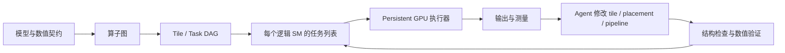

# 技术报告三：Agent 生成与优化 Megakernel

调研日期：2026-11-04（Asia/Shanghai）。本报告完成了论文、官方说明和固定版本源码审阅；没有执行 GPU 编译、性能测量或多卡部署。下文分别标明“作者报告”“源码确认”和“本报告判断”。

**结论：这个方向已出现有用的执行系统、实际生产案例和可由 agent 驱动的研究框架，但尚没有证据支持“给任意模型即可自动生成安全且更快的 megakernel”。** 最值得学习的东西分别是：Hazy 的跨算子流水线、Mirage 的任务图与调度编译、AutoMegaKernel 的受约束编辑面，以及 Mixture-of-Kittens 的专家与 agent 协作。它们解决的问题不同，不能用一张速度榜判断优劣。

## 1. 研究边界与版本

| 对象 | 本轮固定版本 | 主要证据 |
|---|---|---|
| HazyResearch/Megakernels | `7309cec801537b61fea3b50d7dfe454a6cde578e` | Python scheduler、CUDA interpreter、控制 warp 与共享内存页管理 |
| Mirage / `mpk` | `4d09bbadc465b50e9bc014095305c76d804da421` | 动态 runtime 之外新增 static schedule、deadlock checker、cost-driven planner 和 agent skills |
| AutoMegaKernel | `884534c4d2dbed4381576f81a79ae97feca53c34` | ScheduleConfig、IR validator、GPU VM、计时与搜索接口 |
| cursor/mixture-of-kittens | `f3a8bd2432457c5a2a2ea13915f0dcd0224581e4` | BF16/MXFP8 MoE forward/backward、分布式测试与 benchmark |

固定版本入口：[Hazy](https://github.com/HazyResearch/Megakernels/tree/7309cec801537b61fea3b50d7dfe454a6cde578e)、[Mirage](https://github.com/mirage-project/mirage/tree/4d09bbadc465b50e9bc014095305c76d804da421)、[AMK](https://github.com/RightNow-AI/AutoMegaKernel/tree/884534c4d2dbed4381576f81a79ae97feca53c34)、[MoK](https://github.com/cursor/mixture-of-kittens/tree/f3a8bd2432457c5a2a2ea13915f0dcd0224581e4)。这些是访问时可见版本，不代表都在该日发布。旧论文、当前分支和 roadmap 下文分别讨论。

## 2. Megakernel 优化的对象是什么

在本报告的语境中，megakernel 把多个算子的 tile/task 放进一个长期运行的 GPU kernel，在设备端处理任务依赖。persistent 说明工作分配的执行方式；跨算子融合说明覆盖范围，二者不是同一个概念。一个 persistent GEMM 不必是整模型 megakernel。

低 batch decode 中，一个 token 要流过大量权重，而每个算子的工作较短。优化机会来自减少 launch/teardown、尾部空闲与跨算子加载间隙。CUDA Graph 减少 CPU 提交成本，但不会自动把算子级依赖细化成 tile 级依赖。代价是程序接管同步、资源生命周期和调度公平性；单 kernel 本身不是收益证明。



一个任务的简化状态机是 `WAIT_INPUT → LOAD → COMPUTE → STORE → PUBLISH → RETIRE`，流水线允许不同任务停留在不同阶段。不能把 `PUBLISH` 简化为“随便加一个 atomic”：消费者必须确实等到它所读取的生产者完成，发布也必须包含数据可见性。

下面是用于解释检查条件的假设例子，不是某个项目实测失败。数据边只有 `A→B`、`C→D` 时，原始图无环；若固定列表让 SM0 按 `D→A` 执行，SM1 按 `B→C` 执行，则添加队列边后出现 `A→B→C→D→A`。SM0 等 C 才能执行 D，SM1 等 A 才能执行 B，后面的生产者因队列顺序无法前进。因此检查器必须理解执行器添加的顺序，而不能只检查模型图。

数据发布的概念协议可以写成：

```text
生产者所有写线程完成输出
  → 生产者线程间同步，将写入交给发布线程
  → device-scope release 发布完成状态
消费者 acquire 观察到对应完成状态
  → 向本任务其他读取线程传递同步
  → 读取生产者输出
```

这不是可直接编译的通用实现。实际代码必须结合 warp/CTA 的参与者、barrier phase、计数器身份及共享页复用来落实；只有计数器原子性，不能替代跨地址的内存顺序。若执行器允许等待者占满全部共驻资源，还要保证生产任务有机会运行。

## 3. Hazy Megakernels：先把设备端执行骨架理解透

Hazy 的实现先在 Python 侧构造并安排 instruction，再交给 GPU interpreter。算子由统一接口实现加载、计算和存储。源码中 consumer warps 负责计算，另有 loader、storer、launcher、controller 四种角色；controller 轮转 instruction slot，重用前等待上一轮结束，并重新构造 semaphore。共享内存页也随指令生命周期分配和释放。这样才能在上一任务收尾时准备下一任务，而不覆盖仍在使用的数据。[执行器源码](https://github.com/HazyResearch/Megakernels/blob/7309cec801537b61fea3b50d7dfe454a6cde578e/include/megakernel.cuh)、[控制器源码](https://github.com/HazyResearch/Megakernels/blob/7309cec801537b61fea3b50d7dfe454a6cde578e/include/controller/controller.cuh)

本报告判断：这里最有价值的是一套跨算子共享的资源协议。Agent 即便会写 GEMM，也未必能保证下一任务拿到的页已可复用、barrier phase 没有错位、其他 SM 的输入已发布。框架把这些问题集中到少数接口，便于测试与复用；代价是每种操作都要接入接口。

作者的 2025 年 Llama-3.2-1B 结果限定在单序列、BF16、32-token prompt、生成 128 tokens、无 speculation。报告中 H100 带宽利用率为 78%，比较系统启用了 CUDA Graph 与 torch compilation。这是历史实现的作者测量，不是相对 2026 年最新版 vLLM/SGLang 的结论。[原始实验说明](https://hazyresearch.stanford.edu/blog/2025-05-27-no-bubbles)

复现应从 README 的 H100/B200 demo 和 `megakernels/scripts/diff_test.py` 开始，再检查 scheduler 输出，而不是先改 CUDA。基线必须锁定 engine commit、模型配置、KV 长度、精度、采样策略及 GPU clocks。该仓库适合做机制学习与有限模型实验；它不是面向任意任务的自动 kernel agent。

## 4. Mirage MPK：论文动态 Runtime 与当前静态编译路径

MPK 论文的核心是 SM 级任务图：先拆分算子并推导数据依赖，融合事件，再由设备端调度器分发就绪任务。论文配置为预留四个 SM 承载 16 个 scheduler warps，余下 SM 执行 worker。跨任务共享内存页与流水线减少边界气泡。这里自动化主要来自编译器与 runtime，不能直接称为 LLM agent 自动设计。[论文 v1](https://arxiv.org/html/2512.22219v1)

**本轮的重要更新是：当前 `mpk` 分支还包含静态路径。** `StaticMegakernel` 明确绕开原 runtime，每个逻辑 SM 执行编译后的列表；`search.py` 从实测 task cost 选择 grid、SM placement 与顺序，输出 plan，再生成 CUDA。其 cost records 可按 GPU 类型、代码版本和 first-on-SM 条件筛选，能避免拿不匹配的微基准去估算调度。[静态图入口](https://github.com/mirage-project/mirage/blob/4d09bbadc465b50e9bc014095305c76d804da421/python/mirage/mpk/static_megakernel.py)、[规划器](https://github.com/mirage-project/mirage/blob/4d09bbadc465b50e9bc014095305c76d804da421/python/mirage/mpk/search.py)

静态调度器把两类边同时放进检查图：数据依赖边、同一个 SM 列表相邻任务的先后边，再检查环路。只证明原始数据 DAG 无环不够，因为固定队列会添加新的顺序约束。代码还提示，任务真实等待的外部条件必须完整写进依赖描述，否则通过 checker 仍可能挂起。运行时的全局计数使用明确的 `red.release.gpu` 与 `ld.acquire.gpu`；mbarrier 环形流水线另有 phase 规则。[检查器](https://github.com/mirage-project/mirage/blob/4d09bbadc465b50e9bc014095305c76d804da421/python/mirage/mpk/static_schedule.py#L41)、[同步原语](https://github.com/mirage-project/mirage/blob/4d09bbadc465b50e9bc014095305c76d804da421/include/mirage/static_megakernel/runtime.cuh#L213)

这给 agent 提供了三个不同层次的工作：按接口实现 task、调整 graph-to-plan、在固定 correctness gate 下优化 task。当前仓库已带相关 skills 与 subagent 定义，但其中 `v2-*` 文档引用其他分支，不能把文件存在当作当前分支都可执行。[技能目录说明](https://github.com/mirage-project/mirage/blob/4d09bbadc465b50e9bc014095305c76d804da421/.claude/skills/README.md)

性能口径也需要修正：旧 README 的 1.2–6.7× 不能代替论文结果。论文 v1 在 A100/H100/B200 上使用离线批量请求、prompt 64、decode 1024、最大 batch 1–16；报告单 batch 相对最佳既有系统 1.0–1.7×。这不是在线到达流量的尾延迟或 SLO goodput 证据。当前静态库的发展方向强调按模型片段接入 serving engine，因此“整模型一个 kernel”也不应被当作所有新路径的硬性目标。[论文实验设置](https://arxiv.org/html/2512.22219v1#S6)、[维护者路线说明](https://github.com/mirage-project/mirage/issues/773)

## 5. AutoMegaKernel：编辑面有价值，正确性承诺必须收紧

AMK 最直接针对 coding agent：agent 提交 `ScheduleConfig` 与 kernel knobs，经 lowering 形成任务图，再验证、测量和保留候选。GPU 不可用时接口区分 `predicted` 与 `measured-gpu`；这点非常必要，成本模型分数不能包装成实测加速。其 GPU 执行器使用 cooperative launch 并限制共驻 block 数，降低“等待者占满资源，生产者无法被调度”的风险。[Agent 接口](https://github.com/RightNow-AI/AutoMegaKernel/blob/884534c4d2dbed4381576f81a79ae97feca53c34/harness.py)、[VM](https://github.com/RightNow-AI/AutoMegaKernel/blob/884534c4d2dbed4381576f81a79ae97feca53c34/vm/scheduler.cu)

IR 检查覆盖 counter threshold、共享 counter 的 all-join、buffer 读写依赖、WAW、on-chip buffer 的 SM placement 与 page alias。共享 counter 只记录“完成几个”，不记录“哪几个完成”，因此 `Wait(c,k)` 若只等多个生产者中的一部分，可能读错生产者的数据。仓库对此已有专门回归测试。[IR 源码](https://github.com/RightNow-AI/AutoMegaKernel/blob/884534c4d2dbed4381576f81a79ae97feca53c34/schedule/ir.py)、[反例测试](https://github.com/RightNow-AI/AutoMegaKernel/blob/884534c4d2dbed4381576f81a79ae97feca53c34/tests/test_validator_races.py)

本轮源码审阅发现两项应先解决的边界：

1. `_PROVENANCE_MAX_TASKS = 8000`。超过此数量，transitive RAW/WAW 检查跳过并产生 warning；`ValidationResult.ok` 仍由 errors 决定。因此“validate 通过”并不总表示完整数据危害检查完成。
2. `vm/sync.cuh` 中 `amk_acquire_load()` 实际返回 legacy `atomicAdd(c,0u)`，注释却称其具有 acquire 语义。NVIDIA 文档规定 legacy atomicAdd 为 relaxed ordering。防止编译器 hoist 与跨地址 acquire ordering 是两回事；本轮未编译 PTX/SASS 或执行对抗测试，不能断言硬件上已观察到错误，但也不能认可其注释所给出的同步证明。[AMK 同步源码](https://github.com/RightNow-AI/AutoMegaKernel/blob/884534c4d2dbed4381576f81a79ae97feca53c34/vm/sync.cuh)、[CUDA 原子操作语义](https://docs.nvidia.com/cuda/cuda-programming-guide/05-appendices/cpp-language-extensions.html#legacy-atomic-functions)

因此，静态 checker 的覆盖率、VM 正确性、算子数值正确性和编译器 lowering 正确性应分别验收。论文自己也说明是静态图检查而非 mechanized proof。论文与 README 中“零 false-accept”的对抗样本结果只能说明该测试集，不能变成任意生成 CUDA 的安全保证。[论文 v1](https://arxiv.org/html/2606.09682v1)

性能方面，作者报告部分 L4/L40S/A10G/5090 上 W8A16 快于 CUDA-graphed cuBLAS BF16；这是精度不对称、batch 1、position 0 的比较，大 shape 测试采用随机权重，最大的真实 checkpoint 为 TinyLlama-1.1B。同精度 BF16 仍落后，在 A100/H100 上也存在明显负结果。更晚的 commit 还把 H100 occupancy 不足列为解释方向，部分推断来自模型而非重新测量。因此不能沿用“同步就是确定根因”或“自动超过 cuBLAS”的概括。[实验记录与边界](https://github.com/RightNow-AI/AutoMegaKernel/blob/884534c4d2dbed4381576f81a79ae97feca53c34/DATACENTER_RESULTS.md)、[最新固定 commit 的说明](https://github.com/RightNow-AI/AutoMegaKernel/commit/884534c4d2dbed4381576f81a79ae97feca53c34)

## 6. Mixture-of-Kittens：生产算例，不等于自主 Agent 框架

MoK 对象是 NVL72 上分布式 MoE 训练，不是整模型逐 token decode。它融合 dispatch、专家 FFN 与 combine，按场景选择 push/pull，分配计算与通信 SM，并通过 ring token buffer 去除 CPU 获取 token count 再分配缓冲的依赖。它还要协调不同 kernel 的 RDMA overlap；因此 persistent kernel 不一定要独占全部设备资源。[MoK 设计文章](https://cursor.com/blog/mixture-of-kittens)

源码提供 forward/backward、BF16/MXFP8、functional/ops API 和多 GPU 测试。安装条件是 SM100/SM103、CUDA 13.0+，默认编译 SM103。作者论文 v1 §4.2 的 1.41× 来自 512 张 GB300、EP=32、MXFP8 routed experts 加 BF16 shared expert 的训练实验，比较的是原先 DeepEP 加自研 MXFP8 FFN backend 的端到端 tokens/s/GPU。论文实测 Python 3.13 / PyTorch 2.13；README 的 Python 3.12 / PyTorch 2.10 是最低要求，不能当复现实验环境。这是系统贡献的作者证据，不能转成“agent 使开发效率提升 1.41×”。[README](https://github.com/cursor/mixture-of-kittens/blob/f3a8bd2432457c5a2a2ea13915f0dcd0224581e4/README.md)、[论文](https://arxiv.org/html/2609.36070v1#S4.SS2)

关于 agent，公开材料明确说专家提供 warp specialization、PTX 选择等方向，agent 帮助完成单算子和复杂代码。没有公开同预算有/无 agent 对照、完整轨迹或自动设计成功率，所以它证明“专家与 agent 可共同交付复杂系统”，尚不能证明“独立 agent 能重做这项工作”。[作者经验说明](https://hazyresearch.stanford.edu/blog/2026-08-05-retire-the-abstractions)

独立补充发现：[Cohere 的 North Mini Code serving engine](https://cohere.com/blog/megakernels) 展示单 H100 BF16 decode megakernel、动态 task queue、continuous batching 和 paged attention，值得作为服务集成对照；[mKernel](https://github.com/uccl-project/mKernel) 展示 Hopper 上跨 GPU/节点的计算通信融合。但本轮仅做了文档级发现，未深入它们的源码及 agent 轨迹，不纳入成熟度排名。

## 7. 如何在自己的任务上验证这个方向

建议先做一个有明确参考实现的单层或子图，例如 RMSNorm→QKV→RoPE，或 MoE dispatch→FFN→combine。先保留 CUDA Graph 基线，再测普通融合、静态任务调度和动态任务调度；这样能判断收益来自算子本体、launch 减少还是通信重叠。

验收分四层：结构检查（含队列边与内存复用）、算子及跨任务数值检查、sanitizer/超时/状态转储、真实 workload 的重复对照计时。数值矩阵至少包含短长 KV、不同 batch、极值、不同随机种子；服务矩阵另看 TTFT、TPOT、p99、goodput 与 preemption。每个候选保存 source hash、plan、编译选项、GPU/driver、reference 和测量记录。

按投入排序：**机制学习选 Hazy；受约束调度与接入工程优先 Mirage；研究 agent 编辑面可借鉴 AMK，但先补验证和同步审计；多卡训练研究看 MoK。** 目前更可控的 agent 角色是提出候选、实现任务和读取证据，人负责契约、同步不变量、比较条件与最终验收。能否把它扩展成通用自动系统，仍需公开失败样本、跨模型复现和同预算 agent 对照来回答。

## 8. 尚未完成的验证

- 未运行任何 GPU workload；报告中的速度、生产部署及正确率均为作者报告。
- 未复现 AMK 的同步疑点，未检查最终 PTX/SASS；它是代码与文档语义不一致的审计发现。
- 未把 Mirage 旧论文图表绑定到当前静态路径；没有声称当前 branch 重现旧图表。
- 未完成 MoK 的全量跨 rank/跨精度代码审计，也未验证生产训练栈。
- 本报告重点是四条代表路线，不宣称覆盖所有 megakernel 或 LLM kernel-generation 工作。

返回 [[00 阅读入口与结论]] · 共同验收方法见 [[05 评测与可信验收共同附录]]。
