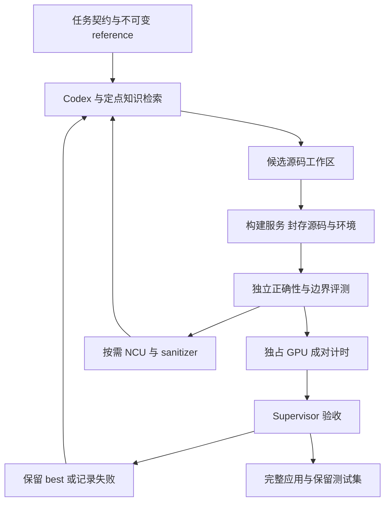

# Codex Skills MCP 与算子工具链技术报告

通用 coding agent 已经可以接入算子开发工具。决定实际效果的是任务接口、实验执行和验收能力：能找到正确的硬件文档，只解决了知识问题；能解释 NCU，只解决了诊断的一部分；能够保留已验证的优化，才形成工程闭环。

本报告给出两种落地方式：已有测试和 GPU 执行环境时，用少量 Skills 组织工作；需要长时间远程搜索、稳定复测和故障恢复时，将这些职责下沉到执行服务。二者可以共用 Codex，不必先训练专用模型。

研究日期为 2026-11-04。以下源码结论固定到具体 commit；本轮执行了一个 CPU gate 反例实验，没有运行 GPU kernel、安装插件或调用付费模型。相关工作流与模型比较见 [[01 开源算子优化框架技术报告]]、[[02 专用模型与学习方法技术报告]]。

## 工具链的四个层次

| 层次 | 应负责什么 | 不能据此推断什么 |
| --- | --- | --- |
| AGENTS.md 与 Skill | 说明任务边界、何时调用工具、报告要求、失败后的处理 | 写了“必须正确”不等于有机器执行的正确性约束 |
| 文档与知识检索 | 查架构、API、指令语义、既有实现，保留来源版本 | 文档相关不代表建议适合当前瓶颈 |
| CLI / MCP 工具 | 构建、执行、profile、返回结构化结果 | 工具能运行不代表输入、输出和测量可信 |
| 独立 evaluator / Supervisor | 固定测试、封存候选、比较性能、晋升或回退 | 一次通过不能覆盖所有 shape 与运行条件 |

OpenAI 官方将 Skill 定义为可重复工作流的指令与资源，MCP server 则暴露工具、数据和受控操作。插件负责分发这些能力。这个分工适合 GPU 开发：把编译、计时、结果检查写成确定的工具，把“依据哪些指标选择下一次实验”留给 agent。[OpenAI Skills](https://developers.openai.com/plugins/concepts/skills)、[MCP 配置](https://learn.chatgpt.com/docs/extend/mcp?surface=cli)

这也解释了为什么“装了算子 skill”和“运行专用 Kernel Agent”不能互换。前者可能只是把规则读入上下文，后者可能额外拥有不可由候选修改的 evaluator、GPU 调度器和持续状态。

## NVIDIA 官方入口已经覆盖到实际优化

### CUDA MCP 是知识接口

NVIDIA 当前公开页面分别提供 hosted CUDA MCP、自部署 Nsight AI Blueprint、Nsight Compute 内的 AI 辅助分析。hosted MCP 面向官方 CUDA 文档和代码示例，首次连接需要 NVIDIA Developer 认证。它不是一个替用户在远端 GPU 上执行任意候选的 benchmark 服务。[Nsight AI 官方说明](https://developer.nvidia.com/nsight-ai)

文档中的 Codex 注册方式如下；这是配置示例，本轮未执行：

```bash
codex mcp add nvidia-cuda-docs --url https://api.copilot.nsight.ngc.nvidia.com/mcp/cuda-docs
```

最有价值的用法是在出现不熟悉的 intrinsic、PTX 语义或新架构接口时定点查询。例如，agent 不应凭函数名假定某个 atomic load 有 acquire 语义。对性能的解释仍需对应当前代码、编译产物和实测数据。

### NVIDIA Skills 中的 TileGym 是上一轮遗漏的重要候选

固定镜像版本为 [`NVIDIA/skills@fea423859bdc70e92d95d0b1e84ac4e0c630db24`](https://github.com/NVIDIA/skills/tree/fea423859bdc70e92d95d0b1e84ac4e0c630db24)。其中已经有 cuTile kernel 生成、性能优化、autotuning、模型接入和 Compute Sanitizer 诊断相关 Skills。因此“官方只有文档 MCP，优化只能靠第三方”的理解需要修正。

[`tilegym-improve-cutile-kernel-perf`](https://github.com/NVIDIA/skills/blob/fea423859bdc70e92d95d0b1e84ac4e0c630db24/skills/tilegym-improve-cutile-kernel-perf/SKILL.md) 组织了 baseline、正确性、定向修改、benchmark、保留或回退。其资源进一步拆成性能模型、优化 playbook、可调参数目录和 IR dump 指南，适合给 agent 提供局部、按需读取的知识。它主要服务 TileGym/cuTile，不是任意 CUDA/Triton 项目的无缝替代。

生成子 agent 的职责也有明确边界：[`kernel_agent.md`](https://github.com/NVIDIA/skills/blob/fea423859bdc70e92d95d0b1e84ac4e0c630db24/skills/tilegym-cutile-python/orchestration/kernel_agent.md) 只负责单 kernel 代码，完整程序的执行、验证与调试交给主 agent。这样能减少职责混乱，但正确性仍依赖主流程的实现。

[`tilegym-cutile-autotuning`](https://github.com/NVIDIA/skills/blob/fea423859bdc70e92d95d0b1e84ac4e0c630db24/skills/tilegym-cutile-autotuning/SKILL.md) 更接近传统 autotuner 的 agent 接口：设计有限的配置空间，首次搜索后缓存配置和 kernel 对象，后续直接 launch；in-place 算子在搜索中使用独立缓冲，防止重复执行改变输入。它没有把所有优化都交给 LLM；参数搜索仍由可执行机制完成。

这里有两个应保留的限制。第一，包含原配置只保证它参与竞争；存在计时噪声时，不保证最终选中项真实不回归。第二，该 skill 建议一次正确性和 A/B 通过后停止，不反复追测；这适合控制任务成本，但不应替代接近噪声水平时的独立成对复测。这是对方法的分析，不是实测否定该 skill。

官方附带的 [`BENCHMARK.md`](https://github.com/NVIDIA/skills/blob/fea423859bdc70e92d95d0b1e84ac4e0c630db24/skills/tilegym-improve-cutile-kernel-perf/BENCHMARK.md) 只有 5 个评估任务，其中 1 个正向激活、4 个负向任务，每题一次尝试。它主要支持“能被调用并按流程完成任务”的小样本判断，不能当成多算子、多硬件的性能验证。官方来源与验证覆盖强度是两个维度。

## kernel-opt-agent 的实现与一次反例审计

固定版本为 [`21f10bbe3c2dc854e533b62fcd306186f88c76c6`](https://github.com/minho-fan/kernel-opt-agent/tree/21f10bbe3c2dc854e533b62fcd306186f88c76c6)。项目把知识查询、正确性/benchmark、NCU 和循环组织成四个 Skills，并提供 Codex 插件 manifest。其价值是把一次实验留下的源码、假设和报告组织得更清楚。

### 接口成本不可忽略

[`correctness_check.py`](https://github.com/minho-fan/kernel-opt-agent/blob/21f10bbe3c2dc854e533b62fcd306186f88c76c6/skills/kernel-profile/scripts/correctness_check.py) 对 Python 后端要求 `setup(**kwargs)` 和 `run_kernel(**kwargs)`，对 CUDA/C++ 路径解析 `extern "C" void solve(...)`。CUDA 路径通过签名与维度推测指针缓冲大小。接入真实 attention、带 stride 的张量、量化元数据或多个不同尺寸指针时，需要自己核实适配，不能只把 `.cu` 文件路径交进去。

Python 路径的测试数据和输出声明来自候选模块的 `setup()`。这对协作开发很方便，却没有建立候选与测试的权限隔离。用于无人值守搜索时，应把 workload 生成、输出 shape/dtype 契约和容差移到候选不可修改的一侧。

[`benchmark.py`](https://github.com/minho-fan/kernel-opt-agent/blob/21f10bbe3c2dc854e533b62fcd306186f88c76c6/skills/kernel-benchmark/scripts/benchmark.py) 可以比较 eager、`torch.compile` 和 FlashInfer 适配器，报告计时统计。对应 profiling 脚本将 CUDA-event timing 与 NCU 采样区分，并处理 lazy init/JIT。这个方向是对的，但调用方仍需固定 cache policy、Graph 设置、精度和数据分布；支持某种 baseline 名称不等于自动找到该算子的最佳官方实现。

### gate 检查的是实验材料是否齐备

[`check_iteration_gate.sh`](https://github.com/minho-fan/kernel-opt-agent/blob/21f10bbe3c2dc854e533b62fcd306186f88c76c6/skills/kernel-loop/scripts/check_iteration_gate.sh) 检查文件存在且非空、标题顺序、版本状态及未来目录是否提前出现。它不解析 correctness 的 PASS/FAIL，不复核 NCU 数值，也不验证单次修改真的只有一个优化变量。Skill 自身已经说明这些限制。

本轮做了一个 CPU 反例：构造 `correctness.md`、NCU 两份文件，内容明确写着 `FAILED; no GPU measurement was performed.`；kernel 文件只放注释，KBS 与 hypothesis 只提供所需标题。运行原版 transition gate 后，退出码为 **0**，状态推进到 **v1**。没有执行候选代码或使用 GPU。

因此它适合作为协作纪律检查器；“Gate PASSED”不能用作正确性或性能验收证据。[实验结果](evidence/gate-audit.json)、[完整输出](evidence/gate-audit.log)与[复现程序](evidence/reproduce_gate_audit.py)保存在本目录，原版脚本以固定源码链接定位，不重新分发。原脚本 SHA256 为 `1ab922a4a876eeb256f07094b7c42dbbcc0fa44385eb653e550e19c096977a93`；取该脚本后运行 `python3 evidence/reproduce_gate_audit.py /path/to/check_iteration_gate.sh` 即可复核，程序会先校验 Git blob。这个结果收紧了上一轮对它“轻量直接试用”的建议：可以试工作流，但需要补独立 evaluator 才适合自动接受结果。

## NCU 报告工具如何帮助形成判断

[`mit-han-lab/ncu-report-skill@c7980a43cb88a8734d113b22b57ff66746cf5719`](https://github.com/mit-han-lab/ncu-report-skill/tree/c7980a43cb88a8734d113b22b57ff66746cf5719) 比纯粹把 CSV 塞给模型更进一步。它提供报告 action 枚举、指标读取、PC/源代码映射、stall hotspot、PM timeline 等 helpers。主要面向 Blackwell 与对应版本 NCU。

[`helpers/ncu_utils.py`](https://github.com/mit-han-lab/ncu-report-skill/blob/c7980a43cb88a8734d113b22b57ff66746cf5719/helpers/ncu_utils.py) 允许枚举全部 launch，并将缺失指标作为缺失返回。使用时必须保留这层语义：缺失的 metric 不是零；同一报告里多个 kernel 也不能只看第一个就作整体判断。

一个好的 agent 诊断至少应连起三类证据：当前代码的访问/计算结构，NCU 的瓶颈指标，修改后非 profiler 计时的变化。例如 Long Scoreboard 高只说明某些依赖等待突出；需结合内存路径、并行度和指令归因，区分带宽饱和、延迟隐藏不足和串行依赖。这里给出的诊断要求属于工程分析，不能由某个统一阈值自动替代。

NCU 会影响执行：replay、cache control 和采集方式都可能改变观测条件。因此最终 latency 应在固定的非 profiler 测量中比较，NCU 用于解释变化。[NVIDIA Profiling Guide](https://docs.nvidia.com/nsight-compute/ProfilingGuide/index.html)

NVIDIA 的 [`compute-sanitizer-diagnose-cuda-bugs`](https://github.com/NVIDIA/skills/blob/fea423859bdc70e92d95d0b1e84ac4e0c630db24/skills/compute-sanitizer-diagnose-cuda-bugs/SKILL.md) 可以补正确性诊断，按 memcheck、racecheck、initcheck、synccheck 分流。其范围不包括一般 global-memory race 的完整验证，`0 errors` 只表示相应工具在此次运行中未发现问题。对 persistent/megakernel 的跨 CTA 同步尤其不能把 sanitizer clean 当作形式证明。[Compute Sanitizer 官方范围](https://docs.nvidia.com/compute-sanitizer/ComputeSanitizer/index.html)

## gpu-perf-tune 适合系统层的证据组织

固定版本为 [`25d74d031732e2f76d30a43e44c3434b588f06b3`](https://github.com/cfregly/gpu-perf-tune/tree/25d74d031732e2f76d30a43e44c3434b588f06b3)。它提供推理工作负载、profiling、baseline、evidence、Slurm 等 CLI 与 Skills，范围比单 kernel 改写更宽。

[`mcp_surface.py`](https://github.com/cfregly/gpu-perf-tune/blob/25d74d031732e2f76d30a43e44c3434b588f06b3/plugins/profile-and-optimize/server/mcp_surface.py) 从 CLI contract 派生工具，减少 CLI 与 MCP 各自维护一份接口的漂移。这个设计值得借鉴：让一个确定实现同时服务人和 agent，而不是重写一套 agent 专用执行逻辑。

本轮只定点核对了接口派生与目录结构，没有完整执行其工具测试，也没有证明所有证据约束在各执行路径都强制生效。它更适合研究如何把 kernel 变化接回服务测量，不宜据此把它排成已验证的首选 kernel 自动生成器。

## 最小可用架构

下面是建议的设计，不是现成项目已全部实现的能力。



MCP 返回值应至少携带 `candidate_hash`、`reference_hash`、`workload_hash`、`environment_id`、原始计时样本和 verdict；让模型报告这些工具产生的记录，不接受模型自己填一个“加速 1.2×”作为验收。远程执行还需要 `submit/status/cancel/fetch_artifacts` 一类 job 生命周期接口，避免把一次长时间 SSH 会话当作全部实验状态。

缓存应分别处理：编译缓存、参数搜索结果缓存和模型知识缓存。前两者的 key 要包含影响执行的源码、架构、dtype、shape/stride、编译版本等条件；检索到的历史成功策略只能当下一次假设，不能直接继承为本轮性能结果。

## 复现与选型

| 目标 | 可借用的组件 | 最先补齐的部分 |
| --- | --- | --- |
| 在熟悉项目中协作优化一个 kernel | 现有测试、Codex、NCU skill、官方文档 MCP | 独立且固定的 benchmark 与真实调用 shapes |
| 学习 cuTile 与参数调优 | NVIDIA TileGym Skills | 与当前工具链匹配的 TileGym/编译器和独立复测 |
| 无人值守跑多轮候选 | Atrex 或 KernelAgent 加执行服务 | 测试所有权、GPU 排他、超时恢复、同条件晋升 |
| 从 kernel 追到推理服务 | 系统 profiler、服务 benchmark、gpu-perf-tune 的证据组织方式 | TTFT/TPOT、尾延迟、吞吐与质量的端到端验收 |

建议先用一个 reduction/normalization 和一个 GEMM/attention 小工作负载试接口。固定模型、预算、硬件和 evaluator，比较“普通 Codex”“加知识/诊断 Skills”“再加受控执行与晋升”三种设置。记录有效优化率、总 GPU 时间、token、失败类型及 held-out shapes。这个消融能判断真正有效的是知识、搜索预算还是实验基础设施，避免把所有改善都归因于 skill。

目前无法从公开来源给出通用美元成本。GPU 费用、编译延迟、NCU replay 和模型 token 都受候选数量及任务复杂度影响；先测每个阶段的耗时和失败率，再估整个搜索预算，比从 README 倍数推成本可靠。

插件分发方面，OpenAI 当前文档推荐 portable 根 `plugin.json`、`mcp.json` 与 `skills/`；`.codex-plugin/plugin.json` 仍作为兼容格式存在。具体 host 的安装方式应按当前文档核对，不把某项目 README 的 slash command 当跨客户端通用命令。[官方打包说明](https://developers.openai.com/plugins/build/plugins)

## 当前判断与待验证项

现成工具已经足够搭一个有用的算子协作环境。最划算的投入通常是完善 evaluator、数据/源码绑定和远程执行，而非先做更复杂的 agent 编排。Skills 最适合保存硬件特例和工具用法；可执行工具负责执行约束。

仍需实机验证：这些 helpers 对用户当前 CUDA/NCU 版本是否兼容；计时中 Graph、cache 与 stream 条件是否一致；候选在极端输入和未见 shape 上是否保持正确；多轮搜索的收益能否覆盖 GPU 与 token 成本。许可证按各子资源单独确认，尤其 `kernel-opt-agent` 当前 API 元数据没有识别到根许可证，不能把公开可读自动当成可任意再分发。

返回 [[00 阅读入口与结论]] · 共同验收方法见 [[05 评测与可信验收共同附录]]。
