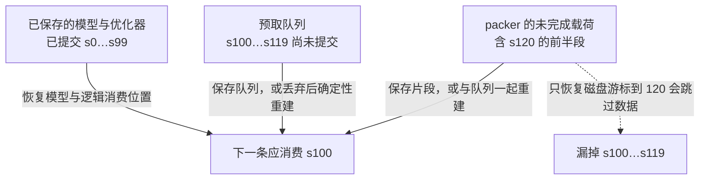

# 数据工程与训练配方

[[领域地图与覆盖缺口|领域地图]] · 基础回看：[[01 我们究竟在优化什么]]

给代码助手准备训练数据时，很容易得到一个看似明确的交付目标：凑齐 100B token。可是网页镜像可以把同一段代码重复十遍，教师也能不断生成相似补丁。它们都增加计数，却未必增加模型尚未掌握的信息。更严格的处理又会花计算、删内容，甚至改写原始事实。我们真正要决定的是：**多花一笔数据生产成本，能否更便宜、更可靠地得到所需能力？**

先约定怎样回答这个问题。用 $Q$ 表示预先规定的独立任务验收，例如修复题上的限时成功率及需要保持的回归任务；$D_Q$ 表示在某套配方下达到它所需的训练量。$D_Q$ 要靠训练与评估确定，不能从过滤器分数或保留率直接算出。下面跟着同一条数据流，依次决定保留什么、怎样曝光、哪些位置贡献损失，以及故障后从哪里继续，最后再结算总成本。

读者只需先知道：训练会对一批输入计算损失，再据此更新参数。“曝光”是材料被读到，“监督位置”是其中实际产生损失的位置，两者未必相同。文本与代码可用 token 计量；图像和音频还要计解码、对齐与模态处理，不能直接换成同一种文本工作量。

## 先决定保留集合：删掉重复，还是修复内容？

决定保留什么之前，还要确定候选材料从哪里来。若原始池缺少需要的任务或监督格式，再精细的筛选也无法补出这些信息。AgenticDS（2026-10-29 v1，本轮补录）把训练需求变成含硬约束的查询计划，用文本检索和受限的模型—论文—数据集关系扩展寻找候选，再依据数据卡、样本与来源路径核验。检索和执行分开后，可以追问某个候选因何进入数据池，而不只保留相似度分数。这将 [[D15 检索推荐与在线数据系统|候选获取]]接到了本域的整理之前，两者解决不同环节。[论文 §3](https://arxiv.org/html/2610.39608v1) · [固定执行器](https://github.com/nju-websoft/AgenticDS/blob/c8d41990b8f5b1c15e0473956a1320a3c1959c71/agent/executor.py)

这个获取环节仍有两道边界。首先，缺失的元数据保持 unknown：没有看到训练用途或许可的证据，不等于已经满足条件。其次，检索相关性不能直接证明训练价值；作者另用三领域、三个模型的受控微调检验获取结果，尚不支持任意规模或配方下的同质量总成本结论。公开实现也不是生产采用或独立复现的证据。数据身份和待补证项应随候选进入后续管线，再分别验证用途、独特信息和最终任务收益；获取与核验尝试也进入文末总账。版本、实验边界与处置见 [[来源与证据#AIINFRA-E-20261109-01|AgenticDS 证据卡]]。

假设代码库 A 被镜像十遍，B 只有一份，每份大小相同。按文件均匀采样时，A 占 $10/11$；合并镜像后，它与 B 各占 $1/2$。去重同时改变空间、重复曝光和领域权重。若镜像中的一个修复版被错误合并，损失的又是真实变化。因而至少要保留原始对象、处理后文档和训练样本三层身份，以及“谁被哪份代表”的映射，才能解释最终配比。[Dolma v2 的数据与工具设计](https://arxiv.org/html/2402.00159v2)是可回看的开放管线案例。

精确文档哈希便宜，适合字节一致的镜像，却抓不到换行、模板和局部重复。基于 n-gram 指纹的近似去重把文档投到候选桶，再验证相似度：它用召回与误合并换取避免全体两两比较。精确长片段去重针对跨文档的重复段落，可以保留文档中的其余内容；短文档、短模板会受最小匹配长度约束。语义去重进一步把不同措辞视为相似，需要 embedding、近邻索引与阈值，容易把同主题的互补事实也合并。

如果主要问题是网页页脚或代码许可证反复出现，片段级删除通常比整篇删掉更少损失信息；如果同一篇文章只改少量模板，文档级近似合并更直接。若任务需要比较相近实现的细微差别，语义阈值过宽尤其危险。阈值不能只按“去掉多少”选择，要抽查误合并，并查看语言、领域与长尾知识的保留变化。[去重原论文 v2](https://arxiv.org/html/2107.06499v2)比较了近似文档与精确子串路线，也显示阈值与文档长度会改变结果，因此不能把其中一种方法的胜负视为普遍结论。

过滤判断“值不值得训练”，去重判断“是否已经出现”。教育分数高的模板仍可重复，罕见的专业文本也可能因写法不规范被低分过滤，丢掉长尾知识。编辑只删除噪声，忠实性较容易检查，却可能删掉上下文，也修复不了破碎叙述；生成式重写能救回这类材料，又可能加入原文没有的事实，扩散教师的表达习惯。处理粒度应针对这些具体损失来选。

训练内部去重还要与训练—验收去污染分开：后者检查评估题、答案、派生版本和时间范围，整体去重率不能代替它。

学习型处理器给这项选择提供了一个具体实现。ReScraper（v1，2026-09-28）先给渲染后的网页行编号，输出抽取删除指令，再选择保留、删除、局部编辑或整页重写，由确定性执行器应用。大部分页面只生成短删除指令，只有重写才输出完整新正文。三个教师的操作被蒸馏到一个 0.6B 模型，第二阶段提高重写样本比例，使模型学会救回单靠删除难以修复的内容。[ReScraper v1，§3 与附录 A](https://arxiv.org/html/2609.34287v1)

要判断这种处理究竟改变了什么，作者从同一网页池出发，固定三个模型规模各自的预训练预算，并给所有路线接上相同去重。操作消融比较了过滤与修复，下游 22 项评估检验处理后的材料是否更适合学习。这些结果来自指定英语池、最高 2.8B 模型；它们支持该范围的质量比较，尚未确定更大模型、其他领域或达到同一 $Q$ 的总成本。后面会把论文的真实生产费用也放进账里。

## 需要补充轨迹时，先数所有尝试

清洗只能整理已有信息。如果助手仍缺少某类修复示范，就要让教师生成并验证新轨迹。这时，最终文件大小尤其容易掩盖生产成本。

假设要交付 10 万条通过规定测试的修复轨迹，每次教师尝试平均输出 2000 token，验证保留率为 20%。忽略重复和长度差异，也需要约 50 万次尝试、10 亿个输出 token，而最终保留只有 2 亿 token。把教师速度乘以最终 token 数会低估四倍被拒输出，教师输入 prefill 和测试执行还另计。如果成功率低的类别恰好是长文件与复杂依赖，按总体保留率估计又会低估这些类别的成本。

提高质量有两条不同路径：让更强教师直接多解决一些难题，或让较弱教师生成更多候选再验证。前者单次贵，后者尝试多且验证器可能成为瓶颈。若测试可以并行且便宜，多候选有机会；若每次都要构建大型工程，先用便宜检查淘汰语法错误再运行完整测试可以节约环境成本，但便宜检查的误拒会改变保留集合。只生成容易验证的题目也会使语料离真正任务越来越远。

生成或改写后，要保留从原始对象到最终样本的身份链：原文引用、教师与提示版本、采样设置、候选序号、验证结果、未保留的尝试和去重代表关系。同一题十个几乎相同的成功补丁不应算成十份独立覆盖；通过验证后仍要回到前面的保留集合判断。只留某个验证器喜欢的写法，也可能教会模型迎合它。D03 的在线轨迹面对相同问题，区别在于数据生产与学习是否同时进行。

## 把文件变成 token，再决定各域出现多少

同一份代码换 tokenizer，token 数、片段边界与稀有标识符的表示都会改变。以 token 预算固定训练量时，较长切分会让模型看到更少原始文件；以文件数固定时，又会产生更多计算。多语言混合尤其不能把字符数、字节数与 token 份额互相代替。文档归一化还可能让代码缩进、公式或特殊符号消失，因此先清洗再分词与先分词再过滤，未必选择同一集合。

一个可解释的配方会同时记录原始对象与分词产物的快照、tokenizer 版本和处理参数，并把不同领域的压缩比例单独看。如果新词表使代码 token 数下降，训练相同 token 数相当于增加代码曝光；质量改善应拆开“表示改善”和“看了更多原始内容”。这也解释为什么更换 tokenizer 后，旧的去重 n-gram 阈值与 packing 长度分布需要重新校准。

此时可以固定输入快照和 tokenizer，讨论真正进入训练的曝光量。为看清采样与损失的差别，先把领域缩成知识 K、数学 M 两桶；这是一个受控例子，不是代码助手应采用的产品配比。

把知识与数学按 7:1 采样，一批 800 个等长样本就约有 700 个知识、100 个数学。把数学损失乘二，仍只看 100 个数学样本；改成 7:2 采样，则约看 178 个数学样本。二者增加数学贡献的同时，以不同方式改变覆盖和梯度噪声。对独立抽样的简化估计，领域均值梯度的方差与样本数成反比；放大同一批梯度不等于增加用于估计它的样本。

用符号写出这项差别：$p_i$ 是领域 $i$ 被采样的比例，$a_i$ 是它被抽中后所乘的损失系数，$\mathcal D_i$ 是该域样本分布，$\ell$ 是样本损失。模型参数为 $\theta$，对应目标为

$$
J(\theta)=\sum_i p_i a_i\,\mathbb E_{x\sim\mathcal D_i}[\ell(\theta;x)].
$$

如果只想改变相对权重，同时保持平均系数为一，7:1 配比、相对权重 1:2 可归一成 $a_K=8/9$、$a_M=16/9$，因为 $(7/8)(8/9)+(1/8)(16/9)=1$。这控制了系数量级，**没有保证梯度范数不变**：不同域梯度的大小、方向与相关性仍会变化。Adam、Muon 等还会对混合后的梯度作非线性变换，不能把每域损失乘二直接解释成该域学习率乘二。

固定混合适合希望持续保留多种能力的情况；分阶段训练把预算集中给当前瓶颈，适合基座已有广泛覆盖、后来需要专门适配的情况，但末阶段可能冲掉先前能力。在线重加权不用重新生产数据，可以响应训练状态，却把损失当成控制信号：高损失既可能是稀缺难题，也可能是噪声，低损失既可能代表掌握，也可能代表模板重复。代理模型挑出的配比更要核查能否迁移到目标规模和后训练阶段。

LARE（v1，2026-10-23）把“曝光固定、贡献变化”落实为在线规则。它记录各域未加权损失与有效目标数的滑动平均，学习率 warmup 后令 $r_i=(\bar\ell_i+\epsilon)^{-1/2}$，再用监督 mask 后的损失 token 份额 $\hat\pi_i$ 归一化：$a_i=r_i/\sum_j\hat\pi_jr_j$。因此，归一化所用份额未必是采样的 7:1。规则依据梯度噪声的简化理论，较低损失域得到较大系数；它并不是按“越难越多学”设计的。[LARE v1，§2–4 与算法](https://arxiv.org/pdf/2610.32141v1)

作者在 1.5B 模型、固定流和 mask 下比较阶段顺序、直接混合及重加权，隔离了仅凭曝光量描述不了的配方差别。更长预算主实验选择了 ActGD 优化器，它的统计与逆变换增加计算和状态；匹配 sampled tokens 并未匹配墙钟或峰值显存。多数结果为单次运行，较小分差还需要重复实验。对实际配方而言，这项研究增加了一个可调变量，尚未证明它在所有规模和优化器下都更省成本。

## 怎样装满设备，同时保持刚才规定的目标

曝光与损失权重已经确定，接下来才是把变长样本装进设备。packing 把多条短样本放进同一个计算载荷；它可以少算填充，却必须保留样本各自的依赖关系。

长度 128 的独立样本若每条填充到 4096，长度利用率为 $128/4096=3.125\%$。装入 32 条后，线性层可以不再处理这些填充位置。但如果仍用一个普通因果 mask，第 20 条就会读取前 19 条；EOS 是可见 token，不是一道阻断注意力的墙。若原目标是独立样本，必须用分段或块对角因果关系，并按目标定义处理位置、标签移位与边界 loss。

把文档连成一条预训练流，允许上下文跨文档，可以是明确采用的训练目标；独立 SFT 则往往要求每个问答只读自己的提示。二者都能 packing，但不能仅因前者实现方便就替换后者。可变长 Attention 若按真实段长计算，位置对数接近 $\sum_j s_j^2$；只给一个长稠密矩阵加 mask，则即使结果正确，也可能仍支付接近 $(\sum_j s_j)^2$ 的执行成本。mask 正确与避免无用计算是两项检查。

损失分母同样重要。一个 100-token 回答与一个 1000-token 回答，按有效 token 平均时，后者约贡献十倍位置；按每条回答均值再平均时，两条权重相同。分布式各卡有效 token 数不相等时，先算本地均值再直接平均，会让短卡与长卡同权。要得到全局 token 均值，应归并损失和与有效位置总数；它会反过来约束 D02 的归并与梯度缩放。

为了装得更满而把长度相近样本聚在一起，也会改变更新顺序、来源共现与噪声。可以保留足够大的 shuffle 缓冲缓解这种偏向，但其内存、随机读和恢复成本必须计入。最快的 packer 不是单看“填满率最高”，而是保持规定学习关系后，实际节约了多少计算和时间。

这也把数据配方接到了 [[D02 分布式训练与模型状态]]：设备怎样切分和归并，会决定前述全局分母能否保持。加载系统的 shuffle 缓冲、随机读与索引能力则连接 [[D11 存储与异构内存]]；它们限制的可能不是峰值吞吐，而是我们能否持续得到规定的样本分布。

## 故障后，从最后一次已提交的更新继续

设逻辑样本流为 $s_0,s_1,\ldots$。检查点里的模型已消费到 $s_{99}$；loader 已预取到 $s_{119}$，packer 又把 $s_{120}$ 的前半段放进未交付的 pack。如果恢复时只保存磁盘游标 120，$s_{100}$ 到 $s_{119}$ 会漏掉；如果从 100 重读又恢复旧预取队列，就会重复。正确提交边界应与模型和优化器的更新边界一致，说明哪些样本已经影响已保存参数。

下图固定在一个完整更新的检查点边界：$s_0$ 到 $s_{99}$ 已影响保存的参数，后面的工作只推进了加载端。图中箭头表示恢复动作，不表示数据生产速度。

要从图中读出的区别是：**读过、打包过和影响了已保存参数，是三个不同进度。**恢复必须选择一致的边界；不能既恢复旧预取队列，又从同一逻辑位置重复补入这些样本。

一种可审计设计是保留确定性的逻辑样本编号、输入快照、混合阶段和随机状态，再记录已提交位置及未完成 pack 的片段。预取可以保存，也可以丢弃并从提交点确定性重建；不能两种方法混用。若在梯度累积中间保存，还要保存累积梯度和子步，或退回上一个完整更新重新执行。恢复“同一批数据”和逐 bit 相同又是不同等级，后者还涉及随机层与算子顺序。

换 worker/rank 数进一步暴露物理游标的局限。旧 rank 的第 10 个分片并不自然对应新 rank 的第 10 个分片；按逻辑编号重分派能保留消费集合，但若还要求同一步的组成和顺序，须保持全局批次定义。这是恢复协议需要满足的语义；具体 loader 的 `state_dict()` 是否保存了这些对象，要逐项检查。

## 现在才能结算：处理得更精细，值得吗？

沿数据流走完一遍，就能明确总账中的每一项。取得网页与代码是采集成本；过滤、去重和编辑是整理成本；生成候选与测试分别是教师、验证成本；寻找配比和规则要计代理搜索；最后才是达到 $Q$ 的训练和独立评估：

$$
C(Q)=C_{\rm acquire}+C_{\rm curate}+C_{\rm teacher}+C_{\rm verify}+C_{\rm search}+C_{\rm train}(D_Q)+C_{\rm eval}.
$$

这些项要先统一成钱、能耗或设备时间之一，再相加。并行执行可以缩短日历时间，却不会自动减少总设备时间；还要单独看最慢生产阶段能否持续供给训练。多训练了哪些 token、为了找到配方跑了多少代理实验、生成失败的轨迹，都属于这笔账。

严格过滤后的材料若只剩一半，再重复两遍填满同一 token 预算，减少的是独特材料与存储，不一定是训练 FLOPs。因此评估要同时记录原始池、独特 token、实际曝光 token、监督位置数和下游质量。[DataComp-LM v4](https://arxiv.org/html/2406.11794v4)提供了受控原始池、训练预算与下游评估的基础流程。先用不接触验收集的代理实验筛选，再固定候选到目标规模验证；还要按领域看提升与回归，防止大领域平均分遮住长尾退化。数据池、规模或后训练方式变化后，过滤器排名也需重核。

回到 ReScraper 的真实费用：每池运行是 494 H200 GPU 小时，高于同文 ProX-C 的 147 和 UltraX 的 180；教师标注与两阶段 SFT 另合计 642 小时一次性成本。小整理模型省去了反复运行三个教师的部分工作，却没有自动赢得所有整理路线的成本比较。是否值得，还要看这些费用能摊到多少训练，以及达到相同 $Q$ 时究竟节约了多少训练量。

用一组明确的教学假设把这个条件算出来：规则管线每轮整理花 100 GPU 小时，训练到 $Q$ 花 4000；学习型整理器先花 600 小时建标注并训练，每轮整理花 400，训练到同一 $Q$ 花 3200。第一轮分别是 4100 和 4200 小时。跨 $m$ 轮数据准备与训练、每轮仍处理新池而只复用整理器时，比较 $4100m$ 与 $600+3600m$，到第二轮才改变胜负。**3200 是假设的同质量训练成本，不是由保留率推出来的，也不是 ReScraper 的实测收益。**它指出我们还缺哪项实验：训练到同一验收结果，并计入所有生产和搜索尝试。换领域后若要重做教师标注，复用前提也随之改变。

至此，处理路线的选择与训练配方接在了一起：去重与过滤决定信息集合，分词与混合决定曝光，损失与 packing 决定更新贡献，恢复决定这些选择能否持续成立。[[D03 后训练与推理时计算]]会进一步把生成和反馈放进在线闭环；届时，丢弃失败或迟到轨迹也会改写这里的分布与总账。

## 来源与适用范围

版本与核读截止为 2026-11-04。Dolma、DataComp-LM 和去重论文承担机制依据；LARE 的 arXiv v1 首投为 2026-10-23，PDF 封面另写 10-26；ReScraper v1 首投为 2026-09-28。以上作者结果未在本地执行，本文也未做数据加工或训练。

待验证的重点是语义去重的代表关系、LARE 跨规模及优化器的同质量总成本、改变 worker/rank 后的完整消费序列。旧库[[courses/hpcgame/HPCGame 2026 MLSys/HPCGame 2026 - 07 数据与后训练闭环#2. 数据生产与输入管线：两个相连的预算|输入管线与恢复案例]]保留历史实现边界，实际查询与读取范围见 [D01 核验记录](evidence/D01.json)。

2026-11-09 限定补读 AgenticDS v1、公开项目说明及上述固定执行器的部分代码，补入候选获取机制；没有重核全部旧来源，也没有完成数据渠道扫描或独立实验。
