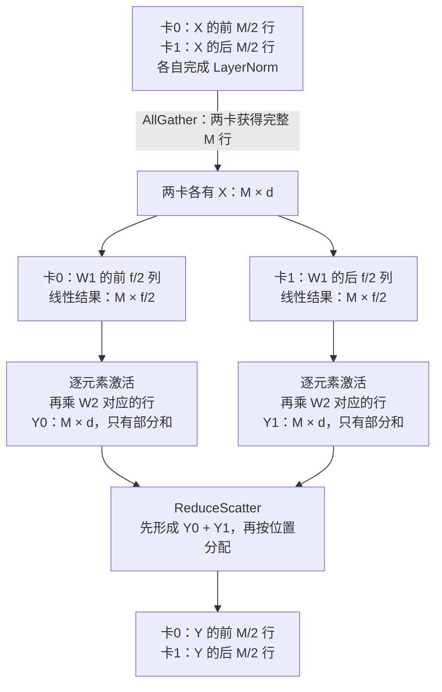

# 分布式训练与模型状态

[[领域地图与覆盖缺口|领域地图]] · 基础回看：[[03 一张卡放不下跑不完以后]]

假设有一个 32B 参数的模型、64 张各有 80 GB 显存的卡。把参数平均分给它们，看起来很宽裕；但训练还要保存梯度、优化器和反向所需的中间结果。即使总容量够，每一层也必须及时拿到自己的输入。并行方案要解决的就是这两个相接的问题：**哪些对象留在本卡，缺少的部分在什么时候、以什么代价送来？**

以下先沿模型状态和一次层内计算确定所有权，再把序列拉长、把工作交给流水阶段与专家，最后检查剩余激活和拓扑预算。装下模型、加速固定任务、扩大总训练工作量各有不同分母，卡数本身不表示加速比。文中 rank 指一个参与分布式计算的进程；mesh 指这些参与者按分工组成的逻辑维度，不等于物理网络。

读前需理解矩阵乘法、前向/反向与激活寿命，见基础 02–03；长序列部分还会用到 [[04 模型结构怎样重新分配系统压力|Attention 的 Q/K/V 依赖]]。GB 为十进制，GiB 为二进制。

## 先把常驻状态放下，再安排本层物化

先算这 32B 参数的训练状态。BF16 参数与梯度各占 2 bytes，FP32 主参数与两个 FP32 Adam 状态各占 4 bytes，合计每参数 $2+2+4+4+4=16$ bytes，即 512 GB。64 卡完全分片时常驻均摊 8 GB；仅在每节点 8 卡内分片、节点间复制，则每卡 64 GB。后一方案只余 16 GB 给激活与临时对象，长序列可能再次超限。

把还未计算的部分记进峰值。先用未分片状态写出基线：$N$ 是全模型参数数目，$q_w,q_g,q_o$ 分别是每参数的权重、梯度和优化器字节数；$A_{\rm live}$ 是仍存活的激活，另外两项分别是临时物化与工作区：

$$
V_{\rm peak}=N(q_w+q_g+q_o)+A_{\rm live}+V_{\rm materialize}+V_{\rm workspace}.
$$

分片后，应把 $N(q_w+q_g+q_o)$ 替换为本卡实际拥有的权重、梯度和优化器常驻字节之和，三者还可使用不同分片度数。不能再把全模型的 512 GB 代作本卡常驻项。其余项仍按同一时刻的本地存活对象计量。预取层参数时，完整视图可能与分片、激活和通信缓冲同时存在；上述 8 GB 或 64 GB 只是常驻状态，不能代替实测峰值。

数据并行（DP）先让各卡处理不同样本、保留相同模型。ZeRO 逐阶段减少优化器、梯度和参数副本。参数分片后本层仍要读到所需权重，因此常需 AllGather；各样本产生的梯度相加后只留所有者，则用 ReduceScatter。不能把“本卡只存八分之一参数”误解成每次 GEMM 只读八分之一权重。[ZeRO v3，状态分片机制](https://arxiv.org/html/1910.02054v3)

完全分片和混合分片的竞争由这笔账决定：完全分片省更多常驻空间，却把物化或归并放进更大的通信域；混合分片用副本换取把高频通信留在快域，只跨域归并相应梯度分片。若容量已足够，后者可能值得；若激活挤满剩余空间，副本代价就不能接受。参数预取太早会同时保留更多完整层，太晚又等通信，所以预取距离本身是容量与等待的选择。

这时就能理解拓扑如何进入分片。HyperParallel-FSDP（v1，2026-09-18）在快超节点内采用逐参数通信，省去适用布局的打包拷贝；慢域用融合梯度消息摊薄启动。它要求单参数消息已经足够有效，且布局确实允许零拷贝。反向先做局部 ReduceScatter，把慢域 AllReduce 异步放进待完成队列，到更新前统一结算，使慢域等待不必逐层进入关键路径。[HyperParallel-FSDP v1，§4–7](https://arxiv.org/html/2609.21594v1)

分片还要尊重优化器。Muon 对逻辑矩阵梯度作矩阵级变换，任意切碎后各自变换未必等同原算法，因此该系统同时处理矩阵布局与重复工作。生产/验证模式在边界核对布局，并提供有限步数的数值比较；外部 opaque kernel 仍有受信契约。Atlas 900 A3 的整系统对照不能拆成各机制的独立收益，最大规模演示也没有同规模基线。它说明拓扑与优化器会约束分片设计，收益范围仍限于作者所测系统。

## 本地矩阵缺哪一块，决定了要交换什么

权重装下以后，看一次两层前馈网络（MLP）。设输入 $X$ 有 $M$ 个 token 行、宽度 $d$，中间宽度为 $f$，$\phi$ 是逐元素激活：$Z=\phi(XW_1),Y=ZW_2$，其中 $W_1:d\times f$、$W_2:f\times d$。

DP 把 $M$ 行分给不同卡，各卡前后向独立，但每卡的 $\nabla W$ 只是本地样本贡献，需要归并后做同一个更新。固定全局批次继续增加 DP，本地矩阵越来越小，完整参数梯度的消息却没有同比缩小，通信与小矩阵效率便逐渐占主导。

张量并行（TP）切中间宽度：各卡拥有 $W_1$ 的不同输出列和 $W_2$ 对应输入行。它们能独立形成 $Z_i$，却只能算 $Y_i=Z_iW_{2,i}$，完整输出是 $\sum_iY_i$。这解释了为何层内切分会引入部分和归并。一个实现可形成完整输出，也可把归并与下一步所需分片合成 ReduceScatter；关键不是 collective 的名字，而是下一算子到底需要完整行还是序列分片。[Megatron-LM v5，层内与层间并行](https://arxiv.org/html/2104.04473v5)

TP 能减少层内矩阵和中间激活的本地规模，但 LayerNorm、dropout 等逐位置区域仍可能在 TP 卡间重复保存。Megatron 式序列并行（SP）把这些区域按位置切开：进入列切分 MLP 前 AllGather，第二个矩阵后 ReduceScatter。图中只画两卡、忽略偏置，并假定 $M$ 和 $f$ 可均分。

图中第二次通信做了两件事：加齐中间宽度上的贡献，并把最终结果留成下一段 SP 所需的位置布局。它常与前面的 AllGather 组成原 AllReduce 的两半，无须额外再加一个等量 AllReduce。[SP 与选择性重计算 v1，§4–5](https://arxiv.org/html/2205.05198v1)

反向沿这些依赖倒走：先形成各矩阵需要的输出梯度视图，在本地中间列计算，再把输入梯度的部分贡献归并到位置所有者。减少前向复制激活，并未消除反向布局转换。这里的检查对象是每条边上的张量：它是最终值还是部分和，哪个轴还欠一次求和？漏归并会少算贡献，多归并则会放大梯度。

因此，大层、模型状态压力和低延迟互联使 TP 有价值；模型能装下、主要需要独立样本吞吐时，DP 可以保留更大的本地 GEMM。SP 解决 TP 边界的复制激活，尚未把全局 Attention 的上下文分散出去。有些文献也把下一节的 CP 称为 sequence parallelism，判断时应回到实际布局。

变长训练还要把数据语义接进来。两卡各有 100 与 900 个有效监督位置，本地平均损失分别为 $l_1,l_2$。全局 token 均值应是 $(100l_1+900l_2)/1000$，不是 $(l_1+l_2)/2$。如果分布式框架默认平均梯度，本地损失的缩放必须与这个约定配合；梯度累积又要以整个更新的有效位置总数为分母。改变 CP 或 packing 后本地有效位置变化，不能沿用旧的隐含缩放。

## 序列拉长后，计算窗口还能盖住 KV 交换吗？

取某个注意力层 $d=4096$、32 个 query heads、8 个 KV heads、head 维 128，序列 $S=131072$，单序列 BF16。这个局部形状用于计算，不据此反推上面全模型的 32B 参数。仅一个残差张量 $S d\times2$ 已是 1 GiB；一层 K 与 V 共 $S\times8\times128\times2\times2=512$ MiB。若保存完整得分矩阵则为 $S^2\times32\times2=1$ TiB。FlashAttention 可以避免物化这个平方矩阵，但没有取消全局位置交互的计算。

上下文并行（CP）让不同卡负责同一序列的不同位置。本地 query 仍需读取远端 key/value，位置切分于是引入了全局依赖。

环形方法保留本地 query，把 KV 块逐轮传来，在每块上计算并合并稳定 softmax 的统计与输出。它不是对各块 softmax 结果简单取平均；反向还需归并远端 K/V 的梯度。[Ring Attention v1](https://arxiv.org/html/2310.01889v1)给出分块通信与计算的具体算法，原 TPU 实验不是 GPU 扩展阈值。

先算环上的一个完整非因果矩形块。假设有效计算预算为 200 TFLOP/s、单向可用带宽为 50 GB/s，忽略启动与争用；它们都是教学预算，不对应某款卡。CP=8 时，本地 query 和每个 KV 块各有 16384 位置：KV 为 64 MiB，QK 与 PV 共约 $4\times16384^2\times4096=4.398\times10^{12}$ FLOPs。可用窗口如下：

| 序列长度与 CP 度数 | 每个 KV 块 | 块计算时间 | 块传输时间 |
| --- | --- | --- | --- |
| $S=131072,P=8$ | 64 MiB | 22.0 ms | 1.34 ms |
| $S=131072,P=64$ | 8 MiB | 0.344 ms | 0.168 ms |
| $S=8192,P=8$ | 4 MiB | 0.086 ms | 0.084 ms |

每块计算随 $1/P^2$ 缩小，KV 块随 $1/P$ 缩小，环却要走约 $P$ 轮。因此每卡总通信趋向一份完整 KV，而计算仍继续下降；“每卡更少工作”逐渐变成“更难隐藏通信”。短序列的第三行已经几乎没有余量。因果 Attention 会跳过上三角块，早晚区间工作不均，完整矩形还会高估部分窗口，需要交错或均衡切分重新核算。

另一条竞争路线是 **Ulysses 式 All-to-All**：起初每卡只有部分位置、全部本地 heads，交换后变为全序列、部分 heads，算完整 Attention，再交换回序列布局。它减少反复轮转，并让本地 kernel 看见较完整的长序列，但交换通常挡在 Attention 前后，要求高效 All-to-All；head 数和整除限制也约束并行度。GQA 的 KV heads 较少时，需核查具体实现如何分配、复制 KV，不能只用 query heads 推出可切卡数。[Ulysses v1，设计与通信分析](https://arxiv.org/html/2309.14509v1)

长到计算足够覆盖传输、或可用 heads 不足时，环形路线有用；网络擅长全交换、head 布局允许且环消息已成下限时，All-to-All 更有吸引力。两维组合可把 All-to-All 放在快域、把剩余序列维交给浅环，但组间重布局、GQA/MLA 的实际 KV 表示和反向都要入账。

## 能装下长序列，还要让每个微批及时通过流水

同一条序列可以借 CP 分散；不同层还可以交给不同流水阶段，称为流水线并行（PP），阶段之间传边界激活与其梯度。此时一个慢微批会沿多个阶段传播等待，只按 token 数平衡就不够了。

理想的平衡流水若有 $p$ 阶段、$m$ 微批，简单填充排空模型的有效比例为 $m/(m+p-1)$；$p=8,m=32$ 时约 82.1%。这只是等时阶段、忽略通信的示例。稳态交替一次前向、一次反向的 1F1B，以及交错调度，会改变在途激活和气泡，增加微批又可能使每次 GEMM 过小或改变有效批次。最长微批会沿多个阶段传播等待，平均 token 数相同也不能保证阶段平衡。

例如，16 条长度 8K 的独立序列与一条 128K 序列都是 128K token，全局 Attention 的平方工作项却相差 16 倍。HyDra（v1，2026-09-28）据此把每 rank 负载从 token 数转向接近 $\sum_i s_i^2/P_i$ 的工作量，按负载目标安排动态 CP 与 packing；再组合内层 Ulysses、浅外环，并在 Q/K/V 满足依赖时分别发起交换，把等待留到真正消费处。[HyDra v1，§3–6](https://arxiv.org/html/2609.34318v1)

这两部分须一起成立：给重微批更多 CP 可以降低计算偏差，通信组织又要允许更大的 CP 真正节约时间。作者的 2048 H800 实机结果中，微批离散程度与 PP 气泡共同下降，支持平衡和通信配套这一解释；它并未隔离某个 collective 的收益。更大规模含模拟，内部模型细节未完全公开，实机与模拟扩展率以及长期质量需要分别看待。

流水调度本身也要固定更新语义。常见同步流水在同一次更新的所有微批完成后统一更新参数，因此前后向对应同一权重；允许阶段异步更新则需要 weight stashing、版本管理或另一套算法解释。1F1B 表示前反向安排，不自动表示异步 SGD，也不自动保证所有阶段负载平衡。恢复时，微批编号、在途激活与已经完成的梯度究竟保留还是整步重做，要与检查点提交边界一致。

## 路由到专家后，平均负载为何失去预测力

混合专家模型（MoE）按 token 选择少量专家执行，使负载由输入决定。设 4096 个 token、64 个专家、top-2，平均每专家 128 行；如果一个专家实际收到 512 行，同一层就不能用平均值预测尾部。容量因子 1.25 给每专家 160 行上限时，热点部分要丢弃、重路由或采用另一种溢出语义；dropless 变长执行保留所有分配，却要承受动态缓冲、小 GEMM 和最忙专家的尾部。二者都应报告路由负载、实际保留 token 与任务质量。

专家并行（EP）把专家放到不同卡，dispatch/combine 搬的是被选中的 token 表示；TP 把一个专家再切开，通信更频繁却可处理过大的单专家；专家复制给热点更多执行者，支付参数副本和一致性成本。扩大 EP 域有利于容纳专家，却会扩大 All-to-All 的故障与争用范围。Attention 和专家还可使用不同 mesh，二者之间要转换布局，所以不能简单把 DP×TP×CP×EP 所有数字相乘来解释卡数。明确哪些 rank 维共享、哪些子图折叠，才有可验证的所有权图。

专家通信也可以直接数 payload。4096 个 token、top-2、宽度 4096、BF16，每次 dispatch 的全组逻辑输入约为 $4096\times2\times4096\times2=64$ MiB；combine 的输出还约 64 MiB，反向另算。这是全组被路由行的总量，既不是每卡消息量，也未扣除本地专家处理。实际再加路由元数据、对齐和可能的填充；热点或链路争用会让相同字节有不同尾部时间。把 EP 域从节点内扩到节点间，就必须重新回答这些消息能否在专家 GEMM 前到齐。

这里会出现两种不同的扩展边界：专家太大时，需要切单专家或扩容量；专家已放得下但热点拖尾时，需要改路由、复制或放置。扩大通信域只解决了“可把 token 送得更远”，没有为热门专家增加算力。任务质量还取决于容量限制、丢弃和重路由究竟怎样改变了每个 token 的路径。

## 剩余激活该重算，还是搬到别处

上述切分仍可能留下过多存活激活。重计算用额外 FLOPs 换保存空间，offload 用传输与主机空间换 HBM；CP 则以跨位置依赖换本地位置数。若要保存的张量为 $A$ bytes，重算需 $R$ FLOPs，设备有效算力为 $C$，首先可比较 $R/C$ 与卸载加读回的约 $2A/B_{\rm link}$，然后扣除各自能被独立工作覆盖的部分。

给 offload 和重计算一组教学数：某激活为 1 GiB，链路可用带宽 50 GB/s，卸载再读回的带宽下界约 42.9 ms；重算相关子图花 20 ms。如果两者都完全暴露，重算较有利。但前向算完之后到反向使用之间若有足够独立工作，传输可提前完成，offload 的暴露时间可能小于 20 ms。反过来，若所有层同时 offload、同链路还搬检查点，带宽预算会下降，不能继续按 50 GB/s 估计。

重算也不总是“多一遍整层”：只重建便宜但占空间大的中间量，可能比丢掉昂贵 GEMM 更合算；结构与融合算子又约束可选择的边界。随机 dropout 等状态必须可重建，否则反向用的是另一次前向。判断因此要在算子图上标出保存点、重算点和传输窗口，不能按一个全局显存压缩率排序。

增加重算有时会把通信藏在更长计算后面，使 GPU 利用率上升；它也增加了总工作，仍应以完整更新时间和总设备成本判定。offload 则要确认读回在消费前真正完成，不能用发起时刻代替可用时刻。两条路线都需要与参数预取、KV 和检查点流量共用同一张时间表。

## 把所有权、关键路径和恢复边界放回同一方案

训练完成一次更新后，权重还可能要交给采用另一种 mesh 的 rollout 池。这里要保留的是同一个逻辑张量，改变的是每个 rank 拥有的区域；先把全权重拼齐，再广播给所有接收者，会传送它们最终丢弃的部分。NVIDIA 在 2026-11-06 的 Reshard Collective 说明中，将两端的全局形状、mesh 和 placement 作为输入，按源分片与目标分片的交集直接搬运；目标副本还可利用 NVLink 域内转发，减少跨域重复流量。它把分片布局从训练内部安排变成了训练—生成交接的通信问题。[官方机制说明](https://developer.nvidia.com/blog/accelerating-reinforcement-learning-weight-refit-with-the-reshard-collective/)

这不是任意布局的零成本转换。核验的 NCCL M2N 是独立的 NCCL 扩展库，要求等大连续本地块、匹配的全局形状，公开 mesh 为一或二维、tensor 为一至三维。NeMo RL 的相关集成早在 7 月已合并，11 月是新的机制报告；报告采用混合路径，主要前馈权重使用 reshard，其他权重仍走原传输。作者的 refit 计时不能直接变成完整 RL 提速或质量提升。下一步应把量化/装载、同步等待与失败重建都放回 [[D03 后训练与推理时计算]] 的更新时间线。[固定 M2N 契约](https://github.com/NVIDIA/nccl-extensions/blob/b4d59251cd0e3e99d19e9d92261e669b8c75b2bc/nccl_m2n/README.md) · [NeMo RL 合并记录](https://github.com/NVIDIA-NeMo/RL/pull/2971)

拓扑组合可从频率来判断：TP 每层都要快速交换，优先占用低延迟域；PP 边界消息频率较低，但会传较大激活并连接所有阶段；DP 梯度可随反向逐层发起，最后仍有一段必须等。它们若共享一张网卡，不能分别按满带宽计算再相加“重叠收益”。正确的规划还要决定哪些流并行，哪些需要错峰，哪个截止时间最紧。

规划时先画状态所有权和张量布局，再逐边计算消息、容量峰值与可隐藏窗口。通信和计算若争用 HBM、SM 或同一网卡，二者单独测得的最佳时间不能简单取最大值。固定质量目标下还应计入规划、编译、输入停顿和恢复；换拓扑、长度分布或专家负载后，成本模型要重新校正。

最后核对同一次学习更新。[[D01 数据工程与训练配方]]的 packing 与监督 mask 决定位置对数和梯度分母；[[D04 模型结构与数值表示]]的 MLA、递归与低位宽会改变 payload，使原先最佳 CP 发生变化；[[D10 通信与互联]]决定消息是否按时推进。故障或扩缩容后，[[D12 集群资源可靠性与隔离]]还要恢复参数与优化器所有权、随机状态和数据进度。重新得到相同卡数，只恢复了资源数量，没有自动恢复那次更新。

一个可执行方案因而应能回答：峰值放得下吗；每个算子拿到的是哪种布局；每条等待有多少独立工作可以覆盖；提交更新与恢复时，哪些贡献已经计入。只要其中一项变化，就要重新检查组合，单卡峰值吞吐或链路标称带宽不足以替代这个过程。

## 来源与适用范围

核读截止为 2026-11-04。ZeRO、Megatron、SP、Ring Attention 与 Ulysses 作为固定版本机制依据；HyperParallel-FSDP v1 和 HyDra v1 分别为 2026-09-18、09-28 的作者研究。本文未运行 GPU、网络或训练实验，教学数字只作单位与依赖分析。

仍需匹配实机核验不同 CP 组合、专家/Attention mesh 转换、重算与 offload 的共驻峰值，以及故障重分片的完整恢复。旧库[[courses/hpcgame/HPCGame 2026 MLSys/HPCGame 2026 - 01 训练状态与并行|并行综述]]保留历史案例，具体读取范围见 [D02 核验记录](evidence/D02.json)。

2026-11-09 增补 Reshard 的报告、固定 M2N 契约及 NeMo RL PR 日期；未复核本域全部既有来源，未执行实验。见 [[来源与证据#AIINFRA-E-20261109-08]]。
