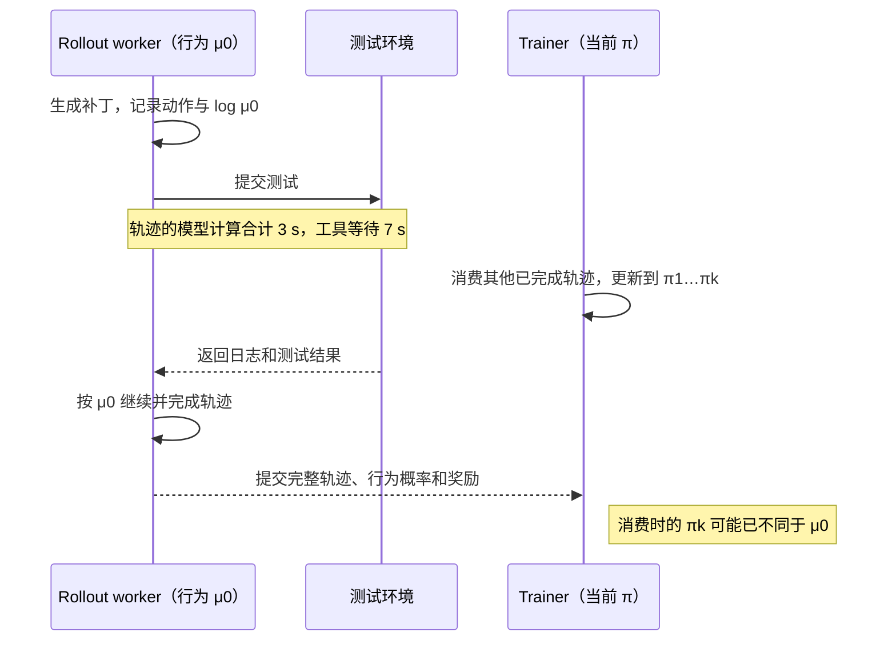

# 后训练与推理时计算

[[领域地图与覆盖缺口|领域地图]] · 基础回看：[[07 当生成结果又参与模型更新]]

代码助手生成了一份没通过测试的补丁。我们可以给它正确示范，让人比较两份回答，让它继续尝试并接受测试反馈，也可以暂时保持权重不变，多生成几个候选再选择。每条路线都在花计算改善结果，付费位置却不同：数据生产、模型更新、环境反馈，或每次请求的额外求解。

本章沿这次修复任务作选择：先规定怎样算成功，再看手里有什么学习信号；需要在线尝试时，把完整轨迹、失败和旧策略概率接起来；最后决定更新多少参数，以及训练投资能否由后续调用收回。读前需理解条件概率、token 损失与一次参数更新；生成、评分和版本交接的基本过程可先回看第 07 章。

## 先规定成功与预算，再选择学习信号

比较时先冻结任务分布、输入与最大预算，再记“准入多少题、在限时内完成多少、真正验收多少”。例如 100 题中完成 80 题、通过 60 题，完成子集通过率是 75%，整体限时成功率却是 60%；另一个方案完成 100 题通过 70 题，不能因为 70% 小于 75% 就说更差。两个指标回答不同问题，还要给出失败种类与已支付计算。

独立质量至少要隔离训练反馈与最终验收。若训练奖励来自公开单元测试，最终要增加未参与训练的测试和问题；若训练依赖 reward model，不能只用同一个模型重新打分。任务中还应保留容易暴露策略缺陷的分层，例如长上下文、多轮工具、无法立即成功的题和原有能力回归。适应新任务的收益可能伴随其他任务退化，平均 reward 无法表示这个交换。

预算也要匹配实际消耗。相同最大长度不意味着相同输出 token，采样次数相同不意味着工具和 verifier 调用相同；通过早停节约预算是有意义的路线，但应单独展示按实际计算或钱归一的质量曲线。论文中按若干 checkpoint 取最好结果，适合描述“曾达到什么”，不能直接作为固定终点、无选择成本的部署质量。小题集上多次测量同样需要防止把验收集变成隐含调参集。

固定了这个验收，才能解释“再学一次”想改变什么。下面的示范、偏好和测试奖励可以服务同一任务，但分别提供不同信息，不能只用训练 loss 或 reward 的涨落替它们判胜负。

## 有正确补丁、有偏好，还是只有测试结果？

先固定一个小过程：提示是代码与报错，模型输出补丁，测试环境返回结果。监督微调（SFT）已有一份可靠补丁，训练时把提示与目标补丁一起输入，预测每个目标 token；目标是 $-\sum_t\log\pi_\theta(y_t\mid x,y_{<t})$。不必逐步采样出这份已知回答，多个目标位置可在一次因果前向中求概率。提示、测试日志通常只是条件；是否监督它们必须写进 mask，不能把环境观察当成模型做出的动作。

若只有“补丁 A 优于补丁 B”，就没有每个位置的理想标签。直接偏好优化 DPO 在同一提示 $x$ 下比较两条完整回答相对参考策略的概率：$y^+$ 是胜方，$y^-$ 是负方，$\pi_\theta$ 是待更新策略，$\pi_{\rm ref}$ 是固定参考，$\beta$ 控制相对概率的尺度，$\sigma$ 是 sigmoid。其损失为

$$
z=\beta\left[\log\frac{\pi_\theta(y^+|x)}{\pi_{\rm ref}(y^+|x)}-\log\frac{\pi_\theta(y^-|x)}{\pi_{\rm ref}(y^-|x)}\right],\qquad L=-\log\sigma(z).
$$

它提高相对参考策略的胜方优势，并通过 sigmoid 调整压力；不是单独把胜方当成唯一真答案。已有离线偏好对时，更新循环无需持续在线生成，也无需另训显式 reward model，但生成和标注偏好、读取两条回答与参考概率仍付费。偏好若来自旧模型，只覆盖那批回答能表达的比较，不能自动探索未出现的解。[DPO v2，§3–4](https://arxiv.org/html/2305.18290v2)

若可靠示范不足，但能运行测试，就可以让策略提出补丁，从环境或评分模型得到奖励，再调整行为。这是在线强化学习（RL）的闭环：生成→环境→评分→更新。终局正确结果只告诉我们整次尝试好坏，并未指出每个中间动作的价值。

把这次修复展开：策略先读代码，写补丁，调用测试，读回错误，再修改并结束。模型行为包括生成的补丁和工具调用，测试日志是环境反馈；更新时要保留各轮边界与行为概率，不把日志文本纳入策略动作的概率和。终局测试奖励作用于此前哪些动作，是信用分配问题；调度只看到最长上下文或最后一次工具延迟，不能据此判断哪个动作最值得强化。

一个终局 reward 配给整条回答，省去了逐步标注，却可能让无关前缀也得到同方向权重。过程评分能给更密的信号，但要付出标注或 verifier 成本，还要防止模型写出“看起来正确”的中间过程。价值模型可以利用状态预测剩余收益，增加训练状态、前向与拟合误差；组内相对基准不需要同样的 critic，却需要多个同题候选，全部同奖时又没有相对信息。这些是信号密度、额外模型与采样预算之间的竞争。

把相对好坏转成更新权重后，一个基本策略梯度估计是 $\sum_{j,t}\hat A_{j,t}\nabla_\theta\log\pi_\theta(a_{j,t}\mid s_{j,t})/K$。$j$ 表示轨迹、$t$ 表示动作位置，$s$ 是当时可见上下文，$a$ 是模型动作；$\hat A$ 是相对基准的优势，$K$ 是所选平均分母。价值模型和同题组内比较构造基准，会产生不同的状态、计算和统计代价。

于是三条路线的竞争条件很具体：高质量示范覆盖充分时，SFT 可以少花探索成本；人工擅长相对判断、难写完美示范时，偏好数据有价值；反馈便宜且策略仍需发现新行为时，在线 RL 更有吸引力。若测试很贵、奖励稀疏且当前模型几乎不能成功，扩大 rollout 未必优于先补示范或教师引导。训练 reward 变高还要到独立问题、独立测试或人工验收确认，评分器自身不能兼任全部质量证据。

也不能把所有角色数量固定成四个大模型。规则测试可替代学习 reward model；组内基准可省 critic；参考概率可预计算或由冻结模型提供；教师也可能只在低置信样本上调用。它们改变峰值驻留、重复前向和数据传输。先按所选目标列出真实依赖，再决定共置、分池或分时装载，才知道是 rollout、环境、评分还是更新端限制产出。

## 一组回答进入更新前，哪些结果可以丢？

组内相对方法把同一题的多个结果放在一起判断，GRPO 类目标便使用这种信号。调度若改变组成员，剩余回答的优势也会变。先用一个可手算的归一化例子看清这一点。

考虑同一题采 8 个回答，其中 2 个奖励为 1、6 个为 0。按组内总体标准差归一，均值 0.25，成功项 advantage 约 1.732，失败项约 -0.577。若三个失败回答因为耗时被丢弃，剩下 2 成功、3 失败，均值变成 0.4，归一后的优势约为 1.225 与 -0.816。这不只是省了三个执行请求，它改变了剩余回答的更新权重，并把训练偏向容易完成的轨迹。

超长、工具错误、编译失败、基础设施超时不能不分语义地全设为零或全忽略。补丁无法通过规定测试是任务失败；测试服务宕机则可能是未知结果，应重试或单独记账；达到明确输出上限属于协议内截断，换上限又改变任务。组内方法还要说明全成功/全失败组怎样处理、重采样花了多少，以及分母按回答还是有效 token 计算。按回答均值与按 token 均值会给长回答不同权重，不能在 batching 优化中悄悄替换。

记录应从“准入题目→生成候选→完成环境→有效评分→实际消费→更新提交”逐层留下数量与成本。吞吐分母包含失败尝试、重试、被丢弃轨迹和 verifier；质量报告则同时说明任务成功率与完成率。只对完成子集报 reward，很容易把系统性漏掉难题误认为学习进展。恢复也要固定已消费样本与更新版本，重复提交一次轨迹会改变更新，而不是无害的数据重传。

因此，完成得慢和任务做错需要不同处理：前者首先是调度与等待，后者才由验收协议决定奖励。若为了吞吐丢掉难题或迟到轨迹，改变的是已经选定的学习分布。[[D01 数据工程与训练配方]]中的身份、曝光与监督分母，也必须延伸到这条在线数据流。

## 把等待藏起来，为什么会产生两套策略

从系统时间看，假设一条轨迹有 3 秒实际模型计算和 7 秒工具等待。让它一直占着独享 GPU 会浪费等待窗口，但把它挂起后仍要保留或可恢复上下文、工具执行身份和取消状态。把等待全删出“生成延迟”，无法解释何时获得可训练样本。若更新频率很高，工具等待又会扩大行为策略与当前参数的差距；更快 kernel 只缩短其中一项，未必解除整个闭环的瓶颈。

同步执行先生成、再更新，行为与更新目标较容易对齐，生成卡和训练卡却可能交替空闲。异步让训练继续消费已完成轨迹，同时允许其他轨迹等待或生成。下面固定一个行为版本 $\mu_0$，只展示一次有工具等待的轨迹；实际系统若中途切换行为版本，需要按相应片段记录概率。

图中重叠节省了资源等待，却没有让这条轨迹变成年轻样本。它进入更新时，需要说明为何行为 $\mu_0$ 产生的数据可以用于当前 $\pi_k$，而不只是核对请求是否成功传到 trainer。

因此版本差只是代理量：十个小更新未必比一个大更新更偏；相同权重的采样端与训练端也可能因 dtype、kernel、mask 或采样变换不同而给出不同概率。需要保存行为策略身份、实际 logprob、temperature/top-p 等协议，以及训练端对同一 token 序列的概率。若训练端用的根本不是实际行为分布，纠正版本号没有修好分母。

**TitanRL 的数值一致性路径（2026-11-09 核验）**把这两种偏差分开处理。共用 TorchTitan 模型定义减少 trainer 与 vLLM generator 的代码漂移，但同一输入仍会因 batch 组成和归约顺序产生不同 logprob。固定提交 `3da9eac835` 的 batch-invariant 模式要求两端 BF16 前向、训练端 FP32 主参数、相同 TP degree，并禁用 SP；还要统一 attention、logprob 和归约路径，关闭 TF32／低精度归约，固定 NCCL allreduce 的树与 channel。FSDP 即使不分片，也承担主参数到 BF16 前向的精度边界。这里控制的是相同权重下的执行差异；异步轨迹的策略滞后仍由前述行为概率与更新目标处理，logprob 相同也不能替代独立任务质量。[固定数值契约](https://github.com/pytorch/torchtitan/blob/3da9eac83509091503e48534c9e3ca06b4d76fd7/torchtitan/rl/BITWISE_PARITY.md)

这组条件还会穿过状态布局与依赖版本。11月8日 UTC 合并的修复处理了 GB300 上 batch-invariant Kimi K3 的 KV 初始化失败：该路径保留展开的 K/V，而 K/V head 大小不同；页面估算误把 V 当成 K，留下 padding，随后与 FA4 固定 block 的拆分要求冲突。修复补入真实 V head 大小。11月9日另一提交暂时固定 vLLM nightly，避免更新后的 model-runner 接口破坏现有集成。两者都属于公开 main 的限定工程进展：Kimi K3 修复的 GPU 测试由维护者在 GB300 上报告，README 仍列 support coming soon；一般模型支持表也以 debug 模型两步端到端运行为标准。它们证明需要共同维护模型、cache、kernel 和软件版本，尚未证明任意组合或长期训练质量。[KV 修复](https://github.com/pytorch/torchtitan/pull/5955)、[依赖固定](https://github.com/pytorch/torchtitan/pull/5958)、[固定支持边界](https://github.com/pytorch/torchtitan/blob/3da9eac83509091503e48534c9e3ca06b4d76fd7/torchtitan/rl/README.md)；[[来源与证据#AIINFRA-E-20261109-04|证据与范围]]。

## 旧数据怎样用于当前更新：修正分布，还是改变目标

令 $\mu$ 为真实行为分布，$\pi$ 为当前目标策略。在相同提示、相同环境机制且具有所需支持的理想条件下，完整轨迹的重要性比为

$$
w(\tau)=\frac{\pi(\tau)}{\mu(\tau)}=\prod_t\frac{\pi(a_t|s_t)}{\mu(a_t|s_t)},\qquad \log w=\sum_t(\log\pi-\log\mu).
$$

它揭示长度效应：若每 token 的对数概率差都为 0.02，20-token 轨迹的比是 $e^{0.4}\approx1.49$，1000-token 则是 $e^{20}\approx4.85\times10^8$。实际差值会正负变化，这个例子只说明小的逐位置差异能沿长轨迹累积。单独用当前位置概率比并不会一般性恢复旧策略所产生的前缀分布；完整轨迹比又可能方差极大。

裁剪比值、删掉异常位置或限制策略年龄，可以降低不稳定性，却改变估计或接受集合。近端策略优化（PPO）对概率比作裁剪的替代目标，也不是精确分布修正或严格的 KL 偏离上限。[PPO v2，§2–3](https://arxiv.org/pdf/1707.06347v2)说明的是其目标构造，不能借用“PPO”一词省略行为概率、旧策略和裁剪位置。权重 $[1,1,1,9]$ 的有效样本量 $(\sum w)^2/\sum w^2=144/84\approx1.71$，展示了四条轨迹也可能只提供少数有效贡献；这是一项诊断，并非训练稳定的充分条件。

这条路线保留目标策略的解释，困难在长轨迹比值的方差、前缀覆盖和裁剪偏差。另一条路线是围绕滞后行为策略直接定义学习目标。OAPL（v1，2026-02-22）采用 KL 正则化目标，以约束策略相对行为分布的偏离；简化到整条回答奖励 $R$，理想最优分布为 $\pi^*(y|x)\propto\mu(y|x)e^{R(x,y)/\beta}$，故有 $\beta\log(\pi^*/\mu)=R-V^*(x)$。它从一组行为样本估计 $V^*$，再回归这一关系，避免完整重要性乘积。这里的 $\beta$ 是该目标的正则强度，与前面 DPO 的损失构造应分别理解。[OAPL v1，§3、§5.2、§6.2 与算法 1](https://arxiv.org/html/2602.19362v1)

OAPL 论文算法在同步行为权重时清空 buffer，以保证组和价值估计属于同一行为分布；实际实验的两个 beta 也分别用于价值估计和回归。

两条路线的成立条件不同。重要性修正要核对真实行为概率及其方差；OAPL 改变目标、参考对象和统计假设，也仍受支持不足、奖励漏洞和有限组估计限制。把 GRPO 的修正项直接删掉，不会自动得到后一套算法。

OAPL 的数学与代码实验使用任务指标，提供了训练 reward 以外的证据；代码设置却过滤了没有任何正确回答的 prompt，并在多个 checkpoint 中选最好者。约 400 个更新的 lag 属于这套分阶段代码过程，不能当作通用安全上限。其代码比较含 279 个 LiveCodeBench 问题、每题 20 次采样；约 200K 对约 650K generations 仍有生成长度差异，作者也未复现基线最初报告的 60.6%。这些是作者复评下的样本效率结果，尚未证明完整训练便宜三倍或同质量墙钟成本更低。

## 目标固定以后，再安排长轨迹怎样完成

算法允许某种行为差异，并不表示任意积压都划算。调度还要把轨迹真正做完，控制在途状态，并保住刚才规定的消费集合。CadenceRL（v1，2026-09-29）给出了一种具体过程：pending 集按行为版本组织，离开 worker 的轨迹仍留在系统，回到同版本 worker 继续；长上下文迁出、短上下文填入，使一部分 worker 保持大活跃批量，短工作耗尽后再集中排空尾部。准入 credit 控制整体在途量，不能给每条轨迹提供年龄硬上限。[CadenceRL v1，§4–6](https://arxiv.org/html/2609.36899v1)

迁出还要交付可用状态：兼容且同集群的 worker 可经 host 快照、relay 与并行读回准备 KV；跨类型或跨集群则回退到 token 传输后重新 prefill。作者把 trainer 留有余量以隔离 rollout 瓶颈，同构池呈现吞吐—尾延迟取舍，异构组合才利用硬件差异；收益不能外推到训练端已饱和的系统。其“训练质量”只检查 Qwen3-8B 的 30 次迭代平均 reward，未关闭长期独立任务质量风险。

这里调度改变的是何时驻留、由谁执行，以及状态如何恢复。它能否改善整个学习过程，还要看 [[D05 推理服务与调度]]中的生成成本曲线与更新端瓶颈；[[D04 模型结构与数值表示]]的 KV 形状、数值路径和概率对齐又会改变迁移及策略差异。只提高 rollout token/s，不能替代从准入到提交更新的完整账目。

## 值得更新权重后，再决定训练哪些自由度

SFT、偏好与 RL 规定学习信号；全参或适配器决定可改变的参数。它们是可以组合的选择：同一个反馈目标，既能做全参数更新，也能限制为低秩适配。

对 $4096\times4096$ 矩阵，全参更新有 16,777,216 个参数；低秩适配 LoRA 写成 $W=W_0+BA$；冻结 $W_0$，取 $A:r\times4096$、$B:4096\times r$。rank $r=16$ 时只训练 $16(4096+4096)=131072$ 个参数，约为前者的 $1/128$。优化器与梯度状态可以随之下降，因此多任务适配和频繁保存小更新有实际价值。[LoRA v2，§4](https://arxiv.org/html/2106.09685v2)

但 $W_0$ 仍要加载和计算。前向不仅有基座乘法，训练前面层的适配器时，反向还要穿过后续冻结基座传递输入梯度；节省了基座权重梯度，不是整个网络反向消失。rank 太小或插入位置太少也限制表达能力。多租户服务时，未合并 adapter 增加分支执行与版本身份，合并后又变成不同权重制品，连接 D16。

量化基座加 LoRA 可以进一步省常驻容量，但反量化、激活保存与误差适配还在；少了优化器字节并不保证同质量时间最少。相反，全参更新在同样数据上可能更快达到质量，也可能更容易回归其他能力。应在相同任务、验收和预算下比较，而不能把可训练参数占比直接当成训练加速比。

## 多算当前问题，还是把成本提前到教师与训练

不更新权重时，也可以多采样、串行修订或搜索。若独立候选各以概率 $p$ 正确且有完美验证器，$k$ 次至少一次正确为 $1-(1-p)^k$；$p=0.2,k=4$ 时为 0.5904。这个数是 oracle 机会，不是现实 best-of-4 的成功率：候选相关、验证器误判、选择器偏好长篇或评分漏洞，都会使可交付质量更低。Pass@k 衡量至少一条正确，也不等于能选对那一条。

并行候选用更多设备换较短等待，串行修订把前一次错误作为信息但增加关键路径；搜索把预算投到中间分支，还需维护分支状态。容易题多采样可能浪费，困难题若验证器不能区分候选，追加预算也可能低效。[推理计算分配研究 v1](https://arxiv.org/html/2408.03314v1)提供了按难度与验证方式比较预算的基础研究。应把候选、被剪分支、verifier 和环境全计入，并比较规定时限内的独立任务成功率。

推理时投入每次调用的预算，训练则把成本提前，希望后续很多问题都少走弯路。蒸馏连接了这两者：学生可模仿教师完整回答、对齐 token 分布，或学习教师筛选的正确路径。序列示范易存储且不要求相同词表，却丢掉未采样概率；分布蒸馏更细，也增加教师前向、传输和词表对齐成本。让学生在自己的前缀上在线问教师，可改善只见教师前缀的覆盖，代价是在线耦合。

其总成本必须按部署量摊销。若离线蒸馏额外花 1000 GPU 小时，教师每任务花 2 GPU 秒，学生花 0.5 秒，且二者达到同一验收，额外 360 万设备秒需靠每任务节省 1.5 秒收回，即约 240 万任务。这里是教学预算，真实边际成本还受批量和容量约束；若学生质量不足，不能用多部署来补这个比较的前提。教师原本是否已训练，也决定哪些是既有成本、哪些应计入本项目。

因此，稳定高频任务更容易收回蒸馏投资，低频难题更有理由按次花搜索预算，领域快速变化则会削弱静态蒸馏的摊销。质量与时限相同仍是比较前提：学生达不到验收，部署量再大也无法把它变成同质量节约。

精确投机解码可以加速规定的目标采样，见 [[D07 投机执行与解码加速]]；搜索、修订和回答选择会主动改变输出分布。选择学习路线时，应将这种执行收益与任务质量收益分别记账，再回到开头固定的整体成功率、完成率与真实预算。

## 来源与适用范围

核读截止为 2026-11-04。DPO、PPO、LoRA 和推理预算论文作为固定版本机制依据；CadenceRL v1 为 2026-09-29，OAPL v1 为 2026-02-22，后者属于较早方法补读，不属于最近 90 天事件。作者结果未独立复现，本文未训练或部署模型。

2026-11-09 增量核验补入 TitanRL 的固定数值契约、支持表、相关源码及两项已合并修复；10月21日的介绍属于既有候选补录，11月8–9日的修复为新增事件。本轮未遍历全部提交和 issue，未运行其测试，也未补齐独立长期质量证据。

还需匹配实验比较同任务下 SFT/DPO/RL/蒸馏与 PEFT 的总成本、长程独立质量、截断和失败协议及跨版本恢复。旧库[[courses/hpcgame/HPCGame 2026 MLSys/HPCGame 2026 - 07 数据与后训练闭环|后训练闭环]]保留 AReaL、verl、slime 和恢复案例的历史边界，实际读取与发现见 [D03 核验记录](evidence/D03.json)。
