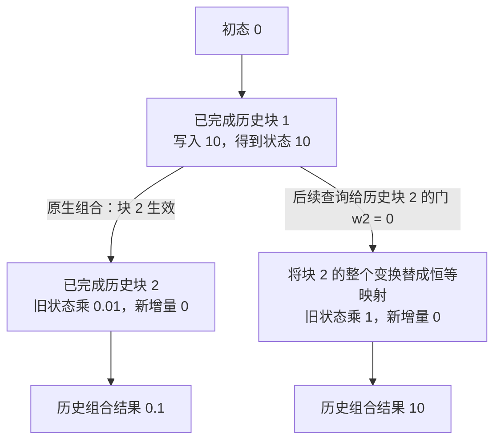

# 模型结构与数值表示

[[领域地图与覆盖缺口|领域地图]] · 基础回看：[[04 模型结构怎样重新分配系统压力]]

一份代码中的变量声明隔了十万 token 才被引用，模型仍需找到它。若想节省这段历史的容量，可以共享 K/V、少读一些位置、把历史压进递归状态，或把每个数表示得更小。它们节省的对象不同，也分别限制模型还能取回什么信息。我们要判断的不是哪种标签更新，而是：**任务需要保留的信息，能否以更少的状态和工作可靠地提供给下一步？**

下面先计算一条长历史，再比较连接和状态；MoE 则把同一问题转到参数容量；最后沿量化、运算和更新路径判断位宽节约能否兑现。读前需了解矩阵乘法和 Q/K/V：query 是当前读请求，key/value 是供它选择和汇总的历史表示；head 是相应计算分组。基础第 04 章有完整定义。本文局部形状用于比较成本，不据此反推某个真实模型的总参数。

## 保留全部位置，还是只保留部分连接

固定一个教学配置：32 层、32 个 query heads、8 个 KV heads、head 维 128，BF16 每元素 2 bytes，单条历史长度 $S=131072$。每层 K/V 为 $2\times S\times8\times128\times2$ bytes，32 层共 16 GiB；若 KV heads 也为 32，则是 64 GiB。这只算逻辑 KV，权重、临时张量和分配浪费另计。

全注意力的长处是当前 query 可以直接选择可见历史的细节；代价是 prefill 的位置对随长度近似平方增长，decode 每步要读越来越多的历史。FlashAttention 改变如何完成这些运算，通常不改可见位置集合；GQA/MLA 改表示；下面的稀疏连接则让一部分位置对根本不参与。三类节约的对象不同，不能都写成同一个“Attention 优化”。

分组查询注意力（GQA）让多个 query 共用 KV，直接减少这项容量与相应读流量，却没有按四倍减少 query heads 的计算，也没有取消全局位置交互。它要由训练或适配保证能力；不是任意多头模型的无损缓存格式。[GQA v3](https://arxiv.org/html/2305.13245v3)研究了从多头检查点进行 uptraining 的方法。多头潜在注意力（MLA）则用 latent 与解耦位置分量改变历史表示，并重排投影计算；具体执行可能保持压缩态，也可能展开，通信与 kernel 不能只看逻辑 latent 维度。[DeepSeek-V3 报告 v2，§2.1](https://arxiv.org/html/2412.19437v2)

只保留窗口 $w=4096$ 时，大部分 query 最多比较 4096 个历史位置，长序列 prefill 的位置对约为 $Sw$，而全局因果关系约为 $S^2/2$，本例两者比约 $1/16$。若所有层都只需这段历史，KV 也可约降到 $16\,GiB\times4096/131072=512$ MiB。但窗口外事实不再直接可读；需要原样回取远端变量或长文证据时，这正是可能丢失的能力。

局部加全局块、块稀疏或按内容选择，为远距离信息增加通道。固定局部连接索引简单，适合局部相关性强的负载；内容路由适合稀疏证据，但要支付筛选、排序、索引读与不规则执行，还可能漏掉真正重要位置。若原模型只在推理时删连接，比较的是近似执行；若从训练开始采用稀疏连接，比较的是另一模型与配方。相同“节省 90% 位置对”并不固定质量，更不说明 GPU 时间也降 90%。

因此，任务若需要精确引用遥远原文，窗口之外的信息通路就是质量验收的重点；若相关性主要局限在近处，固定窗口的规则访问更容易兑现节约。共享表示与删除连接可以组合，但每次组合都要重新核对：逻辑上保留什么、实际读多少字节，以及漏掉什么会使任务失败。

## 把历史压进状态：省去了什么，又留下了什么

另一条路线不逐 token 保存完整 KV，而更新递归状态。例如 $h_t=A_t h_{t-1}+b_t$。只要维度固定，推理状态可不随序列长度增长；但早先信息必须压进有限状态，且未来 query 出现前已经历后续遗忘和覆盖。这个取舍适合保留持续统计与局部模式，却不能由常量空间直接推出精确长程回取能力。

在线性 Attention 的一种简单形式中，可维护矩阵 $S_t=S_{t-1}+\phi(k_t)v_t^\top$，再用 $\phi(q_t)^\top S_t$ 读出；归一化形式还维护相应分母。带门控的 delta-rule、状态空间模型（SSM）与 Mamba 进一步改变写入、擦除和衰减，不能都等同于这一加法公式。[Mamba v2，§2–3](https://arxiv.org/html/2312.00752v2)把输入相关选择、状态压缩和硬件 scan 联系起来，负载也包括音频和 DNA。

递归并不意味着训练只能一个 token 等一个 token。两段仿射变换可以合成：$(A_2,b_2)\circ(A_1,b_1)=(A_2A_1,A_2b_1+b_2)$，这一组合满足结合律，可以组织前缀 scan 或分块计算。它不满足一般的交换律，顺序仍然重要；如果 $A$ 完全稠密，合成成本也很大，实际路线靠结构、分块和硬件映射使之可行。因而“decode 每步固定成本”没有替代训练成本分析。

同样用教学形状，32 个 $128\times128$ 的 FP32 矩阵状态每层为 2 MiB，32 层为 64 MiB，另有卷积等状态未计。若改为 24 层递归、8 层全局 GQA，长历史状态约为 48 MiB 加 4 GiB KV。它比 32 层 GQA 少，却仍随那 8 层的历史增长；训练配方和能力也已经改变，不能把这笔容量账称为同模型无损压缩。

混合路线保留少数全注意力层提供精确信息通路，其余层用递归或稀疏运算。比例、层位置和任务决定成效：检索任务可能需要更多直接访问，连续信号可能更适合压缩状态。运行时同时持有 KV、递归状态、卷积窗口与路由索引，前缀分叉或取消时必须一起分叉与回滚。这里的“更省状态”未必意味着缓存系统更简单。

这条路线把“每步读取全部历史”换成“维护和读取有限状态”。有限状态的好处会延伸到服务容量，代价则取决于任务是否容许信息被逐步压缩。为了增强远程选择，又可以在递归层内部重新引入对历史摘要的访问。

## 让后续查询决定，哪些历史变换应当生效

先看两个**已经完成的历史块**。初态为零，块 1 写入 10，块 2 将旧状态乘 0.01 且无新写入，组合后只余 0.1。后续块中的查询若需要块 1，给块 2 的输出另乘一个权重并不能恢复已被压小的信息；可改变的对象是块 2 对更早状态施加的变换。

HLA（v1，2026-10-05）在 Gated DeltaNet（GDN，一类带门控的 delta-rule 递归层）上增加这种访问。它把每个已完成块保存为仿射摘要 $(A_j,B_j)$，用 query 与块代表生成独立 sigmoid 权重，再组合 $[(1-w_j)I+w_jA_j]S+w_jB_j$。$w=0$ 是跳过整个变换，$w=1$ 回到原变换；当前块只使用因果前缀。它调节的是写入和对旧状态的变换，不是对一组块输出作普通 softmax 平均。[HLA v1，§3 与附录伪代码](https://arxiv.org/html/2610.05842v1)

下图只画这两个历史块，省略查询所在当前块的因果前缀与最终读出。假定查询为历史块 2 给出门值零，展示门到底改了哪一步；它并不证明模型总能学到正确选择。

这里跳过的是遗忘变换与写入的整体，因而需要保留可供重新组合的块摘要。查询所在的当前块仍按原来的因果前缀执行，不能借此看见未来位置。

这解释了代价：保存摘要和代表、为当前 query 路由、重新组合历史，状态随块数增长，已不再是原生 GDN 的固定状态。作者报告长程评估改善，也报告同一 H200 NVL、BF16、B=1、4096 输入和 128-token 稳态生成下 decode 比原生 GDN 更慢；这是表达能力与延迟交换，不能称为无条件加速。预训练适配和从头训练实验支持所测范围，持续 Agent 交互与恢复条件仍需单独核验。

## 参数容量不足时，少激活专家能解决哪一部分

前面改变的是位置交互和历史表示。若瓶颈转到前馈参数容量，混合专家（MoE）可以让不同 token 选择不同专家，而不是让每个 token 都经过全部参数。

假设 64 个专家各有 100M 参数，专家总参数为 6.4B；每 token 选 2 个，则经过约 200M 专家参数的计算，另加共享层。扩大专家数增加总容量，不必让每 token 跑遍所有专家，是否转成同质量收益仍由训练决定。BF16 专家权重总共仍约 12.8 GB：没有被当前 token 选择的专家不能从模型容量账上删掉。

批量也会改变读权重的结论。单 token 可能只触及两个专家，很多 token 的一个批次却可能触及全部专家；有专家没收到行时空置，有的只有几行时 GEMM 又很小。4096 个 token、top-2、64 专家的平均是每专家 128 行，但热点收到 512 行会拖长尾部。限制容量可以控制峰值，却要定义丢弃或重路由语义；dropless 变长执行保留分配，又承受动态缓冲和不均衡。

路由质量与系统放置于是互相制约：强行均衡可能压制有用的专业化，放任热点又浪费其他卡；专家复制减少热点等待但多占容量，限制路由节点减少网络范围却收窄可选专家集合。DeepSeek-V3 的共享/路由专家、均衡与节点限制是一种组合实例，[报告 v2 的 MoE 设计](https://arxiv.org/html/2412.19437v2)保留其固定模型条件。D02 解释 EP/TP 与通信怎样完成这个选择，不能只根据激活参数比例预测速度。

于是“模型有多少参数”至少要分成两项：需要驻留或分片的总参数，以及当前 token/批次实际激活的参数。后者决定部分算量，前者决定容量；两项都还不足以替代路由分布和最忙专家的时间。这些对象先明确，[[D02 分布式训练与模型状态]]才能选择 EP、TP 与专家副本。

## 只改变数的表示，先把有效位数算清

用 $\hat x=sQ(x/s)$ 表示一次量化，$Q$ 决定可用值、舍入与范围，$s$ 决定分组尺度。一个 **INT4 教学例子**：同组最大绝对值 100，正最大整数 7，尺度约 14.29，值 1 会舍入为 0。缩小分组把异常值隔开，可保护更多小数；代价是每组更多 scale、读取与布局处理。FP4 的值级并非这个均匀整数格，不能把 INT4 例子的误差直接套给 FP4。

W4A16 表示权重约四位、激活十六位；它主要争取权重搬运节约。W8A8 或 FP8/FP4 GEMM 还会改变输入运算，KV 与递归状态量化则把误差放进历史。BF16、不同指数/尾数的 FP8、微缩放 FP4 以及带零点的整数格式，需要连同 scale 和累加精度一起比较。

位宽的元数据也能改变选择。对每 128 个 INT4 值保存一个 FP16 scale，平均是 $4+16/128=4.125$ bit/值；组长改为 16，就变成 5 bit/值，还未计零点与对齐。小组改善局部范围，却使理想压缩比从 $16/4.125\approx3.88$ 降到 $16/5=3.2$。如果不同组再有不同 bit，寻址与解包也变复杂；不能只报 payload 位数而忽略真实驻留和每步转换。

例如 32B 权重若全用 BF16，payload 为 64 GB；理想 W4 为 16 GB，再假设每 128 值一个 2-byte scale，增 0.5 GB。按 1 TB/s HBM 预算，单次完整读权重的理想下界从 64 ms 到 16.5 ms。它未计激活、scale 处理、反量化、缓存与计算及非理想访存开销，也假定确实读取全部权重；大批量复用后瓶颈可能已转为计算。若仍保留 FP32 主参数与 Adam 状态，训练容量更不会只剩 16.5 GB。

这笔账已经包含 0.5 GB 的 scale 字节，但仍只是理想读量下界。要判断部署是否更快，下一步必须沿表示怎样进入算子、结果怎样累加、训练怎样更新走完，而不能停在量化文件大小。

## 已有模型怎样适配这套表示

PTQ 是训练后量化，QAT 是训练中显式引入量化误差；直通估计器（STE）用近似梯度让更新穿过不可导或分段常值的量化步骤。

PTQ 与 QAT 在这里竞争。校准后一次性处理已有权重，成本低且不需要完整训练，却可能对目标分布和异常激活敏感；QAT 在训练中暴露量化误差，让参数适应，增加训练预算，还常使用 STE 近似梯度而非量化函数的真实导数。没有足够数据和训练预算时 PTQ 有吸引力，极低位且质量损失无法接受时训练适配可能值得，但最后必须用部署算子复验。

AWQ 的比较进一步说明校准为何看激活：输出误差是 $X(W-Q(W))$，不是仅由权重误差决定。对输入通道作等价缩放 $XW=(XS^{-1})(SW)$，可以改变哪些权重在量化格中得到较好保护，再对少量校准数据搜索尺度；缩放过大又会恶化其他通道。[AWQ v3，方法与消融](https://arxiv.org/html/2306.00978v3)是一条 weight-only 路线，不能据此推导 W4A4、KV 或任意新域的质量。

AWQ 说明校准分布为何影响 weight-only 结果，QAT 则把误差适应提前到训练。选哪条路线，取决于能接受的质量损失、可用训练数据与预算，最终都要由部署算子实现同样的数值路径。

要把这种节约落地，完整路径至少是：高精度权重或主参数生成分组尺度与低位表示，按硬件要求打包；激活也按目标格式转换；矩阵指令执行后以选定精度累加，归一化等敏感运算使用合适精度；训练还要保存或重算激活、为转置准备表示、计算与归并梯度，再更新主参数并重建低位副本。只量化磁盘文件、加载后全部展开为 BF16，不会得到同样常驻容量；只模拟舍入后用高精度 GEMM，也没有测到原生低位运算性能。

训练中的转置又暴露了一个新的布局条件。

矩阵反向会使用转置。以 $Y=XW$ 为例，输入梯度用到 $W^\top$；如果对原矩阵按行分组，转置后重新按行量化，就把原来的列重新分成另一组。含异常值的组改变，scale 和舍入结果随之改变，一般有 $Q(W^\top)\ne Q(W)^\top$。反向使用的近似权重因而可能与前向不同；这项问题独立于单次量化误差大小。

**2026-07-27 的转置一致 FP4 论文 v1**用方形块维持转置前后的元素分组，对权重及部分梯度使用 2D 块，并结合尺度与随机舍入；激活仍保留 1D 取舍，Q/K 路径提高到 MXFP8。方形块保证分组与尺度对应，不自动保证随机舍入逐 bit 相同，也没有取消 STE 等其他梯度近似。[论文 v1，§2–4 与限制](https://arxiv.org/html/2607.24953v1)

作者到 30B、最多 100B token 的结果研究稳定性与质量，**使用软件模拟 FP4，没有原生 FP4 训练平台**。理论 weight memory 和理想线性运算吞吐，不是实测完整训练峰值或加速。更大的块还可能把统计不相似的值放在一起，硬件支持的尺度粒度与转置布局也可能要求额外转换。当前能确认的是这类分组一致性值得单独检验，不能据此宣称所有稳定 FP4 训练都必须采用同一方案。

DeepSeek-V3 的 FP8 训练则把细粒度尺度、累加处理与保留高精度组件一起设计，[报告 v2，§3.3](https://arxiv.org/html/2412.19437v2)可回看完整路径。“FP8 训练”同样不意味着优化器、归一化和所有中间状态都改成 FP8。

原生格式还必须连通训练、导出与服务。导出若重新分组或重新校准，服务看到的量化模型就变了；adapter 合并也可能产生新的异常值，旧 scale 未必仍合适。固定模型制品应包括分组轴、块大小、scale dtype、舍入/饱和规则及布局版本，重新打包需检查表示是否保持。D16 的版本身份因此延伸到数值路径，而不只是基础权重 hash。

## 同一次舍入，放进递归后会存活多久

位宽不仅影响当前矩阵结果，还可能影响未来许多步。回到前面的递归状态：量化误差会参加下一次状态更新，所以只按一次写回的张量误差分配精度，可能忽略误差的寿命。

KV 中一次量化的历史会被多个 query 读取；递归状态还会把误差送入下一次更新。取标量 $e_t=a e_{t-1}+\epsilon_t$，若 $|a|<1$、每次写回噪声独立且零均值、方差 $\sigma^2$，并达到稳态，方差为 $\sigma^2/(1-a^2)$。$a=0.99$ 时约 $50.25\sigma^2$，$a=0.5$ 时约 $1.33\sigma^2$。因此相同单次误差，对慢衰减通道的长期影响更大；真实门控、擦除和相关舍入会改变这个简化模型。

Low-Bit Recurrent States（v1，2026-09-25）将这个问题用于位数分配：方法把误差的未来读出影响与归一化范围合成权重，在平均位预算内给不同通道分配不同 bit。它用可观测 Gramian 推导局部近似，再取整、截断并计入 scale 与位宽元数据；“平均四位 payload”不等于所有模型都只占四位。[论文 v1，§2–5](https://arxiv.org/html/2609.30950v1)

作者区分逐 token 与低频写回，并用消融比较仅看范围、衰减和二者组合；较少写回时，部分改进出现统计并列。这支持“误差的寿命影响分配”，不支持一种固定分配永远最佳。实验是 quantize/dequantize 的模拟，无 kernel 计时；指标为短 WikiText 窗口 NLL，部分逐 token 评估与选规则的数据范围重叠，也没有证明长程任务、实际 packed 容量或服务加速。论文写的是投 ICASSP 2027，不能写成已录用。

这又把写回间隔与数值路线接到了一起：少写回可以减少量化次数，却增加需要保留的高精度工作状态或改变执行组织；多写回压低常驻表示，则更需考虑慢衰减通道的误差传播。实际压缩比、读写带宽和长期任务质量要同时检查。

## 改变批量、上下文或训练预算，重新选择路线

先看批量很小、权重大且每步只生成一个 token 的情况。权重读取难以摊薄，W4A16 可能主要通过减少 HBM 字节起作用；若部署 kernel 每步先把整个矩阵写回 BF16，再读来计算，新增读写会吃掉节约。融合反量化和矩阵计算、复用 scale 与按 tile 解包，才把文件大小连接到执行时间。实际能力必须绑定支持的 shape、分组和设备，不能仅由算术位宽决定。

把批量增加，许多行共用同一权重，读权重的成本被摊薄，瓶颈会向 GEMM 计算与激活移动。原来的 weight-only 路线可能不再最优；支持低位输入的原生矩阵指令可以提供另一个选择，却需要在线量化激活并保持质量。即使同一数值配方，在小 batch decode 与大批 prefill 也可能需要不同 kernel 和量化路径。选择不会只沿“bit 越低越好”变化。

再把上下文从 4K 拉到 128K，权重大小不变，KV 读写与容量却大增。此时只压权重可能腾出空间，却仍留下长程 Attention 的带宽工作；GQA/MLA、稀疏访问或历史量化会进入主要竞争。若任务需要严格引用遥远原文，固定递归状态的压缩风险需要特别验证；若是长期信号统计，逐 token 原样回取也未必值得。结构应由需要保留的信息与质量验收约束，再进入设备预算。

训练中的选择又是另一层。更低乘法精度若需要更多 token 才达到同一质量，节省的每步时间可能被额外步数抵消；若只在训练末期做适配，前期高精度成本仍然存在。比较应画出质量相对于已消费 token、墙钟与总设备时间的曲线，并保留最终任务回归。一次没有发散的短跑只排除了那段范围内的灾难性失败，不能代替长程精度和独立任务评估。

因此，不同条件会把选择推向不同对象：小批量时先看权重读量与解包，大批量时看矩阵吞吐和激活，长历史时看 KV/latent 或递归信息通路，长期训练时还要看误差是否增加达到目标所需的步数。结构与格式须在同一任务验收下比较；少了多少 FLOPs、参数或 bit，都只说明其中一项资源变化。

这些判断会反馈到相邻系统：[[D02 分布式训练与模型状态]]的 CP 最优度随 KV/latent 与专家 payload 改变；[[D06 KV 与模型状态系统]]须对混合状态一起分支和恢复；[[D08 算子与 GPU 执行]]决定低位宽、索引和不规则 shape 是否真的节约执行时间；[[D16 工程交付与模型生命周期]]则要保存分组、尺度和布局身份，保证被验证的模型就是被运行的模型。

## 来源与适用范围

核读截止为 2026-11-04。GQA、Mamba、DeepSeek-V3 与 AWQ 作为固定版本机制依据；HLA v1、转置一致 FP4 v1、递归状态低位论文 v1 分别为 2026-10-05、07-27、09-25。本文未做模型、训练或 GPU 实验；软件模拟、作者实测与理论下界已在对应论证中分别注明。

仍需匹配训练预算检验稀疏/递归/混合结构的长程质量，核查 HLA 持续会话与恢复，以及原生低位完整路径的多形状性能。旧库[[courses/hpcgame/HPCGame 2026 MLSys/HPCGame 2026 - 02 稀疏模型与数值格式|结构与格式综述]]保留历史案例，读取与候选范围见 [D04 核验记录](evidence/D04.json)。
