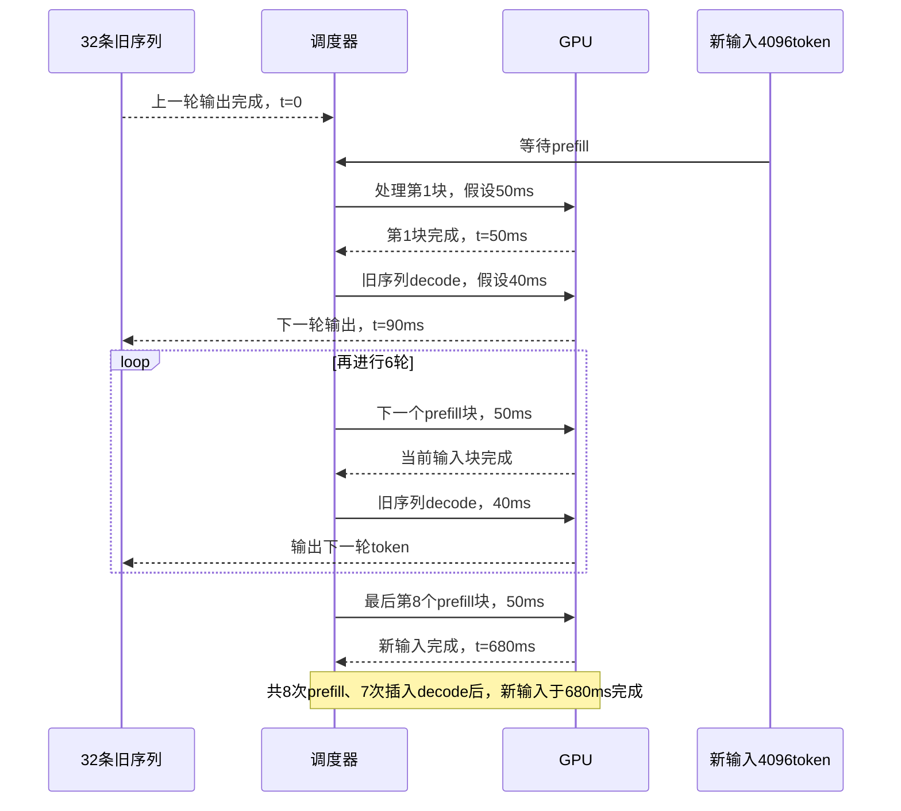

# D05 推理服务与调度

[[领域地图与覆盖缺口|领域地图]] · 关联：[[D06 KV 与模型状态系统]] · [[D07 投机执行与解码加速]] · [[D14 多模态 Agent 与流式系统]]

阅读本篇需要先知道：prefill 处理已知输入，decode 逐步生成输出，历史 KV 会随序列保留和增长；可从 [[05 从模型权重到一次生成]] 回看。本篇接着问：新请求到达时，怎样在既有请求的输出节奏、等待时间和资源预算之间作选择。先跟随一组正在生成的请求，再加入副本、阶段池和扩缩容；这些是同一组约束的不同处理办法。

推理服务面对的是不断到达、占用不同状态、具有不同完成时限的工作。模型执行器回答“一批输入怎样算”，本域回答“何时接纳谁，安排到哪里，如何完成或停止”。它覆盖单池调度、多副本路由、阶段拆分与异构执行；集群作业放置和扩缩机制另见 [[D12 集群资源可靠性与隔离]]。

## 新请求插入时，谁让出执行时间

一个请求带来的不只是 token 数。输入处理占用一段计算，输出逐步推进并持续保留状态，流式返回又要求不能长时间停顿。已有前缀可能减少计算，但加载要等待；输出长度通常事先未知，当前能放下的请求还可能因状态增长触发抢占。

连续批处理允许请求在迭代边界进入和退出，减少等整批结束的空位浪费。但调度粒度变细，只增加选择机会，没有消除阶段争用。可以按等待、估计剩余工作、时限或租户份额决定先后；每一种目标都要解释它怎样避免长请求或冷请求长期被跳过。

先看一个用来推理的假设排程，不把它当成硬件实测。已有 32 条生成中的序列，一轮 decode 为 40 ms；一个 4096-token 新输入的完整 prefill 为 400 ms，若切成八块，假设每块各 50 ms。时间零是上一轮输出刚完成的时刻。若先完整做新 prefill，再做下一轮 decode，老请求下一次得到输出要到 440 ms。若逐块 prefill 与 decode 单独交替，输出间隔约为 90 ms；新输入最后一块结束却要到 $8\times50+7\times40=680$ ms。这还没算切换、调度、分块重读与实际混合执行的变化，不是 Sarathi 的性能预测。

<!-- figure: D05-F1 -->

图 D05-F1 只画单独交替的教学排程：在其余请求和成本不变的假设下，把老请求第一次等待从 440 ms 缩到 90 ms，同时把新输入完成推迟到 680 ms。图不表示混合批的内部并行，也没有计切换或分块重读。

这条时间线暴露了两个不同目标：老请求希望很快得到下一个 token，新请求希望尽快完成输入阶段。缩小 chunk 为调度器提供更多让步点，却不能让双方都免费提前。若又有一条短请求在第 10 ms 到达，它在两种排程中最早可重新参与选择的边界分别约为 400 和 50 ms；能参与选择仍不等于必定立刻执行。真实引擎应测混合批次的时间函数 $t(c,B,\{T_i\})$：它随 prefill 行数 $c$、decode 数量 $B$ 和各自历史长度 $T_i$ 改变，不能只按“本轮 token 总数相同”估时。

Sarathi-Serve 将长输入切块，与 decode 工作组成有预算的混合批次，控制单轮工作量，并让流水线微批的执行更均匀。它不是把本来串行的两个阶段简单交替：关键在于组合后的计算强度与单轮时间。其 2024-06-17 v3 进一步分析了这种分块与多 GPU 微批的安排。[Sarathi-Serve v3，§2–4](https://arxiv.org/html/2403.02310v3)

到这里，分块已经给出了更多选择时刻，仍没决定每个边界该选谁。下一步要把用户承诺变成调度条件，而不是一律让新请求或旧请求优先。

## 把等待变成时限、容量和公平约束

于是一次调度至少要作三个相互约束的决定：哪些请求允许进入、下一轮分配多少工作、状态和计算由谁持有。更大的批量能够提高权重复用，却可能延长每轮时间；优先推进新请求的 prefill 可提前其首 token，但会争用正在 decode 的资源。空闲算力与空闲显存并非同一资源，单看利用率不足以决定下一步。

本文从请求到达前端开始计时：首 token 等待 TTFT（time to first token）应拆成准入等待、路由/状态等待、prefill 排队和执行等部分；生成间隔也会混入队列与抢占。假设目标相邻输出间隔为 100 ms，上面的 90 ms 只剩 10 ms 余量，一次慢状态加载便可能违约。若新请求首 token 预算仅 500 ms，680 ms 的排程又不合要求。此时应改变批次、调度或资源，甚至拒绝部分请求；不能仅报告平均吞吐后宣称同时满足两类时限。

对离线批量任务，完成总工作量的时间和单位成本常是主要目标；交互服务还要约束 TTFT、输出间隔和尾部。有效吞吐应说明请求满足哪些目标、允许多少违约，以及拒绝、取消、失败是否计入分母。TPOT（首 token 之后的平均每输出 token 时间）的请求平均值不能替代相邻 token 间隔的分布。请求到达率相同，突发程度、长短混合与前缀重用不同，也会使同一调度策略产生不同队列。

容量增长使这个问题延续到未来。当前还放得下的一组序列，会在每轮追加状态；输出长度未知，接纳时只能作预算、预测并留恢复余地。对一个稳定阶段，平均到达工作量必须小于其持续处理能力，但即便满足这个必要条件，突发和长尾服务时间仍能使尾延迟很差。平均队长随到达率和平均停留时间相关，也不意味着降低平均值就能保证 p99。服务调度要掌握成本曲线和分布，而不是一个利用率阈值。

抢占至少有三种不同成本：暂停但保留 GPU 状态，会释放执行机会而不释放主要显存；换出状态释放容量，却增加 I/O；直接丢掉可重算状态，则把恢复变成后续 prefill。应先问要解决的是计算时间、显存还是下游槽位不足。即使按剩余长度优先，估计很短的请求也可能继续长生成；反复抢占同一长请求，既会饥饿，也可能让系统重复支付恢复成本。年龄提升、租户份额和最大等待保护不是可有可无的装饰，而是在纠正成本预测和吞吐目标的偏差。

公平还必须定义“分到了什么”。按请求数平分，长文租户和短问答租户并未消耗同样服务。VTC 的 **2023-12-31 v1**以输入和已生成输出的加权 token 服务量维护客户端计数，优先选择欠服务者；新回到队列的客户端需抬升计数，避免长期空闲积攒无限信用。这使未知输出可以边生成边记账。它证明的是给定服务度量与假设下的份额性质，不保证每个 token 按同一时限到达；权重也不是所有长度和硬件下恒定的真实执行时间。[VTC v1，§3–4](https://arxiv.org/html/2401.00588v1)

**2026-09-16 v1**的 FairInference 把这一缺口直接表述为 token 延迟隔离：先估计某租户独占其公平资源份额时各 token 的完成时间，再加入容许延迟，形成共享执行的 deadline。安排新 prefill 前检查它是否使正在生成的 token 超期；同时保护一部分 KV，使被驱逐后可在恢复预算内回来。这里“公平调度”和“公平缓存”是同一个时限合约的两部分，单独改善排队次序仍会被状态重算打破。[FairInference v1，§4–5](https://arxiv.org/html/2609.18112v1)

这个目标比长期服务量更强，条件也更多：需要可信的批次时间模型、受控的需求边界和可兑现的恢复时间。作者原型基于 SGLang v0.3.0，并计入调度/模拟等开销；论文专门分析了低估耗时怎样误放行 prefill、伤害 decode 时限。因此不能把条件化隔离结果写成任意过载下的绝对保证。公平与 deadline 还可能冲突：已超份额的租户也能提交最紧急任务，需要产品明确优先级、配额和拒绝规则，算法不能替产品决定。

如果需求超过可兑现的容量，排队次序无法凭空补足资源。接纳、拒绝和降级必须采用明确契约；先算完输入再发现无处生成，只是把等待变成已浪费的计算。

## 多副本之间，命中率为什么不够

加入副本后，队列最短者未必拥有可用前缀，缓存最热者又可能最拥塞。路由需要比较排队、计算、状态加载及后续生成，而非最大化命中率。跨不同模型的质量路由是另一类决策：它会改变能力与答案，不能与同模型副本分流混为一谈。

同模型路由可以先比较一条可解释的预计完成路径：队列等待，加状态恢复或缺失前缀重算，再加当前阶段执行。假设热副本等待 200 ms、命中后需 30 ms，冷副本等待 20 ms、重算需 100 ms，后者预计 120 ms，优于前者 230 ms；这些是假设值，实际还需考虑后续 decode 与状态增长。只用队长也会误判，因为一个长 prefill 和一个短 decode 不是等量待办。预测错误时要有重新路由的收益门槛，防止请求来回迁移，给网络和缓存制造更大波动。

跨模型质量路由则先改变了所求的答案分布。RouteLLM 的 **2024-06-26 v1**用偏好数据预测强模型相对弱模型获胜的可能，再用阈值选择调用方；这是调用前的能力估计，不是看到答案后的正确性证明，也不等于题目的绝对难度。[RouteLLM v1，§2–3](https://arxiv.org/html/2406.18665v1) 若因为强模型拥塞而调高阈值，成本与排队可能下降，任务质量也可能改变。验收应在相同任务集上画质量、总成本和时限达成的关系，并按领域看误路由；先调用弱模型再升级还要计入两次调用、检测和重试，而不能只算最终模型的 token。

对于最初那条长输入，路由现在有了第二个选择：留在有公共前缀但繁忙的副本，或转去空闲副本重算。这里的代价依赖 [[D06 KV 与模型状态系统|状态何时真正可用]]，不能只根据“查到命中”决定。若所有副本都受相同的长输入与生成节奏冲突限制，再考虑改变资源组织。

## 同样四张卡，要不要把阶段拆开

假设同一模型能装入单卡，现在共有四卡。四个共置副本与“一张 prefill、三张 decode”才是同预算比较；用四个共置副本对八卡拆池会混入扩容收益。再作一个只看平均工作量的教学假设：一个请求平均消耗 0.25 GPU·s 的 prefill 和 0.50 GPU·s 的 decode。理想共置上界约为 $4/0.75=5.33$ 请求/s；1P+3D 的两个阶段上界分别是 4 和 6 请求/s，整体受 4 限制；2P+2D 的上界则是 8 和 4。整数分池本身就可能留下无法互借的空隙。这不是实测结论，因为阶段专用组批与并行又可能改变那两个单位成本。

另一条路线隔离阶段。DistServe 将 prefill 和 decode 分到不同实例，并分别选并行方式和资源比例，以降低阶段间直接干扰。代价是重复持有部分模型资源、交接 KV，以及新增的跨池排队；网络与放置条件进入优化目标。因此分块共置与 PD 是不同资源条件下的竞争设计，不是“单池早期、PD 先进”的演进等级。[DistServe v3，2024-06-06，§2–4](https://arxiv.org/html/2401.09670v3)

拆分的理由是换一条成本曲线和干扰关系。若共置为了保护生成间隔而不断推迟长输入，专用 prefill 池可能允许更大输入批；decode 池也能按状态容量和输出节奏选配置。可是当输入突然变长，原来的池比例会失衡；当输出突然变长，另一端又会积压。DistServe 的阶段放置与并行搜索正是把时限可达区域带入配置选择，而非证明某个固定比例始终最优。要将其作者结果用于新部署，应重新测 TTFT/TPOT 的约束、互联以及长度分布，不能直接移植最大吞吐点。

交接也不是零成本。仅作单位核对，512 MiB 在有效 50 GB/s 链路上传完的纯载荷下界约为 10.7 ms，还未包括查找、排队、封装、接收布局转换和可见性同步。若许多请求同时从同一入口发送，这个有效带宽又不是每条流都能独占。prefill 已完成而 decode 没有可用槽位时，状态必须暂驻某处；没有下游容量预留或有界缓冲，拆池会把计算队列变成 KV 队列。分层状态可以增加缓冲容量，却也会增加恢复等待，反馈回可实现的时限。

同池不是只能逐段交替，拆池也不等于完全隔离。混合批可以让 decode 借用 prefill 矩阵计算的资源形状；共享网络、CPU、内存和调度线程仍会让多个阶段相互影响。应同时比较固定预算下的持续 goodput、短突发恢复时间与低负载响应，而不是让每条路线各选一个最有利的测试点。

因此，共置利用资源可互借的机会，拆池争取阶段独立配置的机会；收益取决于阶段成本能否改善到足以抵过失衡和交接。[[D08 算子与 GPU 执行|混合批执行成本]]与 [[D10 通信与互联|KV 交接的有效带宽和进展]]会改变这条分界，同一比例不能跨负载照搬。

## 状态移到主存，谁负责继续执行

还有一种情况：GPU 执行很忙或 HBM 放不下新增历史，主存却有容量。把状态换到主存可以释放 HBM；若每一轮仍要把全部所需状态运回 GPU，它也会增加持续搬运。于是要继续追问：状态之外，能否把一部分执行职责一同移走？

浙大团队的 DualPace v1 于 **2026-10-24 提交**，提供了异构路线的新实例。其 CPU 引擎拥有独立队列、调度时钟和主存 KV，能够自行推进 decode；GPU 继续处理全部 prefill 与 GPU 驻留请求。部分不访问 KV 的后续稠密阶段，可由 GPU 在明确边界协助，CPU 仍拥有原请求。[DualPace v1，§4–6](https://arxiv.org/html/2610.33501v1)

这与“等 GPU 产生空隙时顺便计算 CPU 请求”有实质区别：调度权不再完全受 GPU 批次门控。但独立队列并不等于独立容量。迁移前后必须同时为已占、已承诺、未来增长与可能迁入的状态预留空间；否则短期接纳更多请求会把主存推向溢出。

进一步看它的迁移流程：新请求的 prefill 仍由 GPU 执行，若最终驻留 CPU，先预留主存块，再逐层生成并异步复制 KV；已有请求换出后，也要等传输完成才对 CPU 调度器可见。换入则预算它直到完成的峰值状态，避免刚搬回 GPU 又因增长被搬走。这将“允许接纳”和“数据可执行”分开，CPU 独立推进才不会靠超卖容量维持表面吞吐。Dense Assist 是显式阶段边界的协助，也不改变请求的所有权；额外跨设备激活与 GPU 争用仍要算入净收益。

其作者实验也暴露了边界：在长输入、很短输出的 Azure-Code 负载中，GPU prefill 仍居主导位置，迁移长前缀却没有足够 decode 工作摊薄，GPU-only 对照在部分配置更有利。论文使用特定 GPU/AMX CPU 组合、长度保持的合成输入与受控到达过程，不能从这些条件推广到任意主机或在线任务质量。这项变化支持的是一种新的执行分工，而非 CPU 层普遍提升服务能力。

分块共置、阶段池化和异构合作还可组合。真正要比较的是同一资源预算下的质量、时限达成率和成本；不能把增加资源或改变输出语义后的结果记为调度算法收益。

## 扩缩容怎样接上正在运行的请求

路由和迁移是在已有资源之间重新安排。若需求持续增长，还需要增加可服务副本；但发出扩容决定和获得可接请求的副本之间，有一段不能忽略的时间。

弹性扩容又有较慢的时钟：决定扩容后，还要分配机器、加载权重、编译或捕获形状、建立状态路径，副本才真正可服务。ServerlessLLM 的 **2024-01-25 v1**将本地权重位置和加载队列放进选址，并研究基于 token 重算的两阶段迁移：目标先追上中间前缀，源继续生成，最后停止源并补上增量，再切路由。它转移的是重算职责，不是把 KV 当作免费传输。[ServerlessLLM v1，§4–6](https://arxiv.org/html/2401.14351v1)

所以扩容触发要看等待工作的增长和副本就绪时间，而非只看瞬时 GPU 利用率；缩容要先停止新路由，再排空或迁移，权重热不等于会话热。滞回区间与最短驻留时间可以抑制反复扩缩，却也让短突发仍需排队保护。长上下文可能令重算迁移不划算，带宽争用又可能令搬 KV 不划算，二者应由同一成本模型选择。将这些成本纳入设计之后，仍需检验多池弹性闭环的稳定性。

过载时，延后接纳、排队保护、拒绝或降级各有不同后果。把请求送入 prefill，却无法在下游获得 decode 容量，可能浪费已经完成的工作。取消也必须沿在途计算和传输传播，等待“停止访问”之后才能回收状态；前端返回取消成功，不自动证明所有 worker 已经结束。具体访问与回收过程见 [[D06 KV 与模型状态系统#迁移和取消分别改变哪一种引用|状态迁移与取消]]。

## 回到最初的请求，怎样判断调度有效

回到时间零的 32 条旧序列和一个新输入：调度器的决定先改变谁等待，再改变批次和状态位置；批次与位置又反过来改变执行成本。增加副本、拆分阶段或引入 CPU 层，都应重新核算这条反馈链。比较时至少保留相同任务语义、总资源预算，以及到达、长度和重用分布；goodput 还必须绑定 TTFT、输出间隔及拒绝、取消和失败的分母。

这些过程说明，调度单位正在跨越 GPU token step，进入阶段、状态驻留与任务依赖；是否值得拆开，仍由负载和成本决定。公平份额、token deadline、质量路由与弹性已经提供不同控制手段，尚未完成的比较包括：长度预测误差下的抢占策略、质量路由的领域校准、边端能耗约束，以及副本变化时的闭环稳定性。下一轮应分别选长输入短输出、长生成、突发多轮任务核验，而非再用一个固定模型代表全部。

[[D06 KV 与模型状态系统|状态系统]]改变接纳容量和恢复耗时，因而会改变调度的可行集合；更高命中只有在状态及时可用时才有价值。[[D10 通信与互联|通信]]决定阶段交接暴露多少等待，拥塞和进展机制可能改变原来的最优池比例。[[D08 算子与 GPU 执行|算子]]则决定混合批、稀疏请求和 CPU/GPU 协助的真实执行时间，不能用一个固定算力预算替代调度成本模型。

## 来源与阅读范围

核读日期为 2026-11-04，不代表全领域扫描截止。正文的算例均为带明确假设的推导；Sarathi、DistServe、VTC、RouteLLM 与 ServerlessLLM 承担机制说明，FairInference 与 DualPace 保留固定版本、原型和作者负载边界，未独立复跑。

本轮以 Sarathi/DistServe/DualPace 与补读的公平、质量路由和迁移材料解释机制；各自只采用核验记录中的方法与选定实验，不声称覆盖各引擎最近全部版本。检索、来源身份和未核项记录在 [D05 核验记录](<evidence/D05 推理服务与调度.json>)。

取消部分另保留 [[courses/hpcgame/HPCGame 2026 MLSys/HPCGame 2026 - 03 推理状态与调度#取消、forward结束与物理完成不是同一个事件|旧库协议记录]] 作为待固定版本的阅读入口，不据旧 issue 推断当前产品状态。
