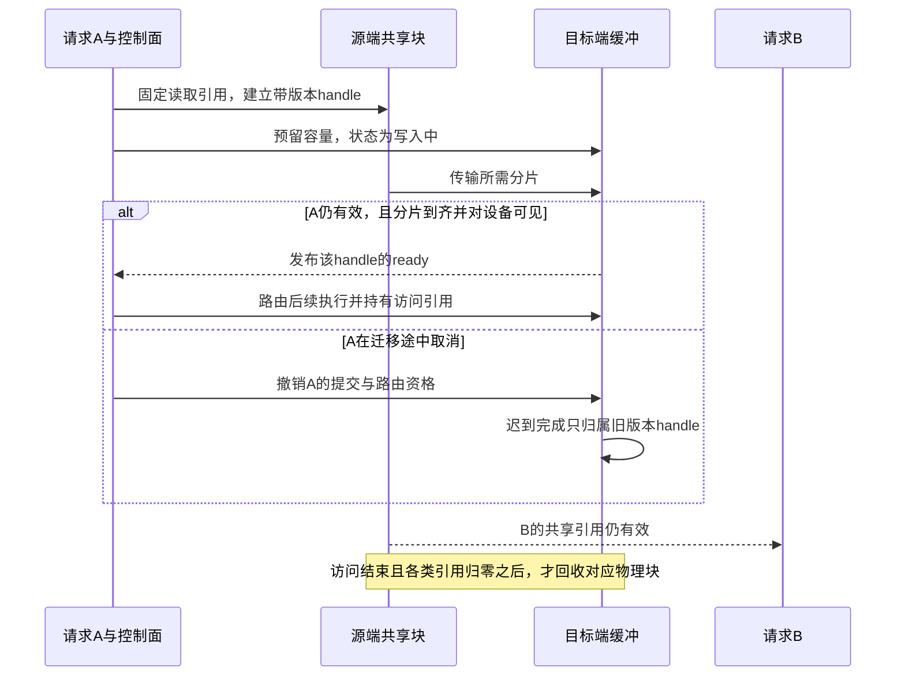

# D06 KV 与模型状态系统

[[领域地图与覆盖缺口|领域地图]] · 关联：[[D04 模型结构与数值表示]] · [[D05 推理服务与调度]] · [[D07 投机执行与解码加速]]

阅读本篇需要先理解因果 Attention：当前位置用自己的 query 读取此前位置的 K/V；历史状态的大小与读取成本可从 [[05 从模型权重到一次生成]] 回看。本篇追踪两条共享前缀的请求 A、B：它们先复用同一批状态，再压缩、换出、修改上下文，最后迁移或取消。要解决的始终是同一问题——哪些数据仍有效，谁能消费，何时才能回收。

KV 系统保存的是可供未来计算复用的模型状态，而不只是显存中的一串数组。常规注意力保存历史 K/V，其他结构可能保存压缩 latent、递归状态、卷积尾部、编码器表示或未验证候选。模型域解释状态怎样产生；本域研究保存什么、如何标识、驻留、访问、恢复和释放。

## 同一段前缀被两次使用，容量怎样变化

普通因果 Transformer 的历史状态不会被后来的 token 改写，所以能够复用；这一性质依赖模型、输入前缀、位置及执行条件。内容相似或来自同一会话，并不足以证明张量等价。共享状态还需要区分内容身份、物理布局与访问权限：知道某个对象存在，不代表目标引擎已拿到完整数据或能够按本地布局读取。

用一个独立算例把逻辑和物理分开：假设 32 个 Attention 层，每层 8 个 KV head、head 维度 128，K/V 都用 BF16，不计元数据。每个历史 token 占 $2\times32\times8\times128\times2=131072$ 字节，即 128 KiB；4096-token 前缀为 512 MiB。请求 A、B 使用完全相同的有效前缀，各自再追加 256 token。独立保存需 $2\times544=1088$ MiB；共享不可变前缀后是 $512+32+32=576$ MiB。省下的是重复副本，单请求读取完整历史时并没有少看那 4096 个位置。

假设物理块容纳 16 个 token，每块跨所有层的原始载荷为 2 MiB。完整公共前缀有 256 块，A、B 各持一个引用；各自尾部只属于自己的分支。若分叉发生在尚未填满的共享块里，后续写入必须采用写时复制或等价隔离，否则 A 新增的状态会破坏 B 的历史。A 被取消时只能减去 A 的引用，不能清除 B 正在使用的公共块。分页、共享和回收因此必须在一个对象合约里考虑，不能先按会话粗略释放、再指望 Attention mask 挽救已经覆盖的内存。

PagedAttention 是物理组织路线的机制基线：逻辑连续的状态可以映射到不连续的物理块，按需增长并共享。它解决预留与碎片等浪费，没有自行减少一条独立序列需要的信息。这一机制基线见 2023-09-12 的 v1。[PagedAttention v1，§3–4](https://arxiv.org/html/2309.06180v1)

内容身份还比“token 一样”更完整：权重或 adapter、位置规则、参与计算的前缀、媒体预处理和数值表示都可能改变可用张量。逻辑上可复用但布局不同，需要转换；租户不允许共享，即使数值相同也不能直接命中。系统应声明它承诺逐位一致、某种数值容差还是近似任务质量，而不是把后端切换、量化格式和跨上下文重用都混成一个“命中”。

DeepInfer 于 **2026-11-03 更新的部署 Q&A**给出了一个具体兼容契约：以部署配置、模型权重、用户组的 tuple 标识缓存；权重、块字节布局、tokenizer 或改变 KV 数值的框架更新都会使旧缓存不能复用。作者还说明 decode 采用 write-back，写失败不反馈给引擎，读取时严格验证，并未进行生产缓存格式迁移。这把“可丢失的复用副本”与“必须可信的读取结果”分开；具体读校验实现仍未核，不能据此声称任意版本互读安全。这里是文档新增说明，不是这些机制的上线日期。[固定 Q&A](https://github.com/deepseek-ai/DeepInfer/blob/a679bb86ce36e883a98a97733492b686e5b9a08e/doc/inference_deployment_qa.md) · [[来源与证据#AIINFRA-E-20261109-10|证据与边界]]

这时已经减少了 A、B 的重复副本，也减少了预留与碎片；下一轮 Attention 仍可能读取每一个有效位置。因此还要区分“同样的信息少存几份”和“每份信息本身变小”。

## 继续缩小状态，减少的是位宽还是位置

要比较压缩路线，可以先固定层数与 KV head 结构：单层原始载荷约为 $2T H_{kv}d_h b/8$ 字节，$T$ 是保留位置数，$H_{kv}$ 是 KV 头数，$d_h$ 是每头维度，$b$ 是每元素位数。量化降低 $b$，仍为每个位置保存近似 K/V；位置选择降低 $T$，让部分位置不再参与注意力。两者都缩小容量，却改变不同的信息。K 的误差会经点积和 softmax 改变关注分布，V 的误差则进入加权输出，不能仅按张量平均误差选同一方案。KIVI 的 **2024-07-25 v2**据其观测采用 K 按通道分组、V 按 token 分组；新到 K 尚未凑成跨 token 的组，便先留在高精度残余区，V 也保留近期高精度窗口。这是经典机制依据，不是 2026 年进展。[KIVI v2，§3.1–3.3](https://arxiv.org/html/2402.02750v2)

继续前面的 512 MiB 前缀。只看载荷，BF16 变成 4 bit 会降到 128 MiB；但假设每 32 个量化元素另存两个 FP16 的 scale/zero-point，元数据又有 32 MiB。再为了演示，假设 K/V 各留 128 个高精度 token：其余 3968 个 token 的量化数据与元数据为 $124+31=155$ MiB，残余区为 16 MiB，共 171 MiB。这里的相同残余长度只是算账条件，不代表 KIVI 在每个时刻的 K/V 更新方式；对齐、索引和临时 workspace 也尚未加入。名义四倍压缩在这本账中约为三倍。

位置选择承担的是另一种预测风险。H2O 的 **2023-06-24 v1**同时保留近期位置和累计注意力较大的位置，用已发生的注意力估计未来价值。它并不知道下一个问题将检索什么；一个过去少被关注的位置，仍可能成为后续答案的关键。删除后，在保留子集上重新归一化也会改变输出，即便剩余 K/V 全是高精度。若要恢复相同前缀的完整状态，需要另存完整副本，或从完整 token 前缀重新计算，不能靠反量化补回被删位置。将完整副本放到别处再按需读取，则还引入了分层存储的访问问题。[H2O v1，§2.1、3–4](https://arxiv.org/html/2306.14048v1)

如果改为仅保留四分之一的位置、仍用 BF16，载荷也会变小，却不等价于上述 4-bit：前者彻底移除了某些位置的 K/V，后者让所有位置以较粗表示参与运算。对局部连续写作，近期窗口可能够用；对跨文档问答或代码中后面才引用的早期声明，历史注意力低不等于未来无用。量化误差还可能改变 H2O 类策略的分数和选择，选择又改变 softmax 归一化；组合收益不能只将两种压缩率相乘，更不能只在同一条短生成上核对张量误差。

因此应把“误差预算”和“执行预算”并排算。量化还需 scales、zero-points 与高精度残余，名义位宽不是实际每 token 字节；消费时若先展开成完整高精度副本，搬运节省又可能被转换成本抵消。KIVI 将反量化与分块矩阵乘融合，就是为缩短这条路径。位置选择则要维护分数、位置映射并执行更新，是否紧凑存放还影响访存规则性。两条路线可以组合，但必须分别核对位置选择与量化后的任务质量，并把元数据、更新、恢复和 Attention kernel 算进服务收益；较小的缓存本身不是验收结果。

在这个算例里，分页负责找到块，共享负责避免重复，量化或位置选择负责改变块里保存的信息。[[D08 算子与 GPU 执行|消费状态的算子]]必须同时理解位宽、分组与位置映射；算不进实际消费路径的压缩，只改变了账面容量。

## 离开 GPU 的状态，取回是否比重算便宜

容量只是第一项成本。状态要花时间生成、占据某层空间、在读取时消耗带宽，并可能在再用之前被驱逐。因此应分别问：复用是否正确，能否保留到下次，取回是否比重算划算。状态失效、物理迁移与上层任务结束也不是同一事件；共享引用或在途访问仍在时，不能立即复用底层内存。

将压缩副本放到 CPU 或远端，再按需读回，增加的是“在哪儿”这一轴。长期不用的对象可以受益于便宜容量，但马上每轮都要读的历史若反复穿过慢链路，就从容量问题变成持续带宽问题。比较时至少区分驻留副本的大小、每次命中的实际读取字节、解包/反量化以及进入 Attention 的格式。保存低位宽但接收后永久展开，可能节省存储却没有提高 GPU 接纳容量；直接消费低位宽可能提高容量，却要求合适 kernel，并承担它在短序列、小批量或不规则位置下的效率边界。

前缀共享又会改变分层策略的收益归属。一次读回公共前缀可能供多个请求使用，取消一个请求也未必值得立即换出；但若共享副本只在远端，所有请求同时回暖可能形成热点。调度器需要预计重用、等待与可用带宽，而不是简单规定“压缩后统一放下一层”。下面的远端缓存研究应在这个组合空间里阅读。

**2026-10-15 提交**的 Multiverse Computing 研究分析了带上下文并行的远端 KV 层。一个首阶比较是：复用 $n$ 个 token，重算约需 $n/R$；加载约需 $T_0+ns/W$。其中 $R$ 是实际 prefill 速率，$s$ 是每 token 状态字节，$W$ 是有效加载带宽，$T_0$ 包括查找、调度和剩余执行等固定成本。[Remote KV Tiers v1，§3–8](https://arxiv.org/html/2610.21500v1)

把远端加载模型代回算例会更清楚。假设 4096 token 重算的实际速度为 20000 token/s，耗时约 204.8 ms；512 MiB 的状态以有效 5 GB/s 加载，纯传输约 107.4 ms，若另有 20 ms 固定成本，总计约 127.4 ms，命中才可能值得。若新 GPU 将同样前缀的重算提高到 50000 token/s，约 81.9 ms，原缓存路径反而更慢。若实际可消费表示压到 171 MiB，纯载荷可降至约 35.9 ms，但反量化、格式转换和网络争用还需另外测；这些是假设参数的单位核对，不是前述作者的基准。

这个式子给出比命中率更有用的判断：GPU 提高重算速率后，同一个缓存层未必仍划算；只增加网络带宽，也无法消除固定开销。这里的 PCP 是 prefill context parallelism：沿序列切分输入，由多个 rank 分担 prefill，并通过 collective 交换注意力所需的 KV；该部署的各 rank 同步推进。论文据此调整这些 PCP rank 的存储所有权、远端分区和异步加载，减少单个 rank 阻塞所有 worker 的情形。

该论文的 PCP 所有权和分区调整，还回答了为什么“所有 rank 合计带宽足够”不够：一个 worker 等自己所需的块，可能让同一并行步骤的其余 worker 一起等。异步加载要使所需数据在消费前可见，而不是只尽早发起传输。应查看分 rank 暴露的等待、命中长度分布和关键路径，不把聚合吞吐平均到所有参与者后当作每次命中的收益。

这里是作者在特定 B300/MLA/vLLM/LMCache 配置上的研究。关键命中路径实验使用可装入远端层的预热子集，条件多数只运行一次；完整部署比较还改变了并行和阶段放置。这些条件限制了最大倍数的适用范围。它真正补充的是：状态层需要与并行协议、重算速度和队列一起设计。

这些路线能够组合，也会冲突。低位宽可能让远端传输更便宜，却需要接收端转换和相应 Attention kernel；共享前缀节省重复生成，却增加身份与引用管理；稀疏读取减少访问，可能增加索引和不规则执行。把它们写成“分页之后升级到分层缓存”，会掩盖真正的设计空间。

这些取舍还以内容有效为前提。如果 A 的公共前缀在工具返回后发生变化，“更快地取回来”可能只是更快取得错误的状态；接下来必须先检查依赖。

## 上下文被修改，哪些历史仍然有效

例如把中间一条工具消息替换成摘要，后面消息的 token 即使没变，也拥有了新前缀，不能原样接上它们旧有的完整因果 KV；保留修改点之前的有效部分，再重算受影响后缀才是基本参照。fork 声明使另一分支仍可保留旧上下文，one-off 则说明临时摘要调用结束后不再期待复用。pin 传递保留意图，不能凭空保证物理显存无限。原语的价值是让引擎知道哪类失效和未来使用发生了，而不是把语义相似的摘要证明成原状态等价。

KVTether 的 **2026-09-30 v1**将 harness 的删除、替换、分支和保留意图映射到模型状态生命周期。父任务删掉一段消息，不代表共享同一前缀的子任务也已放弃它；相反，逻辑上无人再用的状态也不必等到最近最少使用策略被动淘汰。[KVTether v1，§4–6、8](https://arxiv.org/html/2609.39819v1)

这条路线提供的是更好的信息来源，不能消除容量约束或预测不确定性。活着但暂不用的状态仍可能需要驱逐；事件还要与 token 化、前缀失效和在途访问对应。作者在真实硬件上按记录长度和前缀关系回放随机内容，并模拟工具等待，因此不能据其特定策略宣布 MRU 普遍优于 LRU。

对于 A、B，共享身份应绑定有效前缀；A 替换消息导致的后缀失效，不应顺带撤销仍使用旧前缀的 B。反过来，A 在逻辑上声明“以后还会用”，也不表示它能永久占有 GPU：有效性与驻留仍是两个决定。

## 状态不再只是追加的 K/V

前面的恢复过程利用了普通因果 KV 可以按前缀截断这一性质。模型改变状态结构之后，相同的消息编辑和回退操作，还需要另一套恢复条件。

假设混合模型同时拥有 Attention KV 和递归状态 $s_t=F(s_{t-1},x_t)$。删掉最后几个 KV 块，可以定位更早的 Attention 前缀；最新 $s_t$ 却通常不能逆推出 $s_j$。在 8192-token 轨迹上，每隔 1024 token 保存一个递归检查点，回到位置 3500 时可以从 3072 处恢复，再重算 428 token；只有最新检查点时可能要从很早处重新执行。更密的检查点降低恢复计算，又挤占其他轨迹的状态容量。

HiState 的 **2026-10-30 v1**针对这种历史恢复设计分层。它利用恢复时的访问不对称：Attention 需要此前所有 KV，递归层只需要选中边界的一个检查点。因而可把大量历史检查点放在 SSD，把快层更多让给会被整段读取的 KV；间隔控制再权衡重算与存储压力，驱逐时区分中间检查点和“末尾 KV 段+末状态”这个恢复组合。若删掉中间检查点但留着相邻起点，代价可能只是短距离重放；若删掉恢复所需末状态，KV 命中也不能直接继续。[HiState v1，§2–3](https://arxiv.org/html/2610.41508v1)

它不是“所有检查点放 SSD”这条固定规则的证明。作者在单 H100、Qwen3.5-9B 和有限并发的 coding-agent trace 回放上比较，部分 offload 对照是作者扩展，且容量和缓存分区会影响结果。其 Weka 常见请求 p50 还有小幅回退；论文展示的是用少数恢复代价换尾部收益，不能只挑 p99 最大倍数说全请求都快。检查点间隔依赖访问分布，写入与磨损、取消后的脏状态及真正自由执行的 Agent 仍需各自验收。dLLM 的旧状态误差与这里的精确边界恢复也要分开：一个是近似有效性，一个是缺少历史快照。

递归层的问题是缺少某个历史边界的快照；另一类问题则是“快照仍在，但它已经不是完整重算会得到的状态”。二者不能用同一种缓存命中解释。

上交等团队于 **2026-10-29 提交**的 dLLM-KVQ v1 研究了另一种前提变化。在双向的迭代揭示过程中，某位置的 token 更新可能改变其他位置的表示；继续使用早期 KV，本身就可能偏离完整重算。随后再量化，误差包含“复用造成的旧状态”与“表示压缩”两部分。[dLLM-KVQ v1，§2–5、8](https://arxiv.org/html/2610.39853v1)

方法还区分了离线选策略与在线执行：离线用重建揭示轨迹评估哪些 K 位置值得保留高精度，在线只依据块初始可得的注意力或量化误差分数选位置；这些位置仍参与 Attention，其余位置用低位宽，因此不是 H2O 式删除 token。将高精度位置排除在低位宽量化范围统计之外，还可避免异常值把其余位置的量化网格撑大。这里的质量诊断采用 QDQ 模拟，不能把它直接当成低位宽融合消费已经完成。

其方法用与揭示轨迹相匹配的校准状态选择部分高精度 K，并保留其他低位宽路径。这不是把因果模型量化配方直接移植成功的证明；作者只在选定模型、缓存模式和任务上评估。该文报告任务质量与有效位数，端到端服务加速仍依赖低位宽算子和运行时集成。值得保留的领域判断是：压缩的参考对象必须先说清，张量重构误差较小，也未必代表相对完整模型的行为更接近。

同样需要区分模型结构产生的状态变化和运行时近似。混合递归层的恢复要包含它的隐藏状态或检查点；投机候选还需要标识已提交与可回滚部分。统一接口可以统一操作，不应抹平各类状态不同的有效性条件。

## 迁移和取消分别改变哪一种引用

可以把最小协议写成状态过程，而不是把一个“send”当作迁移完成。下面是依赖分析示例，不声称现有每个 connector 都已实现：先确定不可变内容身份和目标布局，给本次传输分配带版本的 handle；源端固定将被读取的块，目标预留容量并处于写入中。所有所需分片到齐，且满足设备消费前的可见性同步后，目标才发布 ready。路由方只有得到有效版本的 ready，才把它分配给后续执行。逻辑登记、完整到达、设备可读和可路由，是四个不同事件。

<!-- figure: D06-F1 -->

图 D06-F1 画的是由数据依赖推得的教学协议，不代表某个 connector 已完整实现。取消撤销 A 的资格；它既不使 B 的数据失效，也不能代替在途访问完成。ready 的发布还必须晚于完整传输与消费所需的可见性。

假设 A 迁移时取消，B 仍引用公共前缀。取消应先停止为 A 追加或提交结果，撤销它尚未兑现的调度承诺；已在执行的 kernel 或传输则持有独立访问引用。目标收到迟到完成通知时，应按 handle 的版本识别它属于已撤销的任务，不能误标记同一地址上后分配的新对象。待访问确已结束、共享引用和传输引用都释放，物理块才可回收。超时或上层返回“已取消”都不能独自证明硬件不再访问；故障路径还须依赖底层可确认的停止/撤销语义。

这一缺边在 **2026-10-20 发布的 llm-d v1.0.0** 对应文档中有具体实例：SGLang 的 NIXL 路径由 prefill 推送 KV；若 decode 在启动传输前取消或死亡，prefill 保留的 KV 可能直到 pod 重启才释放。bootstrap 的定期清理只删除登记信息，不回收 GPU KV；文档所述 prefill 回收超时适用于 Mooncake/Mori，不能挪给 NIXL。因而“支持传输”仍需继续核对失败怎样进入终态、哪端解除引用，以及同一引擎的不同 backend 是否有相同契约。[固定版本取消与故障说明](https://github.com/llm-d/llm-d/blob/378b42d18dabe0b9c4ced4e6f3670d93b52db08e/docs/operations/disaggregation/sglang.md) · [[来源与证据#AIINFRA-E-20261109-05|版本与验证范围]]

迁移未必转移唯一所有权：源副本可继续成为缓存，目标也可能仅有借用或副本。控制面应分别登记内容有效性、位置和使用权，避免因为 A 结束便使 B 的缓存失效。KVTether 提供 harness 的保留/删除/分叉意图，但这些意图仍需落实为引用和执行协议。完整恢复还可能要求卷积尾部、递归矩阵、随机采样或语法状态；只收到 Attention KV，不能据此宣布一个多阶段会话已恢复。

## 把容量收益交回执行与调度

现在可以沿 A、B 的全程重新计价：共享省掉重复生成与副本，低位宽减少表示字节，位置选择减少可参与的信息，分层改变驻留与恢复路径；每项收益都附带自己的有效性和消费条件。少存、能取回、能及时执行，是连续的三个判断。

[[D08 算子与 GPU 执行|算子]]决定压缩、分页和稀疏状态能否被高效消费，Q/DQ、索引和布局转换必须算进收益。[[D10 通信与互联|通信]]决定远端状态何时真正可见，并行 worker 的同步还可能把一次局部慢读放大为全组等待。[[D14 多模态 Agent 与流式系统|多模态与 Agent]]提供消息编辑、音频提交点和工具等待等状态事件，改变缓存有效性与下次使用时机，不能由 LRU 的访问时间独自推断。

因此，KV 正在同时成为模型语义问题、存储对象和服务控制对象。还缺少的是这些路线在同一负载下的组合比较：低位宽与分层的净收益，稀疏/近似复用的长期质量，跨引擎布局兼容，以及故障和取消后的状态所有权。跨引擎 connector 是否满足这些条件，仍需逐版本检查。

## 来源与阅读范围

核读日期为 2026-11-04。正文数字是自写假设算例，迁移图是教学协议；作者的硬件回放、QDQ 诊断与具体实现各自保留范围，没有独立运行或任务质量验证。KIVI/H2O/PagedAttention 为经典机制，KVTether 是旧线索重核；HiState 与其他定日研究不代表全域扫描。

本轮核读七篇论文的所列机制，其中近期论文另读选定实验与限制；KIVI/H2O 补足两类经典机制起点，HiState 补充混合状态的恢复与分层。后续 AR 量化与位置/特征选择的系统对照、真实 kernel 与调度组合、长期质量及 NVMe/PFS 写放大等分支仍需继续核验。实际查询和来源版本见 [D06 核验记录](<evidence/D06 KV 与模型状态系统.json>)。

更细的接口阅读入口保留于 [[courses/hpcgame/HPCGame 2026 MLSys/HPCGame 2026 - 03 推理状态与调度#让驻留、可见性和路由分别拥有合约|旧库的驻留、发布、路由与释放材料]]。

2026-11-09 限定补核 llm-d v1.0.0 固定提交的 SGLang/NIXL 运维正文，以及 DeepInfer 11/03 Q&A 更新；前者是选定 backend 的工程限制，后者是作者部署说明。未运行取消、故障或兼容性实验，也未完成其他 connector 与全域新版本扫描。
