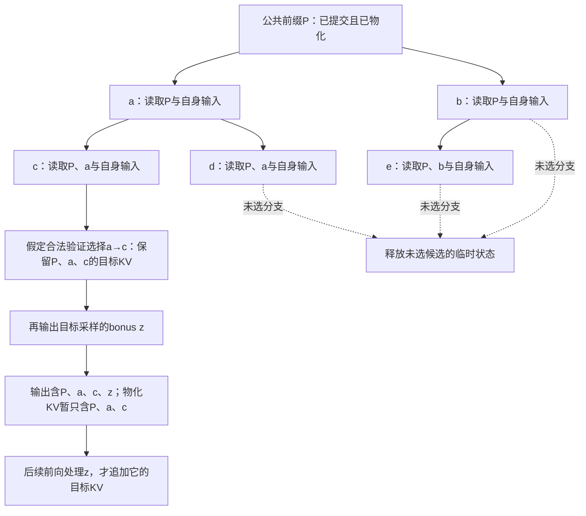

# D07 投机执行与解码加速

[[领域地图与覆盖缺口|领域地图]] · 关联：[[D05 推理服务与调度]] · [[D06 KV 与模型状态系统]] · [[D03 后训练与推理时计算]]

阅读本篇需要了解自回归条件分布、因果 Attention 与 KV：给定前缀，一次目标前向产生下一位置的分布；选出的 token 通常要在后续前向中被处理，才拥有自己的目标 KV。本文从三词词表的一次接受/拒绝出发，将过程延伸到候选链、树与临时状态，再判断候选训练、预算和数据路径怎样改变成本。

本域问的是：在指定输出语义下，怎样减少昂贵模型的串行执行。先固定目标分布，再讨论候选与验证，才能区分执行加速、近似生成和增加计算以改善答案。多候选搜索、反思或 verifier 选优通常改变求解过程；精确投机采样则希望更便宜地实现原分布。两者可以组合，但不共享同一收益定义。

## 一次拒绝为什么能补回目标分布

令 $p(x)$ 是目标模型在当前前缀下的分布，$q(x)$ 是实际候选提议分布；温度、截断和约束若属于协议，也须体现在定义中。先从 $q$ 采样候选，再以 $a(x)=\min(1,p(x)/q(x))$ 接受。被接受的概率质量是 $\min(p,q)$；总拒绝概率恰等于 $\sum_x[p(x)-q(x)]_+$。拒绝后从归一化的 $[p-q]_+$ 重采样，就补上目标分布尚缺的部分：

$$
\min(p(x),q(x))+[p(x)-q(x)]_+=p(x).
$$

把证明变成一次可手算的采样。假设词表只有 A/B/C，目标 $p=(0.5,0.3,0.2)$，提议 $q=(0.6,0.1,0.3)$。三种候选的接受率分别为 $5/6,1,2/3$，接受后贡献的概率质量为 $(0.5,0.1,0.2)$；总拒绝率 0.2，残差只剩 B。因此某轮起草 A，却在接受随机数大于 $5/6$ 时改成 B，并不是算法出错，补上的正是 q 少提议的 B。若把拒绝后输出改成目标 argmax A，整体分布就会变成 $(0.7,0.1,0.2)$，候选再准也不能替这个改动辩护。

这说明正确性来自接受与修正的组合，而非候选准确率足够高。多位置时必须依次检查，首次拒绝后舍弃后续分支，使用相应前缀下的残差分布；全部接受时再按目标分布生成一个额外 token。[Leviathan 等，2023-05-18 v2，§2、附录 A.1](https://arxiv.org/html/2211.17192v2)

这里计算比值时只处理实际从 q 抽到、因而 $q(x)>0$ 的候选；q 没覆盖而 p 有质量的位置由残差补上。若 p=q，总拒绝率为零，不需要求一个分母为零的残差分布。真实实现还要处理 EOS、最大长度、数值容差和 logits processor，不能只把一个简化公式塞进原采样器，就假设所有分支仍成立。

如果改成只接受“看起来合理”的候选、修改残差或放宽阈值，就需要重新说明输出语义。保持采样分布也不要求同一随机种子生成逐 token 相同的序列；greedy 一致和随机采样无偏是不同命题。数值、词表、mask 与位置条件也必须对齐，不能仅凭模型名称判断。

现在已经有了一条可逐步重复的提交规则。加速的机会在于：虽然未来候选尚未验证，它们可以先作为已知输入交给目标模型，一次计算多个条件分布。接下来要保证这次并行计算所用的历史，与逐步执行一致。

## 把候选摊成并行工作，怎样保住每条历史

先取一条候选链 a,b,c。目标需要求出 a 在公共前缀下、b 在“前缀+a”下、c 在“前缀+a,b”下的分布，并在全部接受时提供额外 token 的分布。给定候选之后，各行可以在一个因果前向中组织起来；但接受仍沿前缀依次发生，不能让后面一行补救前面已经拒绝的分支。输入节点、该节点的 KV 和预测后继的 logits 是不同对象，必须在索引上对应。

设公共前缀为 P，第一层候选有 a、b，第二层有 a→c、a→d、b→e。可以把五个候选节点摊进一次目标前向，但 c 只能看到 P、a 和自己的输入位置，不能看到兄弟 d 或另一分支 b/e；c 与 e 的绝对深度相同，也不意味着它们共享同一历史。普通下三角 mask 会让物理行序引入错误依赖，需要祖先关系 mask 和与逻辑深度一致的位置编码。与此同时，哪个行的 logits 在预测哪个后继 token 也要对齐，不能把“节点输入位置”误当成“该 token 的预测条件”。

回滚要同时处理状态和输出。若链 a,b,c 中接受 a,b、拒绝 c 并修正成 z，可以保留目标已正确处理的 a,b 的 KV，释放 c 及其后继；z 刚被选出时，通常还没作为输入经过目标，所以已提交 token 数可能比已物化 KV 多一个。语法状态和 drafter 的缓存也要回到同一个前缀，再接 z。Transformers **v4.46.0**的固定实现正将目标缓存裁到新输出长度减一；此处是可核读的具体消费边界，不能从“接受了几个”直接推断所有状态都已齐备。[固定版本验证与裁剪路径](https://github.com/huggingface/transformers/blob/v4.46.0/src/transformers/generation/utils.py)

<!-- figure: D07-F1 -->

图 D07-F1 的边表示合法祖先依赖，不表示普通下三角 mask。图假定验证已经按其正确规则选择 a→c，只说明状态保留；它不另造一套随机树接受算法。bonus z 已输出但尚未 processed 的间隙，解释了为什么输出边界与物化 KV 边界不能共用一个计数。树的临时节点存储也不能直接当成一条连续候选前缀。

树增加备选覆盖，链把预算集中到一条深路径。固定节点预算下，给 a 增加兄弟 b，就会占掉某些更深候选；如果目标高度确定，宽树可能只是浪费，若早期分歧大，备选又可能减少重起。EAGLE-2/3 的置信度树属于预算分配办法，置信度只是目标接受行为的估计。树的随机接受过程不能把每个节点当作相互独立的链重复试验后挑最长者；那会改变选择概率，须采用与候选联合提议匹配的规则。

## 目标特征尚未产生，候选从哪里继续

验证机制允许候选不准确，因此候选生成可以采用不同信息与代价。对于同一条待验证链，选择主要取决于：候选额外读了什么，能否廉价连续前进，以及需要怎样的训练来适应尚未验证的历史。

独立小模型需要自己读取和更新前缀表示；辅助层则能借用目标已经算过的特征，少做部分重复工作，但未来位置的目标特征尚不存在。EAGLE-3 的 **2025-03-03 v1**将低、中、高层表示融合，再与实际已选 token 的 embedding 一起产生提议；继续向前时，尚无目标表示的位置改用 drafter 自己的输出。为什么要输入已选 token？同一个前缀可能随机选出不同 token，下一步应依赖实际分支，单靠前一步的 feature 无法知道随机选择。[EAGLE-3 v1，§2.2–3](https://arxiv.org/html/2503.01840v1)

这也解释了训练差异。若只用真实目标表示训练，部署时却连续喂回自生表示，训练和执行看到的状态分布不同；EAGLE-3 在训练内展开自反馈步骤，并以 token 预测为目标，不再强迫每步逼近指定的目标 feature。它解决的是候选质量与可扩展训练的约束，仍需原来的验证合约。训练数据扩大有益，不代表对所有目标版本都免维护；抽取哪些层、额外 feature 带宽以及头部是否共享，也会影响部署成本。

Medusa 是多头与树验证的经典对照：它由目标表示产生多个后续位置的预测，并用树形 Attention 组织候选。重要的是同一框架容纳不同训练与接受策略；其 typical acceptance 明确不要求精确匹配原分布，不能把所有配置统称无损。[Medusa，2024-01-19 v1，§3](https://arxiv.org/html/2401.10774v1)

检索或 n-gram 候选走的是另一条路线：不学习一般分布，直接找已见后缀并复制后续 token。编辑代码、大段引用可能提供廉价长命中，开放问答则未必。多 token heads 同时预测不同后续位置，又不自动满足完整自回归依赖，需训练和验证补足。因而“更强的 drafter”不是单一维度：目标表示、外部知识、数据覆盖、并行产生能力和执行成本，分别改变收益模型的不同项。

需要训练的辅助模块还多一笔离线成本：数据收集、蒸馏与维护能否由后续调用摊薄，取决于目标模型更新频率和真实使用量。某个任务上接受率很高，也不能推断跨语言、代码与长上下文仍保持同样成本；训练数据覆盖和运行负载应连起来评价。

链与树在这里是预算分配方式：向前多猜一层，押注较长的正确续写；给同一层多留一个分支，押注早期存在不同选择。独立 drafter、复用表示和多头都可以与不同拓扑结合，不能按名称把候选来源和验证形状锁成一条演进顺序。

## 把接受长度换成每个已提交 token 的成本

一次目标验证可以并行处理给定候选，复用部分权重和历史读取；付出的则是起草、额外计算、候选状态、采样和回滚。设一轮接受 $A$ 个候选，并输出一个修正或额外 token，未遇到终止条件时，将同任务、同执行条件下相对基线的加速比记为 $S$，一个有用的成本模型是：

$$
S\approx\frac{(\mathbb E[A]+1)t_{\rm base}}
{\mathbb E[t_{\rm round}]}.
$$

这里 $t_{\rm base}$ 是对应条件下基线每 token 时间，$t_{\rm round}$ 是完成一轮提交的实际时间。在无重叠的顺序轮次中，后者可拆成起草、验证和管理成本之和；管理包括采样、状态整理与必要通信。异步实现则应沿实际关键路径计算，不能将各阶段用时直接相加。验证时间随候选形状和资源争用变化，模型也没有预设它恒定。

用成本模型作一个明确假设的计算。每个候选在前面都接受的条件下，接受概率均为 0.8，链长为 4，且无 EOS/长度截断，则 $\mathbb E[A]=0.8+0.8^2+0.8^3+0.8^4=2.3616$，每轮平均提交 3.3616 token。假设基线每步 18 ms，四次起草共 6 ms、验证 22 ms、管理 2 ms，顺序轮次约 30 ms，理想比值约 $3.3616\times18/30=2.02$。不是用候选长度 4 除以耗时，更不是每轮保证输出 5 个。

再换到繁忙批次，假设基线一批每步 20 ms，起草 8 ms、验证因额外行数升到 64 ms、管理 2 ms，即使接受行为不变，比值也只有 $3.3616\times20/74\approx0.91$。这是假设曲线的反例，不是某模型的测试结果：同样的预测质量可以加速低并发，也可以伤害高并发。真实开放服务还多了新请求排队、候选占用 KV 和抢占，必须测满足时限的 goodput；一个封闭批次的比值仍没覆盖这些代价。

更长候选可能增加接受 token，也可能在早期拒绝后制造大量无效工作。更强 drafter 提高命中，却增加权重、训练和运行成本。服务已能通过真实请求充分组批时，额外候选还可能挤占其他用户资源，所以单请求加速不能直接转换成高负载 goodput。

若只按接受率选择预算，很容易不断加长候选，却忽略验证成本的拐点。动态策略应比较“再多一个节点的预期已提交收益”与“它对本轮关键路径、显存和其他请求的增量成本”。固定形状有图捕获和 kernel 效率优势，动态树能少做无用节点却增加构造/索引成本；最合适的预算依赖模型、长度、设备与当前批次，而不是候选方法固定拥有的属性。

执行位置也改变分母。同设备起草少了一次交接，却与目标争用计算、内存和 KV；异设备或流水执行可以重叠，仍需传递前缀、目标特征和接受反馈。反馈未到就继续写，可能得到更长的错误续写；取消这些工作时还要处理在途访问。只有沿实际关键路径核算重叠，才知道多出的候选是否值得。

UC Berkeley 的系统测量《Performance or Illusion?》固定 **2025-12-31 v1**给出了这类成本曲线的具体对照。其 vLLM 对照显示，验证成本随批次上升、接受长度随任务和位置变化；代码编辑中廉价 n-gram 也可能胜过学习候选。[固定论文，§3–6](https://arxiv.org/html/2601.11580v1) 这类测量支持“成本曲线需要实测”，不支持所有服务都关闭投机；其部分推理实验特意限制并发以避免抢占，又用 token 吞吐处理输出长度变化，因此尚未证明真实到达、尾延迟和任务成功率下的统一最优策略。

## 换采样协议或词表，原证明还指向什么

前面的分布证明和成本算例都假定 p、q 已经定义清楚。服务若改用语法输出，或让另一个词表的小模型起草，必须重新检查验证器实际接到的对象，不能只保留“投机”这个名称。

如果协议规定每步先做温度、top-p 或语法 mask，目标就应是这些变换后的条件分布；提议 q 也必须是实际生成候选时使用的分布。语法 parser 沿候选分支前进，拒绝后要恢复接受前缀，再消费修正 token；只修 KV、不修 parser，后续 mask 就会针对错误历史。只满足语法也不同于保留原模型在所有合法完整字符串上的条件分布：假设两个当前合法分支概率各为 0.5，后续能合法结束的概率分别为 0.1、0.9，局部 mask 首步仍各占一半，完整合法条件下却应为 0.1、0.9。

这正是 **2026-05-08 v1**的 Future Validity 研究所区分的两种目标。它用未来合法完成概率 $\Phi$ 重加权目标，并分析近似估计误差；但可枚举语法和有限 JSON 上的验证，不等于任意生产语法都能便宜求得精确 $\Phi$。本域应先说“相对既有逐步 mask 采样器保持分布”，还是要求更强的完整语法条件分布，不能让接受修正证明替一个未声明的目标背书。[固定论文，§3–5](https://arxiv.org/html/2605.07698v1)

词表不同又多一层对齐：相同字符串可能在目标侧是一 token、起草侧却是两 token，拼接后还可能改变边界分词。Hugging Face/Intel 于 **2024-10-29**介绍、接入 Transformers v4.46.0 的 UAG，先解码再双向重编码，携带 lookbehind 对齐，并裁掉发生变化的 assistant KV。[官方说明](https://huggingface.co/blog/universal_assisted_generation) 固定源码中的跨词表生成器返回候选而不返回可直接比较的 q logits；验证侧在这种情况下从目标分布采样，保留匹配前缀并在首个不匹配处停止，而非把不同词表的两个概率直接相除。这仍可以正确推进目标采样，却拥有不同的匹配率与转换成本，不能套用上面同词表重叠质量的接受率。[固定候选转换实现](https://github.com/huggingface/transformers/blob/v4.46.0/src/transformers/generation/candidate_generator.py)

于是正确性先分成两个检查：目标是不是应用要求的那个采样协议；实现是否保持该目标。通过后，再把 parser、重编码、对齐与缓存裁剪的耗时加回一轮成本。较好的匹配率无法抵消目标本身定义错误，分布正确也不保证转换便宜。

## 继续起草还是立即验证，状态又何时到达

已经固定候选信息、验证语义和成本之后，还能改变轮次组织：一轮起草完是否立刻验证；验证开始后是否必须等待所有历史状态到齐。这两个选择分别利用了候选与数据路径中的机会。

NAVER 团队的 DLoop 于 **2026-10-06 提交 v1，10-21 修订 v2**。它针对“每一轮起草后立即验证”的安排，允许先循环多个起草阶段，再集中验证。并行 drafter 一次产生整块，简单减少候选长度未必减少其一次前向；继续起草又缺少尚未验证位置的目标 hidden states，因此方法还加入针对额外起草阶段的训练。[DLoop v2，§3–4](https://arxiv.org/html/2610.07659v2)

DLoop 的方法还应沿“没有目标特征时拿什么继续”来理解。额外起草阶段用前序 drafter hidden states 继续，loop-aware training 将自反馈链展开到跨块，并保留首阶段与末阶段的监督，避免只适应一个固定循环深度。其主要表采用 greedy、指定节点预算和 H100；是否在每一类随机采样、不同并发和目标更新后获益，不能由这张表代替。门控延迟验证增加的预期提交，必须抵过失去的中间 bonus 机会和错误链的浪费。

这条路线改变的是验证频率与训练分布，不是简单把候选树变宽。较晚验证会增加未被接受部分的工作，也放弃部分中间 bonus-token 机会。论文报告无损算法与作者加速结果，其结论仍需落实到每个支持组合的接受实现。当前能支持的是一种新的预算粒度，不能据此判断其总优于动态长度。

西安交大团队的 SpecStream **2026-09-27 v1**则把 KV 传输纳入验证路径：只将已经提交的历史移到主存，候选回滚留在 GPU；历史按块到达时，用在线 softmax 逐块完成完整 Attention，让同一历史块服务一轮的多个验证 query。它还控制同 GPU 起草的资源份额，避免把传输空隙填满后反而延误目标模型。[SpecStream v1，§3–5](https://arxiv.org/html/2609.33184v1)

SpecStream 的提交边界给状态设计提供了更具体的例子：已完成迁移历史边界 $H$、已提交且已物化的 KV 前缀边界 $C$、含候选的总物化前缀边界 $L$ 满足 $H\le C\le L$，都是全局位置偏移，其中 $[H,C)$ 仍在 GPU。刚选出但尚未作为输入计算 KV 的修正或 bonus token 不计入 $C$。迁移只在复制完成后推进 H；拒绝后保留的已提交且已物化 KV 边界为 $C'$，满足 $H\le C\le C'$，仅释放 $[C',L)$，不会追到主存已封存历史。读取历史则逐块维护同一 softmax 的最大值、分母和加权分子，统一缩放后合并，最后才除法；不能每块各自归一化后相加。这允许一次历史传输服务一组验证 query，但候选之间仍须遵守自己的因果 mask。完整 Attention 在数学上不删位置，浮点重排仍不等于逐位相同。

两项工作不构成单线演进。前者减少验证触发，后者改变验证所需数据的组织与执行重叠。SpecStream 的完整 Attention 不自动证明所有采样与运行条件逐位等价；其收益仍是作者在选定模型、内存和负载上的结果。

## 回到一次提交，怎样判断执行确实更快

一次有效提交同时要求：候选拥有合法历史，接受/修正针对声明的目标，物化状态在正确边界保留，临时工作被安全回收。到这一步才把已提交 token 数除以实际轮次关键路径，并把候选对其他请求的资源占用计入服务评价。

本域不能只追踪“每次多接受多少”。需要同时观察提议质量、验证时间曲线、临时状态和调度干扰，并说明精确分布、greedy、近似质量各采用什么验收。当前研究正在触及更细的起草/验证粒度和数据路径，这是上述选定来源支持的判断，不是全部项目排名。

跨域上，[[D06 KV 与模型状态系统|状态系统]]要区分已提交历史与候选前沿，拒绝或取消时按正确边界回收；[[D05 推理服务与调度|服务调度]]要把候选节点作为真实计算和容量需求，而非免费的输出 token；[[D08 算子与 GPU 执行|算子]]与[[D10 通信与互联|通信]]共同决定树验证、变长批次和异步交接的成本，可能改变最优候选长度。

EAGLE-3 自反馈训练、无模型提议、跨词表实现和语法目标分别提供了可分析的路线；尚未穷尽 EAGLE 系列全部版本、通用跨词表提议分布的高效变换，以及大 MoE 在真实高 QPS 下的联合调度。Diffusion/非自回归解码还改变了目标计算图，应与模型结构、任务质量一起研究，不能直接套用本节的因果采样证明。

## 来源与阅读范围

核读日期为 2026-11-04。概率与耗时例子是自写推导，图是依赖与物化过程示意；固定 Transformers v4.46.0 代码只支持该版本所述路径，没有执行代码。Medusa 的 typical acceptance、DLoop 的训练与 greedy/节点预算、SpecStream 的数值和采样范围，以及作者闭合批次测量的局限均在相关段保留；没有独立复跑或穷尽全部支持组合。

原有四篇与本轮补读的一手正文、固定代码及实际检索、版本和未核项见 [D07 核验记录](<evidence/D07 投机执行与解码加速.json>)。经典材料只承担机制证明，近期结果保留作者与负载边界。

《Performance or Illusion?》采用固定 v1；其后续版本日期、独立发现顺序、候选处置及具体已读范围留在核验记录中，不把机制补读或 2025 年来源重记为 2026 年 10 月新事件。
