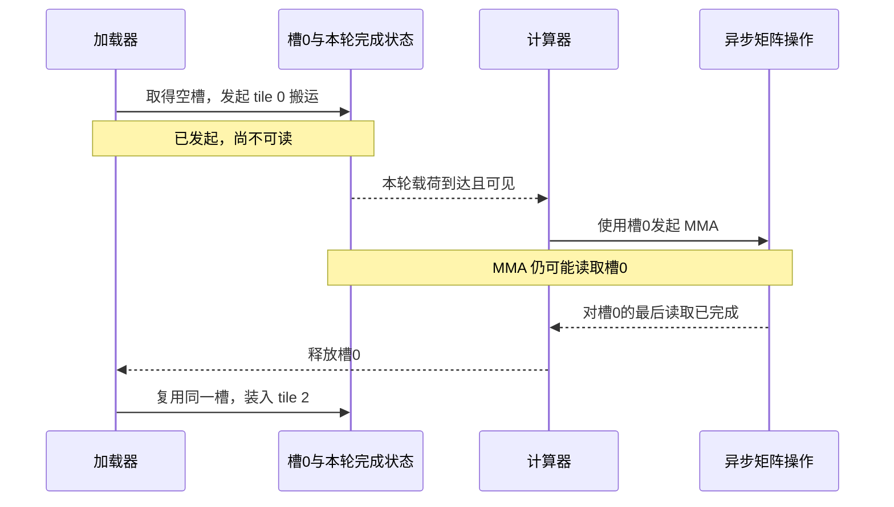

# D08 算子与 GPU 执行

同一个线性层，单 token 解码时可能在等权重，批量变大后却在等矩阵计算；换成 MoE，计算量减少了，设备又可能因专家负载不均而空闲。算子优化要解释的，就是这些等待怎样产生，又能用什么代价消除。

本篇从矩阵乘法出发，依次追踪数据复用、异步交接、不规则调度和计算规则的变化。只需先理解矩阵乘法与 GPU 的线程/存储层级；FLOPs 与字节的基础计数可回看 [[02 一张 GPU 上时间和显存花在哪里]]。读完应能提出一个具体的性能假设：**哪份数据、哪条依赖或哪项资源，限制了下一步工作开始？** 返回 [[领域地图与覆盖缺口]] 可选择相邻领域。

## 1. 先看形状：算得少，为什么反而更难算快

写线性层为 $Y=XW$，其中 $X$ 是 $M\times K$，$W$ 是 $K\times N$。固定 $K=N=4096$，输入、权重、输出都用 BF16。先只算一次理想的全局读写：输入和权重各读一次，输出写一次，不读旧输出，不含量化 scale、临时结果或缓存收益。

| token 行数 $M$ | 计算量 $2MKN$ | 理想载荷 | 算术强度 |
| --- | --- | --- | --- |
| 1 | 约 33.55 MFLOPs | 约 32 MiB，权重占主导 | 约 1 FLOP/byte |
| 64 | 约 2.147 GFLOPs | 33 MiB | 约 62.1 FLOP/byte |

64 行共享同一份权重，搬一次权重能支持更多计算，才有机会从带宽限制转向矩阵吞吐限制。行数可以来自批处理，也可以来自候选验证；64 行的算子形状并不限定请求数。服务调度和投机解码因此会直接改变 kernel 的最佳实现。

小 $M$ 还有第二个困难：输出 tile 太少，启动的 block 可能填不满设备。减小 tile 能增加 block，却降低复用；split-K 沿归约维度拆出更多 block，让它们计算同一输出的不同部分，又要合并部分和。拆成 $s$ 份时，若把部分和存为 FP32，仅载荷就约为 $4sMN$ bytes，另有写入、归约、同步或原子操作。

选择 split-K，要比较新增并行减少的空闲与合并增加的工作。另一条路线是面向矩阵–向量乘法的 GEMV，用线程内累加与 warp 归约消费权重。Tensor Core 的高峰值无法替代必要的权重读取；形状才决定哪种路线值得尝试。[Exo-GPU §6 的 GEMV/GEMM 对照](https://arxiv.org/html/2609.16389v1#S6)给出了有具体精度和计时边界的实现例子；上表则是独立教学计数。

## 2. 数据放在哪里，决定一次读取能服务多少输出

为了看清复用，暂时缩小到两个 $128\times128$ 矩阵相乘。它约有 $2\times128^3=4\,194\,304$ FLOPs；BF16 输入各读一次、输出写一次，合计 96 KiB。这个小例子给出理想输入输出账，浮点累加、真实分块和跨层缓存另计。

若每个输出元素独立读取一行与一列，同样的数据会重复搬运。分块让一组输出共同使用留在片上的输入；布局则决定这份输入由哪些线程持有、以什么地址共同读取、怎样送给矩阵指令。全局内存希望相邻线程形成有效合并访问，片上数据还必须满足矩阵指令的操作数排列。两种要求需要在同一条消费路径上衔接。

更大的 tile 通常增加复用，也占用更多寄存器与共享内存，可能减少同时驻留的工作。occupancy 表示设备上可驻留工作的程度，它是隐藏等待的手段，并非独立的最大化目标。应在减少流量与保留足够并行之间选择，而不是只比较 tile 大小。[Blackwell 调优指南](https://docs.nvidia.com/cuda/blackwell-tuning-guide/index.html)列出了相应硬件资源约束。

融合把同样的取舍延伸到相邻操作。让生产者直接输出消费者需要的排列、位宽和 scale，可以省去中间写回与转换；值的存活期也可能变长，挤占寄存器，甚至产生 spill。判断融合是否值得，要一起查看生产者、消费者和中间数据的寿命。

## 3. 把搬运藏进计算，必须完成两次交接

有了复用，计算仍可能等操作数。异步流水让加载器准备下一块，同时让计算器处理当前块。这里的 MMA 指矩阵乘加操作；TMA 是由硬件执行 tile 搬运的机制。它们可以异步进行，发出指令的线程继续向前，并不表示操作数已经到达或最后一次读取已经结束。

以两个共享内存槽为例，tile 0 用槽 0，tile 1 用槽 1，tile 2 再回到槽 0。下面只展开槽 0 的一轮交接；槽 1 在其间承载另一块计算。

图中的两次交接保护不同事实：**满槽通知让消费者开始，空槽通知让生产者覆盖。** 循环复用还要区分槽号和轮次（phase/generation），否则上轮的完成状态可能被当成本轮就绪。图是教学依赖关系，实际 API 还要核对参与者、可见范围（scope）、预期字节数与完成语义。

[CUTLASS v3.5.1 的流水抽象](https://github.com/NVIDIA/cutlass/blob/v3.5.1/media/docs/pipeline.md)用 acquire/commit、wait/release 组织这两个方向。TMA load 的载荷完成可能自动推进 barrier 的事务计数，单有线程 arrival 并不足以说明数据到齐。异步矩阵操作也需要对应的完成条件：等待加载完成、等待 MMA 完成和允许覆盖操作数，是不同检查。

第三个槽能让加载器更早准备数据，代价是更多片上缓冲。若稳态供给本来就慢于消费，增加槽数只能隐藏有限等待；若共享内存是限制，更多槽还可能减少驻留计算。分析时应分别看 HBM、L2、共享内存、寄存器、矩阵与指数单元：MMA 利用率低可能是等数据、等前驱、等归约，一条总 HBM roofline 解释不了所有片上等待。

这套依赖也适用于 [[D10 通信与互联]] 的 tile 交接。更复杂的异步调度和源码审计可接着读 [[专题研究/Agent 算子开发与优化（2026-11-04）/03 Megakernel 生成与调度技术报告|Megakernel 报告]]。

## 4. 从一张规则矩阵，走到一组大小不同的专家

前面固定了矩阵形状；MoE 的路由会让每个专家获得不同数量的 token。设四个专家分别接收 $[1,7,24,96]$ 行，$K,N$ 相同，行 tile 为 16。它们需要 $[1,1,2,6]$ 组行 tile，共 10 组；若全部填到 96 行，则需要 24 组。这些数还没乘列 tile 数。

跳过填充省去了无用计算，但只有 1 行的 tile 仍比满 16 行难利用硬件。每专家一次 launch 又增加启动成本，并可能要求 host 先得知动态长度。grouped GEMM 因而把多个矩阵问题放进一个调度空间，让设备跨专家分配 tile。

用 4 个持久 block 说明分工：第 $b$ 个先取全局 tile $b$，再取 $b+4,b+8,\ldots$；访问器把全局编号映射为专家和局部 tile。不同专家的空位可以互补。不过，若各问题的 $K$ 不同，tile 数相等仍不代表工作相等。

调度也有两条路线。设备端查找可以直接消费动态长度；host 预先生成日程可以减少设备查找，却支付预计算、上传和形状变化成本。[CUTLASS v3.5.1 调度说明](https://github.com/NVIDIA/cutlass/blob/v3.5.1/media/docs/grouped_scheduler.md)给出了这两类访问器。选择应基于真实路由分布、空专家比例和热点，而非只测试规则大 GEMM。

融合进一步改变专家内部的数据布局。**NVIDIA 2026-06-15 的 MoE 报告**重排 gate 与 input 的权重列，使同一输出 tile 拿到 GLU 所需的两部分，在 epilogue 中完成激活与量化；动态专家长度保留在设备，减少逐专家启动前的 CPU 往返。布局、前反向消费者和 scale 路径因此要共同匹配。[官方方法](https://developer.nvidia.com/blog/boosting-moe-training-throughput-with-advanced-fusion-kernels/)

报告还暴露 cluster margin，为通信等工作保留资源。给 GEMM 更多 SM 可能缩短当前计算，却延后下一批专家数据到达。其单 kernel 与完整预训练测量属于不同范围，后者同时改变 Graph 和重叠；这些结果支持整条路径的设计，无法分解为每项改动独立的加速倍数。

## 5. Attention：先省中间矩阵，再解决新的等待

规则 GEMM 主要调整数据怎样移动；Attention 还能利用数学重组，避免把全部 score 和 softmax 概率写入 HBM。对一行 query，逐块读取 K/V，维护三个量：当前最大值 $m$、指数和 $l$、未归一化输出向量 $u$。新块的 score 为 $s_j$，对应 value 为 $v_j$，则：

$$
m'=\max(m,\max_j s_j),\qquad a=e^{m-m'},
$$
$$
l'=al+\sum_j e^{s_j-m'},\qquad
u'=au+\sum_j e^{s_j-m'}v_j.
$$

最终输出为 $u/l$。当新块抬高最大值时，系数 $a$ 把旧块的累积量缩放到新基准；新旧块才能继续合并。初始空状态和全 mask 行应按实现约定单独处理，避免未定义的 $-\infty-(-\infty)$。反向可保存少量归约量并重算局部概率，以计算换中间存储。[原 FlashAttention 论文 v2 §3.1/附录 B](https://arxiv.org/html/2205.14135v2)

这一重组保留完整 Attention 的数学目标，仍处理所有合法的 query–key 对。块稀疏方法则跳过某些对：原模型本来有相应 mask 时，这是同一运算；学习或启发式丢弃时，质量成为新的验收条件。decode 的 query 行少、历史长，还可能需要拆分历史并合并部分输出。prefill、decode 和稀疏路径因此各有不同的并行与归约成本。

中间矩阵省掉之后，下一处限制在哪里？**FlashAttention-4（2026-03-05，v1）**将 Blackwell 上的 MMA、指数运算与共享内存访问分开核算，用交叠流水、条件缩放和 TMEM/2-CTA 路径重新安排它们。当 Tensor Core 变快，指数与数据发布就可能占据更大比例；继续只追矩阵峰值，解决不了新的关键路径。[固定论文](https://arxiv.org/html/2603.05451v1)、[作者机制说明](https://tridao.me/blog/2026/flash4/)

**Hardware-Aware FP4 FlashAttention-4（2026-09-03，v1）**又缩短矩阵计算，迫使概率转换、缩放和片上依赖一起重组。数值代价需要放在这里理解：部分 MXFP4 P/V 训练轨迹发散，保留的分布式训练路线使用 FP8 P/V；kernel 计时还排除了动态 Q/K/V 量化。[实验与测量边界](https://arxiv.org/html/2609.04105v1#S5)

所以读这条进展应顺着三个问题：在线归约为何省存储，异步流水为何缩短等待，低精度又改变生产者与消费者之间传什么。固定输入误差、单步速度和持续训练质量分别回答不同问题。FA4 的比较也绑定论文时的硬件、形状、精度和对照版本；作者说明后续 cuDNN 吸收了相关技术，旧差距需要重新测量。

## 6. 若连历史表示都变了，算子组织也要跟着变

再往前一步，可以改变模型所保存的历史。用一个简单、无归一化的线性状态说明：

$$
S_t=S_{t-1}+v_tk_t^\top,\qquad o_t=S_tq_t.
$$

decode 只更新一份 $d_v\times d_k$ 状态，状态大小不随历史长度直接增长；训练若逐 token 执行，却产生长依赖链。将 $C$ 个位置成块后，当前输出可以分成两部分：块前状态对当前 Q 的贡献，以及块内带因果 mask 的 QK/V 计算。后者能够用矩阵操作并行，前者负责传递历史。

块越大，矩阵效率可能更好，块内工作、临时量和数值路径也随之变化。[Gated DeltaNet v1 §2–3](https://arxiv.org/html/2412.06464v1)进一步引入衰减、delta 更新和分块求解。算子研究要同时做好块内计算、块间状态传递与反向重算。这类递归规则改变了模型，质量由 [[D04 模型结构与数值表示]] 验证；[[D06 KV 与模型状态系统]] 则需要保存相应递归/卷积状态。

## 7. 怎样把一次优化变成可检验的判断

到这里，几条路线可以放回同一张决策表：

| 观察到的限制 | 可以改变什么 | 必须一起核算的代价 |
| --- | --- | --- |
| 同一数据被反复搬运 | 分块、布局、融合 | 片上容量、转换、值的存活期 |
| 当前工作在等下一块 | 异步、warp 专门分工、更多阶段 | 满/空交接、缓冲、驻留与真实供给率 |
| block 少或负载不均 | split-K、持久调度、grouped 调度 | 部分和、调度、热点与小 tile 效率 |
| 中间结果太大 | 在线归约、重算 | 归约状态、反向工作与数值语义 |
| 工作本身过多 | 稀疏、低精度、递归结构 | 质量、误差、索引与新消费路径 |
| 算子快了，整体仍在等 | 跨算子/通信协作 | 共享 SM、网络、下游就绪与整体关键路径 |

这也给出了阅读前沿的方法：先指出改变了哪项工作，再检查它把成本移到了哪里。[[D09 编译 DSL 与自动优化]]决定哪些映射可以表达和搜索，最终仍要在同语义、同计时边界下验收。

实际实验先用 NCU 区分启动空隙、载荷、依赖与驻留限制，再据假设改变一个条件；性能用独立的同条件计时确认。开发形状之外，还应覆盖保留形状、stride、数值分布、cache/Graph 状态和正确性要求。规则 GEMM、专家 GEMM、归约与 Attention 各有分布，单个最佳形状不足以代表整个实现族。

## 来源与后续深读

本文的教学计数与协议用于推导，论文性能属于作者结果；尚未独立复现 GPU 测量。动态硬件文档按 2026-11-04 所见阅读，源码与论文修订号按各链接固定；[D08 核验记录](evidence/D08.json)保存原始入口与核读范围。

下一步深入应落实到完整前反向源码、跨形状对照、FA4 数值变换/确定性路径以及真实通信共执行。本文已展开递归分块和融合机制，混合模型的全部 kernel 尚待逐一审计。[MLC TMA 章](https://mlc.ai/modern-gpu-programming-for-mlsys/zh/chapter_tma/index.html)可配合阅读数据搬运与交接图；本文图为重新绘制的教学依赖，不代表该文或 CUTLASS 的完整执行轨迹。
