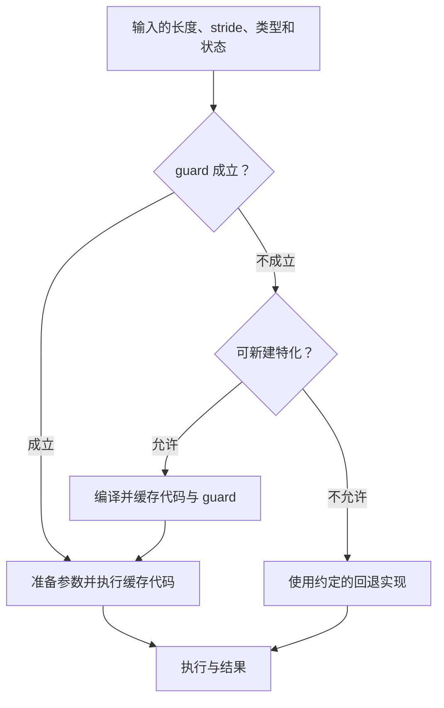

# D09 编译、DSL 与自动优化

把五个张量操作融合成一个 kernel，可能减少中间读写，也可能增加寄存器压力；生成了更快的 kernel，服务仍可能把时间花在 Python 分发和反复编译上。编译优化需要把这两笔账接起来：**程序怎样变成高效执行，以及这份执行在什么条件下值得复用。**

本篇跟随一行 softmax，从数学表达走到线程布局，再把它放进形状变化的调用流。理解归约和 GPU 分块即可开始；布局与异步依赖可配合 [[D08 算子与 GPU 执行]] 阅读。最终要能区分表达能力、生成代码、运行分发和调优成本，进而判断一种 DSL 或自动优化方法究竟改善哪一层。领域入口见 [[领域地图与覆盖缺口]]。

## 1. 一行 softmax，编译器要决定多少事

设输入一行有 1025 列。数值稳定的 softmax 先求最大值，再减最大值、求指数、归约求和，最后相除。逐操作启动 kernel 会反复读写中间数组；若整行能留在片上，融合可以只读输入、写输出。但原先的全局流量会转成寄存器占用、线程间归约与指数单元工作。

接下来要回答：一行由哪些线程负责？每线程持有多少元素？归约时怎样交换？这些决定属于 kernel 映射，数学公式本身没有给出答案。

[Triton v3.4.0 的固定 softmax 教程](https://github.com/triton-lang/triton/blob/v3.4.0/python/tutorials/02-fused-softmax.py)使用下一 2 次幂块，1025 列对应 2048 个逻辑位置。越界加载填负无穷，写回用 mask；多出的 1023 个位置没有合法全局载荷，却仍影响局部表示和归约资源。源码还根据编译后的寄存器、共享内存估计驻留 program 数，选择启动规模。它使用近似指数，正确性应按声明的数值容差判断。

这让“编译”露出三个相连的层次：

| 层次 | 对这行 softmax 的问题 | 需要保存的条件 |
| --- | --- | --- |
| 图层 | 最大值、指数、归约和除法能否融合，状态如何流动 | 可见依赖、控制流、别名与 mutation |
| kernel 层 | 元素分给谁，怎样归约，使用哪些指令和存储 | shape、类型、布局、资源与同步 |
| runtime 层 | 这次输入能否使用已有实现，如何提交执行 | guard、特化身份、地址/状态与回退策略 |

Python 控制、张量操作、内存管理和设备执行共同构成一次模型调用。捕获一段计算图，是看见了一条路径；复用它还需要检查假设。PyTorch 的捕获、guard 和生成流程可从 [2.10 发布说明（2026-01-21）](https://pytorch.org/blog/pytorch-2-10-release-blog/)进入，具体行为仍应绑定后端和版本。

## 2. 融合省下的字节，会不会以另一种形式回来

把 softmax 接到矩阵计算后，问题变成两段布局的衔接。矩阵指令希望用特定排列提供操作数，后续归约却可能希望同一行集中在另一组线程上。编译器因此插入 shuffle 或共享内存重排。图上少一个中间张量，机器上仍可能有数据交换；融合拉长值的存活期，还可能引起 spill，把片上数据重新写到内存。

阅读降低后的代码，应沿着逻辑 shape、元素到线程/存储的映射、指令操作数、同步和回收顺序检查。转换连接哪两个布局？barrier 保护哪次消费？这些问题比 IR 中算子数量更接近真实性能，也更接近正确性。

即使数学计算不变，block 的执行次序也值得调整。[Triton v3.4.0 矩阵乘教程](https://github.com/triton-lang/triton/blob/v3.4.0/python/tutorials/03-matrix-multiplication.py)按 M 方向分组排列 program，以改善 L2 复用，并为 CUDA/HIP 提供不同候选。这里的 grouping 是同一矩阵乘的 tile 次序；D08 的 grouped GEMM 则把多个独立矩阵问题放进共同调度空间，两者解决不同的空闲与复用问题。

## 3. 选择一种语言，就是选择把哪些决定交给谁

如果后端能自动生成所需映射，张量公式会很简洁；若关键流水或布局尚不可表达，就需要更直接的控制。应先明确缺少哪项决定权，再比较工具。

| 路线 | 开发者决定什么 | 系统承担什么，成本落在哪里 |
| --- | --- | --- |
| CUDA/PTX 等贴近硬件的表达 | 线程、指令、资源与同步 | 控制细，适配和验证工作多，代际迁移可能重做映射 |
| Tile/张量 DSL | 块、布局或并行语义 | 后端完成降低；抽象需要能表达目标流水 |
| 整图编译 | 更大的依赖、融合和内存寿命范围 | 受控制流、动态输入、自定义操作和编译预算约束 |
| 自动调优/代价模型 | 给出参数空间与约束 | 搜索、测量和缓存配置，承担噪声与未见形状风险 |
| Agent/学习型搜索 | 提出算法、实现或调度候选 | 扩大候选空间，需要冻结契约与独立晋升 |

这些路线可以组合：整图框架调用手写 kernel，DSL 接 autotuner，Agent 提议可由现有编译器检查的调度。Triton 经典 block 模型、显式 layout 扩展、CuTe 布局组合和 Pallas 的 Ref/BlockSpec，也把控制放在不同位置。比较它们时，可以连续追问三件事：元素由谁持有，搬运和计算何时发生，多操作在哪个边界组合。

更显式的表达让工程师尝试后端暂时无法生成的流水，也把更多同步证明与维护责任移到程序侧。自动后端能较快覆盖规则计算，其效果取决于当前能分析和生成哪些映射。代码行数、语言层次和已接入后端数，都需要落到这些具体控制点上理解。

## 4. 形状开始变化后，编译结果怎样安全复用

现在让调用长度依次变成 128、129、256，stride 也可能变化。逐长度特化能减少边界判断、利用常量，却扩大编译和缓存集合；统一放入 256 桶，以 mask 处理短输入，减少了变体，又保留了一些填充资源。符号长度可以表达一族输入，仍可能要求整除性、范围、类型和分支 guard。

guard 是运行前对这些假设的检查。下面沿一次调用画出两条路径：命中已有假设时复用，未命中时选择已有其他实现、生成新特化或回退。

图中复用的是“代码及其成立条件”。删掉检查虽然能缩短热路径，也可能把错误的输入送进特化。[PyTorch 2.9 Dynamo 机制](https://docs.pytorch.org/docs/2.9/torch.compiler_dynamo_overview.html)还包含 graph break continuation：遇到图中断后可以执行 Python，再继续捕获。因此 guard 命中、guard 失败产生特化、图中断继续执行、预算/能力限制导致回退，应该分别记录；它们消耗不同，也需要不同的修复。

当 GPU kernel 很短，命中路径中的 host 开销就更醒目。**Trident（2026-09-29，v1）**将带 guard 的分发、参数/环境准备和 host 执行合进原生模块；命中时留在编译代码，需要新增特化时才回到 Python。它缩短的是 warm 调用路径，保留了正确复用所需的检查。[设计与实验](https://arxiv.org/html/2609.37241v1)

另一条路线是 CUDA Graph：重放满足捕获条件的设备执行序列，减少 host 提交。它与数值编译互补，仍需保证地址、形状和状态适合复用。长度桶、padding、静态缓冲与运行分发常一起设计。更强图捕获、原生 wrapper、Graph replay、持久化执行和服务批处理改变的边界各异，应先画调用链，再比较它们删掉了哪些步骤。Trident 的特定模型/软件栈原型结果也保留在这一边界内。

## 5. 最快的配置，是否值得构建并长期维护

只看 warm kernel，调优越多似乎越好；把构建放回调用流，结论会变化。设构建与调优成本为 $C$，每次运行时间为 $t$，调用 $R$ 次，简化成本为 $C+Rt$。

新增调优 8 秒，每次节约 4 微秒，忽略其他成本也要超过 200 万次才收回时间；只调用 10 万次，只省 0.4 秒。多形状系统要将各形状的调用数、实际 dispatch 时间相加，再加入构建、未命中、回退和缓存失效。异步构建能减少首请求等待，资源账仍需支付。

**Helion/vLLM 2026-10-02 的报告**将多种 GEMM 算法纳入按 shape 搜索，在有限小形状范围、CUDA Graph replay 下使用 Helion，其他形状回退默认后端。它把自动搜索和实际分发共同设计：在 Graph 外测得的赢家，未必是 Graph 内的赢家；热点形状的收益还要按真实流量加权。[官方正文](https://pytorch.org/blog/building-a-high-performance-and-portable-vllm-linear-backend-with-helion/)

报告中的阈值、覆盖与端到端改善对应作者环境。研究它应同时记录编译时间、调优集、命中/回退比例与运行时间。[[D05 推理服务与调度]]的 chunk 和批量、[[D07 投机执行与解码加速]]的候选宽度都会改变 shape 分布，服务策略变化后，原来的调优账需要重算。

搜索还会选中噪声中的幸运赢家。候选需要在相同 GPU 分配、cache/Graph 状态和计时边界下交错测量，用独立样本确认。带 mutation 的算子每轮恢复输入；未见 stride、极端值/NaN、训练与服务负载、确定性要求分别验收。Agent 可以扩大提案空间，契约与晋升结论则由独立评估器持有。具体闭环见 [[专题研究/Agent 算子开发与优化（2026-11-04）/00 阅读入口与结论|Agent 算子专题]]。

## 6. 更自由的流水，能否同时带来更强的检查

显式异步让优化空间更大，也增加过早覆盖、漏等和线程参与范围错误。**Exo-GPU（2026-09-14，v1）**在顺序语义之上标注并行分配与同步：collective 分析检查哪些线程应共同执行，抽象机跟踪读写和异步可见性，以检查并行解释是否保留顺序结果。[论文 §2、4–6、8](https://arxiv.org/html/2609.16389v1)

这使 D08 的“谁还在读缓冲”成为编译检查的对象。工具覆盖的证明义务也有明确范围：使用具体尺寸，仍有两个 unsafe 重写超出顺序重写检查能力；生成 CUDA 与正式 CUDA 语义之间缺少完整证明，v1 不支持 tcgen05，也不保证所有浮点重排逐位一致。作者 H100 的 TF32 GEMM、FP32 GEMV、split-K 和统计边界各自给定，适合分析具体映射，而非给语言整体排性能名次。

从随机测试到有检查证据的变换，是值得跟进的方向。它与数值测试、硬件测量互补；[[D16 工程交付与模型生命周期]]还应记录哪些义务已由工具覆盖、哪些仍由测试承担。

## 7. 把编译进展放回系统判断

一种新 DSL 的价值，可能是表达原来写不出的布局；一种新编译方法的价值，可能是扩大可检查的变换；一种 runtime 的价值，可能是让已有代码更便宜地命中。先明确改变的是哪一层，才有可比的语义、成本与覆盖范围。

[[D13 硬件与跨平台系统]]还要求继续检查后端降低、通信、运行时和诊断能力：同一源程序可以运行，是起点；目标设备上资源映射有效、长期维护可承受，才构成有用的可移植性。接口覆盖、性能与运维能力应分别比较。

## 来源与后续深读

固定源码、论文修订号与实际入口见 [D09 核验记录](evidence/D09.json)。本文教学算例用于成本推导，Helion、Trident、Exo-GPU 的性能属于作者结果，尚无独立 GPU 复现。

进一步研究需要补 Gluon、CuTe DSL、Pallas、TileLang 等后端的完整 IR/代码生成审计，以及跨平台编译耗时、重编译分布和保留负载验证；Helion/Trident 的实际 dispatch 与源码仍应逐项核对。当前内容足以比较控制与成本，完整后端成熟度还需这些证据。
