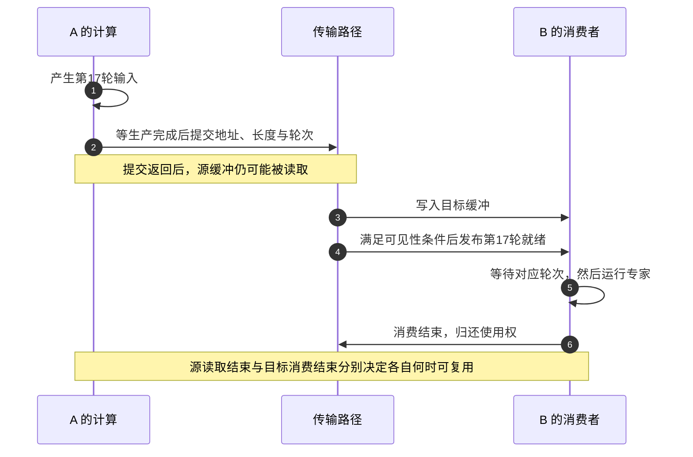

# 通信与互联：一次交换怎样让计算继续

[[领域地图与覆盖缺口|领域地图]] · 基础入口：[[03 一张卡放不下跑不完以后]] · [来源与核验范围](evidence/D10-sources.json)

4 张 GPU 各算出一份梯度，下一次更新需要它们的和。即使每张卡的计算同时结束，更新也得等交换完成。这里有三项相接的选择：怎样把同一份数学结果算出来，消息经过哪些物理链路，以及谁负责让传输从提交走到可用。把这三项拆开，才能看清环、树、RDMA 与 GPU 发起通信分别改变了什么。

## 先固定结果，再比较环与树

把每个通信参与者称为一个 rank。设 4 个 rank 各有大小为 S 的梯度，需要逐元素求和，并让每个 rank 都拿到完整结果；这就是 AllReduce 的结果约定。点对点发送和接收可以组成它，通信库负责组织匹配、分块、归约与错误处理。AllGather 则是收齐各自持有的内容；MoE 的 All-to-All 要把不同内容交给不同专家，依赖关系也随之改变。

设 rank 数为 n，本例 n=4。环形 AllReduce 先做 reduce-scatter，再做 all-gather。每份梯度切成 n 块，前 n−1 步边传边归约，使每个 rank 得到一块完整结果；后 n−1 步将这些结果块散发出去。每步发送 S/n，因此每 rank 的总发送量为 2(n−1)S/n。它只统计发送载荷，接收方向、交换机内部流量与归约计算需另外核算。

设每步启动代价为 α，每个 rank 可持续的单向载荷率为 b，理想时间为：

`T_ring ≈ 2(n−1)α + 2(n−1)S/(nb)`

这里假设环上的链路能并行、没有其他流量，归约也不额外阻塞。大消息可以摊薄启动，小消息仍要走完所有步数。

再构造一棵不分段的教学归约树。第一轮 1→0、3→2，第二轮 2→0；广播反向进行，先 0→2，再 0→1、2→3。每轮每个 rank 至多与一个伙伴通信，关键路径经过 4 次整份传输：

`T_tree ≈ 4α + 4S/b`

取 α=5 μs、b=50 GB/s，比较同样的结果与消息大小：

| 每 rank 的 S | 环：启动 + 载荷 | 教学树：启动 + 载荷 |
| --- | --- | --- |
| 4 KiB | 30 + 0.12288 = 30.123 μs | 20 + 0.32768 = 20.328 μs |
| 100 MiB | 0.030 + 3.145728 = 3.176 ms | 0.020 + 8.388608 = 8.409 ms |

KiB/MiB 按二进制、GB/s 按十进制。小消息中，树少两次启动占优势；大消息中，环的分块减小了载荷项。实际树算法还可以分段流水、分担内部节点负载。NCCL 2.4 的双树就把数据分给两棵互补二叉树，使一个 rank 至多在其中一棵承担内部节点工作。上表的整份传输树用于展示启动与载荷的竞争，优化双树有另一份成本账。[双树构造与分层环](https://developer.nvidia.com/blog/massively-scale-deep-learning-training-nccl-2-4/)

带宽指标也能从这张表还原。100 MiB 在约 3.176 ms 内完成，算法口径 S/T 约为 33.0 GB/s；用每 rank 的实际发送量 1.5S 作分子，则约为 49.5 GB/s。二者描述同一次运行。比较实验时应先统一分子与计时终点，再检查注册、预热、所有 rank 完成和共驻流量是否包含在内。

## 把逻辑交换放到物理拓扑上

现在扩成两个节点、每节点 4 张卡，共 8 张。NIC 是连接节点与网络的网卡；同一节点的多张 GPU 可能共享它的出口，也可能经过同一个 PCIe 根。一个逻辑环若多次穿越节点边界，就可能让多条流挤到同一条物理边上。跨节点总共只有 50 GB/s 时，4 个 rank 各申请 50 GB/s，并不会得到 200 GB/s，它们仍共享总出口。

分层算法利用这个差别：先在节点内 reduce-scatter，再让各结果块跨节点归约，最后在节点内 all-gather。另一种做法是选单个代表先归约、后广播，但代表的 NIC 或 PCIe 路径可能成为瓶颈。多代表条带化只有在路径确实独立时才增加可用能力。

这项选择用额外本地工作，换更少或更合适的跨节点需求。机内快、出口紧时可能有利；节点间足够快、消息很小时，额外同步又可能延长等待。ring、tree、hierarchical 应沿关键路径比较启动次数、载荷与共享边。

物理互联还决定可连接的规模。scale-up 通常服务于机内或较紧密域中的频繁交换；scale-out 把工作扩到更多节点，同时引入包处理、路径竞争与拥塞。NIC 或交换网络可以卸载部分传输或归约工作，但支持的算法、设备组合与错误处理仍会限定它的作用。它们可以承载同一个集合算法，也可以让算法重新分层。

RDMA，即远程直接内存访问，让网卡在预先建立的地址映射和权限下访问远端缓冲，减少逐次经由远端 CPU 搬运的参与。使用前仍要准备资源、注册需要的内存并约定缓冲寿命。双边 send/recv 由双方匹配一次交换；单边 put/get 面向已建立的远端地址，接收者仍需管理空间并确定何时可读。物理路径选好了，下一步是把计算依赖准确地交给它。

## 一块专家输入，何时才算交接完成

设 GPU A 产生一块输入，要交给 GPU B。CUDA stream 是设备工作的有序提交队列：通信需要在生产这块输入的计算之后执行，B 的专家计算又必须等待目标数据可见。请求被接受、源缓冲可复用、对端可见和 B 可以读取，分别是协议中的事件。

下面把缓冲标为第 17 轮。图中的“传输路径”可能由 GPU 线程、主机代理与 NIC 共同推进；箭头表示必须满足的先后关系，不表示每个 backend 都使用相同 API。

图里最重要的是两次交接：生产者先交出有效数据，接收者后取得可消费数据。若先发就绪信号、后使数据可见，B 可能读到旧内容；若 A 提前覆写源缓冲，在途 DMA 可能读到下一轮。消费后重用地址时还要区分轮次，迟到的第 17 轮通知不能把第 18 轮缓冲标成就绪。

NVSHMEM 2.0.3 的语义基线把 fence 的顺序保证与 quiet 的完成保证分开，也区分 CPU、GPU 发起操作的作用域，目标端还需要相应同步。调用者能依赖的完成范围，必须沿具体 API 确认。[内存顺序与完成](https://docs.nvidia.com/nvshmem/archives/nvshmem-203/api/docs/gen/api/ordering.html)

因此，主机发起和 GPU 发起应沿三个问题比较：谁提交请求，谁持续推进，哪个完成条件允许下一步。主机发起集合适合规律、参与组明确的工作；GPU 内发起便于在数据动态就绪时细粒度交错，但要处理设备队列、轮询和顺序。SM 是 GPU 执行线程块的计算资源，通信 kernel 若长驻 SM 等数据，就会与生产数据的计算争资源。GPU 发起路径仍可由 CPU 初始化、NIC 搬运和代理处理部分组合。

版本变化也落在这些交接点。NVSHMEM 3.8.0-0 增加应用控制的非阻塞 RMA 批处理，并修复 device signal wait 后可见性、CFT 同步及延迟完成等问题；新的发起粒度依赖对应的完成契约。[固定 release](https://github.com/NVIDIA/nvshmem/releases/tag/v3.8.0-0)

DeepEP V2.5 使用 GIN 路径，并移除旧 V1/NVSHMEM 路径。它的 deferred epilogue 首次 wait 可以执行尾处理并产生返回结果，所以 wait 本身可能承担工作。专家冗余搬运原语提供的也只是其中一段：复制规划、token 重路由与 GEMM 仍由框架配合。比较这一版需要保留这些真实工作与资源占用。[版本提交](https://github.com/deepseek-ai/DeepEP/commit/def865146e95aa9ea223e277c0a8a4c6b81e5ac7) · [固定 README](https://github.com/deepseek-ai/DeepEP/blob/def865146e95aa9ea223e277c0a8a4c6b81e5ac7/README.md)

## 分块重叠怎样把等待藏进计算

继续跟这批 token 走：dispatch 送到专家，随后进行上投影、激活和下投影，combine 将输出送回原 rank 并按路由权重合并。若一段输出已写完、目的地已知、接收缓冲可写，它就能提前返回，余下专家计算继续执行。

设 dispatch 已完成，输出分两段；每段计算 6 ms、回传 4 ms，均为示意。串行需 12+8=20 ms。独立资源下，第一段 0–6 ms 计算、6–10 ms 回传；第二段 6–12 ms 计算、12–16 ms 回传，总计 16 ms。省掉的是重叠的等待区间，首段准备和最后回传仍在关键路径上。

共驻又会改变阶段时间。若通信轮询、拷贝和 GEMM 争用 SM、HBM/L2、功率或链路，使每段变成计算 8 ms、回传 5 ms，流水就成为 8+8+5=21 ms。相较原先串行的 20 ms，新增争用超过了隐藏收益。把两个 kernel 放进不同 stream，只提供并发机会，具体资源与数据依赖仍需安排。

tile-level signaling 方法先按返回目的 rank 排行并对齐，使一个输出块能交给单一接收者；GEMM 完成 tile 后发布信号，另一组常驻 SM 消费连续段。首尾段保持小以便早发、减少尾部，内部合并以提高带宽。其单节点 4×A100、NVLink 前向实验中，较小隐藏维度模型落后于部分基线，展示了 padding、信号与调度的固定成本。[布局、分段与实验](https://arxiv.org/html/2607.19539v1)

Weave 则在路由已知后，结合标定的带宽/吞吐曲线选择通信 SM 数和流水块数，并让空闲通信 worker 临时执行 GEMM tile。其依据是每层、每 rank 的通信和计算量会变化；实验限定一个 4×H100 NVLink 节点、EP=4，多节点拥塞需另验证。论文的 DeepEP 基线也须按其实验版本理解。[空间与时间调度](https://arxiv.org/html/2609.21483v1)

这种局部收益还要核对如何接到整条执行链。2026-11-09 比对 Weave v1 与 9/25 的 v3 后，关键方法和评测未见改变当前判断的差异；两版 §5.3 的 E2E latency 都由 SGLang 测得的 pre-MoE/attention 时间与各实现的 MoE kernel 时间组合构造，并非整合后的在线服务实跑。因此它支持在所测负载上联合安排 SM 与分块，却尚未证明排队、动态批次和网络争用下的服务 goodput；DeepEP v1.2.1 对照也不能代表后来的 V2.5。[v3 方法与评测](https://arxiv.org/html/2609.21483v3) · [[来源与证据#AIINFRA-E-20261109-06|版本复核与计时边界]]

负载偏斜会进一步决定尾部。4 个专家 rank 平均各收 100 个 token，某个实际收 250 个时，其他 rank 会等它完成。接收窗口满而发送继续会增加排队，多个发送者集中奔向一张卡会形成 incast。控制在途字节、尽早发关键块、重排路由或复制热点专家，分别改变队列、时间、需求与算力；需要针对阻塞的那一项选择。

## 拥塞时，改变速率、路径还是交换图

端点降速可以抑制积压，网络选路可以利用替代路径，通信库则能调整参与者之间的交换图。三层反馈作用于不同对象，需要同时看响应时标和共享出口。

REACT 从各流完成时间找拥塞，在保持集合信息交换语义的条件下修改通信图。原型以 PyTorch P2P 构造集合，独立控制路径交换统计和新图；其附录中部分模式慢于直接 NCCL，说明调图收益必须覆盖检测、搜索、communicator 与执行包装开销。实机共享集群和大规模模拟对应不同证据范围。[反馈方法与实验](https://arxiv.org/html/2609.04417v1)

持续许多轮的热点给控制回路留下摊销空间；几十微秒的热点可能在新图下发前消失。全图或局部换位可以避开某条路径，却未必减少热门节点必须收的总字节，更未必绕开服务器唯一出口。新图还要保留结果所需的数据依赖。

UE 1.1 在网络接口层同时推进 scale-up、UET 应用兼容、网络内归约和拥塞反馈：同步组帮助映射已有 Verbs 操作接口的完成语义，网络内归约改变部分合并位置，拥塞信息与可编程管理改变端点反馈。这里的依据是规范发布说明；NIC、交换机的联合实现及跨厂商互通仍需逐组合核实。[UE 1.1 官方说明](https://ultraethernet.org/ultra-ethernet-consortium-releases-specification-1-1-advancing-ai-and-hpc-networking/)

回到最初那次更新：[[D02 分布式训练与模型状态|分片方式]]决定消息何时产生；[[D08 算子与 GPU 执行|专家计算]]决定哪些块先就绪；[[D12 集群资源可靠性与隔离|放置与共驻]]决定它们经过哪条共享路径。研究一次通信变化，应记录消息分布、最慢 rank、实际 backend、CPU/GPU/NIC 占用和失败终态，再解释哪段等待缩短了。

## 来源注与继续核验的范围

核读日期为 2026-11-04。NCCL 2.4 文章日期为 2019-02-04，NVSHMEM 2.0.3 用作固定语义基线。tile-level signaling 为 2026-07-21 v1，Weave 为 9/18 v1；另发现 9/25 v3，未核版本差异。REACT 为 9/3 v1，UE 1.1 公告为 10/12。NVSHMEM 3.8.0-0 发布于 9/22 UTC、北京时间 9/23。

DeepEP V2.5 固定提交日期为 9/29，旧库 10/19 已读，此处属于补核，且晚于 Weave v1。UE 完整规范、具体互通、UCCL/EFA/NIXL/GPUNetIO 当前组合、持续拥塞和动态成员故障仍待核。本文保留了算法、物理路径和完成协议的解释；没有执行 GPU 或网络实验，示意算例只复核模型内算术，实际读取范围见[核验记录](evidence/D10-sources.json)。

2026-11-09 完成上述 Weave v1/v3 的关键设计、实现及完整评测节比对，关闭 11/04 留下的这一版本差异子项；未做 TeX 逐字 diff。代码公开、独立复现、多节点与在线服务验证仍未闭合；本次不推进其他通信来源的核查截止。
