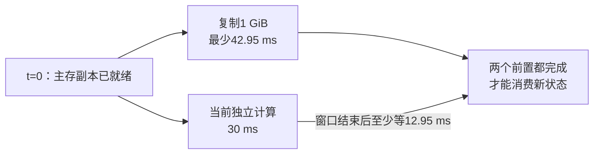

# 存储与异构内存：沿一块状态找到暴露的等待

[[领域地图与覆盖缺口|领域地图]] · 基础入口：[[09 怎样让整套系统持续交付结果]] · [来源与核验范围](evidence/D11-sources.json)

代码助手下一阶段需要一块 1 GiB 状态，冷副本在 SSD，消费者在 GPU。它可以是一段卸载权重，也可以是一批可复用 KV；两者的更新与有效性规则各自保留。先跟着这块状态走到消费者，再决定是否需要预取、缺页迁移、直接访问或另一层存储。容量扩展的价值，取决于新增路径暴露了多少等待。

## 1 GiB 搬完之前，GPU 能做什么

普通分层路径要先定位文件和区间，读到主存，完成必要的解码或重排，再复制到 GPU 的高带宽内存 HBM。每一步都有队列、元数据和完成通知。GPU 工作队列中的消费者需要等待最后一次复制可见，文件 API 接受请求只是这条路径的起点。

先简化为主存已有可直接复制的 1 GiB，单向有效载荷率为 25 GB/s。纯复制时间下界是：

`2^30/(25×10^9)=42.95 ms`

如果下一层计算提供 30 ms 的独立窗口，复制从窗口起点就开始，最少还有 12.95 ms 等待暴露。下图只画这个已就绪主存副本，不含此前的 SSD 读取、缺页、启动与解码。

两条路径汇合在同一个消费者，因此可隐藏的是 30 ms，开始使用的最早时刻是 42.95 ms。若磁盘读、解码和复制只能串行，就要累计它们；若能按块流水，稳态由最慢阶段限制，首块准备和最后一块尾部仍会保留。SSD 与 PCIe 的峰值分别属于不同阶段，组合路径需要按依赖求时间。

预取增加了可用窗口，也占据更多在途缓冲。提前两层取回，可能同时保留多块 HBM 或主存副本；取错会挤出真正需要的页。顺序经过各层的权重往往能提前确定地址；检索或 Agent 分支选出的 KV，则可能直到分支完成才知道去向。相同的 1 GiB，对两类消费者会形成不同的可隐藏时间。

## 已知地址时搬入，未知地址时怎样访问

显式预取、managed memory 和直接远端访问，区别首先在于谁决定搬运的时间与单位。

显式复制让应用选择目标位置、批量与依赖，适合未来访问较确定、搬入后能重复利用的对象。主机页锁定缓冲用于稳定 DMA 所需的页面，但它会占用不能随意换出的主存；过量使用会挤压系统可分页空间。应用需要管理这些缓冲的寿命和容量。

managed memory 提供统一指针，物理驻留由支持的设备与运行时能力决定。CUDA 12.8.1 支持相应组合下的迁移、驱逐及 advise/prefetch 提示，不同设备组合的路径仍有差别。[固定版分配与迁移语义](https://docs.nvidia.com/cuda/archive/12.8.1/cuda-runtime-api/group__CUDART__HIGHLEVEL.html)

在按需迁移的路径中，GPU 发出 load 后发现数据未驻留，触发缺页处理；HBM 不够时先腾出旧页，再迁入并重试。必须保留的脏数据还涉及回写。若复用距离超过可驻留集合，刚迁走的页很快又被访问，链路就会忙于来回换页，计算持续等数据。

访问单位决定这种代价能否摊销。假设迁移单位为 4 KiB，每次只消费其中 128 bytes，驱逐前也不再用其余内容，有效字节只有 1/32：消费 32 MiB 可能搬来 1 GiB，尚未计回写。4 KiB 是这个教学算例的单位，具体 CUDA 迁移粒度需按平台核实。若整页都被多次使用，迁移成本可以分摊；若只用少量内容一次，直接从远层取所需数据可能更合算，但每次 miss 都进入远端延迟和带宽预算。

NVIDIA 的 oversubscription 方法实验用 grid-stride、block-stride、random-warp 区分这些访问模式：先在 CPU 填充 managed allocation，再让 GPU 读取，比较按需迁移、直接访问与分区。V100/A100、PCIe 与 Power9 NVLink 的结果不同，给出的条件是访问分布、驻留和互联共同决定成本。[访问过程与实验设置](https://developer.nvidia.com/blog/improving-gpu-memory-oversubscription-performance/)

| 对这块状态已知的条件 | 可优先比较的路径 | 需要计入的代价 |
| --- | --- | --- |
| 未来地址确定、搬入后多次使用 | 显式预取到 HBM | 缓冲、预取窗口与误取流量 |
| 地址动态，希望少管理物理位置 | managed memory 按需迁移 | 缺页、驱逐和可能的抖动 |
| 每次仅使用远层的一小部分 | 直接访问或细粒度获取 | 每次远端访问的延迟与有效载荷率 |

这些路径都要回到图里的汇合点：数据到齐时，消费者是否已经在等它。

## 主存位置与直达路径，改变哪一段搬运

即使都在主存，页面也未必离 GPU 一样近。设 GPU 接在 CPU socket 0，页面由 socket 1 上的线程首次分配和写入，后续 DMA 可能经过跨 socket 互联再到设备。这种非均匀内存访问称为 NUMA。把读取线程绑到 socket 0，并不自动证明已经存在的页也迁了过来；生产线程、页面、GPU 与网卡的位置需要一起核对。

缓存一致互联为可见性提供机制，远端访问仍经过实际链路。缓存行被不同执行者反复修改，还可能放大流量。减少绕行是否有用，要看这段路径是不是当前瓶颈。

DeepInfer **2026-11-03 更新的部署 Q&A**说明了另一种主存分工：Engram 以独立 ENP 组沿词表分片，GPU 路径把词表置于已注册主存，由 forward 开始时发起单边 RDMA 读，NIC 后台搬入 GPU；较小的 scales 留在 GPU，经 NVLink 传输。NPU 路径尚无 CPU offload。这里的收益条件由查询字节、提前量和设备路径共同决定，不能把一种平台的主存扩容能力拼接到另一平台。[固定部署说明](https://github.com/deepseek-ai/DeepInfer/blob/a679bb86ce36e883a98a97733492b686e5b9a08e/doc/inference_deployment_qa.md) · [[来源与证据#AIINFRA-E-20261109-10|文档更新证据]]

GPUDirect Storage（GDS）尝试让存储设备与 GPU 之间的 DMA 绕过 CPU bounce buffer，即减少先读入 CPU 中转缓冲、再复制出去的过程。它仍由 CPU 控制路径提交和准备资源，也需要 GPU、驱动、文件系统及拓扑支持。接口调用成功以后，实际走直接路径还是回退路径，需要按具体组合确认。[GDS 设计与适用范围](https://docs.nvidia.com/gpudirect-storage/design-guide/index.html)

如果数据必须先由 CPU 解压或解析，这段处理仍是必经依赖；如果 IO 已完全藏在计算后面，再缩短传输也未必改变交付时间。官方指南把 IO 位于关键路径、GPU 是数据首个或最后消费者列为适用条件。GDS 改变中转路径，预取改变发起时机，managed memory 改变迁移管理方式，它们应沿同一消费过程分别比较。

## 大块吞吐够了，小请求仍可能拖住整批计算

继续取那 1 GiB，但现在只能做 4 KiB 随机读。若路径可持续处理 100,000 IOPS，即每秒完成十万次 IO，则载荷率最多为：

`100000×4096=409.6 MB/s`

1 GiB 需要 262,144 次 IO，至少 2.621 s。它与前面 25 GB/s 的大块复制预算描述不同瓶颈：一个受每秒操作数限制，一个受连续载荷限制。合并请求能减少操作次数，也可能多读无用内容、等待相邻请求或增加缓冲。

队列深度用来填满设备流水。在稳定系统里，平均在途数约等于完成速率乘平均响应时间；100,000 IOPS、平均 100 μs 对应约 10 个在途请求。这个 Little 定律关系约束平均量。过饱和后，更多并发主要增加排队，不能从中直接推得 P99。

消费者还常要等一批块。假设 100 个独立读取各有 99% 的概率在某时限内完成，整批都按时的概率仅为 `0.99^100≈36.6%`。这是独立同分布的示意，实际共享队列可能相关。它说明单 IO 的 P99 与整批任务的 P99 不同。合并读取、提前发关键块、先消费本轮必需部分，会同时改变任务等待、流量和缓冲需求。

元数据也位于这条路径。十万个小对象带来名字查找、权限和版本检查、open/stat 或远端请求。打包成大文件减少小操作，但需要索引；修改一个小片段又可能迫使更大区间重写。压缩省下字节，同时增加解码计算。布局需要贴合消费单位。

冷、热状态应分别计时。第一次读取包含文件查找、页面驻留和设备注册，重复地址可能已由主存或页缓存服务。记录实际命中层、字节、在途数、消费者等待及内容版本，才可识别省掉了磁盘访问、CPU 中转还是窗口外等待。

## 扩成共享内存池，还要发布正确的版本

当主存容量不足，CXL 可以把设备内存映射进主机地址空间。Linux v6.12 文档通过设备、主桥与地址解码拓扑描述这一过程；条带化、映射和平台配置决定访问落点，GPU 可寻址能力仍需按系统组合确认。[固定版 CXL 操作模型](https://www.kernel.org/doc/html/v6.12/driver-api/cxl/memory-devices.html)

CMM-MP 把这条路径继续扩到 Ethernet 后端：主机看见 CXL Type 3 内存，设备内部完成地址映射并转发请求，设备还承担池节点发现和部分传输管理。其多主机共享模式保证单次访问原子性，但不保证主机请求的执行顺序，上层需要相应一致性与带外同步。评估主要是 Valkey/YCSB、DiskANN 等原型应用，GPU 训练和长上下文业务组合仍需另核。[架构、主机接口与评估](https://arxiv.org/html/2610.22716v1)

设生产者先写 payload，再写“版本 17 就绪”。如果系统只保证每次访问原子，消费者可能先看见标志，再读到旧 payload。把标志换成原子整数只能防止标志被撕裂；发布协议还须保证数据先于就绪条件可见，采用该实现实际支持的顺序与确认机制。CPU 上的 release/acquire 习惯需要与远端设备契约对应。

发布后还有引用寿命：消费者仍持有旧版本时，地址不能立即分给新对象；节点失效后，引用要失效或从副本恢复。对象身份、租期、回收与故障域由此进入内存池设计。可寻址容量、跨主机正确共享与持久事务，分别需要自己的协议。

## 副本和持久化，需要从读取收益中付账

另一条扩容路线维持文件访问接口，在 NVMe 与远端存储之间安排 IO。KVStream 同时在 NVMe 和并行文件系统保存副本，把一批读取交给先空闲的路径，并尽量将写入藏在计算后面。收益来自关键路径上的读等待，以及两条路径额外提供的有效能力。[设计、范围与第 6.5 节反例](https://arxiv.org/html/2610.31827v1)

它的 Chutes trace 随主机内存增加，TTFT 加速比由 1.71 降至 0.98，稀疏复用也可能亏损：主存已容纳复用时，磁盘层能够省下的读工作变少，复制写入仍存在。原型按节点适应读取，跨节点共享、全局协调与完整 prefill/decode 分离还需添加身份、发布与交接协议。

副本的写账可以直接数。产生 1 GiB 新状态，同时写本地 NVMe 和远端文件系统，应用层已写 2 GiB。若只改 4 KiB 却重写完整 1 MiB 块，单副本又有 256 倍逻辑重写；SSD 内部闪存回收的物理写放大属于另一层。后台检查点顺序写能被流水隐藏，仍会争用训练数据和在线恢复读取的服务能力。

写入终点同样要分开：进程缓冲、OS 页缓存、设备确认、跨故障域持久化依次提供不同承诺。可再生缓存允许丢失时可以使用较轻协议；检查点则需在恢复前找到已提交版本与完整分片清单。[[D12 集群资源可靠性与隔离|提交与恢复]]接着解释这个边界。

同份 DeepInfer Q&A 对 CXL L2 的讨论说明，增加快层未必首先为了降低读取延迟：作者称其 KV 读取已与排队和计算重叠，预计更低命中延迟对 TTFT 的改善有限，更值得研究的是把热或只用一次的条目暂留内存以减少 SSD 写入。但该方案**尚未采用**，也没有给出相应实验；这是待验证的写入成本假设，不能写成 CXL 已进入其生产 KV 路径。[固定 Q&A 的 CXL 问答](https://github.com/deepseek-ai/DeepInfer/blob/a679bb86ce36e883a98a97733492b686e5b9a08e/doc/inference_deployment_qa.md)

由此回到开头的消费者：先由 [[D06 KV 与模型状态系统|状态表示]]决定必须保留的信息，再确定访问单位、驻留和可隐藏窗口；远端路径与 [[D10 通信与互联|通信]]共享网卡及注册资源，副本与后台 IO 又改变集群的故障域和租户尾部。存储选择的结果应体现在可用数据何时到达，而不只体现在新增容量。

## 来源注与继续核验的范围

核读日期为 2026-11-04。CUDA 12.8.1、Linux v6.12 为固定语义基线，NVIDIA oversubscription 文章为 2021-10-05；GDS 引用访问时的动态设计指南。CMM-MP 为 2026-10-15 v1。KVStream 为 10/22 v1，旧笔记已收录，此处重新解释路线与反例。

具体 GDS 驱动/文件系统直接及回退路径、缓存行一致性与 C2C 争用、复杂元数据服务、近存计算和共享池的 GPU/故障组合仍待核。本文未执行 IO 或 GPU 实验；算例复核了预取、粒度、队列与写放大的模型内关系，作者原型的负载范围继续保留，详见[核验记录](evidence/D11-sources.json)。

2026-11-09 补核 DeepInfer commit `a679bb86ce36e883a98a97733492b686e5b9a08e` 的部署 Q&A，提交时间为 11/03 07:31:40 UTC；它新增部署说明，不证明机制在该日上线。Engram 按作者所述平台组合记录，CXL 保留未采用状态；未核内部存储实现或独立性能，其他存储分支仍维持原缺口。
