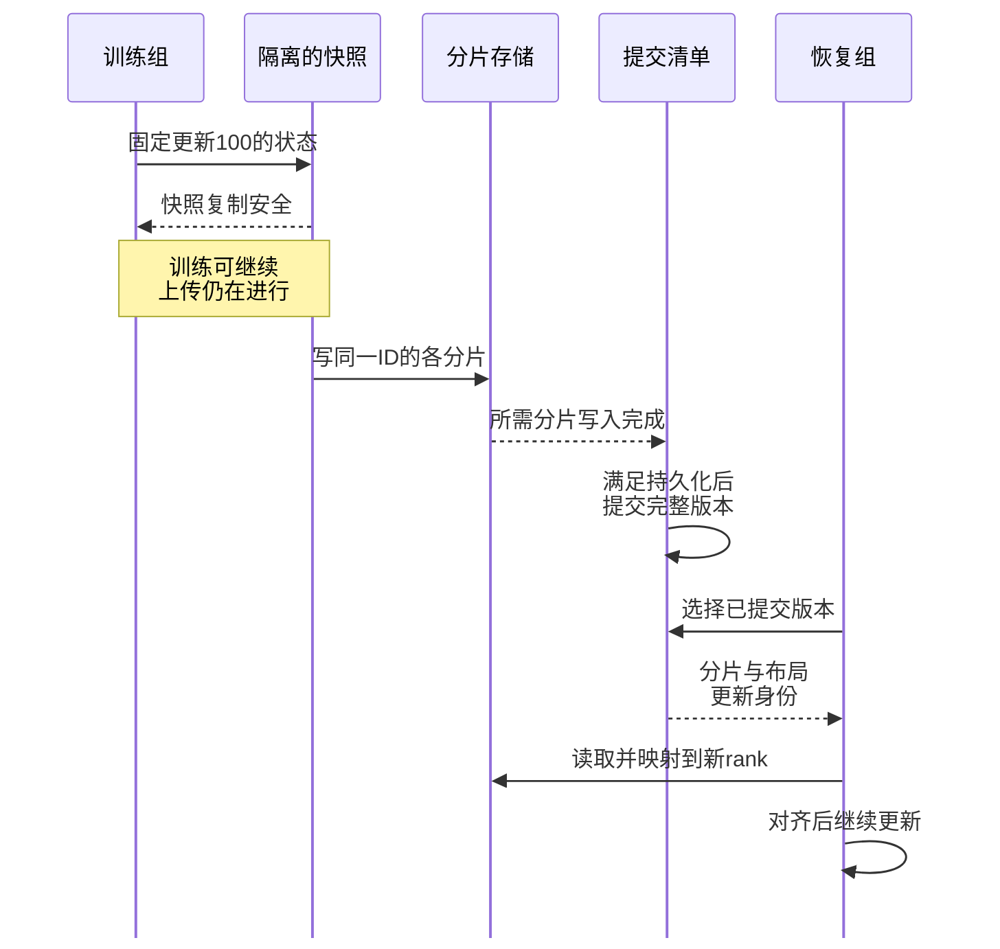

# 集群资源、可靠性与隔离：从分到资源到恢复进展

[[领域地图与覆盖缺口|领域地图]] · 基础入口：[[09 怎样让整套系统持续交付结果]] · [来源与核验范围](evidence/D12-sources.json)

代码助手的训练、生成和 CPU 测试共用一个池：8 张 GPU、64 个可分配 CPU 核。调度器要选择谁先进入、落在哪些设备上，以及运行中怎样扩缩和恢复。一次分配只有持续完成有效工作，才兑现为产出。下面先算分配约束，再让其中一项训练经历故障，检查它如何回到同一个学习过程。

## 资源够不够，先按需求向量计算

先隔离公平问题，假设设备同构、任务独立且每份需求固定：A 用 1 GPU、16 CPU；B 用 2 GPU、8 CPU。按 GPU 平分忽略了 A 的 CPU 需求，按任务数平分又需要解释“相同一份”代表多少资源。

Dominant Resource Fairness（DRF）把用户在各资源上的已分配比例取最大值，称为 dominant share，再提高当前最小的这项份额。本例中：

`A: max(1/8,16/64)=1/4`

`B: max(2/8,8/64)=1/4`

若资源可分割，或用时间平均理解，两者各分 x 份，需满足 GPU 的 `3x≤8` 与 CPU 的 `24x≤64`，得到 `x=8/3`，两类资源恰好用满。真实任务是离散的：先各放 2 份只用 6 GPU、48 CPU，余量能再放一份 B，但两人的瞬时 dominant share 就不再相等。配额权重、任务结束后的再分配与离散碎片需要另外处理。[DRF 定义与假设](https://www.usenix.org/events/nsdi11/tech/full_papers/Ghodsi.pdf)

这种公平规定资源权利，性能模型再判断它能换来多少进展。相同 GPU 数可以处理不同 token、输入长度与质量目标；历史分配也会影响队列策略。在线服务另有尾延迟要求，训练的公平份额和最短平均完成时间需要分别取舍。

拓扑让同样数量的卡形成不同可用集合。一个 4-GPU 同步作业立即拿到分散设备，预计运行 20 分钟；等 2 分钟后可进入紧密互联域，预计运行 17 分钟。在预测成立且不损害更紧急作业时，后者早 1 分钟结束。若只有 1 分钟的短任务，多等通常不合算。通信组的高速域、GPU 与网卡的距离、每节点剩余显存，都会改变选择。

成组准入（gang admission）要同时交付作业的必要资源，避免部分 rank 先占卡，其他参与者长期未到。回填则让短工作利用预留前的空隙，但需估计它能否及时结束或可承受地被抢占。CPU 测试可以填空，也可能占满训练解码核和存储队列，使原来的运行时间预测失效。

## 运行之后，配额、隔离与弹性继续约束这笔账

| 要作的决定 | 需要掌握的事实 | 主要取舍 |
| --- | --- | --- |
| 准入与配额 | 已预约、已交付、可借与待回收量 | 公平、紧急性和闲置利用 |
| 拓扑放置 | 通信组、节点和高速域的可用集合 | 等待、碎片与运行时间 |
| 共享隔离 | 显存峰值、执行资源及 CPU/网络/存储竞争 | 利用率、尾部与故障范围 |
| 扩缩与抢占 | 保存/重分片、准备和排空的时间 | 新容量到达速度与迁移代价 |

Kueue v0.14.0 将拓扑调度升为 beta，并记录弹性作业、配额回收相关修复。它提供一个工程基线：伸缩前预约了什么，结束后究竟归还了什么，需要保持资源账一致。[固定 release](https://github.com/kubernetes-sigs/kueue/releases/tag/v0.14.0)

共享首先要按峰值准入。两项服务各需 20 GB 权重与状态，看似能放入 48 GB 卡；长输入却可能同时增加 KV 和工作区。可以限制并发，或采用声明过的抢占、交换与失败规则。即使容量足够，同时进行的大 prefill 也会共享 GPU 执行资源、HBM 和功率，改变 decode 尾部。

整卡独占减少直接共驻干扰，付出细粒度闲置；时间复用能容纳更多工作，付出切换与竞争；硬件切片提前划定部分计算和内存，可能留下大小不匹配的碎片。MIG 对支持的 GPU/配置分配独立的部分处理器、L2、内存控制器和 DRAM 路径；CPU、共享网卡、存储和整节点故障仍是别的边界。[MIG 的资源隔离范围](https://docs.nvidia.com/datacenter/tesla/mig-user-guide/introduction.html)

租户数据另有访问边界。共用权重时，前缀、工具结果和会话仍要遵守各自权限；认证、配额和缓存共享域需分别落实。输入触发的控制面错误、诊断操作等也可能超出资源切片的隔离范围。验证应观察竞争下每租户的完成量、尾延迟与失败。

扩容则需要把“缺多少”换成“何时到达”。队列 token 只估计工作量，处理速率还需模型、输入、硬件和状态路径标定。若突发只持续 20 秒，新副本 40 秒后才 ready，它不能挽回这次队列；预热池缩短交付时间，同时持续占预算。控制器应分别记录期望量 desired、已分配 allocated、可服务 ready 与正在排空 draining。

阶段拆分还要求一组兼容角色同时可服务。**2026-10-20 发布的 llm-d v1.0.0** 用 DisaggregatedSet 协调 P/D 的版本与滚动，却不能免除备用容量：其依赖 LWS v1.0.0 把未显式配置角色的默认预算改为 `maxSurge=0/maxUnavailable=1`，避免无空闲 GPU 时新组无法就绪。代价是先排空每 slice 唯一的 prefill，可能让全部版本暂不完整，router 因而拒绝请求并返回 503。保留旧角色直到新角色 ready 需显式设为 `1/0` 并预留容量；这把“滚动过程能继续”与“始终有完整服务路径”分开。公开问题 #2854 和修复 PR #2857 记录了这一具体配置反例，11/09 API 核查 PR 仍未合并，不能写成正式版已修复。[llm-d release](https://github.com/llm-d/llm-d/releases/tag/v1.0.0) · [LWS 默认值变更](https://github.com/kubernetes-sigs/lws/pull/1169) · [修复 PR](https://github.com/llm-d/llm-d/pull/2857) · [[来源与证据#AIINFRA-E-20261109-05|证据与范围]]

训练扩容还会改变更新。4 卡增到 8 卡，每卡 microbatch 和梯度累积都不变，全局 batch 就翻倍；保持全局 batch 则需重调两者，可能降低单卡效率。Pollux 用系统吞吐乘统计效率估计训练 goodput，协同选择资源和 batch，把系统速度与学习进展放在同一个条件模型中。这一效率要依学习目标估计，RL reward 不能直接替代它。[方法与官方论文入口](https://www.usenix.org/conference/osdi21/presentation/qiao)

在线扩缩不改变训练 batch，但要付权重分发、编译、KV/会话交接。收回资源前先停止接新请求，再使在途任务完成、迁移或按契约失败；训练抢占也需确定状态如何保存和重分片。应用可恢复到哪些参与规模，是下一步能否释放资源的前提。

## 失效之后，先恢复哪一个更新

让池里的一项同步训练经历一次中断。它需要 60 分钟无故障等价工作，排队 2 分钟、准备 3 分钟；在第 45 分钟失效，最近提交在第 40 分钟。示意恢复时间如下：

| 阶段 | 时长 |
| --- | --- |
| 检测、隔离问题 | 1 分钟 |
| 替换资源 | 2 分钟 |
| 载入一致状态 | 3 分钟 |
| 预热 | 1 分钟 |
| 重做未提交区间 | 5 分钟 |

总交付时间为 `2+3+60+1+2+3+1+5=77` 分钟。60 分钟计最终所需的无故障等价工作，另加的 5 分钟是故障丢失的重做。更快检查点只影响部分阶段；更快检测也要控制误杀慢而健康的工作。排队时未占 GPU，所以这 77 分钟是交付时间，设备成本还需沿实际占用另算。

恢复者需要知道“第 40 分钟提交”究竟意味着什么。检查点必须包含同一更新边界的参数、优化器、步数、随机状态、数据游标和分片描述。若拼进 rank 0 的更新 100 与 rank 1 的更新 101，即使各分片完整，恢复的也不是一个共同学习时刻。

以更新 100 为例，下图展示一个教学保存/恢复协议。图中有两道允许继续的边界：快照复制安全以后，活跃参数才可被下一次更新修改；完整版本提交以后，恢复者才可选择它。

复制隔离允许上传与训练重叠，前提是后台不会继续读取正在被优化器改写的对象。分片写入可以并行，清单发布必须等待所需结果齐备。恢复时先选完整提交，核验布局和状态，将新 rank 映射到旧分片，再全组对齐；版本清单、校验和与保留上一份提交用于支撑这个过程，具体存储实现承担哪些保证需逐项确认。

| 故障位置 | 可选恢复状态 | 需要守住的条件 |
| --- | --- | --- |
| 正在复制更新 100 | 上一已提交版本 | 活跃对象与半份快照分开 |
| 分片写入途中 | 上一已提交版本 | 目录存在不作为完成标志 |
| 数据齐备、清单未发布 | 按协议通常仍选旧提交 | 不自行拼接未确认的新版本 |
| 提交后，训练已到 105 | 已提交更新 100 | 全组重放 101–105，保持数据/更新对应 |

只放本地的检查点恢复快，但可能与计算节点一起损失。副本应按进程、GPU、节点和机架故障域放置。在线任务还要恢复已完成工具动作和状态版本；进程重启、容量回归、旧会话接续与质量维持，是需要分别计时的终点。

## 源码里的复制与提交边界

DCP 的异步保存区分 staging 完成和上传完成。staging 是把待保存状态准备到可安全读取的位置；下一次参数修改须尊重其完成条件，持久保存又有另一个终点。限制在途保存数量可以避免快照占满主存。[DCP 异步保存教程](https://docs.pytorch.org/tutorials/recipes/distributed_async_checkpoint_recipe.html)

固定到 PyTorch v2.9.0，默认 collective 保存路径先等分片写结果再调用 `finish`。文件系统 writer 写临时 metadata，按 `sync_files` 执行同步，再 rename 为正式 metadata；关闭同步时源码明确不给故障一致性保证。覆盖旧目录也不是跨后端通用事务，因此应按 checkpoint ID 保留已提交版本，POSIX 路径的语义不能直接移植给所有对象存储。[写入协调](https://github.com/pytorch/pytorch/blob/v2.9.0/torch/distributed/checkpoint/state_dict_saver.py) · [文件提交](https://github.com/pytorch/pytorch/blob/v2.9.0/torch/distributed/checkpoint/filesystem.py)

NVRx v0.7.0 的异步 writer 在解析相关 CPU tensor 时做 clone，将快照与活跃存储隔离。如果后台序列化仍读原动量，而优化器已原地更新，完整落盘的文件也可能不对应任何真实训练时刻。完整文件和一致快照由此成为两项条件，应用仍需正确收集状态、协调更新。[固定 writer 实现](https://github.com/NVIDIA/nvidia-resiliency-ext/blob/v0.7.0/src/nvidia_resiliency_ext/checkpointing/async_ckpt/filesystem_async.py)

同版还更新故障节点排除、重新集合参与者的 rendezvous 和热备重启规则。归因与 Restart Agent 属实验功能，归因异步执行，STOP 判定的动作需显式选择；诊断、决策和恢复执行各有边界。[NVRx 固定 release](https://github.com/NVIDIA/nvidia-resiliency-ext/releases/tag/v0.7.0)

保存间隔可以用一个简化模型起算。假设每次保存造成 1 分钟不可重叠代价，平均每 600 分钟失效一次，失效均匀落在间隔内，忽略相关故障、后台争用和状态变化。间隔 I 分钟时，开销近似为：

`1/I + I/(2×600)`

I=10、30、60 时分别约 10.83%、5.83%、6.67%；模型最优点为 `sqrt(2×1×600)=34.64` 分钟。实际异步系统要用暂停、后台资源成本、故障相关性和恢复条件替换这些假设，再决定保存频率。

## 把准备移出中断窗口，仍要交接正确状态

TrainMover 将新节点准备提前到训练仍在进行时：用记录的通信张量进行 sandbox 预热，先准备 bootstrap 和拓扑，切换时只更新差异连接。计划迁移可以从离开节点接最新状态；突然故障仍需从冗余副本或检查点恢复，其他 rank 也要对齐。[原论文第 3–8 节](https://www.usenix.org/system/files/osdi26-lao.pdf)

其约 20 秒来自最高 1024 GPU 的作者实验；64K 资源节省属于推演，基础设施清理与重调度成本另行处理。预热和复用不变连接缩短的是前表中的部分阶段。热备自身占设备，低故障率下可能不划算；机架失电和共享网络故障会同时影响多个节点，这些相关失效不满足独立单机故障概率相乘的假设。原型修改训练框架、c10d 和 NCCL，迁移到其他栈需要对应适配。

归因则应沿同一时间线查第一个停止推进的边界：输入未到，追 CPU/存储；输入到齐但计算慢，追设备、共驻和功率；本地计算结束但远端未到，追通信边与对端；数据齐备而未提交，追协调和存储。等待最久的 rank 可能只是受害者。将更新号、collective 序号、节点及 checkpoint ID 连起来，才能隔离原因并检查恢复后是否继续有效更新。

[[D02 分布式训练与模型状态|分片与并行]]决定保存和重建对象，[[D11 存储与异构内存|副本位置]]决定能承受的故障域；恢复环境可工作以后，[[D16 工程交付与模型生命周期|交付系统]]还要核对模型与配置身份。后续验证应核数据游标、已提交更新与未提交重放，区分会话接续和单纯容量恢复，再比较有效产出。

## 来源注与继续核验的范围

核读日期为 2026-11-04。DRF 为 NSDI 2011、Pollux 为 OSDI 2021；Kueue v0.14.0 发布于 2025-09-30 UTC、北京时间 10/01，是历史基线。MIG 引言页面标注更新于 2026-10-13。NVRx v0.7.0 为 9/16 已收录材料，此处补核源码。DCP 教程为访问时的动态文档，DefaultStager 标为 2.9 引入，未追认首次发布日期；提交代码固定到 v2.9.0。TrainMover 会期为 2026-07-13–15。

相关故障、控制器持久化、网络分区后的旧进程隔离、租户恢复承诺和竞争下长期成本仍待专门设计与验证。本文没有故障注入、GPU 或部署实验，各来源的实际读取范围与作者实验边界见[核验记录](evidence/D12-sources.json)。

2026-11-09 限定核读 llm-d/LWS v1.0.0 发布、LWS #1169 和 llm-d #2854/#2857，并通过 GitHub API 核实后者未合并。该记录说明特定 singleton P/D recipe 的容量与可用性边界；未独立复现 rollout、审计 nightly 日志或完成集群可靠性来源全量检查。
