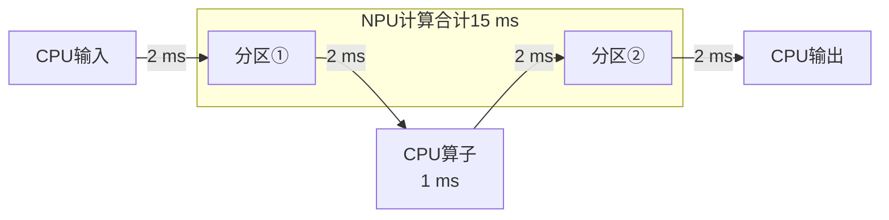

# 硬件与跨平台系统：从工作负载推到设备选择

[[领域地图与覆盖缺口|领域地图]] · 基础入口：[[02 一张 GPU 上时间和显存花在哪里]] · [来源与核验范围](evidence/D13-sources.json)

同一个 8B 代码助手，先处理 4096-token 输入，再逐步生成最多 256 个 token。前一阶段有许多行可以共同使用权重，后一阶段每条序列每次只增加一个位置，同时不断读取历史。要为它选择设备，先算工作如何变化，再看 GPU、TPU、CPU 或 NPU 能否把对应路径执行出来。

## 算力增加以后，哪部分工作会缩短

沿用全书教学预算：BF16 权重约 16 GB，其他显存预留 8 GB，每 token 逻辑 KV 为 128 KiB。下面三台设备只用于比较资源比例，不对应实际芯片规格或性能测试。C 表示对应矩阵运算预算，W 表示 HBM 有效载荷率，H 表示容量，GB/TB 按十进制。

| 教学设备 | 矩阵算力 C | HBM 载荷率 W | 容量 H |
| --- | --- | --- | --- |
| A：基础预算 | 200 TFLOP/s | 1 TB/s | 48 GB |
| B：增加矩阵算力 | 400 TFLOP/s | 1 TB/s | 48 GB |
| C：增加带宽与容量 | 100 TFLOP/s | 2 TB/s | 96 GB |

参数数目 N 取约 8×10⁹。单条输入的主要矩阵计算近似为 `2N×4096=65.536 TFLOP`，A/B/C 对应 327.68、163.84、655.36 ms。这个量只覆盖所标定的矩阵工作，Attention 等仍需另外核算；它说明大量 token 行能够利用新增算力，不能直接作为完整首 token 延迟（TTFT）。

逐步生成时，若每轮主要权重读量约为 16 GB，纯读取分别需要 16、16、8 ms。B 的矩阵算力翻倍，却没有缩短这项。活跃 32 条、每条已缓存 4096 位置时，KV 约 17.18 GB；按一次权重读取加全部 KV 粗略核账，共约 33.18 GB，三台设备分别对应 33.18、33.18、16.59 ms 的载荷量级。实际矩阵、Attention、缓存与调度的依赖决定这些读量怎样进入每轮时间。

容量则决定能同时驻留多少请求。为每条保守预留 4352 个 KV 位置，占 570,425,344 bytes。A/B 可用 KV 预算为 24 GB，最多 42 条；C 为 72 GB，最多 126 条，均未扣调度余量。首个输出来自 prefill，256 个输出通常再执行 255 次 decode；4352 是额外留出最后一个输出也被送回模型的容量。接入更多序列还会增加每轮读取和排队，容量上界要与时限一起使用。

把这项比例缩到一次 BF16 矩阵乘：输入有 M 行，计算 `X[M,K]×Θ[K,J]`，其中 Θ 是权重矩阵，避免与上表的带宽 W 混用。权重每次读一次、输入输出流量相对小时，算术强度近似为：

`(2MKJ)/(2KJ)=M FLOP/byte`

它与设备的 C/W 相比，给出 A/B/C 大致 200、400、50 行的局部转折。B 要更多行复用同一权重，才能发挥新增算力；C 会在更小 M 进入计算侧限制。Attention 和完整模型还有其他流量，这个推导用于解释资源比例，不给完整 8B 划精确阈值。

于是硬件选择开始分化：大矩阵 prefill、小批量 decode、更多请求驻留，分别对算力、带宽、容量提出不同要求。拆阶段部署可以为它们选择不同资源，但会增加 KV 交接与网络等待，仍需把整个任务合起来核算。

## 资源比例怎样变成不同的硬件路线

GPU 把线程、通用执行和矩阵单元组合起来。矩阵单元要靠布局、共享存储及异步搬运供给；增大 tile 能提高复用，也会增加寄存器、共享存储和同步压力，减少可驻留工作。不规则地址与控制又会进入通用执行路径。[[D08 算子与 GPU 执行|算子映射]]决定纸面资源能利用多少。

TPU 等阵列加速器同样需要给运算安排数据，但其缓冲和执行约束不同。Pallas 的 GPU/TPU backend 共用 Ref、BlockSpec 和流水思想，同时提供硬件专用 API：Ref 表达可读写的缓冲视图，BlockSpec 描述一次处理哪些切片，共用表达还需各自落到物理执行。[Pallas 的共享抽象](https://docs.jax.dev/en/latest/pallas/index.html)

Pallas TPU 文档进一步描述，HBM 输入由编译组织到较低层的 VMEM/SMEM 缓冲，kernel 内的 Ref 常指向这些缓冲；输出窗口和归约维的网格顺序也有约束。其 TPU v6 二维向量布局示例中，最后两轴影响 padding、转置与寄存器利用。[TPU 内存与布局](https://docs.jax.dev/en/latest/pallas/tpu/details.html)

移植一个矩阵时，先确定读写切片和归约依赖，再安排目标平台的本地缓冲与执行次序。窗口超过本地容量，就要重新分块或流水；扩到多芯片，又要重选分片轴和通信组。矩阵变快而互联相对更慢时，减少频繁小同步可能比继续加大矩阵更有效。

TorchTPU 让这项迁移进一步落到分布式程序怎样被编译。2026-11-09 核验的固定提交 `680b8436e61b` 在 ProcessGroup 层接入 PyTorch collective，再降低为 StableHLO/XLA 图。不同 rank 若形成不同图，融合通信可能使同步关系失配；默认 skinny collectives 因此把通信单独切开，换取 MPMD 安全，也失去同图内计算通信重叠的机会。确认严格 SPMD 后可用 `spmd_safe`，或在支持范围内启用图一致性握手；当前握手实现只处理 global process group，不能外推到任意 TP/EP 子组。项目状态表也将 SimpleFSDP 与低性能、实验性的 FSDPv2/MPMD 分开。原生接口减少了代码迁移，却没有自动保留 [[D02 分布式训练与模型状态|原来的分片与重叠策略]]。[固定通信文档](https://github.com/google-pytorch/torch_tpu/blob/680b8436e61baf6f832f32d2bc8ca55615ff619e/docs/distributed_support.md)、[握手边界](https://github.com/google-pytorch/torch_tpu/blob/680b8436e61baf6f832f32d2bc8ca55615ff619e/src/torch_tpu/_internal/distributed/handshake.py#L365)、[功能状态](https://github.com/google-pytorch/torch_tpu/blob/680b8436e61baf6f832f32d2bc8ca55615ff619e/docs/feature_set.md)。

数值路径同样要迁移。TorchTPU 的默认 FP32 matmul 使用 BF16 输入精度和 FP32 累加，提高精度则增加 MXU passes；相同张量 dtype 因而不足以定义相同算术成本或结果。应记录实际乘法、累加与融合舍入，再验层输出、梯度和任务质量。增加 passes 的局部计算成本，也不能直接当成整模型同比例变慢。这把硬件选择接回 [[D04 模型结构与数值表示|数值表示]]，以及 [[D03 后训练与推理时计算|训练与采样概率的一致性]]。TorchTPU 当前公开机制不等于所有 RL 组合成熟；其状态表仍把 RL 列为后续重点。[固定精度说明](https://github.com/google-pytorch/torch_tpu/blob/680b8436e61baf6f832f32d2bc8ca55615ff619e/docs/numerical_precision.md)；[[来源与证据#AIINFRA-E-20261109-03|证据与范围]]。

真实系统也在按阶段重新配置资源。Google 的 TPU 8t/8i 报告分别面向大规模训练和采样、推理，将 8i 的片上 SRAM、collectives 加速单元与 Boardfly 互联联系到小步生成和通信等待；8t 采用另一种训练系统组织。峰值与性价比仍属于厂商指定条件的声明，可订购容量、完整比较配置与独立长期服务结果需另外确认。[Google 架构说明](https://cloud.google.com/blog/products/compute/tpu-8t-and-tpu-8i-technical-deep-dive/?hl=en)

Intel 的 GPU D-series，即此前的 Crescent Island，选择 LPDDR5X、大容量、风冷 PCIe 路线，在容量、带宽、功率与部署形态之间作另一种配置。公告中 Intel 自有卡是 160 GB，给伙伴 ODM 的设计上限为 480 GB；客户采样已经开始，普通生产供货与全模型性能是后续证据终点。[Intel OCP 公告及脚注](https://www.intc.com/news-events/press-releases/detail/1783/intel-accelerates-open-infrastructure-for-the-agentic-ai-era)

这些设计应代回前面的工作负载：权重和状态能否驻留，当前批量能复用多少数据，频繁同步经过什么路径，再判断资源比例是否合适。每种精度还需确认质量与实际指令支持。

## CPU：保留通用执行，也要支付内存与准备成本

CPU 同时适合分支、工具控制、数据处理，也可以执行模型。缓存、线程、向量/矩阵指令与 NUMA 页面位置共同决定吞吐。作一个额外教学假设：某 CPU 路径的有效内存载荷率为 200 GB/s，16 GB 权重读一次就需 80 ms。更多线程只有在仍有空闲服务能力时才会增加吞吐；跨 socket 取远页还可能多付互联成本。

小模型、低并发、本地工具或没有独立加速器的环境，则可能省掉转换与跨设备往返。规则矩阵也可利用专门指令。PyTorch CPU max-autotune 在编译时比较库实现和 C++ GEMM 模板，为冻结权重预打包，使缓存内访问更连续；它限定相应推理条件，并标为 prototype。目标 CPU 的指令、数据类型和形状仍需命中实际实现。[CPU 方法与生成代码](https://docs.pytorch.org/tutorials/unstable/max_autotune_on_CPU_tutorial.html)

预打包把部分成本移到了准备阶段。假设编译与转换额外花 2 秒，每次请求省 2 ms，忽略其他变化，也要约 1000 次调用才能摊平。频繁换模型、多形状或短生命周期会推迟摊销。缓存制品可以减少重复准备，但其身份需要绑定权重、量化、目标指令集 ISA 和编译版本。

## NPU：看整条图怎样穿过执行边界

把助手的一项本地推理子任务交给 NPU，需要导出图、匹配算子和形状、量化或转换、准备可执行 context，再执行。某个算子缺少支持时，运行时可能将图切成多个分区，交给 CPU 与 NPU 分别处理。

下图是示意任务：原本整图在 CPU 上需 20 ms；两个 NPU 分区合计 15 ms，中间 CPU 算子 1 ms，每次边界转换与同步 2 ms。四条边都进入调用的关键路径。

总时间为 `15+1+4×2=24 ms`，超过整图 CPU 的 20 ms。重写不支持的操作、融合边界或保持子图驻留，才有机会取回计算收益。共享物理内存可以减少部分复制，但布局、精度转换、缓存可见性和同步仍须按实际路径计算。

ONNX Runtime QNN EP 文档提供一种验收方式：已读工作流要求固定动态形状、检查算子覆盖，量化使用代表性校准数据；设置 `session.disable_cpu_ep_fallback=1`，可以让不能整图落到所选 HTP backend 的情况报错。它还提供 context cache，HTP 子系统重启错误则要求上层重建 session。这些是特定 EP 的约束与接口，需要按具体 SoC/模型验证；本文尚未验证 8B 助手整图支持。[QNN 图覆盖、回退与恢复](https://onnxruntime.ai/docs/execution-providers/QNN-ExecutionProvider.html)

边端的任务单位也可调整：本地图像编码、语音、排序或小模型能够减少远端交互，网络不可用时又可能要求全本地完成。容量账要分列权重、KV、scale/zero-point、工作区和系统保留。8B 权重由 BF16 理想缩到 4 bit，纯权重项从约 16 GB 到约 4 GB，元数据和运行时仍在，KV 也需要单独选择表示；质量与算子覆盖共同决定它是否可用。

电池设备还要把时间带进功率账。示意两条路线分别为 10 W×5 s=50 J、30 W×1 s=30 J，较低平均功率可能花更多单任务能量。热限制会改变持续频率，burst 首轮性能需要与长时间运行分开。离线、本地数据与隐私约束确定部署地点之后，质量、时限和能量仍要一起验收。

## 从单个算子移植到完整服务

软件支持需要分层读取。ROCm/AITER 的固定 README 列出 Triton、CK、ASM 等路径，区分 CDNA 与实验性 RDNA；这些专门实现说明同一接口之下仍有硬件分工。[固定 README](https://github.com/ROCm/aiter/blob/7fda458d631dcf2eede3558f6448a14293f51639/README.md)

该提交还将一个 MLA 性能 sweep 改为显式启用，标准 CI 改用 pytest 执行相应测试。脚本默认成功退出，与完整性能扫描完成分别对应不同事实；这是测试流程变化，没有据此推导新增算子或性能提升。[提交与差异](https://github.com/ROCm/aiter/commit/7fda458d631dcf2eede3558f6448a14293f51639)

完整移植先保持功能与语义：算子、状态、误差与错误路径符合约定。随后检查实现工具是否连通：编译、库、profiling、通信和设备管理形成可用组合。最后在实际输入和并发下比较启动、稳态、尾延迟、恢复与总成本。这三层各有证据终点。

CUDA 13.5 在2026年11月4日将 Vera Rubin 的 toolkit 支持推进到 GA，更新了其中的软件支持层；硬件供货、框架 recipe 和完整服务仍要各自核验。同版 Tile 跨 GPU 操作把通信纳入 kernel 表达，其中 unicast 依赖 NVLink 对端访问，multicast/multimem 还要求带 NVLink SHARP 的 NVSwitch fabric；目标架构和外部映射也须匹配；Tile 调用 SIMT 库函数则单列 public preview，显式开启且不保证跨版本兼容，部分配套 tilelib 尚未提供，自写 `__device__` 函数也仍属后续计划。因此应分别追踪编译器能表达、库已接入、模型通过验证这三个阶段，不能由平台 GA 推出全部能力成熟。[11/4 官方公告](https://developer.nvidia.com/blog/nvidia-cuda-13-5-brings-nvidia-vera-rubin-ga-support/)、[13.5 release notes](https://docs.nvidia.com/cuda/cuda-toolkit-release-notes/)、[cuTile 1.8.0](https://docs.nvidia.com/cuda/cutile-python/generated/release_notes.html)；[[来源与证据#AIINFRA-E-20261109-09|证据与范围]]。

例如同一权重在 A 上原样加载，在 B 上转成量化布局，应先确认数学与任务质量，再记录转换、编译和常驻内存。比较可以允许各平台使用合理专门实现，同时固定任务与验收。支持范围还需标明前向、训练反向或某条量化路径，检查实际 dispatch、动态输入和失败时回退；最优配置可能随批量、上下文改变。

单卡前向跑通以后，AllReduce、变长 All-to-All、图捕获、注册和故障终止组合仍需验证。换平台可能改变 rank 数、局部 layout、通信缓冲及检查点映射。通信完成、异步错误和重试必须与执行契约一致，才能让数值正确的模型持续推进。

运维还包括设备枚举、驱动/固件兼容、错误码、健康检查、容器权限和恢复。按原始质量基线、逐算子和完整图正确性、实际 dispatch，分别检查冷启动、稳态、竞争与故障。采购则继续核可订购型号、地区、配额与交期；发布、采样、内部使用和一般供货提供不同承诺。

这条路径把 [[D09 编译 DSL 与自动优化|编译]]、[[D02 分布式训练与模型状态|并行状态]]和硬件联系起来。[[D15 检索推荐与在线数据系统|稀疏 embedding]]又会改变主存、网络和计算的比例，密集 Transformer 的边界需要重算；设备容量和互联反过来决定 embedding 放置、暂存与分组，相关支持仍按 D15 的固定负载证据读取。

## 来源注与继续核验的范围

核读日期为 2026-11-04。Pallas、CPU max-autotune、QNN 引用访问时的动态官方方法文档。Google TPU 8t/8i 文章日期为 2026-04-22，Intel OCP 公告为 10/12；AITER 固定提交 7fda458d631dcf2eede3558f6448a14293f51639 为 11/4。Intel 的 Hot Chips 官方描述入口已读，但内嵌 PDF 获取失败，本文未采用其未读内容。

2026-11-09 增量核验锁定 TorchTPU `680b8436e61b` 的通信、精度、状态表和相关源码；其项目介绍在4月7日已公开，10月20日公告对应开源阶段，本轮属于机制与边界补录。CUDA 13.5 公告与当前官方 release notes／cuTile 1.8.0 正文已核，release notes 自标13.5、NVCC及TileIR AS为13.5.37；固定 `archive/13.5.0` 入口访问失败，不能记为已读固定归档。上述核查没有覆盖完整 issue、库／硬件支持矩阵或生产部署。

此 8B 模型在具体 CPU/NPU/SoC 的完整覆盖、NVIDIA/AMD/TPU 同任务质量成本、国产加速器、wafer-scale、PIM 的实现与部署仍待深读。后续可分别选择大批量训练、低延迟生成和工具密集任务，连同主机、互联、软件准备与恢复成本一起比较。本文没有运行模型或 GPU benchmark，也没有独立供货或长期服务验证，实际读取范围见[核验记录](evidence/D13-sources.json)。
