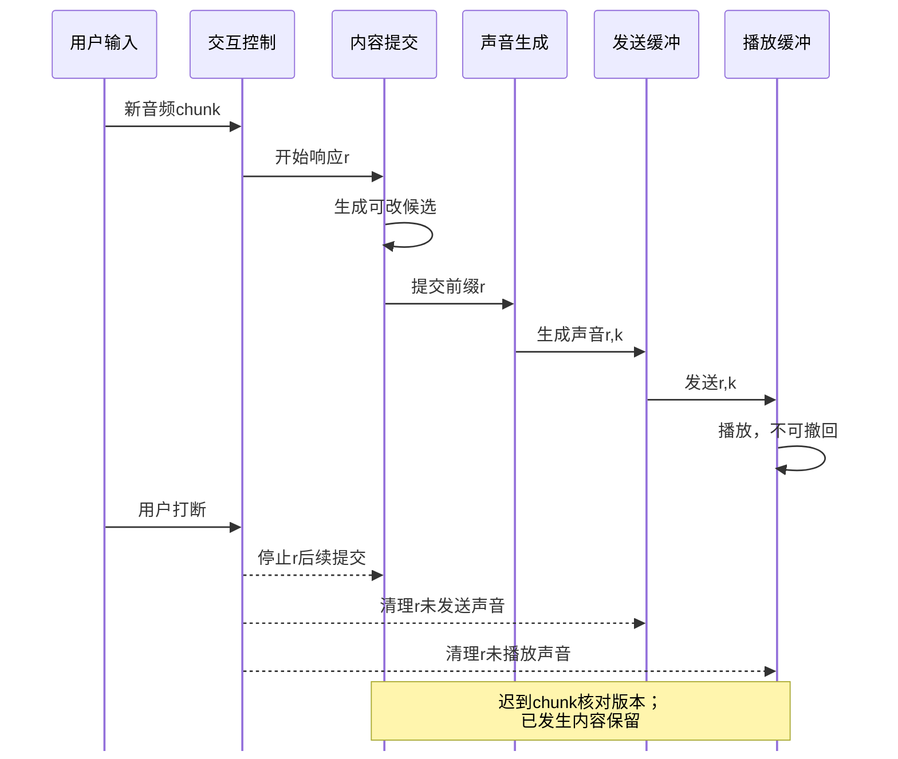

# D14 多模态 Agent 与流式系统

[[领域地图与覆盖缺口|领域地图]] · 关联：[[D05 推理服务与调度]] · [[D06 KV 与模型状态系统]] · [[D03 后训练与推理时计算]]

阅读本篇需要了解模型前向、prefill/decode 和缓存；生成画面所需的去噪迭代会在正文另行解释。用一段应用过程串起问题：用户交来演示视频，希望助手找出变化、查资料，随后边讲解边按需生成示意片段。视觉编码、语言生成、媒体生成和工具执行可以由不同模型承担，各自需要不同状态与完成条件。本篇追踪它们何时就绪、怎样并行，以及用户修改或打断后谁必须停止。

这些负载不能由“给文本模型加一个输入前端”统一解释。视觉理解、图像视频生成、实时语音和 Agent 各有不同的计算图、时间结构与状态。它们共同要求基础设施沿完整任务安排多个阶段，却不共享同一套 token/s、缓存语义或完成标准。

## 从一帧图像进入模型，到两个阶段排队

先从视频里一张需要细读的帧开始。上传一个文件并没有直接得到语言 token：系统要解码、选帧或切块、编码视觉内容，再把表示交给语言模型。阶段之间传递的序列长度不同，因此先数清每个阶段实际消费什么。

视觉理解可以从一条具体计算图拆开。Qwen2.5-VL 的 **2025-02-19 v1**给出一种固定版本的计算图：输入图像先调整到宽高为 28 倍数，以步长 14 形成 patch，经过 ViT 后，将空间相邻的四个特征拼接并经两层 MLP merger 投影到语言 embedding。只算这类静态图像的主体特征，调整后 $H\times W$ 对应约 $HW/14^2$ 个视觉编码位置、$HW/28^2$ 个进入语言侧的视觉 token，尚未计特殊标记。它们不是同一个序列长度，也不是相同成本的工作单位。[Qwen2.5-VL v1，§2.1–2.1.1](https://arxiv.org/html/2502.13923v1)

把规则代进一个静态图像例子：448×448 的已调整输入对应 1024 个 ViT patch，merger 后为 256 个主体视觉 token；896×896 则是 4096 和 1024。边长加倍使两种序列都变为四倍，全局视觉注意力的配对数可能变为十六倍，窗口层、MLP 和语言侧的增长却各不相同。若图中目标是细小表格，缩小图像省下计算，也可能让答案所需文字直接不可辨；如果问题只问主体颜色，代价与质量的最佳点又不同。不能用一组视觉问答平均分替所有分辨率策略作结论。

由此可以推出两个不同的优化位置。降低输入分辨率会减少编码器位置，也减少后续上下文，却可能丢失细字与局部证据；只加强桥接压缩，主要减少语言 prefill、后续 KV 和注意力读取，不能反推上游 ViT 也同比少算。该报告在多数视觉层采用窗口注意力，但仍保留四个全局注意力层，因此“窗口内随 patch 数近似线性”不能扩展为整个编码器永远线性。视频还包含时间分组与动态帧率：少取帧改变时间覆盖，降低每帧分辨率改变空间细节，两者要用具体任务质量分别检验，不能仅统一成少了多少 token。[Qwen2.5-VL v1，§2.1.1–2.1.3](https://arxiv.org/html/2502.13923v1)

长视频增加的还不只是更多图片。帧采样决定哪些事件能被看见；时间位置和相邻帧分组决定模型如何理解先后与速度；媒体解码本身也会产生 CPU 与缓冲压力。先解码整段再准入，可能让 GPU 仍有空位而主存已经堆满；分段送入则需明确当前模型允许怎样的上下文和跨段状态，不能为了流式接口擅自改变模型依赖。选择关键帧、压缩视觉特征、减少语言上下文和并行编码是不同路线，前两项尤其需要检查漏掉短事件或细节的风险。

这也改变了服务决策：路由需要估计媒体尺寸、帧数与各阶段队列。视觉编码与语言阶段可以分别扩容，代价是特征传输、身份校验和阶段间排队；是否值得，要看哪一段正在限制请求，而非直接从模型报告推出。

假设服务有独立编码器队列和语言队列，同一短文本分别附带一张图和一段视频，按文本长度路由会低估后者的编码与 prefill。若编码器快、语言池堵，提前无界编码只会积累大特征；若语言池快、编码器堵，增加语言副本也救不了首响应。应给阶段间缓冲设限，并让下游可用容量反馈到媒体接纳和上游并发。缓存可省去重复编码，却需包含媒体内容、采样、分辨率、权重和预处理身份；换了帧率或裁剪，不能仍把同一文件路径当作等价输入。

在这条视频讲解请求中，选择帧数和分辨率先改变可见证据，再改变编码、语言上下文与 KV。[[D15 检索推荐与在线数据系统|候选召回]]也有相似的约束：上游漏掉的短事件或文字，后续强模型未必能补回来。阶段拆分因此必须与任务质量和有界缓冲一起设计。

## 需要生成画面时，迭代依赖怎样限制加速

用户还要求输出示意图或视频，系统就要从理解转向生成：前者可以选少量帧判断，后者必须构造连续输出。生成过程从潜在表示（latent）和条件出发反复更新，最后经 VAE 解码器将表示转回画面，再作媒体输出。即使使用相同 Attention kernel，两者的时间连续性和阶段成本仍不同；请求级并发、阶段流水与模型内并行也要分别安排。

沿迭代本身看，去噪过程每一步都用当前 latent 和时间/条件，求得更新后才有下一步输入。把 30 步改成 10 步是改变采样轨迹或训练目标；在 30 步内缓存部分特征，是用旧表示近似当前表示；把单步切到多设备，则是在分摊同一步计算。只有最后一种在保留全部依赖时才可能仅改变执行；若为了隐藏通信而使用旧激活，它也承担近似误差。不能将“省了 20 次网络前向”和“多卡分摊当前一次前向”合并成同一条加速曲线。

此外，按层 offload 可以用搬运换取容量。这些路线可组合，收益却会彼此影响：步数变少会减少可隐藏搬运的机会，缓存后剩余算子的比例也改变，并行通信仍需发生。应重新测量组合后的路径。

DistriFusion 的 **2024-02-29 v1**提供一个可以拆开的经典实现：每卡处理自己负责的空间块，自注意力保留本块 query，但 K/V 覆盖整幅特征；远块使用前一步到达的激活，本块用当前激活，异步 all-gather 为后续步骤补齐。初始同步和额外 warm-up 提供起点，跨空间的归一化还要修正。这不是完全独立切图拼接，也不是精确移除全局依赖；它用相邻迭代相似性换取重叠。[DistriFusion v1，§4–5](https://arxiv.org/html/2402.19481v1)

论文同时比较原输出相似度、感知与分布指标，并观察步数、分辨率及设备数，所以比一张漂亮图片更能支持其选定 SDXL/A100 配置的取舍；仍不能将相近 FID 写成逐样本相同，或自动推广到长视频的跨帧连贯性。若将多卡全给单请求，延迟可能降低，多用户总吞吐却未必比多副本更好。视频时空并行还要看跨帧依赖和链路：更大的局部计算可能隐藏通信，也可能令所有卡等待最慢分片。

以一个纯假设的端到端账本说明边界：若条件编码 100 ms、30 次去噪各 20 ms、VAE 与媒体输出合计 150 ms，总计 850 ms；只将去噪降为 300 ms，总路径仍为 550 ms，约 1.55 倍而非两倍。把步数继续减小，权重 offload 的预取窗口也缩短，原先藏住的搬运可能重新暴露。应测完整路径与相同输出条件，而不是拿 denoiser 的局部倍数替代交付延迟；这些数字仅演示分阶段账目，不来自上述论文。

SGLang-Diffusion 团队 **2026-01-16**的官方报告给出按层预取/释放、多种并行和 Cache-DiT 集成的工程起点。它明确针对特定 dev 镜像，当时的模型支持和最大倍数仍受该 dev 版本限制，不能作为 11 月现状。[官方机制报告，Key Improvements](https://www.lmsys.org/blog/2026-01-16-sglang-diffusion/)

对这一路线的前沿判断，必须回到同质量、分辨率、帧数与输出长度下的完整路径：究竟少算了什么，权重是否仍要搬，VAE 和媒体编码是否已变成主导。图像单帧快，不足以说明长视频在时序质量或多用户服务中同样获益。

这让 [[D10 通信与互联|通信]]和 [[D11 存储与异构内存|权重驻留]]进入同一条迭代链：拆出一份空间工作，何时需要别处的特征；减少一次迭代，又失去了多少隐藏搬运的时间。依赖、近似质量和资源预算要一起比较。

## 持续到来的声音，怎样赶上物理时间

视频和工具结果可以等队列，实时麦克风仍按物理时间产生新输入。讲解尚未结束时，用户可能继续补充问题；系统必须持续接收，并在适当时机让出或取得发言权。

处理一小时音频只用半小时，不等于用户能及时听到第一段。缓冲和前瞻决定算法至少要等多少输入；编解码、推理与输出队列再增加执行延迟。阶段平均速率足够，遇到突发、慢 chunk 或取消仍可能积压。接纳若放在波形解码之后，也可能让前端内存先被长输入占满。

流式语音合成（TTS）逐段输出声音；全双工还要求系统说话期间持续接收输入，判断用户在继续、暂停还是打断。Moshi 的固定 **2024-09-17 v1**把用户和系统声音作为不同流，在同一时间轴推进；每个时间点的大 Temporal Transformer 先汇总历史，小 Depth Transformer 再处理多个音频码本与文本关联。它避免让大模型按“码本数乘时间点数”的扁平序列逐个执行；伴随的延迟安排也是质量与时延的选择，而非去掉了一切等待。[Moshi v1，§3.4](https://arxiv.org/html/2410.00037v1)

降低每帧工作量是另一条实时路线，但要保留任务区别：增强一帧已经存在的声音，与生成一段新回复有不同的依赖和质量目标。

成均馆大学的 StreamSE **2026-10-27 v1**提供了一条边端路线：在冻结的因果 codec latent 中逐帧回归，再反馈过去的量化输出，避免每帧反复迭代采样。其端侧实验测完整 codec—增强—decoder 路径，按 80 ms 帧预算检查 p95，而非只报告小模型的耗时。[StreamSE v1，§3、4.4](https://arxiv.org/html/2610.37024v1)

这也揭示评价边界：无未来前瞻仍要等待一个输入帧，不能称零延迟；论文的手机单核、int8、热管理、有限状态窗口与分段重置，不证明任意连续长会话都满足实时性。这是直接改变每帧工作量的作者原型，不能推广成通用端侧部署结论。

Moshi 的 12.5 Hz 时间步对应每 80 ms 一个新时点，端到端延迟还包括音频编解码器（codec）积累帧、模型执行与输出缓冲；已有播出内容无法回滚。假设某次服务连续三帧各需 100 ms，输入间隔却是 80 ms，待办便累计 60 ms；平均偶尔赶得上，也不排除慢帧造成抖动。跨会话组批可提高效率，但等批会消耗每条流自己的余量。StreamSE 的完整路径 p95 与有限窗口条件，正是在一个受控边端任务上检查这种持续速率；全双工生成还需另验轮次、回声与中断。

Diffuplex 的 **2026-10-13 v1**进一步将交互与内容分成两个执行时钟。其 AR 分支每个音频 chunk 判断交互状态，diffusion 分支在取得发言权后产生内容；二者共享权重但持有各自 KV。开头少量 token 提前冻结并送入 TTS，其余画布继续去噪，缩短开口等待，同时牺牲继续修改这段开头的机会。评价它需要同时观察发言时机与内容生成速度。[Diffuplex v1，§3.3–3.5](https://arxiv.org/html/2610.17780v1)

其作者对照也提醒我们不要把快响应等同更好对话：Fisher 数据改变发言策略，更积极接话可以缩短延迟，却更容易误解犹豫和短暂停顿；batch=1、单 GB300 的内容生成吞吐也不等于并发语音服务能力。提前冻结开头还有独立的质量/时延参数。v1 仍将训练产物列为待发布，作者原型不能据此视为成熟通用平台。

两个时钟给内容生成增加了可用的执行空间，却也产生一个交接问题：开头已经开始说，其余内容仍在修改；这时用户打断，哪些结果还算进入了对话？

## 用户打断时，哪些结果还能提交或播放

取消必须穿过文本、音频 token、波形和播放缓冲。听见有效打断后，只停止后续文本生成，仍可能让队列中的旧声音继续播放；仅清输出缓冲，又会留下不应再提交的候选状态。Diffuplex 的具体规则会截断余音，对一秒内中断丢弃未说出的画布；这是一种作者实现的上下文取舍，不是所有对话都适用的普遍语义。系统应跟踪“已生成、已提交、已发送、已播放”边界及响应版本，拒绝迟到的旧 chunk，清理尚未播放的输出，同时保留应用所需的真实对话记录。输入感知若也被暂停，模型甚至无法知道应当停止。

<!-- figure: D14-F1 -->

图 D14-F1 是教学交接过程，$r$ 是响应版本，$k$ 是声音 chunk 序号。生成、提交、发送和播放分别发生；清掉一层缓冲不能证明其他层已停止。文本前缀的提交也不等于音频已经被用户听见，网络与设备能确认的边界需要由具体实现定义。

另一个维度是状态何时定型。SGLang-Omni 的 Fun-CosyVoice3 工程案例，PR #2406 **2026-10-01 合入**：为每个 Euler step、每层分别保存已完成因果 chunk 的 K/V，并保存卷积上下文。这里是同一 step 的前缀跨输出 hop 复用，不是把一个去噪步的状态近似拿给另一个步；已经分配的尾部也不等于可以提交复用的完整 chunk。[PR 身份与合入记录](https://github.com/sgl-project/sglang-omni/pull/2406) · [固定合入 commit 的状态实现](https://github.com/sgl-project/sglang-omni/blob/257826d526b718851a5323b8dab72a11522fb0de/sglang_omni/models/fun_cosyvoice3/prefix_cache.py)

PR 最初自报的性能表不能作为最终服务保证。池容量、编译预热、首 hop、不同 chunk 计划与取消释放，仍需作为同一配置的成本与正确性一起验收。

回压因此不应简单向所有方向一齐暂停。文件转码可以让上游等待，实时麦克风却不会停止物理时间；积压会让模型始终听见过去。可以限制生成并发、丢弃或降采样某些输入、降级模型、拒绝新会话，但每个选择都改变质量或可用性，需要明确策略。完整 chunk 提交和 Fun-CosyVoice3 每 Euler-step 状态隔离，解决的是一种因果缓存边界；它与播放完成、用户真正听见、另一去噪步可否复用，仍是不同事件。

这些提交点也是 [[D06 KV 与模型状态系统|状态系统]]需要的生命周期事件。它们告知哪些 chunk 已经定型、哪些输出应该撤销，以及什么访问仍在继续；单看最近访问时间，无法恢复这些语义。

## 工具调用加入以后，关键路径怎样变化

回到用户还要求“查资料”的那一步：媒体和模型之外，工具也有自己的就绪、执行、结果与副作用。GPU 等待外部结果时可执行其他工作，但工作流是否能向前，取决于真实依赖。

把一个 Agent 请求展开，也能看见同样的依赖。模型先规划，随后“读文件”和“检索资料”若互不依赖可以并发；需要二者结果的下一次推理必须等 join。模型产生工具参数时，语法完整不等于参数已可执行；工具返回成功也不等于下一模型轮次已就绪。调度器应区分可提交、执行中、等外部结果和可恢复，而不是把工具等待算进 GPU 服务时间，再用长短请求策略一并排序。

工具等待时 GPU 可以服务别人，但任务仍拥有上下文、环境进程、版本、结果和重试预算。可以并行提交独立的 ready turns，也可以为状态命中调整次序；这不能越过工具依赖或无限推迟冷任务。应用检查点保存“做过什么”，模型缓存保存“怎样减少重算”，两者不能互相代替。

状态局部性和任务完成时间还可能相反：先处理一个热会话能少做 prefill，但若冷会话的结果会解锁十个后继步骤，它可能更接近整个任务的关键路径。执行器需要拿到这些依赖和状态信息，才能作出比较；普通模型调用未必带有完整工作流。工具时延未知、动态新增依赖和失败重试，还使关键路径估计随执行而改变。

哈尔滨工业大学团队的 HEAR **2026-10-05 v1**尝试连接上层任务编排器（harness）与引擎：前者提供工作流意图、依赖和要求，后者返回队列、缓存、能力与执行结果。协议把描述与控制、偏好与要求、观察与保证、接受与完成分开，允许不同优化策略使用同一信息接口。[HEAR v1，§3–4](https://arxiv.org/html/2610.06597v1)

它的价值不在于给所有 Agent 固定一种调度。作者实验中，偏向缓存的提交顺序可能改善中位数，却拖延冷请求；等待保护和会话保留的组合又随负载变化。SCBench 的到达过程是构造的，部分工作流使用特定 harness，不能据此认定接口对所有引擎通用。能更新的认识是：双方拥有互补信息，接口语义与选择哪种策略应该分开评价。

取消时应为每次工具调用和模型响应保留独立 ID/版本：父任务放弃后，迟到结果不能自动接进新的上下文；共享前缀与兄弟任务仍需自己的引用。若工具已经写入外部系统，停止模型不会撤销那个副作用，重试也可能重复执行；应用需要幂等键或明确补偿规则，基础推理服务不能仅凭清理 KV 宣布任务已回滚。GPU 进程失败后的模型状态恢复、环境检查点和已提交的外部结果，是三条需要对齐的恢复记录。

因此 [[D05 推理服务与调度|推理调度]]拿到的不应只是下一段 token 数，还应包括哪些阶段已就绪、谁等待工具、什么结果会解锁后继，以及能否安全重试。harness 与 engine 分别掌握的信息，需要通过明确的请求、反馈和状态边界连接。

## 沿完整任务验收，避免把局部指标当交付

现在同一请求已经跨过视觉输入、可选画面生成、持续听说和工具 join。局部吞吐提高是否有用，要看它有没有缩短当前关键路径，或释放真正紧缺的资源；若只让上游更快积压，用户交付并未改善。

这些过程也决定实验怎么设计。只回放每轮 token 长度和工具等待，可以隔离缓存/调度，却无法验证自由生成下工具选择、真实环境时延和最终成功率。相反，只比较任务成功率又看不见资源为何节省。应将同质量或同任务目标下的阶段耗时、就绪队列、状态驻留、取消完成与最终交付并列记录，保留拒绝、超时、重试与取消，它们还会改变实际被评估的任务分布。

优化对象由此从单次模型调用扩大到阶段图和状态提交点。生成质量、视觉时序、可播放音频与任务成功率，需要各自的指标；这些材料揭示了不同边界，统一执行器能否正确覆盖它们，仍需对应实现与验证。

[[D05 推理服务与调度|调度]]需要从 token step 扩展到阶段就绪、媒体速率与工作流依赖；[[D06 KV 与模型状态系统|状态系统]]需要理解完整 chunk、消息替换与共享引用，而非仅按访问时间淘汰；[[D10 通信与互联|通信]]和[[D11 存储与异构内存|存储]]负责跨阶段张量、编码器状态和模型 offload，慢链路可能通过回压阻塞上游。沿这些因果联系，才能判断局部 kernel 加速是否影响最终任务。

## 来源与阅读范围

核读日期为 2026-11-04。视觉与耗时数字是明确假设的自写算例，泳道图和工具过程是教学协议。Qwen2.5-VL、Moshi、DistriFusion 承担固定机制说明；SGLang-Diffusion 保留当时 dev 镜像范围，Fun-CosyVoice3 是旧 PR 与固定合入代码的重核。StreamSE、Diffuplex 与 HEAR 的原型、负载、质量和版本边界已随对应取舍保留，没有独立运行或验证统一平台。

正文已沿这些过程说明机制；尚未核验视觉跨阶段服务实现与同质量路由对照，也未完成长视频时空并行、端到端回声处理与视听同步、具身实时闭环的系统比较。Diffusion 系统的近期正式版本覆盖仍不足。这里保留了问题边界和若干具体机制，后续应分别补代表性计算图与作者实现，不能将它们标为已完成前沿综述。查询、事件日期、固定代码及未核项见 [D14 核验记录](<evidence/D14 多模态 Agent 与流式系统.json>)。
