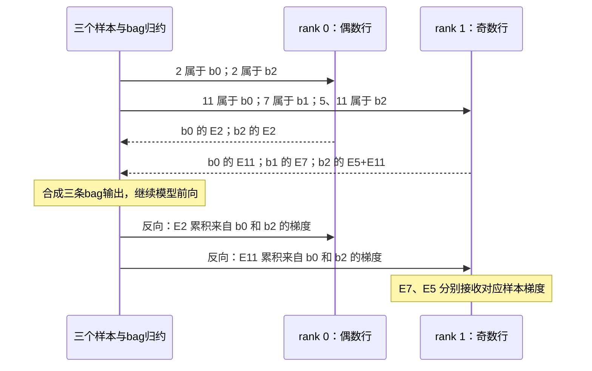

# D15 检索、推荐与在线数据系统

面对十亿篇文档或商品，最强的模型也通常无法在一次请求里逐个细读。系统先找一小批候选，再用更贵的模型排序，最后推荐或生成答案。这个安排节约了计算，也把一个决定提前了：**后面的模型究竟有机会看见什么？**

本篇沿一次请求，先解释候选怎样产生、过滤和重排，再追踪执行位置、更新可见性，以及推荐模型的稀疏参数。理解向量内积和两阶段检索即可开始；这里同时关心任务质量、延迟、容量和新鲜度。基础推理路径可见 [[05 从模型权重到一次生成]]，其他领域见 [[领域地图与覆盖缺口]]。

## 1. 先固定候选集合，再谈搜索快慢

向量检索将查询与对象编码到表示空间，按距离或相似度选择；倒排检索保留词项匹配；结构化过滤规定时间、类别和访问范围。混合检索组合这些信息，还要校准分数或融合候选。它们的差别首先在于保留什么信息，然后才是执行成本。

过滤尤其需要先定义语义。假设目标是“指定语言且有访问权限的 top-k”。若先取全局 top-100，再筛掉其中 99 个，最后只有 1 个候选；reranker 可以细读这个对象，却无法找回未被取回的合格对象。比较不同方法时，参考答案应来自同一个合格集合。

三条竞争路线由此出现：过量取候选再过滤，简单但工作可能浪费；搜索过程中结合过滤，需要索引支持；按属性分区，减少无关搜索却增加分区与更新管理。[Vespa 官方示例](https://docs.vespa.ai/en/learn/tutorials/hybrid-search)还区分用某种表示召回，还是仅在排序阶段使用它；只有前者能改变进入候选集的对象。混合本身并不保证任务质量改善。

候选数量是整条链的预算。增加它可能减少漏召回，也增加数据读取、重排和生成上下文。[[D05 推理服务与调度]]因此需要计入检索与重排等待；最终比较的是任务收益与总成本，而非单独的 ANN 查询吞吐。

## 2. 索引怎样少看对象，又会遗漏什么

先看容量：$10^9$ 个 768 维、每元素 2 bytes 的向量，仅向量载荷就是 1.536 TB，另有索引、元数据与副本。它提示我们，压缩、分片和 CPU/GPU 分层需要共同考虑。

为看清单次搜索，接下来缩小到一个含一百万个 128 维 FP32 向量的例子。全量扫描约读取 512 MB 向量，还需 top-k 归约；大批量 query 可以复用读取，低延迟单 query 较难摊薄这份工作。

IVF 将对象分入粗聚类，查询先找中心，再只扫描若干 list。假设 1024 个 list 完全均匀，探测 8 个，平均约比较 $10^6\times8/1024\approx7813$ 个数据向量，另算粗中心。热点 list 和过滤会破坏均匀假设。它节省工作的来源，是主动放弃其他分区的比较。

HNSW 则从图入口向更近的候选探索。增加搜索宽度通常改善召回，也增加随机读取与候选维护。IVF 受选中分区限制，HNSW 受访问路径限制；局部距离算得精确，仍可能漏掉全局近邻。

索引还可以叠加编码压缩。PQ 将向量拆成多个子向量，以码本编号表示，通过查询查表距离累加。例如 16 个 8-bit 子码有 16 bytes 码载荷，ID、码本与索引另计。这里有两种不同误差：对象根本没被访问，以及已访问对象的量化距离改变了次序。增加 probe 主要处理前一种，并不会自动修复后一种。[Faiss 官方索引说明](https://github.com/facebookresearch/faiss/wiki/Faiss-indexes)

| 选择 | 少做了什么 | 新增或转移的成本 |
| --- | --- | --- |
| 精确扫描 | 保留全集合比较 | 读取、距离计算和归约，可借批量提高复用 |
| IVF/HNSW 等近似搜索 | 少访问候选 | 召回损失、索引维护、随机访问与参数选择 |
| PQ 等编码 | 少存、少读向量 | 编码误差、查表/解码、码本及更新 |
| 分片/分层 | 扩大可容纳集合 | 跨分片合并、搬运、热点和尾部 |

质量应相对于明确集合报告，构建、更新和删除成本也要进入比较。静态热索引的赢家，在持续写入、强过滤或不同 batch 下可能换位。

## 3. 给更强的交互留多少候选预算

单向量将对象压成一个点；多向量保留 token、片段或视觉区域，再在查询时交互。以经典 ColBERT 为例，query 的每个表示 $q_i$ 寻找文档中最相近的 $d_j$，得分为：

$$
\operatorname{score}(q,d)=\sum_i\max_j q_i^\top d_j.
$$

文档表示可以离线保存，query 编码一次。若 query 有 16 个、文档有 128 个局部表示，一篇比较 2048 对，200 篇比较 409600 对，计算还需乘向量维度，另有读取与候选发现。[ColBERT 2020 固定 v2](https://arxiv.org/html/2004.12832v2)提供这一机制基线。

late interaction 比单向量保留更多局部关系，也消耗更多存储与交互；cross-encoder 则为每个 query–document 对运行更完整的联合编码。可以先便宜召回再昂贵重排，但它仍继承前级漏召回。裁剪 token、缩短文档与压缩表示各自改变覆盖或误差，必须在相同任务质量下重新选择候选预算。[[D14 多模态 Agent 与流式系统]]的视觉 patch、[[D04 模型结构与数值表示]]的表示学习和 [[D08 算子与 GPU 执行]]的小矩阵/归约，正是在这里相遇。

排序之后，还能单独决定每篇文档究竟向生成模型提供多少证据。Cohere 于 2026-10-21 发布的 Rerank 5（本轮补录）在同次重排调用中可返回相关段落的原文字符区间和分数；Context Focus 默认关闭，启用后用阈值与段落数上限控制保留内容。这样，候选文档数与每篇保留长度成为两个不同预算：后者可以减少后续 prefill、KV 和多轮累积上下文，却也可能裁掉必要证据。应将任务质量、重排开销与生成成本一起比较；厂商实验中的 token 减少并不直接给出等比例费用或延迟收益。[发布记录](https://docs.cohere.com/v2/changelog/rerank-v5) · [机制与作者实验](https://cohere.com/blog/rerank-5)

这项选择还取决于实际 API。11-04 的 [OpenRouter 集成发布](https://docs.cohere.com/v2/changelog)使 Rerank 5 模型可经另一入口调用，但 Cohere 的集成文档明确该入口不提供 `relevant_spans`；需要段落输出时仍须走 Cohere Rerank API。模型名称相同，应用能取得的证据粒度可以不同。因此 [[D16 工程交付与模型生命周期|交付验证]]要绑定模型版本、接口和参数支持，不能把模型能力拼接成所有后端都可用的配方。当前文档也指出，广泛总结需要全文，表格、表单和代码不如普通段落容易切分；阈值的质量边界应随负载验证。[接口限制](https://docs.cohere.com/docs/cohere-on-openrouter) · [模型限制](https://docs.cohere.com/docs/rerank) · [[来源与证据#AIINFRA-E-20261109-02|Rerank 5 证据卡]]

## 4. 一条深路径加一条广路径，还是把检索合进同一模型

有了候选和交互成本，就能理解两种系统路线。

**Hybrid GPU–CPU Retrieval（2026-09-18，v1）**把较深的个性化计算放到 GPU 路径，把较广的库存覆盖留给 CPU，合并候选后再排序。不同路径可以独立演进，代价是合并、去重和版本契约。它改变模型、数据范围与编排的组合，而非单个 ANN kernel 的设备位置。[固定论文](https://arxiv.org/html/2609.21281v1)

论文也记录离线相关性改善而在线退化的前例：精确/量化 ANN、文本表示和下游过滤可能不匹配。这使任务验收必须覆盖整条消费链。作者生产效果对应完整处理，无法单独归因于硬件或某层模型；文中的 2027 会议信息也不构成已录用证据。

另一条路线合并检索内部。**SilverTorch（论文 v1 为 2025-11-18，Meta 工程报告为 2026-05-26）**将 ANN、过滤、embedding 和重排表示为同一 GPU 模型中的张量模块：先 probe 聚类，只过滤相关分区，避免全库 mask；融合 index–matmul，减少完整候选 embedding 的聚集中间量。[论文 §3–4](https://arxiv.org/html/2511.14881v1)、[官方工程报告](https://engineering.fb.com/2026/05/26/ml-applications/silvertorch-index-as-model-new-retrieval-paradigm-recommendation-systems/)

Bloom 近似过滤允许 false positive，访问权限等精确规则仍需复核。作者 A100 40GB 和生产流量子集的整体比较同时改变分片、过滤和编码，内存与 batch 等待也限制效果。它支持协同设计这条路线，尚不能拆成某个算子的独立收益，也没有单独证明更新新鲜度。

分路执行便于各自演进，统一执行减少交接；后者扩大了共同制品和发布范围。[[D09 编译 DSL 与自动优化]]的能力、更新频率及 [[D16 工程交付与模型生命周期]]的版本契约会改变选择，两条路线可以长期并存。

## 5. 查询使用的数据，究竟是哪一刻的事实

前面的比较暂时固定了索引。线上对象、行为和权限会持续变化，快的查询还需要读到正确的版本。

设行为发生于 10:00，10:07 才进入特征系统，而一个预测样本的请求时刻为 10:05。只看事件时间，这条行为属于过去；重建线上当时可知的信息，它尚未到达。若离线训练直接加入它，就可能得到线上拿不到的优势。

[Feast 的 point-in-time join](https://docs.feast.dev/getting-started/concepts/point-in-time-joins)按样本时刻、特征时间与 TTL 约束历史连接。若目标是重建“当时已知”，还应保存到达/发布版本和实际变换。事件时间、处理时间与可见版本各回答不同问题，一个历史 join API 无法替代全部上游记录。

流式增量减少陈旧窗口，需要处理迟到、重复、重算和修正；水位与过期策略也要保留在处理记录中。批量快照较容易绑定版本，代价是发布等待。删除还要追踪副本、缓存、训练快照和下游候选。迁移 embedding 模型时，新 query 与新索引必须在匹配空间中比较，常需双写、重建、并行验证，再切换模型–索引组合。这把 [[D01 数据工程与训练配方]]的数据身份连接到 D16 的交付单位。

**UBIS（2026-01-31，v1）**研究的是更新期间仍能查询的索引。posting（对象分组）分裂/合并时，用状态、版本和后继指针帮助并发更新找到新去向；过渡期向量进入可查询缓存，后台再分配，平衡检测也处理过小 posting。[方法 §IV、实验 §V](https://arxiv.org/html/2602.00563v1)

这种维护减少了长期失衡，也增加查询与后台工作的竞争。作者单机 CPU/NVMe、指定线程/参数的表中，存在更高 recall/TPS 却有更差尾延迟的组合；部分更新顺序为构造。因此应一起观察更新积压、可见性和查询尾部，而不是只取平均收益。

## 6. 推荐模型的另一笔账：参数稀疏，通信随 ID 到来

推荐系统除了在线检索，还训练和查询实体 embedding 表。这里常见的瓶颈是稀疏随机读取，而非大矩阵乘。用三条样本的 ID 展开一次 embedding bag：

```text
样本 b0: [2, 11]     b1: [7]     b2: [2, 5, 11]
values  = [2, 11, 7, 2, 5, 11]
offsets = [0, 2, 3, 6]
```

offsets 标出各段，不必把输入填成等长矩阵。若 bag 求和，输出是每段所查行向量的和；若求平均，还要按段长缩放输出及对应梯度。反向时同一 ID 的梯度必须累积到同一参数行。[TorchRec 机制文档](https://meta-pytorch.org/torchrec/concepts.html)将过程拆成 input 分发、lookup、output 分发和反向回传。

下图以按行分片为例，**仅为教学让偶数 ID 在 rank 0、奇数在 rank 1**。分发不仅要保留 ID，还要保留它属于哪个 bag；返回部分和才能组合回原样本。



图中 ID 很小，回复却是一段向量；bag 在哪里合并，决定返回流量能减少多少。按表分片让一张表局部完成，但大热表会压满单卡；按行分片分散容量，需要路由 ID 和返回结果；按列分片分散同一行的维度，需要重组输出；复制小热表减少远端读，增加状态和梯度同步。行数均匀也可能访问不均，planner 需要访问分布、维度与拓扑。行列二维组合分片（GRID）继续在这两个轴上取舍。

**TorchRec 2026-09-11 的发布记录，tag 为 `v1.9.0-rc1`**，把两类新压力接到这条数据流上。Maglev 将阶段放在各自硬件 scale-up 域，域内做 embedding 通信，跨阶段传微批激活和梯度；少了跨域稀疏交换，多了流水气泡、阶段失衡和输入级联。EMS 在权重暂不用时移到 pinned host，在反向需要前恢复，并分块 copy 以缓解 copy-engine 争用。[固定发布记录](https://github.com/meta-pytorch/torchrec/releases/tag/v1.9.0-rc1)、[暂存源码前 210 行](https://github.com/meta-pytorch/torchrec/blob/v1.9.0-rc1/torchrec/distributed/memory_stashing.py)

这些机制要求把 [[D10 通信与互联]]的分发/合并、[[D11 存储与异构内存]]的冷热驻留和反向消费者接在一起。前向完成之后还有参数与输入的使用者，迁移和释放要等正确的生命周期。该 tag 与 API 的发布标记分别保留；名字本身不证明全部功能已稳定，分块传输也需要实测能否被隐藏。

## 7. 用哪几个问题判断新的在线数据方案

先问合格集合与参考答案是什么，再问表示和索引分别损失了哪些候选；随后计算重排预算、执行位置与总延迟；最后检查更新、时间和发布版本。推荐稀疏参数还要另看实际 ID 分布触发的通信。训练、召回、排序和生成的组合，应以同一任务结果验收。

这条链解释了为什么某个搜索阶段变快，整体仍可能退化：候选质量下降、输入变陈旧，或把更多低价值上下文交给了生成模型。它也解释了为什么数据系统本身会成为 AI Infra 的前沿，而不仅是模型服务的前置依赖。

## 来源与后续深读

源码/论文版本与已读范围见 [D15 核验记录](evidence/D15.json)。动态文档按 2026-11-04 所见阅读，经典 ColBERT 用于机制；近期论文和生产描述属于作者证据，本文未独立运行基准。

后续重点是动态索引在过滤、删除和热点下的长期质量，迟到特征修正协议，多向量/跨模态的实测，以及 Maglev/EMS 的完整代码和同预算对照。已解释的局部机制无法代替这些验证，也不足以给数据库或推荐引擎做通用排名。

2026-11-09 限定核读 Rerank 5 的 10-21 发布、官方实验及当日 API/集成文档，补入段落预算和接口组合边界；没有重核全部旧来源，也没有完成检索、推荐或在线数据渠道扫描。
