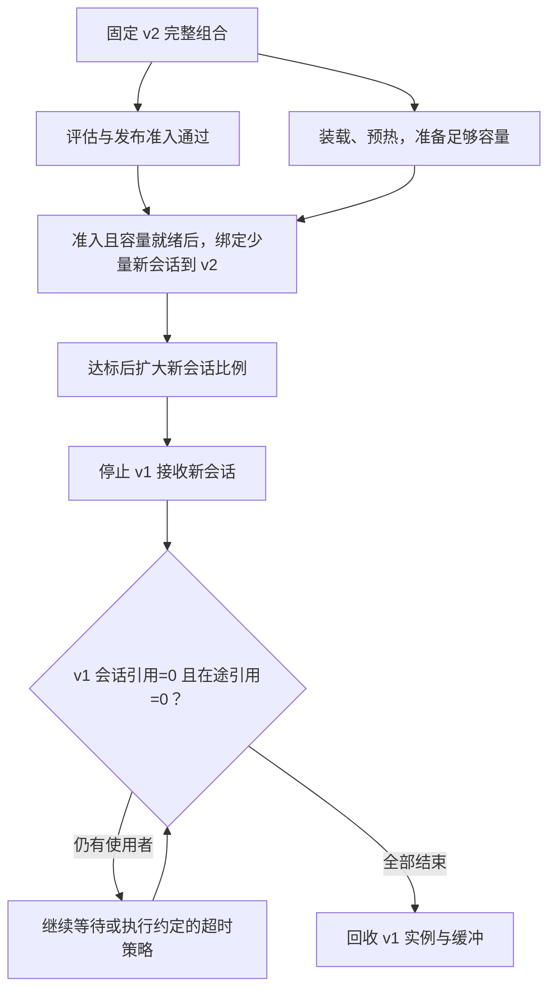

# D16 工程交付与模型生命周期

模型 v2 的离线评估更好，文件也成功载入了，为什么上线仍会失败？可能因为请求还用着 v1 的 tokenizer，编译引擎绑定了另一种设备，或者旧会话的工具协议被切换了一半。交付首先要保证：**被评估的组合，正是实际处理请求的组合。**

本篇沿一次 v1→v2 发布，追踪制品身份、兼容、装载、评估、切流量和退出。只需先理解模型服务有请求、实例和在途状态；调度可配合 [[D05 推理服务与调度]]，资源准备可配合 [[D12 集群资源可靠性与隔离]] 阅读。这里最终要回答的，是出了问题该重新评估、重试加载、停止新流量，还是等待并回收旧资源。入口见 [[领域地图与覆盖缺口]]。

## 1. 发布单位：把“模型名字”展开成可追溯的组合

设 v2 同时改变了 tokenizer、量化布局和工具 schema。只替换权重，旧前处理可能产生另一串 token，旧 plugin 可能误读权重，工具调用也可能解析成功却执行不同动作。相同权重配不同模板、图像处理、适配器或采样规则，也会改变语义、质量和容量。

因此发布需要一个不可变的身份。下面是教学 manifest，用来说明应绑定的关系，并非某平台的实际配置：

```json
{
  "release": "v2",
  "weights_digest": "W2",
  "preprocessor_digest": "P2",
  "runtime_image_digest": "R2",
  "compiled_artifact_digest": "E2",
  "interface_schema": "tools-v2",
  "evaluation_record": "eval-v2-env-A",
  "state_namespace": "state-v2"
}
```

数据和训练代码产生权重，权重加处理/协议配置形成模型包，模型包与目标环境再产生可执行服务；评估记录证明其中某个组合满足某些任务和条件。digest 说明文件是否相同，来源可信、能运行与质量合格，还需要各自证据。

注册表保留这些版本和关系，部署系统负责实例与流量。[MLflow Model Registry](https://mlflow.org/docs/latest/ml/model-registry/)的 alias 可以指向版本，适合改变入口；评估与请求记录应保存解析后的不可变身份，避免事后查询时 alias 已指向别处。alias 更新、某个副本载入完成、全部在途请求结束，是三个不同的事实。

近期的一条进展是把更多上下文带过这条边界。**AWS 2026-09-08 的 managed MLflow/Model Registry 同步说明**将训练指标、评估、来源关系和推理规格接入注册，并联系权限与审计。其生命周期操作与 approval 也分别记录。[官方公告](https://aws.amazon.com/blogs/machine-learning/govern-models-with-mlflow-and-amazon-sagemaker-ai-model-registry-sync-part-1/)

这减少跨工具丢失信息的地方，范围对应该托管平台及插件。记录同步仍需绑定评估数据、阈值和环境；生命周期晋升本身没有产生可服务实例，也没有验证指标的充分性。

## 2. 同一个组合，要通过三种兼容检查

**先检查图的语义。** [ONNX v1.17.0 的版本规范](https://github.com/onnx/onnx/blob/v1.17.0/docs/Versioning.md)区分 IR、opset 和模型版本：IR 描述图的表示，opset 给出运算签名与语义，模型版本由作者管理。runtime 解析了文件之后，还需实际支持 operator、类型、shape 和 custom domain。转换结果也要做数值对照。

**再检查可执行制品。** 编译后的 engine 可能绑定硬件、driver、runtime、plugin 或形状。TensorRT 的 [Engine Compatibility](https://docs.nvidia.com/deeplearning/tensorrt/latest/inference-library/engine-compatibility.html)区分版本兼容和硬件兼容选项；放宽绑定条件可能排除专用 tactic，改变性能。应保存实际构建 flag 和目标环境，再检查对应版本的支持组合。

**最后检查应用契约。** 输入模板、采样、生成约束、输出格式、工具 schema 和状态命名空间，需要与调用方一致。opset 无法定义工具动作，能解析请求也不足以说明约束得到执行。[[D09 编译 DSL 与自动优化]]产生的调优制品要附形状与软件条件；[[D06 KV 与模型状态系统]]则需要据模型、适配器、位置和输入身份隔离缓存。

三项检查分别回答“怎样解释图”“怎样执行图”“执行结果怎样被使用”。把它们拆开，才能在失败时找对修复对象。

模型迭代快时，还需要把这三项检查落实成可扩展的引擎接口。RTP-LLM 的系统报告（arXiv v1 提交于 2026-10-31）把模型特定前向与 checkpoint 解释留在 Python/PyTorch，将 batching、调度与状态管理交给 C++ runtime，再用 CUDA Graph 降低重复执行的 host 开销。新模型通过每层状态描述与 cache view 接入公共运行时；但仅提供一个描述符并不会自动实现新的状态类型，特殊布局或执行方式仍可能要求两侧同时修改。形状相同的权重也可能因物理排列不同而不能交给原 kernel。这个实例说明，“更快接模型”依赖明确的状态和执行契约，不能只以 Python 代码可运行作为完成标准。[RTP-LLM v1，§3–4](https://arxiv.org/html/2611.00967v1)

报告还把请求、传输和保留缓存的引用分别管理，异步使用者结束后才能释放存储；这把模型接入条件接到了 [[D06 KV 与模型状态系统]] 的生命周期。这里核实的是作者公开的系统设计，未审计其全部实现或独立验证生产规模；它是既有引擎的新报告，不是本周首次发布引擎。

## 3. 文件到了，实例还要准备什么

模型可以从对象存储拉取、经共享卷访问，也可以作为独立 OCI 模型制品分发。

| 分发方式 | 主要收益 | 需要承担的代价 |
| --- | --- | --- |
| 对象存储下载 | 模型与运行镜像独立 | 多副本冷启动的出口、解压、CPU 与本地盘竞争 |
| 共享卷 | 减少重复取数 | 共享带宽、可用性和文件语义 |
| OCI 模型制品 | 复用镜像缓存与分发体系 | 构建、分层、注册表与缓存淘汰 |

[KServe OCI/Modelcar 说明](https://kserve.github.io/website/docs/model-serving/storage/providers/oci)在本次阅读标为 0.20，Modelcar 还需启用。模型可经进程文件路径访问，说明的是取数机制；显存中的运行状态仍要由 runtime 建立。

冷启动应沿依赖记录：等资源 → 取得制品 → 校验/挂载 → 初始化 runtime → 载入或转换权重 → 建图/调优 → 预热 → 对外 Ready。一些阶段能重叠，一些必须累计。缓存只缩短其中的取数，未预热的 batch/Graph 仍会影响首请求。队列开始违约后才触发扩容，准备时间可能已经超过余量；这将本域接到 D12 的容量预留和 D05 的过载控制。

多模型池还要决定常驻谁。[ModelMesh v0.12.0 的 runtime 契约](https://github.com/kserve/modelmesh-serving/blob/v0.12.0/docs/runtimes/custom_runtimes.md)区分 load/unload、容量报告与推理：load 成功才可用，unload 返回前应完成释放，size 估计用于容量判断。它把装载变成可执行操作，而非“存在模型服务”这个抽象标签。

LLM 还要另留 KV、workspace 与加载峰值。只按静态权重安排容量，生成时仍可能超额；频繁驱逐冷模型虽节省常驻容量，也增加装载排队和热模型干扰。选择应回到真实访问分布与峰值。

## 4. 评估门禁：准备上线之前，要证明哪项承诺

格式/协议、数值、任务质量、SLO 和故障恢复，是不同的承诺。两个模型逐 token 输出不同，可以是正常变化；约束语法被违反、模板暗中变化、state 混用，则可能破坏契约。离线成对任务、线上固定分组和影子执行分别回答不同问题。

先固定任务分层、允许退化、观察窗口和停止条件，再看结果。稀有失败尤其容易被短窗口掩盖：若真实错误概率为 $10^{-4}$，1000 次独立请求全无失败的概率仍为：

$$
(1-10^{-4})^{1000}\approx90.5\%.
$$

所以“小流量没有出错”只是一份有限证据。请求相关、长会话和长上下文热点还会改变独立假设，应据实际风险选择分层样本。

性能比较也要固定总资源与负载。新增副本、候选或 shadow 流量都会消耗容量；容量翻倍后的低延迟无法归因于模型自身优化。新模型若让更多请求进入 decode，产出可能提高，同时增加生成争用。成功样本的平均值会漏掉拒绝、失败、超时与重试，预热、cache 重建和回退阶段也需分别记录。

## 5. 切流量和回收资源，是两条相接的状态变化

让 v1、v2 同时运行，先选择分组单位。逐请求分配便于比较单次表现，却可能把多轮会话切成不同工具协议；按用户或会话固定版本有利于连续性，也要核对分组偏差和长会话占用。shadow 可以比较相同输入的输出，但有副作用的外部写动作需要独立策略，同时计入额外算力。

下面的教学流程将评估事实、容量事实和退出事实分开。准备过程可以并行，流量依赖两个条件；旧版本退出则依赖最后的使用者。



图的 D 节点必须同时获得评估准入和容量就绪两个事实；图中箭头表达依赖，实际控制器需要实现对应门禁。退出阶段的在途引用包括 forward 与传输：取消请求后，设备仍可能最后一次访问缓冲，需待访问结束再释放。逻辑会话为零无法替代物理访问结束。若设最大 drain 时限，就要规定超时请求失败、重试还是重算。

[KServe Next 的 LLM canary 设计](https://kserve.github.io/website/docs/next/model-serving/generative-inference/llmisvc/canary-rollout)以 group 和比例 weight，经 HTTPRoute weighted backend 分配新流量。9:1 表示 90/10，9:9 表示 50/50；页面还提示零权重启动可能遇到网关预热问题。这是 Next 文档设计，正式 release 与完整控制器行为尚待固定核对。

跨角色上线已有更具体的版本证据：llm-d 1.0（10 月 20 日正式发布）通过 DisaggregatedSet 协调 P/D 的 revision 和 readiness，但完整路径仍取决于实际 rollout 预算。单 prefill/slice 若允许先排空旧副本，可能暂时没有可路由的完整 revision；保留旧副本、先启动新副本又需要备用 GPU。公开修复 PR #2857 在 11 月 9 日仍未合并。因而协调控制器提供的是管理这些依赖的机制，是否无损还要由角色数、备用容量和引擎组合证明，具体取舍见 [[D12 集群资源可靠性与隔离]]。[llm-d v1.0.0](https://github.com/llm-d/llm-d/releases/tag/v1.0.0) · [问题与修复状态](https://github.com/llm-d/llm-d/pull/2857)

权重可以改变新流量去向；已绑定会话、在途执行与外部动作另有生命周期。回退到 v1，不能撤销 v2 已发出的工具动作，也不能把 v2 的 KV 直接解释成 v1 状态。可保存输入/事件用于重放，是否保留物理缓存则是另一笔成本。D06 负责状态的身份与物理回收，[[D14 多模态 Agent 与流式系统]]负责已播放内容和外部动作的应用语义；本域负责让发布控制据这些事实行动。

## 6. 比较平台时，先看谁拥有哪层状态

框架直接加载灵活，但需要自行管理启动、兼容和观察；提前编译/量化能生成专用制品，也扩大构建矩阵与重新验收成本。集中网关便于统一策略，增加一层路径；后端直连减少中间环节，客户端则承担更多版本与接口责任。

| 路线 | 谁决定执行与版本 | 主要约束 |
| --- | --- | --- |
| 直接框架/引擎副本 | 应用或外部控制器发布组合，engine 安排内部 batch | 自行承担装载、观测、兼容与回退 |
| Kubernetes 模型控制器 | 声明模型/运行环境，控制器协调资源与路由 | Ready 和路由更新需要对接引擎及在途状态 |
| 多模型按需装载 | 池内装载/淘汰，路由选择已热实例 | 冷热错配、装载排队、驱逐干扰 |
| 统一网关与应用编排 | 网关管理鉴权/限额/路由，harness 管任务与工具 | 接口统一之后，后端采样、恢复和动作仍需契约 |

这些层可以叠加。一次性全量切换较简单，灰度、shadow 和分组比较能积累较细证据，也增加容量、状态和归因要求。D05 决定一次计算何时运行，D12 决定副本何时有资源，本域保证两者操作的是同一个已评估组合。

动态适配器、多模态和 Agent 又会扩大交付单位：prompt、工具 schema、索引、编码器与执行规则，哪些必须同步发布，哪些允许交叉版本，需要由应用契约决定。评估结果应能触发具体动作：停止新会话，决定旧任务完成/重试/终止，再推进回收。注册表中的一个状态标签无法独自表达全部过程。

## 来源与后续深读

[D16 核验记录](evidence/D16.json)保存实际入口和范围。ONNX、ModelMesh 使用固定源码；MLflow、TensorRT 和 KServe 动态页面按 2026-11-04 所见解释，latest 中的支持组合应再对照实际 engine 版本。本文没有部署服务或验证 TensorRT plan；状态图说明必要事实，并非某平台已实现整条协议的证据。

后续应固定 KServe 正式版本，逐项对照 controller/网关源码，补跨框架数值、动态适配器、制品来源验证和回退故障实测。不同多模型/网关平台也需在同一契约下比较，才能判断哪些维护成本真正被平台承担。

2026-11-09 增补 RTP-LLM 固定论文和 llm-d 固定 release/指定 issue、PR；没有将 KServe Next 的旧缺口标为已解决。证据见 [[来源与证据#AIINFRA-E-20261109-07]]、[[来源与证据#AIINFRA-E-20261109-05]]。
