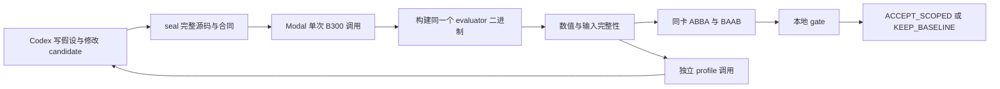

# Codex 与 Modal 的 B300 GEMM 工作流

最建议先采用 **KDA 式轻量流程：Codex 负责提出和实现候选，Modal 负责运行已有 CUDA 代码，独立 evaluator 与本地 policy 决定结果是否可接受**。这里把用户现有 `04l_wide_streamed.cu` 接成第一条执行链。它不是通用新框架，也没有引入另一套模型调用服务。

**2026-11-04 的首次 B300 smoke 在 CUDA 编译阶段失败，未执行数值验证或计时。** 随后封存了显式使用 `compute_103a → sm_103a` 的修订快照，实机验证仍待完成。原始环境、日志和远端清理记录保存在实验机器的 `work/attempts/first-smoke-20261104/`。

## 为什么先选这个组合

[KDA 的工作流](https://github.com/NVlabs/kda/blob/acdd79343c5e9d0c7cb96289f26fd3f1051ce785/docs/agent-flow.md) 允许任务工程自带 evaluator、数据、硬件和 benchmark，适合你现有的 CUDA/PTX、Triton 与 Modal。当前执行包采用其任务组织方式，没有安装或声称完整运行 KDA 的 Claude 插件。

Atrex 更适合以后管理长时多任务搜索。其 [Light 晋升依赖 Agate Atrex-Bench](https://github.com/alibaba/atrex-kernel-agent/blob/02ff86be4cd7467c28fdaaa7d3bc71f1b107ca48/docs/supervisor-promotion.md)，任意 Modal 函数不能直接获得同等晋升语义。KernelAgent 的主要实现围绕 Triton 生成与搜索；先迁进去，会把当前 raw CUDA 适配工作放到优化前面。

你的既有基础设施已经包含 TMA、cuBLAS 验证、成对测速和 NCU。先把它们统一成一个可审计入口，更容易判断一次修改是否真的有效。



## 首个任务的确切范围

| 项目 | 固定内容 |
| --- | --- |
| 源码 | 原课程仓库的 `assignment02/cuda/m4_gemm/04l_wide_streamed.cu`，按文件 SHA256 冻结 |
| 运算 | `D[M,N] = A[M,K] @ B[N,K].T` |
| 精度 | BF16 连续输入，FP32 累加与输出 |
| 硬件与构建 | Modal 单 B300，`sm_103a`，CUDA 13.1，STAGES=2 |
| ABI | BM128、BN256、BK64、160 threads、99328 bytes shared memory；只支持相应整齐倍数 |
| 数值检查 | 三 shape、三 seed、integer/random/structured 数据，计时前后两版全输出；NaN预填 |
| reference | `cublasGemmEx` 默认算法、`CUBLAS_COMPUTE_32F`；不是 tuned cuBLASLt |
| 正式性能 | 4096×4096×4096 与 2048×4096×1024；512×768×320 只做数值检查 |
| 晋升比较 | 与当前保留的 04l 比较；cuBLAS用于数值reference，未在此包中计时 |

初始 candidate 是 baseline 的逐字复制，用于第一轮链路检查。这个包不实现新的 GEMM 解法。参数、ABI或shape支持范围变化应建立新的合同版本，而不是让候选自行改变测试。

## 本地准备

在本目录执行。首次安装时创建虚拟环境并安装依赖。已有 `.venv` 时可直接从 `doctor` 检查开始。

```bash
uv venv --python 3.11 .venv
uv pip install --python .venv/bin/python -r requirements.txt
.venv/bin/python workflow.py doctor
```

Modal SDK 由 `requirements.txt` 固定，macOS 本地准备不需要 CUDA。课程仓库位于其他目录时，给 `doctor` 和 `prepare` 传入 `--project`。提交时通过 `MODAL_PROFILE` 或 `submit --profile` 选择已配置的 Modal profile。

```bash
export MODAL_PROFILE=your-modal-profile
export MODAL_DISABLE_API_PROXY=1
```

以下两步在本地执行。首次初始化时运行 `prepare`。已有 `work/` 时可直接运行 `seal`。

```bash
.venv/bin/python workflow.py prepare
SNAPSHOT=$(.venv/bin/python workflow.py seal)
```

首次运行和构建修订的快照分别记录在实验机器的 `READY.json`。修改候选后，使用 `seal` 生成新的快照。

```text
work/
  fixed/                 baseline、common.h、contract；不属于优化编辑面
  candidate/candidate.cu  Codex唯一的算子编辑入口
  snapshots/<id>/        baseline、candidate、evaluator、worker、policy、manifest
  attempts/<name>/       dispatch、call_id、原始artifact、verdict
```

prepare 会检查原 04l 和 common.h 的 SHA256，按实际源码校验这两个输入。

## 第一次实机 smoke

这一节会上传快照并使用收费 B300。只有用户授权后才执行；首次先保持 candidate 与 baseline 相同。`--allow-cloud` 是明确执行开关，不是预算审批系统。

2026-11-04 的一次 smoke 授权已经使用，结果为构建失败。下面是后续得到新执行授权时的命令格式，不能自动再次执行。新快照仅修订构建参数，尚未验证。

```bash
ATTEMPT=work/attempts/first-smoke
.venv/bin/python workflow.py submit --snapshot "$SNAPSHOT" --output "$ATTEMPT" --mode bench --allow-cloud
.venv/bin/python workflow.py poll --attempt "$ATTEMPT"
.venv/bin/python workflow.py gate --attempt "$ATTEMPT"
```

submit 通过 `modal run --detach` 保存 call ID，最多等待约30秒获取结果。PENDING 表示待调度或运行中；之后只执行 poll。没有有效 call ID 的 SUBMISSION_UNKNOWN 不能自动重交，先到 Modal app 检查提交状态。超时不等于 GPU 已开始运行。[Modal spawn/get](https://modal.com/docs/guide/function-invocation-methods)、[detach](https://modal.com/docs/cli/latest/run)

首轮成功应同时满足：remote-result status=complete、完整数值矩阵和计时后检查、GPU/源码/二进制身份匹配、本地 gate 正常输出。两版相同预计 `KEEP_BASELINE`；若意外 ACCEPT_SCOPED，应先查计时与顺序效应，不能当作优化成功。

远端每次最多一个B300函数，函数timeout600秒，子命令总预算约540秒、关闭应用配置的自动retry。**v1编译也在已分配B300内进行，会产生GPU费用**；这比原实验的CPU编译/GPU分阶段更简单，不提供相同的费用隔离。调度/镜像构建等待不受该600秒等同约束，金额上限也不由timeout保证。首次只提交一个smoke；下一任务单独记录授权与次数。

`retries=0` 关闭配置的函数重试；平台容器崩溃后的重调度是独立机制。本次只有一条已记录调用、没有观察到容器崩溃或重交，不能把配置值解释为所有平台故障情形下的绝对保证。[Modal retries](https://modal.com/docs/guide/retries)

## 后续每个候选的循环

1. 从上一结果选择一个瓶颈。写 `hypothesis.md`，再只改 `work/candidate/candidate.cu`。
2. seal；所有后续 phase 都使用同一快照。check先验证数值，失败先修正确性。
3. 有需要时才单独profile。只采第一个acceptance shape的candidate，跳过warmup，使用少量sections、`--clock-control none`。保留`.ncu-rep`与CSV，核对实际采到的kernel名称。
4. 最终bench在自己的单次调用里重新做数值检查、两版配对计时和计时后检查，然后gate。
5. `KEEP_BASELINE` 保留为负结果；`ACCEPT_SCOPED` 仅接受当前任务范围，不自动写回原baseline。

每个phase使用不同目录：

```bash
.venv/bin/python workflow.py submit --snapshot "$SNAPSHOT" --output work/attempts/v1-check --mode check --allow-cloud
.venv/bin/python workflow.py submit --snapshot "$SNAPSHOT" --output work/attempts/v1-profile --mode profile --allow-cloud
.venv/bin/python workflow.py submit --snapshot "$SNAPSHOT" --output work/attempts/v1-bench --mode bench --allow-cloud
.venv/bin/python workflow.py poll --attempt work/attempts/v1-bench
.venv/bin/python workflow.py gate --attempt work/attempts/v1-bench
```

这些命令不是建议连续无条件运行三次；先取得相应结果，再决定下一phase。明确单次授权时不扩大为三次。check/profile结果不能通过性能gate。

NCU用来回答“为什么”，CUDA events用来回答“有没有更快”。例如先核对同一PC附近指令、stall和访存，再用非profiler成对计时判断实际收益。计时不启用CUDA Graph、不显式清cache，属于重复buffer稳态条件；不能推断冷cache或服务端表现。[NVIDIA profiling guide](https://docs.nvidia.com/nsight-compute/ProfilingGuide/index.html)

## 正确性与性能怎样验收

数值检查既包含独立调用，也检查真正重复计时之后的D；每个block末在计时区外对全D验证，输入A/B在计时前后做BF16位级完整性比较。整数数据精确比较；随机与structured数据使用既有容差 `0.002+0.0002*abs(reference)`。容差冻结不代表适用于其他算子或精度。

每个性能shape有12块、6个ABBA和6个BAAB；每槽30次warmup、100次launch共一对CUDA events。**一个slot均值是一项观测，不是100个独立样本。** gate用配对block统计，记录原始slot；GPU时钟不强锁，前后telemetry记录UUID、driver、温度、功耗和clock。

默认工程门槛：两个shape等权几何聚合的延迟下降至少3%；每个shape不回退、配对block的描述性bootstrap区间下界大于1，且ABBA/BAAB两类都显示收益。3%是此次预先声明的采纳策略，不是普适性能定律。区间只描述本会话，不能取代独立session复现。

gate拒绝以下证据：错误/缺失数值case，部分输出检查，输入污染，非有限时延，重复或缺失slot，顺序不一致，缺失complete，profile数据，以及任何source/contract/worker身份不匹配。它读取固定记录，不接受模型写的“已通过”。

`ACCEPT_SCOPED` 表示值得在当前合同范围保留；改同步、布局或准备推广时，还需要针对性Compute Sanitizer、保留workload和独立session验证。本包v1未接Sanitizer，数值通过不能证明异步同步协议完全正确。

## 断连与产物

```bash
.venv/bin/python workflow.py poll --attempt work/attempts/v1-bench
.venv/bin/python workflow.py cancel --attempt work/attempts/v1-bench
```

poll/cancel自动恢复提交时的profile。取消记录只是请求，不冒称远端清理完成。产物放在attempt/artifacts，包含构建日志、GPU信息、JSONL、environment和profile结果。

v1依赖Modal FunctionCall的结果保留与本地落盘，没有Volume/WAL持久化；容器被强制终止或平台硬timeout时，可能没有最终日志。未使用隐藏重交来恢复。单文件64MiB、总返回96MiB限额，超过会标failed。需要长期无人值守时，应先加Volume和job状态恢复，再考虑Atrex集成。

## 怎样接入 Triton

当前包只实现上述raw CUDA ABI，**没有完成Triton adapter**。下一步可复用你C2的 `validation/run_validation.py`：让固定task生成输入、reference和容差，候选仅提供 `run(inputs)->output`；禁止用候选的setup决定测试数据。

在同一GPU进程加载baseline/candidate Triton模块、先JIT和验证，再沿用这里的paired记录与gate；编译缓存、autotune过程和正式计时分开。Triton接入时需要新的contract和adapter，不能把当前CUDA文件改后缀来宣称通用支持。

## 本地检查与首次任务提示

```bash
python3 -B -m unittest -v test_workflow.py
```

测试使用合成数据验证接受/拒绝逻辑，不提供GPU性能证据。将 [PROMPT.md](PROMPT.md) 交给本目录的Codex会话即可开始。源码修改范围与运行纪律见 [AGENTS.md](AGENTS.md)。
